# Architecture

How the bakery demo fits together: the systems around it, the two Workers and the fourteen Durable Object (DO) classes inside the API, how events move between objects, who owns each datum, how the main requests flow, and what each failure takes down. The made-up bakery, Proof of Concept Bakery (Q2 · Q-name), is a running business system built so a visitor can watch the site's Lab principles run in production code. The why is in [product.md](product.md), the language and event catalog in [domain.md](domain.md), pins in [stack.md](stack.md), threats in [security.md](security.md), prices in [cost.md](cost.md), the pipeline in [delivery.md](delivery.md), runbooks in [operations.md](operations.md), decisions in [adr/](adr/README.md). Nothing is built yet; spike S1 (a Rust DO on Workers: size, startup, SQL) runs before anything depends on this design, and nothing is deployed before the launch pull request (PR 11); until then every pull request runs on `wrangler dev` (Q44 · Q-posture, [roadmap.md](roadmap.md)).

Status: Draft for review in PR 1 · 2026-11-04

Limits and prices on this page are as of 2026-11-04. Sources are in the footnotes.

## Shape

Two hostnames, two Workers, one Cloudflare account and zone, the site's (Q29 · Q-account).

- **`bakery.ihaveasegway.com`**: the storefront and the staff console. Astro 7 pages with React 19 islands on an assets-only Worker, `bakery-web`, with no script, like the site's `ihaveasegway-web` ([ADR 0008](adr/0008-astro-site-with-react-islands-on-an-assets-only-worker.md)). Static asset requests are free, unlimited and never invoke a Worker.[^assets] The signed-in app is client-rendered islands that call the API.
- **`api.bakery.ihaveasegway.com`**: one Rust Worker, `bakery-api`, built with workers-rs (`worker` 0.8.7 as of 2026-11-04) for `wasm32-unknown-unknown`.[^workersrs] It holds every DO class, the Queue consumer and the cron handler ([ADR 0002](adr/0002-rust-for-every-backend.md), [ADR 0009](adr/0009-the-api-on-its-own-hostname.md)).

Everything on a server is Rust. The domain lives in plain crates (`crates/domain`, `crates/app`) that `cargo test` runs natively; the Worker is the adapter that gives them storage, a clock, a queue and a payment gateway.

**The sandbox is the unit of everything.** Each visitor gets a private copy of the bakery, seeded with about 90 days of synthetic history and wiped every night at 10:00 UTC. A sandbox is a family of DOs, one per aggregate. The visitor plays customer and staff, switching with one control (Q4 · Q-personas), and can move the sandbox's business clock forward ([ADR 0005](adr/0005-a-private-sandbox-per-visitor-wiped-nightly.md)).

**State lives in DOs.** Each aggregate is one SQLite-backed object, the single writer of its data, with its own event log and a transactional outbox to one Queue ([ADR 0003](adr/0003-durable-objects-as-the-system-of-record.md), [ADR 0004](adr/0004-queues-between-objects-and-alarms-for-time.md)). There is no central database.

**The bulkhead with the site.** The bakery shares no code, deploy or runtime call with ihaveasegway.com; the browser joins them with links. It shares the account, so one bill, and the zone, so one zone mistake reaches both.

## Context diagram

C4 level 1, with the site's deviation: Cloudflare is drawn open, because its parts are owned, changed and broken separately. Dashed lines are side channels.

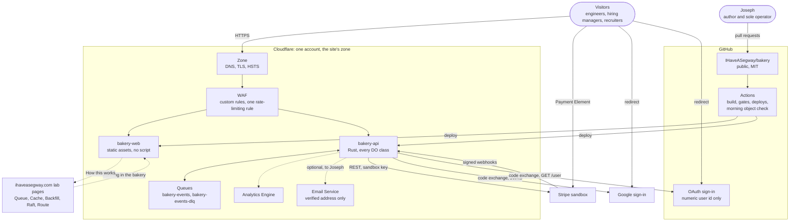

- The site and the bakery link each other and nothing more (Q32 · Q-links).
- Stripe, Google and GitHub's sign-in are the only third parties in the request path, and none receives a real name, email address or card from the bakery ([security.md](security.md)).
- Email Service appears only for sends to Joseph's own verified address, free on any plan.[^email] Visitors never get email (Q22 · Q-email). Email sign-in is designed and shipped later (Q43 · Q-email-signin): one link per sign-in through Email Service, to an address used once and never stored ([security.md](security.md#email-sign-in-later)).

## Container diagram

C4 level 2: everything deployed, configured or holding state.

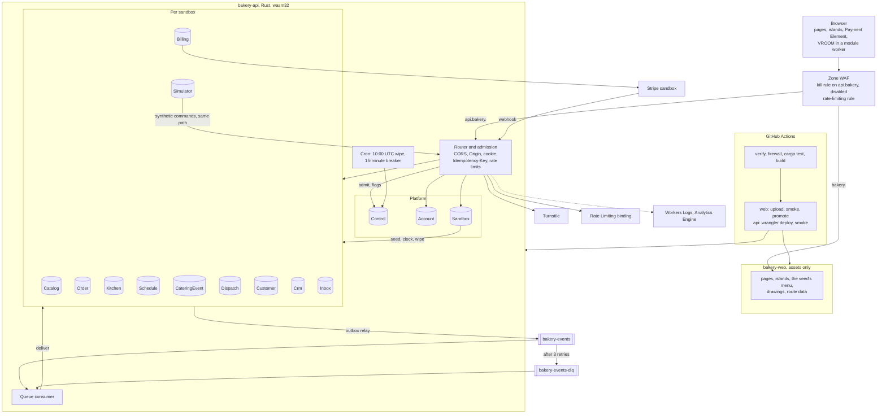

- `bakery-web` has no `main` and Workers Cache stays off, so a page view is never a billed Worker request. `/menu/` is built from `crates/seed` and costs $0 to serve.
- Only `bakery-api` binds the classes, and a DO has no URL of its own, so every request passes the router first. `workers_dev` is false on both Workers (Q30 · Q-previews).
- One Worker holds the consumer, the cron handler and the classes, so one deploy restarts all of it: the trade the site's lab made in its [ADR 0009](https://github.com/IHaveASegway/website/blob/main/docs/adr/0009-lab-worker-same-origin.md).
- The bundle must fit 64 MiB uncompressed and start within 1 s (error 10021), in 128 MB of memory per isolate with Wasm linear memory included.[^limits] One binary with 14 classes is what spike S1 measures.

## Bounded contexts

Eight domain contexts and three operational ones. Each writes only its own data.

| Context | Vocabulary | Owns | Boundary | Talks to the others by | It is not |
|---|---|---|---|---|---|
| Platform | account, session, API token, sandbox, seed, clock, simulated customer, flag, budget | identities, sandboxes, registries, the business clock, simulated traffic, flags, the daily ledger | `Control`, `Account`, `Sandbox`, `Simulator`; `src/auth/` | commands to children (seed, clock, wipe); `SandboxSeeded`, `ClockAdvanced`, `SandboxWiped` | A user directory. It knows a hash of a `sub` or a GitHub id |
| Storefront | item, variant, category, allergen, lead time, menu version | the menu, prices, availability rules | `Catalog` | `MenuPublished`; an `ETag` of the version | The day's stock count, which Scheduling holds |
| Ordering | order, line, note, expiry, board | each order's log and state; the live board | `Order`, `Kitchen` | commands from the router and the board; `OrderPlaced` to `OrderClosed` | The payment. It asks Billing and listens |
| Scheduling | slot, window, capacity, hold, reservation, bake list | slots, windows, daily item caps, catering day capacity, the production plan | `Schedule` per day | a synchronous hold; `SlotReserved`, `SlotReleased`, `BakeListChanged` | The catering calendar of record |
| Catering | inquiry, package, venue, quote, deposit, balance, reminder | each job's log, quote and money due | `CateringEvent` | commands; `CateringInquiryReceived` to `CateringClosed`; alarms | A general calendar |
| Billing | payment, intent, invoice, refund, webhook, ledger | the ledger and every Stripe id | `Billing`; `src/stripe/`; the `PaymentGateway` port | Stripe REST out, signed webhooks in; `PaymentSucceeded`, `RefundIssued` | A copy of Stripe |
| Fulfillment | stop, van, route, proposal | each day's stops and plans | `Dispatch` per day | `RoutePublished`, `StopCompleted`; the browser's VROOM plan as a command | A map; travel times are static assets |
| CRM | customer, timeline, segment, campaign, consent, loyalty, message | personas, projections, campaigns, the inbox | `Customer`, `Crm`, `Inbox` | consumes most events; produces `CampaignSent`, `LoyaltyPointsEarned`, `MessageOpened` | A writer of orders |
| Presentation | page, island, screen, tour, step, persona switch | pages, islands, drawings, the tour (the "How this works" drawer is one of its steps), the OpenAPI page at `/docs/api/` | `apps/web/`; `bakery-web` | build-time reads of `crates/seed` and `crates/contracts`; HTTPS to the API | A runtime |
| Delivery | job, gate, preview, version | workflows, the firewall check, the deploy credential | `.github/`, `.githooks/`, `scripts/` | builds and deploys both Workers ([delivery.md](delivery.md)) | A second deployer; Workers Builds stays disconnected |
| Edge | zone, record, rule, certificate | the Custom Domains' records, WAF rules, the rate-limiting rule | the dashboard | wraps every request before a Worker runs | Owned here. The zone is the site's |

**Commands may be synchronous; events never are.** A command (hold this slot, seed this child, mark this order ready) is a call from the router, from a Sandbox to its children, or from the Kitchen room to the Order a staff member clicked. An event crosses only by the Queue, so no write waits on a subscriber.

**The published language** is `crates/contracts`: API types and the envelope, exported as JSON Schema with `schemars` and turned into TypeScript at build, so the web app cannot drift unnoticed. The socket follows the site's protocol v1 shape. ADR 0013, the API and socket contract v1, is written in PR 10 with the visitor API ([simulated traffic, the tour and the API for visitors](#simulated-traffic-the-tour-and-the-api-for-visitors)).

## Durable Object topology

Fourteen classes, all SQLite-backed, declared with `exports`. On Paid an account may hold 500 classes and an object 10 GB; a row is capped at 2 MB, with 100 columns and 100 bound parameters.[^dolimits]

Isolation is a database per tenant per aggregate, not row-level security over a shared table: every object is its own SQLite database, so there is no shared table to filter ([security.md](security.md#sandbox-isolation) says why that is the stronger design here).

| Class | One per | Holds | Who writes | Lifetime | Cleanup alarm |
|---|---|---|---|---|---|
| `Control` | account, `control` | flags `live`, `read-only`, `off`; daily ledger; kill switch; the daily IP salt, in memory only, never stored | router, cron, Joseph (flags, in Data Studio) | long-lived | prunes ledger rows past 35 days |
| `Account` | identity | demo password hash, current sandbox id, created day | router | 30 days after last sign-in (Q23 · Q-auth) | 30 days idle, then `delete_all` |
| `Sandbox` | sandbox | lifecycle, seed, child registry, clock offset, API token version, fault switches, dead letters | router; its alarms | to the next wipe | next 10:00 UTC; 36 h |
| `Catalog` | sandbox | items, variants, prices, availability rules, menu version | staff; seed | to the wipe | 36 h |
| `Order` | order | event log, state, lines, note, seen commands | router, Kitchen, events | to the wipe | 15-minute expiry; 36 h |
| `Kitchen` | sandbox | hibernating sockets, the board, fan-out | events | to the wipe | 36 h |
| `Schedule` | sandbox and day | slots, windows, caps, holds, reservations, production plan | router (holds); events; staff | to the wipe | hold expiries; 36 h |
| `CateringEvent` | inquiry | event log, state, quote, deposit, balance | router; events | to the wipe | reminders; 36 h |
| `Billing` | sandbox | intents, invoices, refunds, Stripe ids, webhook ids seen | router; verified webhooks | to the wipe | Stripe cleanup at the wipe; 36 h |
| `Dispatch` | sandbox and day | stops, proposed plan (Clarke–Wright), published plan | events; staff | to the wipe | 36 h |
| `Customer` | persona | synthetic profile, preferences, consent, loyalty | router; events | to the wipe | 36 h |
| `Crm` | sandbox | consumed event log, projections, campaigns, rebuild cursor | consumer; staff | to the wipe | rebuild batches; sends; 36 h |
| `Inbox` | sandbox | messages, simulated opens and clicks | events | to the wipe | simulated opens; 36 h |
| `Simulator` | sandbox | the rate, the running flag, the minute ledger, its alarm | the visitor (Start and Stop traffic); its alarm | to the wipe | the next tick while running; 36 h |

`Campaign` is an aggregate hosted in `Crm`, since each send reads Crm's segment projection and a sandbox holds a handful ([domain.md](domain.md#campaign)).

**One platform alarm per object.**[^alarms] Each object keeps a `timers` table (purpose, due business time, due wall time) and arms the alarm for the earliest; the handler runs every due row and re-arms for the next. Each `setAlarm()` is one row written.[^dopricing]

### Object naming

| Class | Name |
|---|---|
| `Control` | `control` |
| `Account` | `account:<hex of HMAC(ACCOUNT_HMAC_KEY, "google:" + sub, "github:" + id or "demo:" + username)>`; later `"email:" + normalized address` (Q43 · Q-email-signin) |
| `Sandbox` | `sandbox:<ULID>`, minted by the router, carried in the signed session |
| per-sandbox | `catalog:<sandbox>`, `kitchen:<sandbox>`, `billing:<sandbox>`, `crm:<sandbox>`, `inbox:<sandbox>`, `simulator:<sandbox>` |
| per-day | `schedule:<sandbox>:<YYYY-MM-DD>`, `dispatch:<sandbox>:<YYYY-MM-DD>`, a business date bounded to birth minus 90 to plus 30 days |
| per-aggregate | `order:<sandbox>:<ULID>`, `catering:<sandbox>:<ULID>`, `customer:<sandbox>:<ULID>` |

A path's sandbox id must equal the session's (or the API token's), and an aggregate's ULID must be in the Sandbox's registry, before any object is addressed ([domain.md](domain.md#identifiers)).

**Children are born only through the Sandbox.** An object with no `meta` row refuses every command with 410 and never seeds itself. To materialize a child (a new order, a persona touched for the first time, a future day, the Simulator on the first "Start traffic"), the router registers its name with the Sandbox, which answers with the seed and clock offset, or 410 once wiped. So the wipe knows every object, and a stale cookie cannot revive a wiped sandbox.

### The rules, restated for Rust

The site's lab wrote these for TypeScript ([lab.md](https://github.com/IHaveASegway/website/blob/main/docs/lab.md#durable-object-rules)). Here they bind workers-rs.

1. **SQLite only**, through `Storage::sql()`. Free allows only SQLite-backed objects,[^dolimits] which keeps Q27 · Q-plan a two-way door.
2. **Hibernation API only.** The Kitchen accepts with `State::accept_web_socket` and handles `websocket_message`, `websocket_close`, `websocket_error`. A hibernating object is not billed for duration.[^dopricing] Pings go to the platform's auto-response; whether workers-rs exposes its setter is in spike S1, and if not, the client sends no pings.
3. **Alarms, never timers.** No `setTimeout`, no sleeping futures. Later work is a `timers` row.
4. **Idempotent alarms with a guard.** Handlers act from cursors and ledgers, so a rerun changes nothing. An alarm re-arms only for a time later than now, and an object counts alarm-driven re-arms per UTC day: at 100 it stops, logs `alarm_guard`, and waits for the wipe.
5. **Names from the server** ([object naming](#object-naming)).
6. **Every object ends with `delete_all`**, which with `compatibility_date` 2026-02-24 or later also clears the alarm. Each arms its 36 h backstop on its first write. `Control` and `Account` are the exceptions.
7. **Short handlers.** Paid gives 30 s of CPU a request,[^limits] but a long handler blocks an object that serves a soft 1,000 requests a second.[^dolimits] S1 times the two heaviest: Clarke–Wright on 63 stops, argon2 on a demo password.
8. **No Tokio, no threads**: `wasm32-unknown-unknown` and the runtime's event loop.

Deleting is not erasing: SQLite objects keep 30 days of point-in-time recovery.[^sqlite] The privacy page says so.

## Events and the outbox

The Queue Lab's principle, running for real ([ADR 0004](adr/0004-queues-between-objects-and-alarms-for-time.md)).

**Envelope** ([domain.md](domain.md#the-envelope) has an example): `{v:1, id (ULID), sandbox, stream, seq, type, at (business time), recorded_at (wall time), data, cause (command id)}`.

**Write.** A command carries a ULID id, the `Idempotency-Key`. A known id in `commands_seen` returns the stored result. Otherwise `decide(state, command)` returns events or a rejection, and one `Storage::transaction` appends to `events`, copies the envelopes into `outbox`, updates state and records the command id. All or nothing; S1 confirms the transaction API in workers-rs 0.8.7.

```sql
-- every aggregate object: sketch; confirm against current docs when building
CREATE TABLE events (seq INTEGER PRIMARY KEY, id TEXT NOT NULL UNIQUE, type TEXT NOT NULL,
                     at TEXT NOT NULL, recorded_at TEXT NOT NULL, data TEXT NOT NULL, cause TEXT);
CREATE TABLE outbox (seq INTEGER PRIMARY KEY, envelope TEXT NOT NULL, attempts INTEGER NOT NULL DEFAULT 0);
CREATE TABLE commands_seen (id TEXT PRIMARY KEY, result TEXT NOT NULL, at TEXT NOT NULL);
```

**Relay.** After commit the object sends its outbox rows to `bakery-events` in one batch under `wait_until`, deleting each accepted row, and leaves an `outbox` timer 30 s out. If the send failed or the isolate died, the alarm sends what is left and re-arms only while rows remain. A row may go twice; once committed it is never lost.

**Consume.** The consumer runs in the same Worker on `#[event(queue)]` (beta in workers-rs as of 2026-11-04),[^workersrs] in batches of up to 100.[^queues] A static table in `crates/app` maps each event type to subscribers; the consumer delivers to each by `fetch` on its `/_event` path (DO RPC is not bound in workers-rs), acks when all answered 2xx, and retries otherwise.

**Idempotent consumers.** Each subscriber applies an event and records its id in `seen` in one transaction, so a redelivery changes nothing.

**Dead letters.** After 3 retries a message goes to `bakery-events-dlq`. A second consumer writes it and its last error to the owning Sandbox's `dead_letters`, logs it and acks. The visitor sees it on the Queue screen and can redrive it with the same id, which `seen` still protects. A fault switch makes the Inbox refuse deliveries: the Queue Lab's broken subscriber, live.

**Ordering is per stream, by `seq`.** Queues promise no order. `seq` is gap-free because one object writes each stream. Subscribers that copy state (the board, Crm's order rows) keep the highest `seq` per stream and ignore older events; subscribers that react (Billing, Inbox) are written so order within a stream does not change the outcome. Nothing orders across streams, and nothing needs to.

**At least once.** Every event is delivered at least once, possibly more, possibly out of order across streams. Exactly-once effects come from the `seen` tables and idempotency keys at every side effect, Stripe's included. A message costs about 3 Queue operations, plus a read per retry,[^queues] and each delivery is a DO request and at least 2 rows written. [cost.md](cost.md) assumes 50 events a session.

## Data ownership

Every datum the bakery touches, left to right: where it lives, who changes it, who reads it, how it gets there, how fresh they need it.

| Datum | System of record | Context | Writes it | Reads it | How it crosses | Consistency readers need |
|---|---|---|---|---|---|---|
| Accounts | `Account`: id, argon2 hash, current sandbox, created day | Platform | router | router | command | strong |
| Sessions | `__Host-session` cookie, HMAC-signed, on the API host | Platform | router, after sign-in or a guest's Turnstile | router, every call | `HttpOnly; Secure; SameSite=Strict; Path=/`, 24 h; sandbox claim ends at the next wipe | self-verifying; nothing stored |
| API tokens | nothing stored but the token version in `Sandbox`; the token itself is signed like the cookie | Platform | router, when the console shows or rotates it | router, every API call | `Authorization: Bearer`, 24 h, never past the wipe | self-verifying; the version check is strong |
| Sandboxes | `Sandbox`: lifecycle, registry | Platform | router; alarms; the wipe | router; the wipe | command | strong |
| Clock offset | `Sandbox`, the only writer | Platform | the visitor, "Advance time" | every child, from a copy in `meta` | command from the Sandbox, retried by alarm | within one Sandbox alarm; versioned `clock_v` |
| Menu | `Catalog` | Storefront | staff; seed | storefront island; Order, priced at placement | HTTPS with `ETag`; the Cache API keyed by sandbox and version; `MenuPublished` | per version; an old entry is unreachable once the version moves |
| Orders | each `Order`: log and state | Ordering | router, Kitchen, events | visitor; Kitchen, Schedule, Crm, Customer, Inbox, Dispatch | events | strong in the object; projections one Queue hop behind |
| Slots and caps | `Schedule` for the day | Scheduling | router (holds); events; staff | checkout, console | synchronous hold; `SlotReserved` | strong at the hold, so capacity is never oversold |
| Production plan | `Schedule`, projected from reservations and catering | Scheduling | Schedule | Kitchen board | `BakeListChanged` | one hop |
| Catering events | each `CateringEvent` | Catering | router; events; reminder alarms | visitor; Schedule, Crm, Inbox, Billing | events | strong in the object |
| Billing ledger and Stripe ids | `Billing` | Billing | router; verified webhooks | Order, CateringEvent, Crm, Inbox; the wipe | events; Stripe ids go only to Stripe | strong; webhook ids deduped |
| Stripe's copy of payment objects | Stripe's sandbox | outside | Billing, by REST; the Payment Element | Billing; Joseph, in Stripe | REST, signed webhooks | Stripe is the authority; Billing records what Stripe confirmed |
| Routes | `Dispatch` for the day | Fulfillment | Dispatch (proposal); staff (publish) | console; Order | `RoutePublished`, `StopCompleted` | strong in the object |
| Customers | each `Customer`, materialized from the seed | CRM | router; events | Crm; checkout | events | strong in the object |
| Projections and campaigns | `Crm` | CRM | consumer; rebuild; staff | console; Inbox | derived from Crm's copy of the log | eventual; rebuildable |
| Inbox | `Inbox` | CRM | events | inbox screen | HTTPS | one hop |
| Simulated traffic | `Simulator`: rate, running flag, minute ledger | Platform | the visitor; its alarm | console; `Control`, for the day's minutes | commands, as a visitor's | strong in the object |
| Flags, ledger, IP salt | `Control` | Platform | router; cron; Joseph | router, through a 30 s in-isolate cache | command | flags apply within 30 s |
| Logs | Workers Logs | Platform | the Worker: JSON lines; `HMAC(daily salt, IP)`, country, continent | Joseph | ingestion; invocation logs off | best effort; 7 days on Paid[^logs] |
| Metrics | Analytics Engine | Platform | Worker and objects | Joseph; the breaker; the status page later (Q31 · Q-status) | data points | eventual |
| Secrets | Worker secrets on `bakery-api` | Platform; Billing | Joseph, by Wrangler | the Worker | injection | one reader each ([security.md](security.md#secrets-inventory)) |
| Deploy credential | Cloudflare | Delivery | Joseph | deploy steps in Actions | repository secret, in those steps' `env` | rotation in [operations.md](operations.md) |
| Seed data | `crates/seed`: word lists, menu, venues, the 64 Salt Lake City places and their travel-time matrix (built in PR 9) | Platform; Presentation | Joseph, by pull request | Sandbox; the web build | compiled into both builds | per version; deterministic per seed |

One system of record and one writer each. Three rows look like copies and add no owner: each child's clock offset (versioned, retried until current), Crm's event log (a copy of what the Queue delivered), and Billing's view of Stripe (only what Stripe confirmed). A Worker-side cache of order state, or a Crm that wrote loyalty points, would have created second owners.

## Request flows

### A public page view

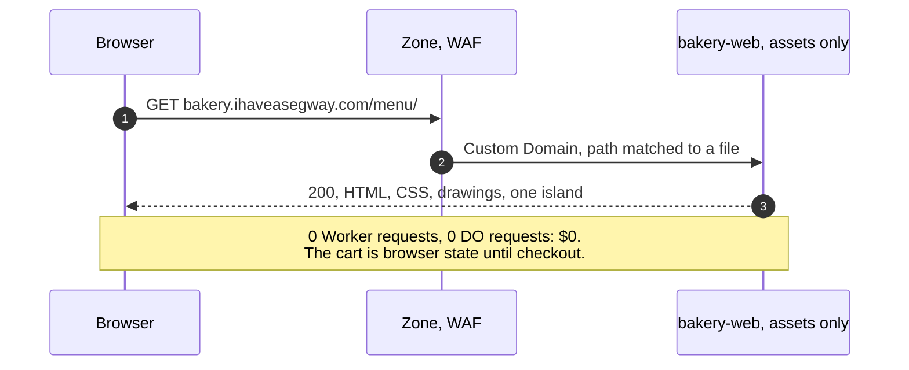

- Home, Menu, Catering, About, How it's built, Privacy and Status are static (Q6 · Q-public); the menu is the seed's.
- A Custom Domain issues its own certificate for a two-level name like `api.bakery.ihaveasegway.com`; Universal SSL covers only the apex and one level.[^customdomains]

### Sign-in with Google, and a demo account

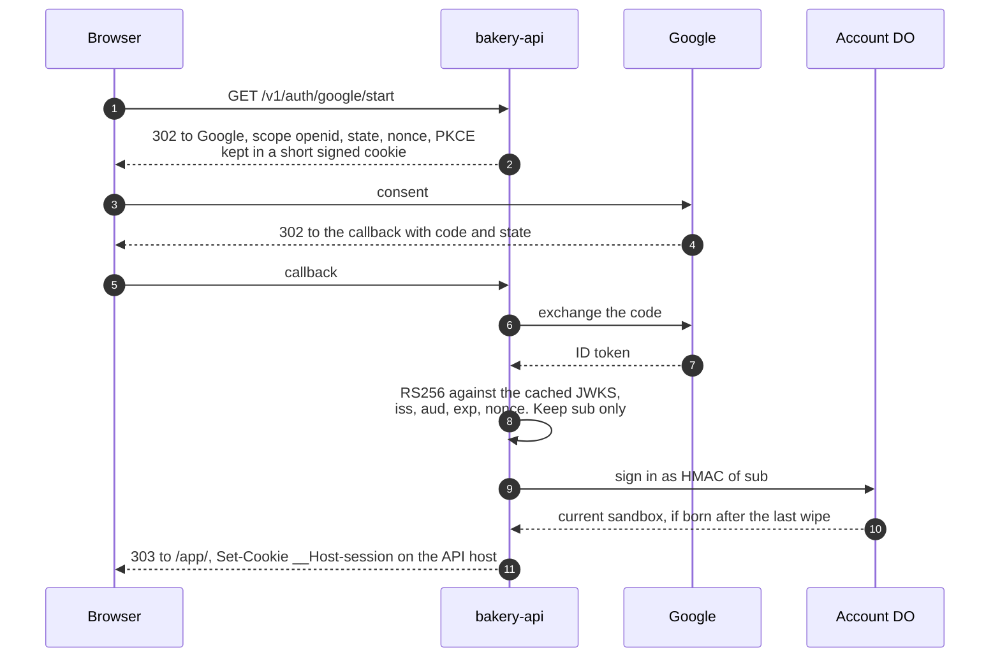

- Only `sub` is used: always present, "unique among all Google Accounts and never reused"; `email` appears only with the `email` scope.[^google] Tokens are verified locally against the discovery document's `jwks_uri`, never `tokeninfo`.
- Whether `scope=openid` alone works is spike S2; the docs say the scope "must begin with openid and then include profile, email, or both". The fallback is `openid email` with the claim dropped before storage, the weaker design ([ADR 0006](adr/0006-sign-in-that-learns-nothing.md)).
- The cookie is host-only on the API: the web origin never sees it and asks `GET /v1/session`. The two hostnames are one site and two origins, so `SameSite=Strict` still rides credentialed fetches; CORS allows exactly `https://bakery.ihaveasegway.com` with credentials.
- **GitHub has the same shape** (Q23 · Q-auth): `GET /v1/auth/github/start`, a 302 to GitHub with `state` and PKCE (S256) and no scope requested, so no `user:email`; the callback exchanges the code, makes one `GET /user` with the token and discards it. Only the numeric `id` is kept, the durable one (a login can change), and the account is `HMAC(ACCOUNT_HMAC_KEY, "github:" + id)`.[^github] [security.md](security.md#github-with-the-numeric-user-id-alone) owns the details.
- **Demo account:** after Turnstile, the router generates a username such as `baker-7f3k`, the visitor sets a password, and the `Account` stores an argon2 hash. No email, no recovery. [security.md](security.md) owns the parameters.

### Creating a sandbox

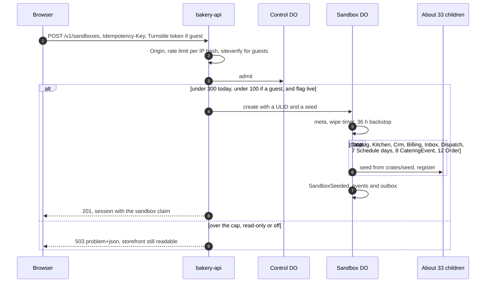

- Turnstile, free and unlimited,[^turnstile] guards every guest sandbox and demo sign-up (Q24 · Q-guest). A signed-in account may create 3 sandboxes a day.
- **Guest scope** (Q45 · Q-guest-scope): a guest sandbox can browse, order and pay with a test card. Sign-in unlocks the console's writes (menu edits, campaigns, publishing a route), the API token, simulated traffic, and a sandbox that follows the account across devices. Guests are capped at 100 of the 300 sandboxes a day in `Control`, so bots creating sandboxes hit a wall before the paid-for meters do.
- `Control` costs one exact DO request, so it runs after the free checks: admission in layers. Its cap of 300 sandboxes a day bounds a bot ([cost.md](cost.md)).
- About 2,000 rows in about 2 s. Closed history goes into Crm's log and Billing's daily summaries; only open orders and the 8 catering jobs become live objects ([domain.md](domain.md#the-seed)). Personas and later days materialize on first touch.

### Placing and paying an order

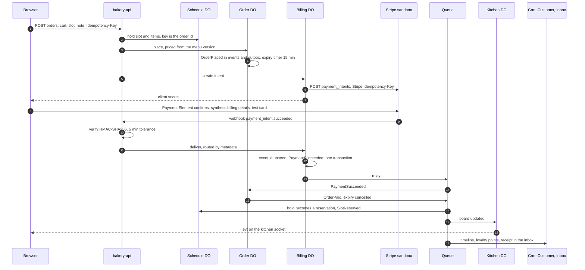

- The hold is a lease: Schedule counts held and reserved places against capacity, and releases an unconfirmed hold by its own alarm.
- The router verifies the signature (HMAC-SHA256 over `t.payload`, 5-minute tolerance)[^webhooks] before choosing an object, since an unverified body must not pick a sandbox; Billing dedupes by event id. Only the webhook marks an order paid, never the browser.
- `fields.billingDetails: 'never'` stops the Payment Element collecting name, email, phone and address, and the page passes the persona's synthetic ones to `confirmPayment`.[^paymentelement] Whether Stripe's sandbox accepts that with test cards such as 4242 4242 4242 4242[^testing] is spike S3 ([ADR 0007](adr/0007-stripe-sandbox-and-a-payment-element-that-collects-nothing.md)).
- **Expiry.** With no payment, the Order's alarm appends `OrderExpired`; Schedule releases the hold (`SlotReleased`) and Billing cancels the intent. A payment that lands after the expiry gets `OrderPaymentLate` and a full refund (`RefundIssued`): the compensating step.
- A webhook for a wiped sandbox finds an empty Billing, which answers 200 so Stripe stops retrying.

### The catering saga

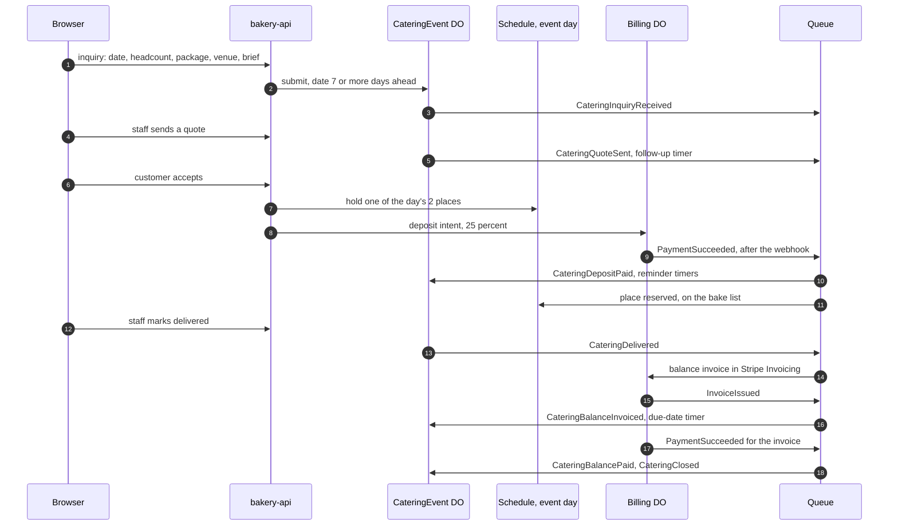

- A saga by alarm: each step is one object's transaction, triggered by an event or a timer row, with a compensation for each failure: decline, quote expiry after 14 business days, cancellation with or without a deposit refund ([domain.md](domain.md#cateringevent)). Workflows is JavaScript and TypeScript only,[^workflows] so the state machine lives in the object.
- Capacity is 2 events a day with a 7-day lead (Q16 · Q-catering). Stripe sends no invoice email, since the synthetic customer has none; paying an invoice in the page with the Payment Element is part of S3.

### A campaign send

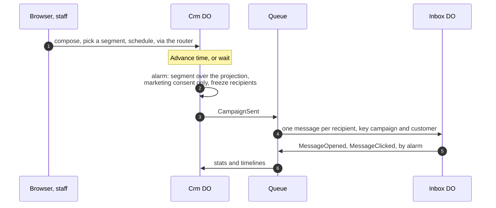

- "Delivered" is a row in the Inbox. Opens and clicks come from the seed's PRNG, so a seed gives the same open rate (Q21 · Q-crm-scope).
- **Rebuild projections**, the Backfill Lab's principle: truncate Crm's projections, set a cursor at the start of its log, replay 200 events per alarm with a progress bar. Commands keep working; reads show "rebuilding" until the cursor reaches the end.

### The nightly wipe

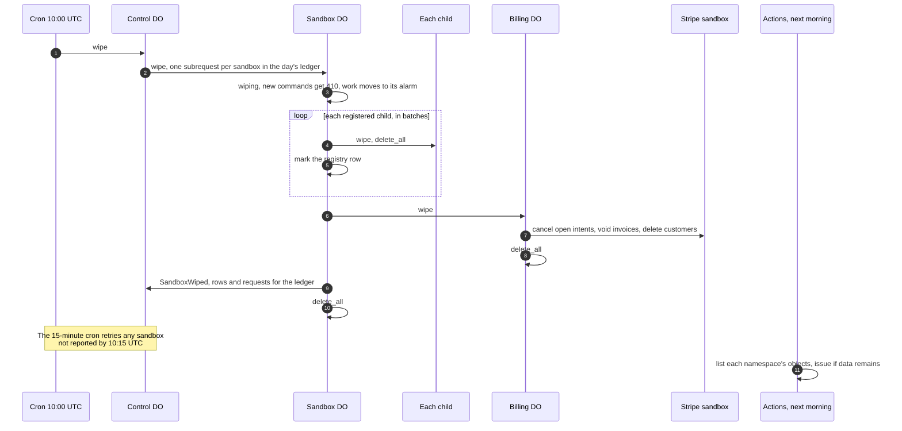

- Three layers: the cron through `Control`, each Sandbox's own 10:00 UTC timer, each child's 36 h backstop. Any one empties the sandbox (Q25 · Q-ttl).
- `Control` makes one subrequest per sandbox, and its cap of 300 new sandboxes a day keeps that far under Paid's 10,000 subrequests and the cron's 15 minutes of wall time.[^limits] Each Sandbox then works in its own alarm, so a half-done wipe resumes from the first unmarked child ([ADR 0005](adr/0005-a-private-sandbox-per-visitor-wiped-nightly.md)).
- Deletes count as rows written,[^dopricing] so a wipe costs about what the sandbox wrote; spike S5 measures it. A succeeded Stripe payment cannot be deleted and stays in Stripe's sandbox, synthetic. "Wipe now" is the same command for one sandbox.

### Time travel

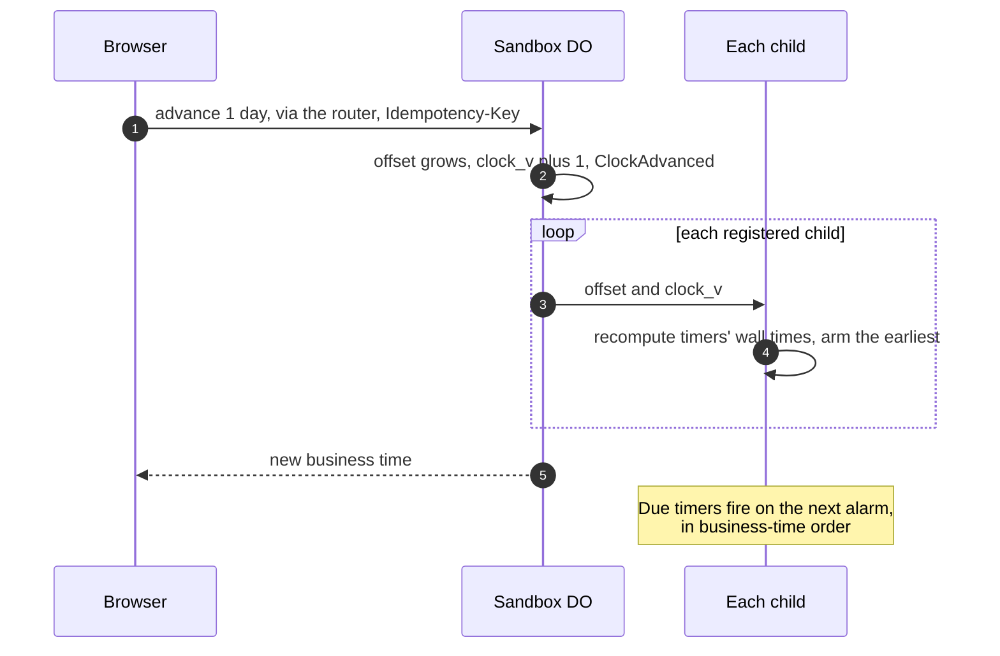

- Business time is wall time plus the offset (Q12 · Q-clock). It only grows, by 15 minutes, 1 hour, 1 day or "next opening", at most 14 days in total.
- **Moves:** expiries, slot dates, the bake list's day, catering lead times and reminders, invoice due dates, campaign schedules, simulated opens, the `at` of new events.
- **Does not move:** platform alarms (re-armed on wall time), the wipe, the 36 h backstop, cookies, Turnstile tokens, Stripe's timestamps and webhook tolerance, `Control`'s UTC ledger, `recorded_at`, logs.
- A child that missed the update keeps an old `clock_v` in the registry, and the Sandbox's alarm retries it. A command may re-arm an earlier wall time; the loop guard counts alarm-driven re-arms only.

## Simulated traffic, the tour and the API for visitors

Three features turn a reader into an operator (Q40 · Q-traffic, Q41 · Q-tour, Q42 · Q-api-access): load the visitor can start and stop, a guide that names what they see, and the same commands from their own terminal. All three come with sign-in (Q45 · Q-guest-scope), and all three end at the wipe. The simulator arrives with the kitchen board in PR 4; the tour and the visitor API in PR 10, after dispatch ([roadmap.md](roadmap.md)).

### Simulated traffic

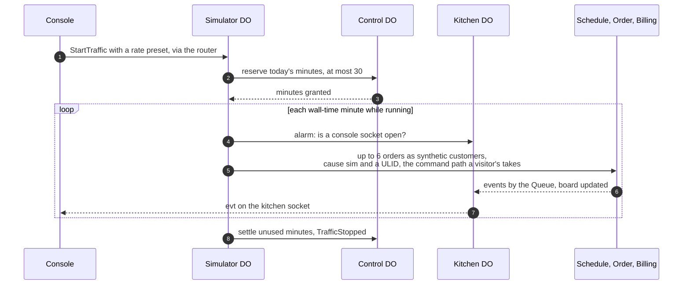

- **One object per sandbox,** `simulator:<sandbox>`, registered with the Sandbox on the first "Start traffic" like any other child. It holds the rate, the running flag, the minute ledger and its alarm. It starts stopped.
- **Alarm-driven.** Each run is a `Tick`: it draws the minute's commands from the seed's PRNG and the business clock (orders at the preset rate, now and then a catering inquiry or a pickup), issues them, records the minute and re-arms one wall-time minute later. Thirty ticks a day sit far under the loop guard's 100 re-arms.
- **Ordinary commands, the same path.** A synthetic customer is one of the 60 personas. Each command passes the checks the router applies after admission (validation, an idempotency key of `sim:<ulid>`, the object names, the free-text rules) and goes to the same objects; every event it causes carries `cause: sim:<ulid>`, so the activity screen and the tour can tell the visitor's actions from the simulator's. Simulated orders pay with Stripe's test payment method, confirmed by the API, so the webhook path runs as for the visitor's own order.[^testing]
- **Bounded.** It runs only while the console is open: each `Tick` asks the Kitchen whether a console socket is open, a console without a socket sends a heartbeat `POST` every 30 s instead, and with neither for 90 s the `Tick` stops with reason `console_closed`. At most 6 orders a minute and 30 minutes a sandbox a UTC day, reserved in `Control`'s ledger and charged to its daily budgets, so the designed worst month does not move ([cost.md](cost.md#guardrails)). The wipe stops it with everything else.

### The tour

- **A client-side island on every screen,** shipped by `bakery-web` with no third-party script, so it adds nothing to the CSP and costs $0 to serve.
- **One step per screen element.** Each step names what is shown; lists the events the visitor's last action produced, with their `cause`, from the activity feed the screen already holds; names the principle, with its lab page and ADR; and offers a copyable API request for the same action, filled with the visitor's own token when copied and masked on screen.
- **The "How this works" drawer is one of its steps.** Steps are data in `apps/web/`, checked at build against `crates/contracts`, so a request in a step cannot drift from the API.

### The API token

- **One per sandbox, shown and rotated in the console.** A bearer token signed like the session cookie, with `SESSION_HMAC_KEY` and the same claims (account, sandbox, a token id, issue and expiry times, key id) plus the Sandbox's token version. It travels in `Authorization: Bearer`, lasts 24 h and dies with the sandbox. "Rotate" bumps the version in the Sandbox, which the router checks with the registry lookup it already makes, so the old token stops at once.
- **Rate-limited per token** with the Rate Limiting binding. A request with a token and no cookie needs no CORS and no `Origin`: `curl` sends neither, and a browser never attaches a bearer token on its own. [security.md](security.md#the-api-token) owns the rules.
- **Every console action has an API equivalent.** An OpenAPI document generated at build from `crates/contracts` (its `schemars` types and the route table) is served as a static page at `/docs/api/` on the storefront, $0 like every page. ADR 0013, the API and socket contract v1, is written in PR 10.

## Bulkheads and failure modes

Five walls:

1. **Site and bakery are separate Workers and hostnames.** A bakery outage leaves ihaveasegway.com serving.
2. **Web and API are separate Workers.** Public pages keep serving while the API is down, read-only or detached.
3. **One sandbox cannot touch another.** Names come from the session or the API token, every child checks its sandbox id, and nothing crosses sandboxes.
4. **The zone works without the pipeline.** The kill rule changes in seconds from the dashboard.
5. **The pipeline is not in the request path.**

Two shared resources: the account's bill on Paid, which has no spend cap,[^pricing] so its ceiling of $100 a month is held by alerts at $10, $25, $50 and $100, `limits.cpu_ms`, the rate-limiting rule, the 15-minute breaker and `Control`'s caps ([ADR 0010](adr/0010-workers-paid-with-the-sites-guardrails.md), Q27 · Q-plan, Q28 · Q-budget); and the zone, with one writer, Joseph.

### Failure table

| Failure | Blast radius | What visitors see | Detection | Recovery |
|---|---|---|---|---|
| Stripe sandbox down | payments in every sandbox | checkout says payments are unavailable; orders expire at 15 min | Billing errors in Analytics Engine | none; expiry releases slots, late webhooks dedupe |
| Google or GitHub down | new sign-ins with that provider | an error; the other provider, guests and demo accounts work | sign-in failures by reason | wait; sessions last 24 h |
| Queue backlog | reactions everywhere | writes succeed; board and timelines lag, the drawer shows it | backlog; oldest outbox row | catches up; retention 4 days[^queues] |
| A consumer poisoning | one event, one subscriber | a missing row; a dead letter on the Queue screen | DLQ consumer logs | fix forward, redrive, or the wipe |
| An alarm loop | one object | a stuck timer | `alarm_guard`; rows written per object | the guard at 100 a day; the wipe |
| API deploy drops sockets | every live socket | the board reconnects to a fresh snapshot | deploy log | none; retried commands reuse their key |
| Bad web deploy | storefront and console | a broken page | Version URL smoke; prod-smoke | the `rollback` job ([delivery.md](delivery.md)) |
| DO class lifecycle change | API rollback, which cannot cross it[^rollback] | nothing, if shipped alone | CI refuses a class change bundled with others | expand, migrate, contract; nightly wipes make data migrations nearly free |
| Wipe fails halfway | one sandbox | 410 and an offer of a new sandbox | registry; the morning check | its alarm resumes; the 15-minute cron retries; backstops finish |
| Leaked deploy token | both Workers' code | possibly a hostile storefront or API | audit log; a deploy no run explains | revoke, reissue, redeploy `main` ([operations.md](operations.md)) |
| Leaked API token | one sandbox, synthetic only | commands the visitor did not send | per-token rate-limit denials; the activity screen | "Rotate" in the console; the wipe at the latest |
| Simulator over its share | one sandbox's minutes, then the day's budget | traffic stops; "today's traffic is used up" | `Control`'s ledger | none needed: 6 a minute, 30 minutes a day, console open only |
| Leaked Stripe sandbox key | the Stripe sandbox, synthetic only | odd test payments | Stripe dashboard; the Worker refuses non-sandbox keys | roll the key, update the secret |
| Cloudflare outage | everything, the site too | down | Cloudflare status; the site's monitor | wait; accepted concentration |
| GitHub outage | builds, deploys, the morning check | nothing | GitHub status | wait |
| A fall back to Free (Q27 · Q-plan chose Paid) | every sandbox | creation refused once `Control`'s share is spent | `Control`'s ledger | rows written bind first, 100,000 a day,[^dopricing] at about 20 sandboxes a day ([cost.md](cost.md)); 10 ms CPU and 50 subrequests[^limits] push argon2 and Clarke–Wright to the browser; no Email Service sends |

**Kill switch**, the site's levels adapted: L0 `Control`'s breaker, L1 flags, L2 redeploy, L3 the prebuilt WAF rule, L4 detach the API's Custom Domain, the switch the own hostname buys (Q8 · Q-api-host). [operations.md](operations.md) owns the runbook.

## Cross-cutting concerns

- **Security and privacy:** [security.md](security.md): threat model, CSP, CORS, auth, data and secrets inventories, Stripe safety.
- **Cost:** [cost.md](cost.md): prices, the per-sandbox meter, scenarios, denial of wallet.
- **Delivery:** [delivery.md](delivery.md): layout, pins, pipeline, previews, deploy and rollback.
- **Operations:** [operations.md](operations.md): access, observability, alerting, runbooks, calendar.

## Weaker designs and why

| Design | What goes wrong here | It trades away | It would be right if |
|---|---|---|---|
| D1 as one central database | Every sandbox writes one database; the wipe is a `DELETE` across shared tables; single writers disappear. D1 is alpha in workers-rs[^workersrs] | consistency per aggregate, security, testability | the bakery needed queries across sandboxes |
| One DO per sandbox holding everything | Sockets, rebuilds and sends serialize; the outbox connects nothing | latency, and the Queue Lab's principle | the demo were about one object |
| Direct object-to-object calls instead of the Queue | Order calls four subscribers before answering; one failure fails the order | availability, latency | subscribers were few, fast and in one failure domain |
| The API inside the web Worker | No Version URLs for a Worker with DOs;[^previews] a page fix redeploys every object | operability, availability | there were no static pages to protect |
| A same-origin `/api/*` route | A trade the site's lab made ([ADR 0009](https://github.com/IHaveASegway/website/blob/main/docs/adr/0009-lab-worker-same-origin.md)): no CORS, one CSP origin. A route runs before the custom-domain Worker[^customdomains] | operability: the hostname kill switch and a clean split, which Joseph asked for | preflights or a second origin became a real cost |
| KV for sessions | Eventually consistent, and a second writer beside the cookie | consistency, cost | revocation before 24 h were needed; even then an epoch in `Account` comes first |
| Workflows for the sagas | JavaScript and TypeScript only[^workflows] | the Rust rule ([ADR 0002](adr/0002-rust-for-every-backend.md)) | workers-rs bound Workflows and a saga outgrew alarms |
| A shared public bakery | Visitors see each other's orders and text; moderation becomes a job | security, privacy, cost | visitors needed to interact |
| Real email to visitors | The system would hold addresses; $0.35 per 1,000 past 3,000 a month[^email] | security, privacy, cost | never, while the bakery holds no personal data |

## Prior art for this shape

- **[tldraw sync](https://tldraw.dev/docs/sync):** one DO per room with SQLite storage, running tldraw.com.
- **[Liveblocks on Durable Objects](https://www.cloudflare.com/case-studies/liveblocks/):** rooms moved to DOs, crediting Hibernation for idle time off the bill; the Kitchen hibernates for the same reason.
- **[How Cloudflare built Queues](https://blog.cloudflare.com/how-we-built-cloudflare-queues/):** a queue whose storage is DOs; the outbox relays from one DO into it.
- **[Figma's multiplayer](https://www.figma.com/blog/how-figmas-multiplayer-technology-works/):** one authority per document; the board's snapshot on join follows it.
- **[Orleans](https://www.microsoft.com/en-us/research/publication/orleans-distributed-virtual-actors-for-programmability-and-scalability/):** actors that exist by name and activate on demand.
- **[Brandur Leach, "Implementing Stripe-like Idempotency Keys in Postgres"](https://brandur.org/idempotency-keys) (2017):** `commands_seen` is the same idea in an object.
- **[The site's lab design](https://github.com/IHaveASegway/website/blob/main/docs/lab.md):** the DO rules, admission layers, protocol v1 and the nightly object check restated here.

## Patterns and further reading

- Bulkhead: Michael Nygard, [*Release It!*, 2nd ed.](https://pragprog.com/titles/mnee2/release-it-second-edition/), ch. 5.
- C4 model: Simon Brown, [c4model.com](https://c4model.com/).
- Virtual actor: Bernstein et al., ["Orleans: Distributed Virtual Actors"](https://www.microsoft.com/en-us/research/publication/orleans-distributed-virtual-actors-for-programmability-and-scalability/) (2014).
- Transactional outbox: Chris Richardson, ["Pattern: Transactional outbox"](https://microservices.io/patterns/data/transactional-outbox.html).
- Idempotent consumer: Chris Richardson, ["Pattern: Idempotent Consumer"](https://microservices.io/patterns/communication-style/idempotent-consumer.html).
- Saga: Hector Garcia-Molina and Kenneth Salem, ["Sagas"](https://www.cs.cornell.edu/andru/cs711/2002fa/reading/sagas.pdf) (SIGMOD 1987).
- CQRS: Martin Fowler, ["CQRS"](https://martinfowler.com/bliki/CQRS.html) (2011).
- Event sourcing: Martin Fowler, ["Event Sourcing"](https://martinfowler.com/eaaDev/EventSourcing.html) (2005).
- Lease and TTL: Cary Gray and David Cheriton, ["Leases"](https://dl.acm.org/doi/10.1145/74850.74870) (SOSP 1989).
- Admission control: Google, [*Site Reliability Engineering*, ch. 21, "Handling Overload"](https://sre.google/sre-book/handling-overload/).
- Single writer: Martin Thompson, ["Single Writer Principle"](https://mechanical-sympathy.blogspot.com/2011/09/single-writer-principle.html) (2011).
- Client-side composition: Cam Jackson, ["Micro Frontends"](https://martinfowler.com/articles/micro-frontends.html) (2019), "Run-time integration via JavaScript".

[^assets]: Free, unlimited, never invoke the Worker: [static assets billing](https://developers.cloudflare.com/workers/static-assets/billing-and-limitations/). As of 2026-11-04.
[^pricing]: Paid: $5 a month minimum, 10M requests then $0.30 per million, 30M CPU-ms then $0.02 per million, no spend cap: [Workers pricing](https://developers.cloudflare.com/workers/platform/pricing/). As of 2026-11-04.
[^limits]: 64 MiB uncompressed; startup 1 s (10021); 128 MB per isolate including Wasm memory; subrequests 50 Free, 10,000 Paid; CPU 10 ms Free, 30 s Paid by default; cron wall time 15 min: [Workers limits](https://developers.cloudflare.com/workers/platform/limits/) and [pricing](https://developers.cloudflare.com/workers/platform/pricing/). As of 2026-11-04.
[^dopricing]: Rows written Free 100,000 a day, Paid 50M a month then $1.00 per million; deletes count as writes; each `setAlarm()` one row; hibernating objects not billed for duration: [DO pricing](https://developers.cloudflare.com/durable-objects/platform/pricing/), updated 2026-10-18. As of 2026-11-04.
[^dolimits]: 10 GB per object on Paid; 500 classes on Paid; soft 1,000 requests a second per object; 2 MB rows; 100 columns; 100 bound parameters; Free uses SQLite-backed objects only: [DO limits](https://developers.cloudflare.com/durable-objects/platform/limits/). As of 2026-11-04.
[^sqlite]: 30 days of point-in-time recovery: [SQLite storage API](https://developers.cloudflare.com/durable-objects/api/sqlite-storage-api/). As of 2026-11-04.
[^alarms]: One alarm at a time per object, run at least once: [alarms](https://developers.cloudflare.com/durable-objects/api/alarms/). As of 2026-11-04.
[^queues]: An operation per 64 KB written, read or deleted, about 3 per message; retries add a read; retention 4 days by default, up to 14; batches up to 100: [Queues pricing](https://developers.cloudflare.com/queues/platform/pricing/). As of 2026-11-04.
[^workflows]: JavaScript and TypeScript only: [Workflows pricing](https://developers.cloudflare.com/workflows/reference/pricing/). As of 2026-11-04.
[^email]: Sending on Paid only, beta; 3,000 a month then $0.35 per 1,000; sends to verified destination addresses free on any plan: [Email Service pricing](https://developers.cloudflare.com/email-service/platform/pricing/), [Email Service](https://developers.cloudflare.com/email-service/). As of 2026-11-04.
[^logs]: Paid 7-day retention ([Workers pricing](https://developers.cloudflare.com/workers/platform/pricing/)); [Observability pricing](https://developers.cloudflare.com/observability/pricing/) from 2026-12-01. As of 2026-11-04.
[^customdomains]: Automatic certificates for multi-level subdomains, no Advanced Certificate Manager; the zone must be in the account; a route Worker runs first: [Custom Domains](https://developers.cloudflare.com/workers/configuration/routing/custom-domains/). As of 2026-11-04.
[^turnstile]: Free and unlimited: [Turnstile plans](https://developers.cloudflare.com/turnstile/plans/). As of 2026-11-04.
[^previews]: "Version URLs are not generated for Workers that implement a Durable Object": [Previews](https://developers.cloudflare.com/workers/configuration/previews/). As of 2026-11-04.
[^rollback]: Not across a DO class lifecycle change: [Rollbacks](https://developers.cloudflare.com/workers/configuration/versions-and-deployments/rollbacks/). As of 2026-11-04.
[^workersrs]: `worker` 0.8.7: `DurableObject` with `fetch`, `alarm`, `websocket_*`; `State::accept_web_socket`; `Storage::sql`, `set_alarm`, `delete_all`, `transaction`; `queue` entrypoint in beta; D1 alpha; Workflows and DO RPC not bound; no Tokio: [workers-rs](https://github.com/cloudflare/workers-rs), [docs.rs](https://docs.rs/worker/latest/worker/). As of 2026-11-04.
[^google]: [Google OpenID Connect](https://developers.google.com/identity/openid-connect/openid-connect). As of 2026-11-04.
[^github]: `scope` defaults to empty, `state` and PKCE with `S256` only, codes expire after 10 minutes: [Authorizing OAuth apps](https://docs.github.com/en/apps/oauth-apps/building-oauth-apps/authorizing-oauth-apps); a token without scopes still authenticates as its owner, and the user id is durable where the login can change: [REST API, users](https://docs.github.com/en/rest/users/users). As of 2026-11-04.
[^paymentelement]: [Payment Element](https://docs.stripe.com/js/elements_object/create_payment_element); Stripe recommends Checkout Sessions with it, and either API works in a sandbox ([Payment Element guide](https://docs.stripe.com/payments/payment-element)). As of 2026-11-04.
[^testing]: [Stripe sandboxes](https://docs.stripe.com/sandboxes): isolated, free, not processed by card networks; [test cards and test payment methods](https://docs.stripe.com/testing). As of 2026-11-04.
[^webhooks]: [Verify signatures manually](https://docs.stripe.com/webhooks#verify-manually). As of 2026-11-04.
