# Architecture

How the bakery demo fits together: the systems around it, the two Workers and the fifteen Durable Object (DO) classes inside the API, how events move between objects, who owns each datum, how the main requests flow, and what each failure takes down. The made-up bakery, Proof of Concept Bakery (Q2 · Q-name), is a running business system built so a visitor can watch the site's Lab principles run in production code. The why is in [product.md](product.md), the language and event catalog in [domain.md](domain.md), pins in [stack.md](stack.md), threats in [security.md](security.md), prices in [cost.md](cost.md), the pipeline in [delivery.md](delivery.md), runbooks in [operations.md](operations.md), decisions in [adr/](adr/README.md). Built and deployed: both Workers have served their hostnames since the launch on 2026-11-06 (PR 11), and spike S1's numbers are in `workers/api/budgets.json` (as of 2026-11-09). Before the launch every pull request ran on `wrangler dev` (Q44 · Q-posture, [roadmap.md](roadmap.md)). Where the text below says "as built", it was checked against the code on 2026-11-09.

Status: Updated in PR 17 · 2026-11-06; reconciled with the code on 2026-11-09

Limits and prices on this page are as of 2026-11-04. Sources are in the footnotes.

## Shape

Two hostnames, two Workers, one Cloudflare account and zone, the site's (Q29 · Q-account).

- **`bakery.ihaveasegway.com`**: the storefront and the staff console. Astro 7 pages with React 19 islands on an assets-only Worker, `bakery-web`, with no script, like the site's `ihaveasegway-web` ([ADR 0008](adr/0008-astro-site-with-react-islands-on-an-assets-only-worker.md)). Static asset requests are free, unlimited and never invoke a Worker.[^assets] The signed-in app is client-rendered islands that call the API.
- **`api.bakery.ihaveasegway.com`**: one Rust Worker, `bakery-api`, built with workers-rs (`worker` 0.8.7 as of 2026-11-04) for `wasm32-unknown-unknown`.[^workersrs] It holds every DO class, the Queue consumer and the cron handler ([ADR 0002](adr/0002-rust-for-every-backend.md), [ADR 0009](adr/0009-the-api-on-its-own-hostname.md)).

Everything on a server is Rust. The domain lives in plain crates (`crates/domain`, `crates/app`) that `cargo test` runs natively; the Worker is the adapter that gives them storage, a clock, a queue and a payment gateway.

**The sandbox is the unit of everything.** Each visitor gets a private copy of the bakery, seeded with about 90 days of synthetic history and wiped every night at 10:00 UTC. A sandbox is a family of DOs, one per aggregate. The visitor plays customer and staff, switching with one control (Q4 · Q-personas), and can move the sandbox's business clock forward ([ADR 0005](adr/0005-a-private-sandbox-per-visitor-wiped-nightly.md)).

**State lives in DOs.** Each aggregate is one SQLite-backed object, the single writer of its data, with its own event log and a transactional outbox to one Queue ([ADR 0003](adr/0003-durable-objects-as-the-system-of-record.md), [ADR 0004](adr/0004-queues-between-objects-and-alarms-for-time.md)). There is no central database.

**The bulkhead with the site.** The bakery shares no code, deploy or runtime call with ihaveasegway.com; the browser joins them with links. It shares the account, so one bill, and the zone, so one zone mistake reaches both.

## Context diagram

C4 level 1, with the site's deviation: Cloudflare is drawn open, because its parts are owned, changed and broken separately. Dashed lines are side channels.

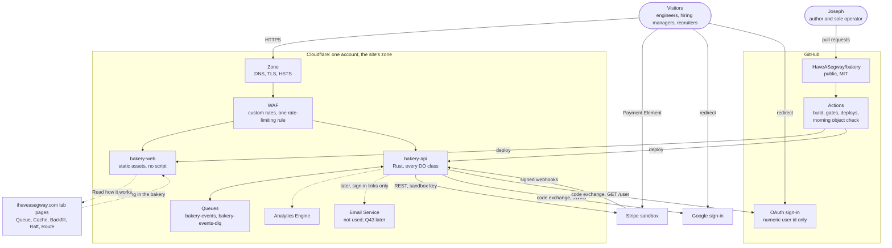

- The site and the bakery link each other and nothing more (Q32 · Q-links).
- Stripe, Google and GitHub's sign-in are the only third parties in the request path, and none receives a real name, email address or card from the bakery ([security.md](security.md)).
- Email Service is not used. Sends to Joseph's own verified address, free on any plan,[^email] were struck on 2026-11-09 by the session, under Joseph's delegation of the same day; revisable: the bakery holds no address for anyone, and the Inbox object is the mailbox by design (Q22 · Q-email, roadmap R23). Visitors never get email. Email sign-in is designed and shipped later (Q43 · Q-email-signin): one link per sign-in through Email Service, to an address used once and never stored ([security.md](security.md#email-sign-in-later)).

## Container diagram

C4 level 2: everything deployed, configured or holding state.

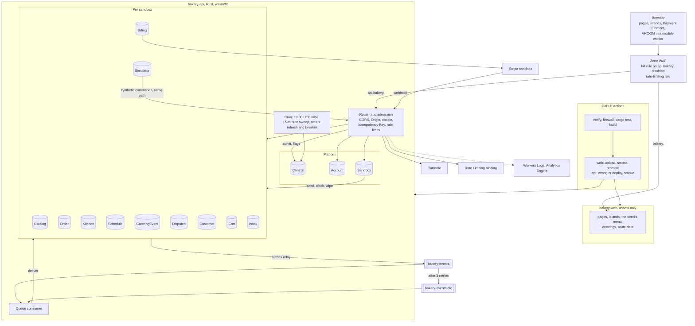

- `bakery-web` has no `main` and Workers Cache stays off, so a page view is never a billed Worker request. `/menu/` is built from `crates/seed` and costs $0 to serve.
- Only `bakery-api` binds the classes, and a DO has no URL of its own, so every request passes the router first. `workers_dev` is false on both Workers (Q30 · Q-previews).
- One Worker holds the consumer, the cron handler and the classes, so one deploy restarts all of it: the trade the site's lab made in its [ADR 0009](https://github.com/IHaveASegway/website/blob/main/docs/adr/0009-lab-worker-same-origin.md).
- The bundle must fit 64 MiB uncompressed and start within 1 s (error 10021), in 128 MB of memory per isolate with Wasm linear memory included.[^limits] One binary with 14 classes is what spike S1 measured. The WebAssembly budget is held in `workers/api/budgets.json`: as of 2026-11-09, 5,317,776 B, PR 10's stripped module plus a quarter, checked by `verify` on every build.

## Bounded contexts

Eight domain contexts and three operational ones. Each writes only its own data.

| Context | Vocabulary | Owns | Boundary | Talks to the others by | It is not |
|---|---|---|---|---|---|
| Platform | account, session, API token, sandbox, seed, clock, simulated customer, flag, budget | identities, sandboxes, registries, the business clock, simulated traffic, flags, the daily ledger | `Control`, `Account`, `Sandbox`, `Simulator`; `src/auth/` | commands to children (seed, clock, wipe); `SandboxSeeded`, `ClockAdvanced`, `SandboxWiped` | A user directory. It knows a hash of a `sub` or a GitHub id |
| Storefront | item, variant, category, allergen, lead time, menu version | the menu, prices, availability rules | `Catalog` | `MenuPublished`; an `ETag` of the version | The day's stock count, which Scheduling holds |
| Ordering | order, line, note, expiry, board | each order's log and state; the live board | `Order`, `Kitchen` | commands from the router and the board; `OrderPlaced` to `OrderClosed` | The payment. It asks Billing and listens |
| Scheduling | slot, window, capacity, hold, reservation, bake list | slots, windows, daily item caps, catering day capacity, the production plan | `Schedule` per day | a synchronous hold; `SlotReserved`, `SlotReleased`, `BakeListChanged` | The catering calendar of record |
| Catering | inquiry, package, venue, quote, deposit, balance, reminder | each job's log, quote and money due | `CateringEvent` | commands; `CateringInquiryReceived` to `CateringClosed`; alarms | A general calendar |
| Billing | payment, intent, invoice, refund, webhook, ledger | the ledger and every Stripe id | `Billing`; `src/stripe/`; the `PaymentGateway` port | Stripe REST out, signed webhooks in; `PaymentSucceeded`, `RefundIssued` | A copy of Stripe |
| Fulfillment | stop, van, route, proposal | each day's stops and plans | `Dispatch` per day | `RoutePublished`, `StopCompleted`, `StopReady`; the browser's VROOM plan as a command | A map; travel times are static assets |
| CRM | customer, timeline, segment, campaign, consent, loyalty, message | personas, projections, campaigns, the inbox | `Customer`, `Crm`, `Inbox` | consumes most events; produces `CampaignSent`, `LoyaltyPointsEarned`, `MessageOpened` | A writer of orders |
| Presentation | page, island, screen, guide, entry, persona switch | pages, islands, drawings, the guide (its entries began as the tour's steps), the OpenAPI page at `/docs/api/` | `apps/web/`; `bakery-web` | build-time reads of `crates/seed` and `crates/contracts`; HTTPS to the API | A runtime |
| Delivery | job, gate, preview, version | workflows, the firewall check, the deploy credential | `.github/`, `.githooks/`, `scripts/` | builds and deploys both Workers ([delivery.md](delivery.md)) | A second deployer; Workers Builds stays disconnected |
| Edge | zone, record, rule, certificate | the Custom Domains' records, WAF rules, the rate-limiting rule | the dashboard | wraps every request before a Worker runs | Owned here. The zone is the site's |

**Commands may be synchronous; events never are.** A command (hold this slot, seed this child, mark this order ready) is a call from the router, from a Sandbox to its children, or from the Kitchen room to the Order a staff member clicked. An event crosses only by the Queue, so no write waits on a subscriber.

**The published language** is `crates/contracts`: API types and the envelope, exported as JSON Schema with `schemars` and turned into TypeScript by `pnpm --filter web contracts`, which writes `apps/web/src/contracts/*.ts`; the files are committed, and `apps/web/test/contracts.test.ts` regenerates them and fails on any difference (as built, 2026-11-09), so the web app cannot drift unnoticed. The socket follows the site's protocol v1 shape. ADR 0013, the API and socket contract v1, is written in PR 10 with the visitor API ([simulated traffic, the tour and the API for visitors](#simulated-traffic-the-tour-and-the-api-for-visitors)).

## Durable Object topology

Fifteen classes since 2026-11-09 (the `Recorder` is the fifteenth), all SQLite-backed, declared with `exports`. On Paid an account may hold 500 classes and an object 10 GB; a row is capped at 2 MB, with 100 columns and 100 bound parameters.[^dolimits]

Isolation is a database per tenant per aggregate, not row-level security over a shared table: every object is its own SQLite database, so there is no shared table to filter ([security.md](security.md#sandbox-isolation) says why that is the stronger design here).

| Class | One per | Holds | Who writes | Lifetime | Cleanup alarm |
|---|---|---|---|---|---|
| `Control` | account, `control` | flags `live`, `read-only`, `off`; daily ledger; kill switch; the daily IP salt, in memory only, never stored | router (since 2026-11-10 every route reads the flag, from an isolate's copy at most 60 s old; roadmap R85), cron (the breaker raises the flag, never lowers it), Joseph (flags and the breaker's reset, in Data Studio) | long-lived | prunes ledger rows past 35 days |
| `Account` | identity | demo password hash, current sandbox id, created day | router | 30 days after last sign-in (Q23 · Q-auth) | 30 days idle, then `delete_all` |
| `Sandbox` | sandbox | lifecycle, seed, child registry, clock offset, API token version, fault switches, dead letters | router; its alarms | to the next wipe | next 10:00 UTC; 36 h |
| `Catalog` | sandbox | items, variants, prices, availability rules, menu version | staff; seed | to the wipe | 36 h |
| `Order` | order | event log, state, lines, note, seen commands | router, Kitchen, events | to the wipe | 15-minute expiry; 36 h |
| `Kitchen` | sandbox | hibernating sockets, the board, fan-out | events | to the wipe | 36 h |
| `Schedule` | sandbox and day | slots, windows, caps, holds, reservations, production plan (PR 6: the fold of its own events, with a `hold:<ref>` timer per held place) | router (holds); events; staff | to the wipe | hold expiries; 36 h |
| `CateringEvent` | inquiry | event log, state, quote, deposit, balance, timer rows | router; events; its own timer rows | to the wipe | three reminders, the quote's expiry, the deposit hold's lapse; 36 h |
| `Billing` | sandbox | payments and their intents, refunds, Stripe ids, the ids of the webhook events it has applied (inside the events it appended), the seed's daily totals; since PR 7 the balance invoices and the persona's Stripe customer ids | router (the payment route); verified webhooks; the Queue consumer (refunds, expiry); the Simulator | to the wipe | the wipe cancels each intent still open at Stripe, voids each open invoice and deletes the customers it made, best effort, before `delete_all`; 36 h |
| `Dispatch` | sandbox and day | the day's stops, the server's proposed plan (Clarke–Wright), the browser's submitted plan, the published plan, the command keys and the ids of the events it has applied; the travel-time matrix is read from the build, never stored | the consumer (stops); staff, through the router (propose, plan, publish, complete) | to the wipe | the outbox and the 36 h backstop only |
| `Customer` | persona | synthetic profile, preferences, consent, loyalty | router; events | to the wipe | 36 h |
| `Crm` | sandbox | consumed event log, projections, campaigns, rebuild cursor | consumer; staff | to the wipe | rebuild batches; sends; 36 h |
| `Inbox` | sandbox | messages, simulated opens and clicks | events | to the wipe | simulated opens; 36 h |
| `Simulator` | sandbox | the rate, the running flag, the minute ledger, its alarm | the visitor (Start and Stop traffic); its alarm | to the wipe | the next tick while running; 36 h |
| `Recorder` | sandbox | the flight recorder: the last 200 batches of hops the Queue's consumer sent, no event data; the retry counts; hibernating sockets ([below](#the-flight-recorder), 2026-11-09) | the Queue's consumer, after each batch | to the wipe | 36 h |

`Campaign` is an aggregate hosted in `Crm`, since each send reads Crm's segment projection and a sandbox holds a handful ([domain.md](domain.md#campaign)).

**As built in PR 8 (2026-11-05, `workers/api/src/objects/{customer,crm,inbox}.rs`).** The three rows above hold as follows, and what each keeps is nothing that names a person ([security.md](security.md#privacy-and-data-inventory)).

| Class | What it keeps, as built | Timers it arms | Its deliveries |
|---|---|---|---|
| `Customer` (`customer:<sandbox>:<persona>`) | the domain's `Customer`: its own events, from which consent and the loyalty balance are folded. Born on first touch (a consent change, or an order's `OrderPaid`) from the persona's profile, consent and opening points, which the Sandbox keeps in a `personas` table written at creation and hands out at `/_register-customer` | none | `OrderPaid` becomes `EarnPoints` and `OrderRefunded` becomes `ReversePoints`, each under the key `evt:<event id>`; 410 while unborn and no birth was sent |
| `Crm` (`crm:<sandbox>`) | one row holding the roster, the projection (as its serialized JSON), a `shadow` and the rebuild's progress; an append-only `log` of every envelope that changed the projection, the note and the brief removed; its own stream of campaign events, from which campaigns are folded | `send:<campaign>` (the send), `rebuild` (the next batch) | answers `applied`, `duplicate`, `stale` or `ignored`; 503 for an unknown reference, so the consumer retries; a refused rule is logged and acknowledged |
| `Inbox` (`inbox:<sandbox>`) | a `messages` table, one row a message, and one row of the domain's state without its messages (the order and catering facts it needs, the ids it has seen) | `open:<message>`, `click:<message>`, from the seed's engagement draw | inserts the message and its `MessageDelivered` in one transaction with the consumed event's record; 503 for an unknown reference or while the `inbox` fault is on |

Crm and the Inbox are the sandbox's one object each, so `all(Crm)` and `all(Inbox)` go to that object and a 410 from either (not yet seeded, or wiped) counts as delivered and is logged `subscriber_unborn`. `all(Customer)` goes to the order's customer, which the consumer asks the Order for (`GET /_customer`), because no event after `OrderPlaced` names the customer; when the Customer answers 410 the consumer registers it with the Sandbox and sends the delivery again with the birth and the persona. **The consumer strips the note and the brief** (`routing::strip_for`) from every event bound for Crm or the Inbox, and Crm's `log_entry` strips them a second time before anything is stored. The ordering rule above is applied per aggregate stream (`order:`, `catering:`, `customer:` and Crm's own per campaign): a late event with a lower `seq` is dropped as stale and neither stored nor logged, which is what lets a rebuild reproduce the projection byte for byte. The multi-entity streams (`inbox:`, `sandbox:`, `billing:` and the rest) dedupe by event id alone, because their data are sets and time-sorted lists that converge in any order.

**One platform alarm per object.**[^alarms] Each object keeps a `timers` table (purpose, due business time, due wall time) and arms the alarm for the earliest; the handler runs every due row and re-arms for the next. Each `setAlarm()` is one row written.[^dopricing]

### Object naming

| Class | Name |
|---|---|
| `Control` | `control` |
| `Account` | `account:<hex of HMAC(ACCOUNT_HMAC_KEY, "google:" + sub, "github:" + id or "demo:" + username)>`; later `"email:" + normalized address` (Q43 · Q-email-signin) |
| `Sandbox` | `sandbox:<ULID>`, minted by the router, carried in the signed session |
| per-sandbox | `catalog:<sandbox>`, `kitchen:<sandbox>`, `billing:<sandbox>`, `crm:<sandbox>`, `inbox:<sandbox>`, `recorder:<sandbox>` (since 2026-11-09), `simulator:<sandbox>` |
| per-day | `schedule:<sandbox>:<YYYY-MM-DD>`, `dispatch:<sandbox>:<YYYY-MM-DD>`, a business date from the sandbox's birth day to 30 days after business today, or any later date for an accepted catering quote's event day (as built, `workers/api/src/objects/sandbox.rs`, 2026-11-09) |
| per-aggregate | `order:<sandbox>:<ULID>`, `catering:<sandbox>:<ULID>`, `customer:<sandbox>:<ULID>` |

A path's sandbox id must equal the session's (or the API token's), and an aggregate's ULID must be in the Sandbox's registry, before any object is addressed ([domain.md](domain.md#identifiers)).

**Children are born only through the Sandbox.** An object with no `meta` row refuses every command with 410 and never seeds itself. To materialize a child (a new order, a persona touched for the first time, a future day, the Simulator on the first "Start traffic"), the router registers its name with the Sandbox, which answers with the seed and clock offset, or 410 once wiped. So the wipe knows every object, and a stale cookie cannot revive a wiped sandbox.

### The rules, restated for Rust

The site's lab wrote these for TypeScript ([lab.md](https://github.com/IHaveASegway/website/blob/main/docs/lab.md#durable-object-rules)). Here they bind workers-rs.

1. **SQLite only**, through `Storage::sql()`. Free allows only SQLite-backed objects,[^dolimits] which keeps Q27 · Q-plan a two-way door.
2. **Hibernation API only.** The Kitchen accepts with `State::accept_web_socket` and handles `websocket_message`, `websocket_close`, `websocket_error`. A hibernating object is not billed for duration.[^dopricing] Pings go to the platform's auto-response. As built (2026-11-09) the Kitchen arms it for `{"t":"ping","v":1}` on every accept, through `worker::worker_sys` (`workers/api/src/objects/kitchen.rs`). The console sends no pings; while its socket is closed it sends an HTTP heartbeat every 30 s instead (`apps/web/src/lib/use-kitchen.ts`).
3. **Alarms, never timers.** No `setTimeout`, no sleeping futures. Later work is a `timers` row.
4. **Idempotent alarms with a guard.** Handlers act from cursors and ledgers, so a rerun changes nothing. An alarm re-arms only for a time later than now, and an object counts alarm-driven re-arms per UTC day: at 100 it stops, logs `alarm_guard`, and waits for the wipe. As built in PR 6, arming the wall time the platform already holds writes nothing, a command's arm is never counted, and the count is per distinct wall time ([Time travel](#time-travel)).
5. **Names from the server** ([object naming](#object-naming)).
6. **Every object ends with `delete_all`**, which with `compatibility_date` 2026-02-24 or later also clears the alarm. Each arms its 36 h backstop on its first write. `Control` and `Account` are the exceptions.
7. **Short handlers.** Paid gives 30 s of CPU a request,[^limits] but a long handler blocks an object that serves a soft 1,000 requests a second.[^dolimits] Of the two heaviest, spike S1 timed one argon2id hash locally only, 35.7 ms of wall time on `wrangler dev` on 2026-11-04 ([roadmap.md](roadmap.md#spikes)); the savings heuristic on the 63-stop Saturday was timed natively on 2026-11-10, a median of 0.69 ms ([ADR 0012](adr/0012-delivery-dispatch.md)'s postscript of 2026-11-10). Neither has been timed as WebAssembly on the edge (corrected 2026-11-10).
8. **No Tokio, no threads**: `wasm32-unknown-unknown` and the runtime's event loop.

Deleting is not erasing: SQLite objects keep 30 days of point-in-time recovery.[^sqlite] The privacy page says so.

## Events and the outbox

The Queue Lab's principle, running for real ([ADR 0004](adr/0004-queues-between-objects-and-alarms-for-time.md)).

**Envelope** ([domain.md](domain.md#the-envelope) has an example): `{v:1, id (ULID), sandbox, stream, seq, type, at (business time), recorded_at (wall time), data, cause (command id)}`.

**Write.** A command carries a ULID id, the `Idempotency-Key`. A known id in `commands_seen` returns the stored result. Otherwise `decide(state, command)` returns events or a rejection, and one `storage.transactionSync()` call appends to `events`, copies the envelopes into `outbox`, updates state and records the command id. All or nothing. As built (2026-11-09): workers-rs 0.8.7 does not bind `transactionSync`, and its `Storage::transaction` is the asynchronous key-value one, so `workers/api/src/objects/sql.rs` reaches the synchronous call through `Reflect`. An error inside the closure throws, and the runtime rolls every write back, so the events, the outbox rows, the state and the command's key land together or not at all.

```sql
-- every aggregate object, as built: `SCHEMA` in workers/api/src/objects/stream.rs (2026-11-09)
CREATE TABLE events (seq INTEGER PRIMARY KEY, id TEXT NOT NULL UNIQUE, type TEXT NOT NULL,
                     at TEXT NOT NULL, recorded_at TEXT NOT NULL, data TEXT NOT NULL, cause TEXT);
CREATE TABLE outbox (seq INTEGER PRIMARY KEY, envelope TEXT NOT NULL, attempts INTEGER NOT NULL DEFAULT 0);
CREATE TABLE commands_seen (key TEXT PRIMARY KEY, body_hash TEXT NOT NULL DEFAULT '',
                            result TEXT NOT NULL, at TEXT NOT NULL);
CREATE TABLE timers (id TEXT PRIMARY KEY, purpose TEXT NOT NULL, due_wall TEXT NOT NULL, due_business TEXT);
CREATE TABLE rearms (day TEXT PRIMARY KEY, n INTEGER NOT NULL, last_at INTEGER);
```

**Relay.** After commit the object sends its outbox rows to `bakery-events` in one batch under `wait_until`, up to 100 rows a send (the Queue's batch limit), deleting each accepted row, and leaves an `outbox` timer 30 s out. Each envelope travels as a JSON string, not as a `serde_json::Value`: spike S6 found on 2026-11-04 that `worker` 0.8.7 passes a `Value` map through serde-wasm-bindgen as a JavaScript `Map`, which the Queue encodes as `{}` ([roadmap.md](roadmap.md#spikes)). If the send failed or the isolate died, the alarm sends what is left and re-arms only while rows remain. A row may go twice; once committed it is never lost.

**Consume.** The consumer runs in the same Worker on `#[event(queue)]` (beta in workers-rs as of 2026-11-04),[^workersrs] in batches of up to 10 (`max_batch_size` in `workers/api/wrangler.jsonc`, as configured on 2026-11-06; Cloudflare allows up to 100).[^queues] A static table in `crates/app` maps each event type to subscribers; the consumer delivers to each by `fetch` on its `/_event` path (DO RPC is not bound in workers-rs), acks when all answered 2xx, and retries otherwise. Since PR 5 the live subscribers are the Kitchen, `Billing` and the `Order`. `Billing` is the sandbox's one; an `Order` is the one the data's `ref` names, for the routes the catalog scopes `ByPurpose` (`PaymentSucceeded`, delivered when the purpose is `order`) and `ByRef` (`RefundIssued`, and `PaymentFailed`), where the purpose narrows the route when the data carries one. An event whose route needs a `ref` it lacks has no instance to deliver to, so its delivery fails, retries and dead-letters rather than guessing one. `Billing` takes Stripe's webhook events on a path of their own, so `/_event` keeps one meaning for every subscriber.

**The Dispatch edges, as built in PR 9 (2026-11-05; `workers/api/src/queue.rs`).** `Dispatch` is a live subscriber, and its delivery is the day of the order's window. An order event is read from its `Order` (`GET /_order`) at most once per delivery, and the one read is shared between the Schedule edge and the Dispatch edge. `OrderPlaced` for a delivery becomes `AddStop`, with the customer's place read from the Sandbox (`GET /_place/<customer>`, the persona's `p<n>`) and mapped to a matrix index; `OrderPaid` becomes `ConfirmStop`, and `OrderExpired` and `OrderCancelled` become `RemoveStop`, the slot and kind coming from the Order because those events carry neither. A pickup's event is acked with nothing sent, and an Order that answers 404 or 410 is acked. A day never touched answers 410, and the consumer registers it with the Sandbox (`/_register-dispatch`) and sends the event again with its birth; a date outside the sandbox's days, or a wiped sandbox, is acked and logged `dispatch_no_day`, a persona with no place is acked and logged `dispatch_no_place`, and a day still being seeded is retried. The other direction: `RoutePublished` goes to each stop's `Order`, which decides `MarkOutForDelivery` with the route `van-<n>` and the stop number (an Order that is not yet ready refuses, logged and acked), and to the Kitchen, which labels its cards with their van and stop, the highest `plan_v` of a day winning; `StopCompleted` goes to its `Order`, which decides `MarkDelivered`. Since 2026-11-08 `OrderReady` also goes to the day of the order's window, read from the Order like `OrderPaid`, and an order made after its stop was published comes back as the Dispatch's `StopReady`, which goes to that `Order` and becomes `MarkOutForDelivery` ([domain.md](domain.md#dispatch) says why the edge is the Dispatch's). Since the same day `OrderOutForDelivery` goes to the day as well, read from the Order like `OrderReady`, and marks the stop out for delivery (`StopDeparted`, the Dispatch's own log). An Order that is gone by then is acked and logged `stop_order_gone`. The Dispatch object reads the travel-time matrix once per isolate from the fixture compiled into the Worker (`crates/seed/data/salt-lake-city/matrix.json`, 19,071 B of JSON as of 2026-11-05), hands it to the commands that plan, and never stores it.

**Idempotent consumers.** Each subscriber applies an event and records its id in `seen` in one transaction, so a redelivery changes nothing.

**Batch timeout.** The consumer in `wrangler.jsonc` sets `max_batch_timeout: 0`, as built in PR 4 (2026-11-05). `wrangler dev`'s default of 1 s put the kitchen board about 1,012 ms behind a write, past the one-second goal. The platform's default is believed to be 5 s and was not re-verified. The cost is more consumer invocations, not more Queue operations, because operations are counted per message.[^queues]

**Dead letters.** After 3 retries the platform moves a message to `bakery-events-dlq`. The same `#[event(queue)]` handler, seeing the dead-letter queue's name, writes it and its last error to the owning Sandbox's `dead_letters`, logs a `dlq` line and acks. `worker` 0.8.7 exposes no attempt count, so the consumer records each failed delivery's error in the Sandbox's `delivery_errors` table and the dead-letter writer picks the last one up. Any session can list the dead letters (`GET /v1/sandboxes/{id}/dead-letters`); a signed-in one can redrive a message (`POST .../dead-letters/{id}/redrive`), which delivers it again with the same event id, so `seen` still protects it. Proven on 2026-11-05 with the `kitchen` fault: the Kitchen answered 503, each delivery was retried, the message reached the dead letters after three retries, and a redrive after clearing the fault put the card on the board once. A fault switch makes the Inbox or the Kitchen refuse deliveries: the Queue Lab's broken subscriber, live. The alert on a dead letter does not exist yet; it arrives with PR 11. Since 2026-11-10 (roadmap R67) a dead letter that arrives while `Control`'s flag is `off`, or within two minutes of the flag's last change, is kept with `made_while_off` and writes no `dlq` point, since at `off` the consumer retries every message ([operations.md](operations.md#breaker-tripped)).

**Ordering is per stream, by `seq`.** Queues promise no order. `seq` is gap-free because one object writes each stream. Subscribers that copy state (the board, Crm's order rows) keep the highest `seq` per stream and ignore older events; subscribers that react (Billing, Inbox) are written so order within a stream does not change the outcome. Nothing orders across streams, and nothing needs to.

**At least once.** Every event is delivered at least once, possibly more, possibly out of order across streams. Exactly-once effects come from the `seen` tables and idempotency keys at every side effect, Stripe's included. A message costs about 3 Queue operations, plus a read per retry,[^queues] and each delivery is a DO request and at least 2 rows written. [cost.md](cost.md) assumes 50 events a session.

## Data ownership

Every datum the bakery touches, left to right: where it lives, who changes it, who reads it, how it gets there, how fresh they need it.

| Datum | System of record | Context | Writes it | Reads it | How it crosses | Consistency readers need |
|---|---|---|---|---|---|---|
| Accounts | `Account`: id, argon2 hash, current sandbox, created day | Platform | router | router | command | strong |
| Sessions | `__Host-session` cookie, HMAC-signed, on the API host | Platform | router, after sign-in or a guest's Turnstile | router, every call | `HttpOnly; Secure; SameSite=Strict; Path=/`, 24 h; sandbox claim ends at the next wipe | self-verifying; nothing stored |
| API tokens | nothing stored but the token version in `Sandbox`, with the last token's id, times and masked form for the console; the token itself is signed like the cookie and never stored | Platform | router, when the console issues or rotates it | router, every API call | `Authorization: Bearer`, 24 h, never past the wipe | self-verifying; the version check is strong |
| Sandboxes | `Sandbox`: lifecycle, registry | Platform | router; alarms; the wipe | router; the wipe | command | strong |
| Clock offset | `Sandbox`, the only writer | Platform | the visitor, "Advance time" | every child, from a copy in `meta` | command from the Sandbox, retried by alarm | within one Sandbox alarm; versioned `clock_v` |
| Menu | `Catalog` | Storefront | staff; seed | storefront island; Order, priced at placement | HTTPS with `ETag`; the Cache API keyed by sandbox and version; `MenuPublished`. Since 2026-11-08 staff read unpublished edits through `GET .../menu/drafts`; a visitor still reads only the published version | per version; an old entry is unreachable once the version moves |
| Orders | each `Order`: log and state | Ordering | router, Kitchen, events | visitor; Kitchen, Schedule, Crm, Customer, Inbox, Dispatch | events | strong in the object; projections one Queue hop behind |
| Slots and caps | `Schedule` for the day | Scheduling | router (holds); events; staff | checkout, console | synchronous hold; `SlotReserved` | strong at the hold, so capacity is never oversold |
| Production plan | `Schedule`, projected from reservations and catering | Scheduling | Schedule | Kitchen board | `BakeListChanged` | one hop |
| Catering events | each `CateringEvent` | Catering | router; events; reminder alarms | visitor; Schedule, Crm, Inbox, Billing | events | strong in the object |
| Billing ledger and Stripe ids | `Billing` | Billing | router; verified webhooks | Order, CateringEvent, Crm, Inbox; the wipe | events; Stripe ids go only to Stripe | strong; webhook ids deduped |
| Stripe's copy of payment objects | Stripe's sandbox | outside | Billing, by REST; the Payment Element | Billing; Joseph, in Stripe | REST, signed webhooks | Stripe is the authority; Billing records what Stripe confirmed |
| Routes | `Dispatch` for the day | Fulfillment | Dispatch (proposal); staff (publish) | console; Order | `RoutePublished`, `StopCompleted`, `StopReady` | strong in the object |
| Customers | each `Customer`, materialized from the seed | CRM | router; events | Crm; checkout | events | strong in the object |
| Projections and campaigns | `Crm` | CRM | consumer; rebuild; staff | console; Inbox | derived from Crm's copy of the log | eventual; rebuildable |
| Inbox | `Inbox` | CRM | events | inbox screen | HTTPS | one hop |
| Simulated traffic | `Simulator`: rate, running flag, minute ledger | Platform | the visitor; its alarm | console; `Control`, for the day's minutes | commands, as a visitor's | strong in the object |
| Flags, ledger, IP salt, the breaker's state (`breaker_state`, one row) | `Control` | Platform | router; cron, including the breaker; Joseph | as built (2026-11-09): the router at admission (sandbox and demo-account creation), uncached; the Queue consumer, through a 60 s isolate cache (`workers/api/src/queue.rs`); the 30 s isolate cache is the IP salt's | command | admission sees a change at once, the consumer within 60 s; `read-only` refuses new sandboxes and new demo accounts only, and commands inside existing sandboxes continue, bounded by the per-sandbox limits and the nightly wipe (decided as built on 2026-11-09, roadmap R20); `off` makes the consumer retry every message, so events in flight reach the dead-letter queue after three tries, and such a dead letter is to be kept but not counted as a `dlq` point (decided on 2026-11-09, roadmap R21, built as R67) |
| Logs | Workers Logs | Platform | the Worker: JSON lines; `HMAC(daily salt, IP)`, country, continent | Joseph | ingestion; invocation logs off | best effort; 7 days on Paid[^logs] |
| Metrics | Analytics Engine | Platform | Worker and objects (eight points, fire-and-forget, the `breaker` one among them; as built 2026-11-06, counted from `crates/app/src/analytics.rs` on 2026-11-10) | Joseph; the breaker (built in PR 17, 2026-11-06; it reads the GraphQL Analytics API, not this dataset, and writes one `breaker` point when it trips); the status page, from a snapshot that the `*/15` cron refreshes through the SQL API and `Control` stores, not from a query per view | data points; the snapshot over `GET /v1/status` | eventual; the page's counters are up to about 15 minutes old, `stale` after 20 or a failed refresh |
| Secrets | Worker secrets on `bakery-api` | Platform; Billing | Joseph, by Wrangler | the Worker | injection | one reader each ([security.md](security.md#secrets-inventory)) |
| Deploy credential | Cloudflare | Delivery | Joseph | deploy steps in Actions | repository secret, in those steps' `env` | rotation in [operations.md](operations.md) |
| Seed data | `crates/seed`: word lists, menu, venues, the 64 Salt Lake City places and their travel-time matrix (built in PR 9) | Platform; Presentation | Joseph, by pull request | Sandbox; the web build | compiled into both builds | per version; deterministic per seed |

One system of record and one writer each. Three rows look like copies and add no owner: each child's clock offset (versioned, retried until current), Crm's event log (a copy of what the Queue delivered), and Billing's view of Stripe (only what Stripe confirmed). A Worker-side cache of order state, or a Crm that wrote loyalty points, would have created second owners.

## Request flows

### A public page view

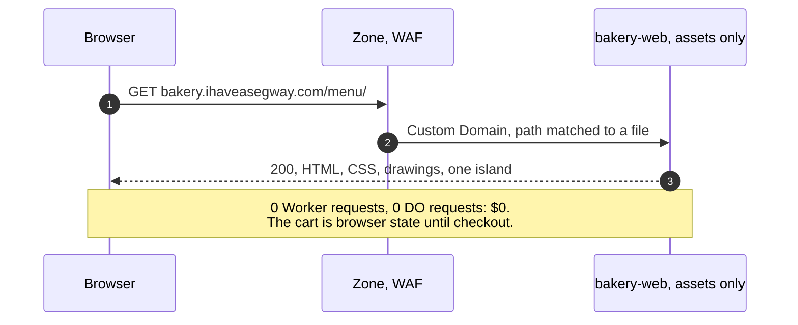

- Home, Menu, Catering, About, How it's built, Privacy and Status are static (Q6 · Q-public); the menu is the seed's. As built on 2026-11-06 (PR 12), all but Status existed, with the essay at `/how-its-built/single-writer/`; the build made 14 pages. PR 13 added `/status/` the same day, an island (policy class `island`) that calls `GET /v1/status` on load and every 60 s while visible and shows the API's counters, or the browser's last good answer with a note when the API is unreachable, for 15 pages. PR 14 (2026-11-06) added four more essays beside the first, at `/how-its-built/outbox/`, `/how-its-built/cache/`, `/how-its-built/rebuild/` and `/how-its-built/routes/`, one for each of the other four lab principles, so `pnpm --filter web build` makes 19 pages with both merged (counted on 2026-11-06). PR 15 (2026-11-06) added four more, for the principles with no lab page, at `/how-its-built/idempotency/`, `/how-its-built/sagas/`, `/how-its-built/leases/` and `/how-its-built/admission/`, so the build makes 23 pages (counted on 2026-11-06): nine essay pages for ten principle ids, because idempotency keys and payment keys share one page. PR 16 (2026-11-06) added the last four, at `/how-its-built/time-travel/`, `/how-its-built/lag/`, `/how-its-built/sandbox/` and `/how-its-built/api/`, so the build makes 27 pages (counted on 2026-11-06): thirteen essay pages for sixteen principle ids, because idempotency keys and payment keys, CQRS and load, and the sandbox and no personal data each share one page. PR 18 (2026-11-06) added the breaker essay at `/how-its-built/breaker/`, so the build makes 28 pages (counted on 2026-11-06): fourteen essay pages for seventeen principle ids. The fourteen essays are static, with no island and the strict page policy. Every page shares one header, nav and footer made of plain links (`apps/web/src/layouts/Base.astro`), which add no script. About, How it's built and the fourteen essays are reading pages with no island and the strict page policy; Home, Menu, Privacy and the API reference carry the guide's island (the tour's until 2026-11-09), and Status its own and the guide's. Their text is data or markup in `apps/web/`, so a view still costs $0. On 2026-11-10 PR 21 added `/how-its-built/tools/`, "The tools, and what was not chosen", a reading page with no island and the strict page policy, rendered from `apps/web/src/data/tools.ts`: every tool in the build, why it is used, when not, and the alternatives the records weighed.
- A Custom Domain issues its own certificate for a two-level name like `api.bakery.ihaveasegway.com`; Universal SSL covers only the apex and one level.[^customdomains]

### Sign-in with Google, and a demo account

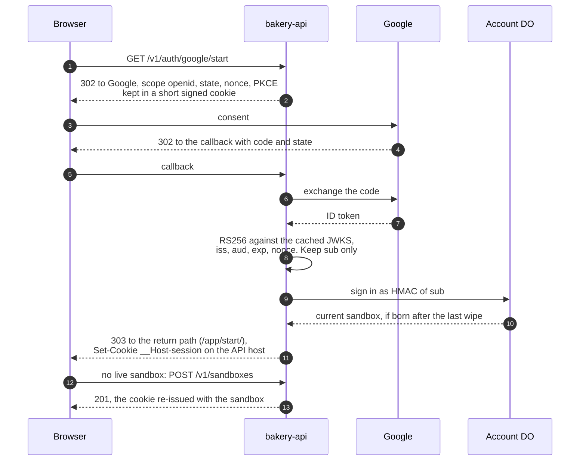

- Only `sub` is used: always present, "unique among all Google Accounts and never reused"; `email` appears only with the `email` scope.[^google] Tokens are verified locally against the discovery document's `jwks_uri`, never `tokeninfo`.
- `scope=openid` alone works: [S2](roadmap.md#spikes) passed on 2026-11-05, and the ID token carried `sub` and no `email`, `email_verified`, `name` or `picture`, although Google's docs still describe the scope as needing `profile`, `email`, or both. The callback drops those four claims if they ever appear, which is the fallback design too ([ADR 0006](adr/0006-sign-in-that-learns-nothing.md)); the token response's `access_token` is dropped as well.
- The cookie is host-only on the API: the web origin never sees it and asks `GET /v1/session`. The two hostnames are one site and two origins, so `SameSite=Strict` still rides credentialed fetches; CORS allows exactly `https://bakery.ihaveasegway.com` with credentials.
- The redirect URI sent to Google (and to GitHub) is `API_ORIGIN` plus the callback path, not the request's host: `wrangler dev` rewrites the host to the route's, and the URI must match the registered one exactly.
- **GitHub has the same shape** (Q23 · Q-auth): `GET /v1/auth/github/start`, a 302 to GitHub with `state` and PKCE (S256) and no scope requested, so no `user:email`; the callback exchanges the code, makes one `GET /user` with the token and discards it. Only the numeric `id` is kept, the durable one (a login can change), and the account is `HMAC(ACCOUNT_HMAC_KEY, "github:" + id)`.[^github] [security.md](security.md#github-with-the-numeric-user-id-alone) owns the details.
- **Demo account:** after Turnstile, the router generates a username such as `baker-7f3k`, the visitor sets a password, and the `Account` stores an argon2 hash. No email, no recovery. [security.md](security.md) owns the parameters.
- **Each way in ends with a sandbox** (since 2026-11-10, audit G11). The sign-in page says so, and until then a new account reached the console's "You have no sandbox" and needed one press more. The Google and GitHub links ask the API to come back to `/app/start/` (`signinUrl` in `apps/web/src/lib/api.ts`; the return path is a lower-case path and never a query, `return_path` in `crates/app/src/auth/oauth.rs`). That page is the Kitchen's console with one difference: when the session names no live sandbox it makes one (`POST /v1/sandboxes`, which needs no Turnstile for an account), first sign-in or a return after the night's wipe alike, and then shows itself at `/app/` with the address replaced. A refusal (a cap, the one-a-minute limit, the API out of reach) is shown in the API's words over the empty state, with no retry. The demo account's card makes the sandbox in the same press that makes the account, and says so. `/app/` itself never makes one: a session that outlives its sandbox and opens it gets the empty state and its New sandbox button.

### Creating a sandbox

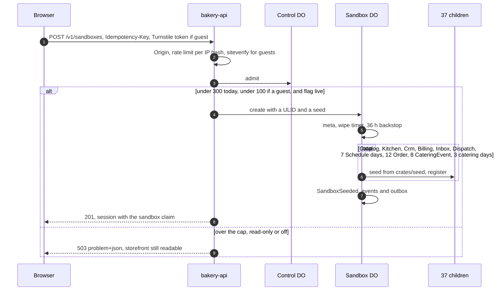

- Turnstile, free and unlimited,[^turnstile] guards every guest sandbox and demo sign-up (Q24 · Q-guest). A signed-in account may create 3 sandboxes a day.
- **Guest scope** (Q45 · Q-guest-scope): a guest sandbox can browse, order and pay with a test card, and since 2026-11-10 move its own orders on the kitchen board over the socket ([roadmap.md](roadmap.md#remaining-work), R72). Sign-in unlocks the console's writes (menu edits, campaigns, publishing a route), the API token, simulated traffic, and a sandbox that follows the account across devices. Guests are capped at 100 of the 300 sandboxes a day in `Control`, so bots creating sandboxes hit a wall before the paid-for meters do.
- `Control` also keeps the creation's `Idempotency-Key` with its result for the ledger's retention, so a retried creation does not take a second place. The key is checked in `Control` at admission because that is the one request a creation already makes.
- `Control` costs one exact DO request, so it runs after the free checks: admission in layers. Its cap of 300 sandboxes a day bounds a bot ([cost.md](cost.md)).
- **Seeding is asynchronous, as built in PR 4 (2026-11-05, [ADR 0005](adr/0005-a-private-sandbox-per-visitor-wiped-nightly.md) decision 2).** `create` writes the Sandbox in state `seeding` and arms an alarm for now; the first alarm seeds the children in resumable batches of 7 from a cursor row, registering each child before its first write, so a crashed batch resumes where it stopped. In PR 6 the children are the Catalog, the Kitchen and `Billing`, the 7 `Schedule` days and the 12 Orders: 22 in four batches, not the 33 the diagram shows (PR 5 seeded 15 in three, PR 4 14 in two; the rest arrive with their PRs). The last batch sets state `live` and appends `SandboxSeeded`. The creation answers 201 at once with `seeding`, and a repeated creation returns the same sandbox, still `seeding` or `live` with `children: 22`. Until `live`, the order, menu and clock routes answer 503 `seeding` with `Retry-After: 1`. The seeded orders' events reach the Kitchen through the outbox and the Queue like any others, so the board fills by delivery.
- **As built in PR 7 (2026-11-05):** the children are 33 in five batches of 7, the diagram's number: the Catalog, the Kitchen and `Billing`, the 7 `Schedule` days, the 12 open orders, the 8 `CateringEvent` objects, and 3 more `Schedule` days that hold the accepted and the two confirmed events' places (22 children before this pull request, per the smoke scripts' old expectation). A repeated creation now returns `children: 33` once live. The `CateringEvent` objects replay the seed's commands through the aggregate at their own business times, are written to their own logs with no outbox rows, and the accepted event is accepted at the birth time, so its deposit hold is live ([domain.md](domain.md#the-seed)).
- **As built in PR 8 (2026-11-05).** The Sandbox seeds 35 children in five batches of 7, where the diagram says about 33: the Catalog, the Kitchen, `Billing`, `Crm` and the `Inbox`, then the 7 days, the 12 orders, the 8 catering events and the 3 catering days. Crm and the Inbox come early, before the orders, so that a seeded paid order's events find them born. Crm's seed is the roster, the personas' profiles and the 722 history envelopes (seed 42; 714 for seed 8), the Inbox's the 240 receipts. The seeded orders' events reach Crm and the Inbox through their outboxes and the Queue like any others; a seeded catering event has no outbox relay, so its log is read right after it is seeded and handed to Crm and, for its facts only, to the Inbox. `Customer` objects are made on first touch, and seeding touches some, so `children` ends above 35 and the smoke scripts assert at least 35. `SANDBOX_SEED` (`.dev.vars.example`) fixes the seed, and is honored only when `API_ORIGIN` is loopback, so the smoke can pick one.
- **As built in PR 9 (2026-11-05).** The Sandbox seeds 36 children in six batches of up to 7, which is now the diagram's count: the Catalog, the Kitchen, `Billing`, `Crm` and the `Inbox`, the 7 Schedule days, today's `Dispatch`, the 12 open Orders, the 8 catering events and the 3 days that hold the accepted and confirmed events' places (`workers/api/src/objects/sandbox.rs`, and its test that the plan is 36 children in six runs). The `Dispatch` and the Schedule days go before the Orders, so an Order's events find their stop's day already there; nothing is published at seed. A repeated creation returns the same sandbox with the same `children` count, and the smoke scripts assert at least 36.
- **As built on 2026-11-09.** The `Recorder` joins the first group, after the `Inbox` and before every child whose events the consumer delivers, so the Sandbox seeds 37 children, still in six runs (`workers/api/src/objects/sandbox.rs`, and its test that the plan is 37 children in six runs).
- About 2,000 rows in about 2 s. Closed history goes into Crm's log and Billing's daily summaries; only open orders and the 8 catering jobs become live objects ([domain.md](domain.md#the-seed)). Personas and later days materialize on first touch; since the hardening after PR 13 (2026-11-06) a later `Schedule` day reads the Catalog's published menu once at its birth and is born with its item caps, as a seeded day is, and is not born (the touch refused) when the menu cannot be read.

### Placing and paying an order

Built in PR 5 against a local fake of Stripe's API (`scripts/fake-stripe.mjs`); what only a real sandbox can show is spike S3 ([roadmap.md](roadmap.md#spikes)). Steps marked with a later PR are the design and not yet built.

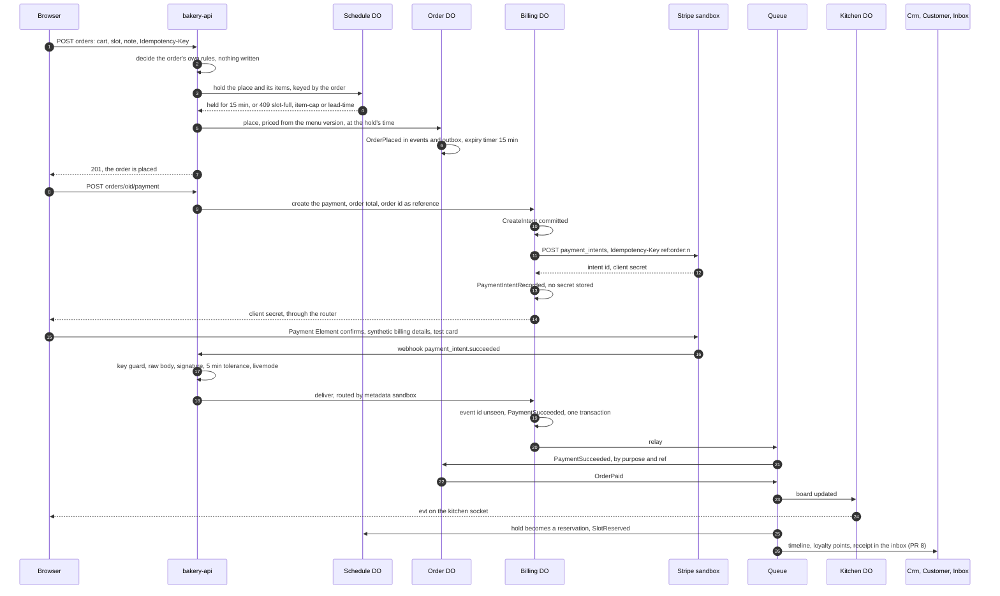

- **The hold is a lease** (built in PR 6, proven on `wrangler dev` 4.157.0 by `scripts/smoke-schedule.sh`, 2026-11-05): Schedule counts held, reserved and fulfilled places against capacity, and releases an unconfirmed hold by its own alarm ([domain.md](domain.md#schedule-reservation)). The order of a placement is: the Sandbox registers the order's key and the slot's day in one call (`/_register-order` with the date); the router decides the order first, so the order's own 422s answer as before and hold nothing (without it, a 21-line cart answered 409 `item-cap` and not 422 `too-many-lines`); the day holds the place under `hold:<key>`, hashed on the client's body, with `expires_at` 15 business minutes ahead; the Order then decides at `expires_at` minus 15 minutes, through `Place.at`, so its `held_until` equals the hold's `expires_at` exactly. The Order accepts `Place.at` only if it is at most 5 s ahead of its own clock and at most 15 minutes behind it. A full slot answers 409 `slot-full` with `next_free`, an item over its cap 409 `item-cap`, a cake too soon 409 `lead-time` naming the hours; a date outside the sandbox's days is 422 `no-such-slot`.
- **The release on failure.** If the Order's own rules refuse after the hold, the router releases the place with reason `cancelled`, under `release:<key>:<expires_at in ms>` so a place taken again by a retry is given back again; a reused idempotency key does not release it. A retry with the same key first asks the Order whether it exists (`GET /_order`): if so, `/_place` replays its first answer and no place is asked for. If not, the day's `hold:<key>` replays a place still held (keeping the first `expires_at`), so it places at the first attempt's time; a place released since, by its timer or by that release, is not replayed but decided as `Retake` (since the hardening after PR 13, 2026-11-06): held again with the retry's own 15 minutes and its answer stored under the key, so the Order is placed on a live hold at the retry's time, or refused 409 `hold-lost` with `next_free` when the slot has no room ([domain.md](domain.md#schedule-reservation)). The gap PR 6 wrote down here, an order placed with no live hold, is closed: proven over HTTP by `scripts/smoke-orders.sh` for a place given back after the Order refused (the timer's release reaches the same state, released with no Order, and is proven natively).
- **The intent is created after the order is committed, in a request of its own.** `POST .../orders/{oid}/payment` runs once the storefront has the placed order: the router reads the order, answers 409 `order` unless it is `placed`, and asks `Billing` for the payment. `Billing` always works in one order: decide and commit the command, call Stripe with the idempotency key the committed state names (`<ref>:<purpose>:<n>`, [domain.md](domain.md#idempotency)), then record Stripe's answer as a second command. A retry after a lost answer makes the same call with the same key. The amount is the order's total, read from the Order and never from the browser. Only the webhook marks an order paid, never the browser or that route.
- **The client secret passes through once.** It goes from Stripe to `Billing` to the router to the browser, in the response body. It is in no event, no row and no log line (the smoke script greps the Worker's log for `_secret_` and finds none, 2026-11-05). A remount of the payment step is recovered by the idempotent re-create, not by a retrieve: `Billing` reuses the open payment and makes the same create call with the same key and body, and Stripe answers it with the same intent and the same secret. At real Stripe that holds only while the idempotency key lives, 24 hours ([Stripe](https://docs.stripe.com/api/idempotent_requests), as of 2026-11-05), and a sandbox lives under 36 h ([domain.md](domain.md#idempotency)); what a remount does after the key is gone is not built or tested, and spike S3 notes it ([operations.md](operations.md#3-the-stripe-sandbox)).
- **The webhook route checks in this order** (`workers/api/src/http/webhook.rs`; Stripe calls it, so it has no CORS, Origin check, session or `Idempotency-Key`, and spends no rate limit, [security.md](security.md#headers-csp-and-cors)): the key guard (503 `stripe-key`); the webhook secret's shape (503 `config`); the raw body, as bytes, before anything parses it; `Stripe-Signature` over that body, constant time against each `v1`, with `t` within 5 minutes[^webhooks] (400 `signature` or `timestamp`); the parse (400 `body`); `livemode` (400 `livemode`); an event type `Billing` has no use for (200, dropped); then the sandbox, from the intent's `metadata[sandbox]`, so an unverified body never picks an object. A refund event's own metadata is not the intent's, so for one the route reads the intent from Stripe. Then `billing:<sandbox>`: 200 for an event applied, replayed or with no effect, and 200 for a wiped or unknown sandbox, so Stripe stops retrying. An event `Billing` cannot apply yet (an unknown intent, a refund before its payment) answers 409 `webhook-later` so Stripe delivers it again; that answer is in the code and no smoke check drives it.
- **`Billing` dedupes by event id and checks the amount.** The Stripe event id is inside the event it appends, in the same transaction as the state change, so a replay finds it in the fold and changes nothing; five deliveries of one event gave one application and four replays (`scripts/smoke-payments.sh`, 2026-11-05). The amount comes from `Billing`'s own record, and an event whose amount differs is refused as `amount-mismatch`.
- **The consumer resolves the Order.** `PaymentSucceeded` carries `purpose` and `ref`, and the routing table scopes it by purpose: for `order`, the consumer addresses `order:<sandbox>:<ref>` and the Order's `RecordPayment` appends `OrderPaid`, keyed by the delivered event's id, so a redelivery is a no-op. `PaymentFailed` reaches the Order by `ref` and changes nothing: the order keeps waiting, and a later success still counts.
- **The Simulator pays its orders.** After placing an order on its tick, it asks `Billing` for the intent and confirms it server-side with Stripe's test payment method `pm_card_visa`; one order in six, chosen by the first byte of a hash of the order's key, uses `pm_card_chargeDeclined` and becomes a visible `PaymentFailed`. The confirm records nothing itself: the webhook does, as for a browser. A failed payment is logged `sim_pay` and does not stop the tick.
- **Expiry.** With no payment, the Order's alarm appends `OrderExpired`; Schedule releases the hold (`SlotReleased`, reason `expired` or `hold_expired`) and `Billing`, on `OrderExpired` from the Queue, appends `PaymentCanceled` and cancels the intent at Stripe with the reason `abandoned`, best effort. Proven against the fake on 2026-11-05. A payment that lands after the expiry is recorded anyway, since the money moved, and the Order answers with `OrderPaymentLate` and a refund of the whole amount (`RefundIssued`): the compensating step. Native tests cover each piece (`crates/domain/src/billing.rs`, `expiry_cancels_the_open_payment_and_a_late_success_still_counts`; `crates/domain/src/order.rs`, `a_payment_after_expiry_is_late_and_refunded`); no smoke check drives the whole path.
- **A refund runs the other way.** Staff `POST .../orders/{oid}/refund` (a full refund, or an amount in cents) needs a succeeded payment in `Billing`, and an order Billing holds none for answers 409 `no-stripe-payment`. A seeded order's payment counts: since the UI audit of 2026-11-08 (second pass, N2) `Billing` refunds it alone, with no Stripe call, as `RefundIssued` with the id `seed:<refund>`, and the rest of the path below is the same ([domain.md](domain.md#order)). The Order's `RefundOrder` appends `OrderRefundRequested`, whose event id is the refund's id, so a redelivery refunds once; the rest of an unclosed order also appends `OrderCancelled`. The consumer delivers it to `Billing`, which commits `RefundRequested`, calls Stripe's refunds with `<ref>:<purpose>-refund:<ordinal>` and records the answer as `RefundIssued` with Stripe's refund id. `RefundIssued` goes back through the Queue to the Order by `ref`, whose `RecordRefund` appends `OrderRefunded`, and a cancelled order ends `cancelled`. Stripe's `refund.created` webhook may arrive before the gateway's answer; `Billing` matches it to the one unissued request with the same payment and amount, and deduplicates by Stripe's refund id, so the two together issue one `RefundIssued`. The ledger lists each payment and refund with its Stripe id and nets to zero for a fully refunded order (`GET .../billing/ledger`).
- `fields.billingDetails: 'never'` stops the Payment Element collecting name, email, phone and address, and the page passes the persona's synthetic ones to `confirmPayment`.[^paymentelement] Whether Stripe's sandbox accepts that with test cards such as 4242 4242 4242 4242[^testing] is spike S3 ([ADR 0007](adr/0007-stripe-sandbox-and-a-payment-element-that-collects-nothing.md)); the fake cannot answer it.
- A webhook for a wiped sandbox finds an empty `Billing` or none, and the route answers 200 so Stripe stops retrying. The wipe cancels each intent still open at Stripe before it deletes `Billing`'s rows.

### The kitchen socket

As built in PR 4 (2026-11-05), `GET /v1/sandboxes/{id}/kitchen/ws` upgrades to a WebSocket on the Kitchen, on the Hibernation API. It needs the session cookie (401 without), the exact `Origin` (403 otherwise) and the Upgrade header (426 otherwise), and `UPGRADE_LIMIT` allows 6 upgrades a minute per session (429 after). Every frame is JSON text with `v: 1`.

| Frame | Direction | Meaning |
|---|---|---|
| `snapshot {board, seq}` | server to client | On open: every card, and the board's applied count as `seq`. A reconnect gets the board as it stands, so no replay is needed. Since PR 6 `board` also holds `bake_lists: [{date, version, lines: [{item, qty, start}], reserved}]`, the days from the sandbox's business today on, sorted by date |
| `evt {env, bake_list?}` | server to client | The whole envelope, after each event that changed the board. Since PR 6 that includes `BakeListChanged`, `SlotReserved` and `SlotReleased` from `schedule:<sandbox>:<date>` streams (a release for a place the board never saw reserved changes nothing and is not sent), and the Sandbox's `ClockAdvanced`, once per newer `clock_v`. Since 2026-11-06 a Schedule frame also carries `bake_list`, that day as the board holds it after the event (the snapshot's entry shape), and the client sets the day from it rather than adjusting its own count, so a place reserved before the client's snapshot and released while it watches lowers the count at once |
| `presence {sockets}` | server to client | On every open and close |
| `bye {reason}` | server to client | `wiped` or `limit`, just before the server closes |
| `cmd {id, order, action}` | client to server | `start_production`, `mark_ready` or `mark_picked_up`. It goes to the Order's command path with the frame id as the key |
| `ack {id}` or `nack {id, rule}` | server to client | The answer. The last 64 ids and answers are kept in the Kitchen's `commands` table, so a repeated id gets the stored answer and the same id with another body gets `nack key-reused`. Until 2026-11-10 a guest's command got `nack guest-scope`; since then any session of the sandbox, a guest's included, sends the three moves, and the socket holds no session kind (R72). Since the same day a command past the sandbox's budget, 60 reaching its Orders at once and then one a second, gets `nack rate-limit` and is not stored, so its id may be sent again ([security.md](security.md#sandbox-isolation)) |
| `ping` and `pong` | client to server, and back | Answered by the platform's auto-response, so a ping does not wake a hibernating Kitchen. The console sends no ping; the pair is armed for other clients, such as `scripts/ws-probe.mjs` or a visitor's own (2026-11-09) |

An idle Kitchen leaves memory while its sockets stay open; the next frame or upgrade wakes it (`kitchen_wake` in the log). The limits are in [security.md](security.md#threats). A heartbeat `POST /v1/sandboxes/{id}/heartbeat` stands in for the socket where one is not open, and the Simulator reads both. As built (2026-11-09): while the console's socket is open, the socket is its presence. When it closes, the console posts a heartbeat at once and then every 30 seconds (`apps/web/src/lib/use-kitchen.ts`), and the Simulator stops a run that has seen neither for 90 seconds. On the wipe the server sends `bye wiped` and closes with 1001, and the console stops reconnecting and stops beating; otherwise it reconnects with a backoff of up to 30 s and takes a fresh snapshot.

### The flight recorder

As built on 2026-11-09 ([ADR 0015](adr/0015-a-lossy-flight-recorder-beside-the-event-path.md); `workers/api/src/objects/recorder.rs`, `workers/api/src/queue.rs`, `workers/api/src/http/trace.rs`). The storefront's guide shows a visitor what their own action did. The page sees its own requests and the kitchen socket's envelopes, but not the fan-out, which only the Queue's consumer knows. The `Recorder`, one per sandbox (`recorder:<sandbox>`), keeps it.

- **What feeds it.** Once a message's deliveries are decided, the consumer builds its hop: the envelope's `id`, `type`, `stream`, `seq`, `cause`, `at` and `recorded_at`, the time the deliveries were decided, the lag between the two in milliseconds (clamped at 0), and each class the routing table named with its outcome: `delivered`, `retried` (this one failed, or an earlier one did, so the message goes back) or `dead_lettered`. At the end of the batch it sends each sandbox's Recorder one `POST /_record` with that sandbox's hops, under the context's `wait_until`, so the handler returns and every ack stands before the request goes. A failure is one `trace_drop` log line with the sandbox, the path, the count and the status, and changes nothing else; the requests are at most 10, one a sandbox of the batch, and hops not yet sent when the platform ends the invocation are lost with no line. Once the dead-letter queue's consumer has kept a message as a dead letter, it sends the sandbox's Recorder the event the same way (`POST /_dead`). With the flag `off` nothing is delivered and nothing is recorded, dead letters included.
- **What it keeps.** One row per batch, the hops as JSON, the oldest deleted in the same transaction once 200 are kept; and a row per event whose last recorded hop was not delivered everywhere, with how many routes had answered on it, the newest 200 kept. `worker` 0.8.7 does not expose a message's attempt count, so a hop's `attempt` is the Recorder's count of the hops it recorded for the event, a lower bound on the Queue's attempts (a retry made with the flag `off` and a lost recording are not counted). A dead letter is never inferred from that count: the dead hop the dead-letter queue's consumer reports marks `dead_lettered` the routes from the one that had not answered on the last recorded hop, or every routed class when no row is held. Never an event's `data`: the hop's contract type has no field for it and refuses one.
- **How it is read.** `GET /v1/sandboxes/{id}/trace?after=<cursor>` answers the hops of up to 50 batches after the cursor, newest last, with the next `cursor`, `more` and `missed` (the cursor is older than the ring, or past its newest batch, as one kept from another sandbox is, which then reads from the start). A Recorder's 410 is read from the sandbox's state for both routes: 503 `seeding` while it seeds, 410 `wiped` while it is wiped or gone, and for a live sandbox born before the recorder's deploy, which has none, an empty page on the read and 404 `not-found` (reason `no-recorder`) on the socket. `GET /v1/sandboxes/{id}/trace/ws` upgrades to a socket on the Hibernation API that sends a `snapshot` of the last 50 batches, then a `hops` frame for each batch as it is recorded; the frames are in [workers/api/README.md](../workers/api/README.md#the-trace-socket). The upgrade takes the kitchen socket's checks and limits, its `ping` auto-response, and its `bye wiped` and 1001 at the wipe.
- **Why it is in no command's path.** A command, a delivery and an ack never wait for it, so a slow or broken Recorder loses hops and nothing else. The recorder is lossy by design: a lost `/_record` is not retried, and the socket has no replay; a reconnecting client reads `GET .../trace` from its last cursor.
- **Why it is its own object.** Observability is not the Kitchen's job, and one object should not become the hub every event passes through ([ADR 0004](adr/0004-queues-between-objects-and-alarms-for-time.md)'s rejected in-object broker). Its own class keeps its schema, its socket and its cost apart, and lets it be removed alone. Its cost is in [cost.md](cost.md#the-flight-recorder).

### The catering saga

Built in PR 7 and proven on `wrangler dev` 4.157.0 on 2026-11-05 by `scripts/smoke-catering.sh` (151 checks), against the local fake of Stripe's API, `scripts/fake-stripe.mjs`, which now models customers and invoices; what only a real sandbox can show is spike S3 ([roadmap.md](roadmap.md#spikes)). Every message below is a command to an object or an event through the Queue; no event is synchronous.

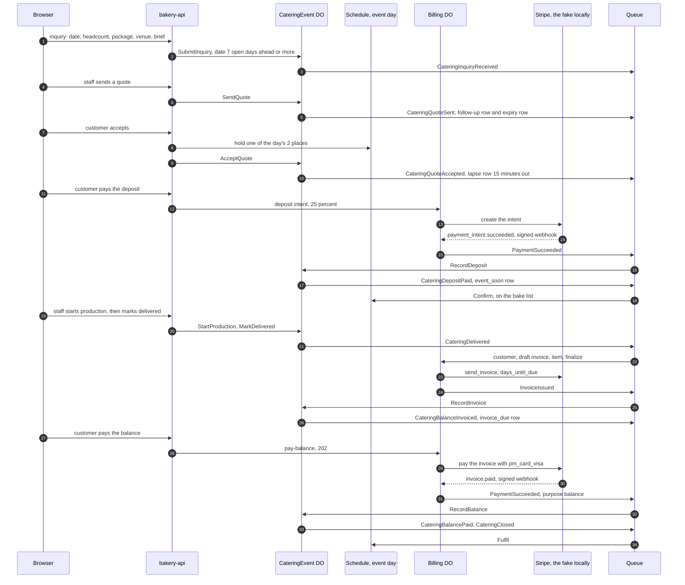

- **A saga by alarm.** Each step is one object's transaction, started by a route's command, an event from the Queue or a timer row, and each failure has its compensation: decline, quote expiry after 14 business days, a deposit hold that lapses, cancellation with or without a deposit refund ([domain.md](domain.md#cateringevent)). Workflows is JavaScript and TypeScript only,[^workflows] so the state machine lives in the object. The process manager is the object itself, not a choreography of its neighbours: the aggregate says what the next timers are (`timers`, a pure function of its state), and the object rewrites its `timers` rows from that list in the same transaction as every commit.
- **The hold at acceptance.** `accept` first asks the event day's `Schedule` for one of its 2 catering places, keyed by the catering id, and only then records the acceptance. A full day answers 409 `slot-full` and nothing is recorded (smoke: a third event on a day holding two). The hold lasts 15 minutes of business time, the same as an order's. If no deposit arrives, the object's own `deposit-lapse` row runs `LapseDeposit`: `CateringDepositLapsed` releases the place and the quote is open again (smoke: 15 business minutes by the clock lapse it, and a third event can then accept).
- **The deposit.** `deposit` asks `Billing` for a payment with purpose `deposit` for 25% of the quote and returns the client secret; a second call returns the same payment and secret. The Payment Element confirms it in the browser, the webhook marks it, and `PaymentSucceeded` reaches the event by purpose and `ref` as `RecordDeposit`. A deposit webhook delivered twice is applied once (smoke: the fake delivered one `payment_intent.succeeded` twice, each answered 200; the log holds one `CateringDepositPaid` and the ledger one deposit).
- **A deposit that lands late.** After a lapse, with the quote still valid, it confirms: the money moved, and `Schedule` takes the place back. After the quote expired, the aggregate refuses it as `out-of-order`; the object then asks `Billing` to refund the whole amount under the delivery's envelope id (reason `goodwill`), logs `deposit_late` and acknowledges the delivery, and it answers 503 while `Billing` is unreachable so the delivery retries. Proven end to end on the seed's accepted event, once its quote had expired by clock advance (smoke: refunded in full at the fake, the event stays `expired`).
- **The invoice.** `CateringDelivered` carries the customer, the balance and the due date, so `Billing` needs nothing from the event's object. `Billing` checks it holds no invoice for the job yet, finds or creates the persona's Stripe customer once (carrying the synthetic persona id and no email, under the key `<sandbox>:<persona>:customer`), then raises the invoice as a draft, adds the balance as one item on that draft, and finalizes it, with `collection_method=send_invoice` and `auto_advance=false`, so Stripe charges and finalizes nothing on its own. The invoice's id in the ledger is the `CateringDelivered` envelope's id, so a redelivery answers `duplicate` instead of raising a second one (smoke: one customer for two invoices of the same persona). `InvoiceIssued` comes back and the event records it as `RecordInvoice`, with the due date 7 days after the event's date. Since 2026-11-08 production starts no earlier than the day before the event and delivery no earlier than the event day, so the smoke moves the clock to those days before it takes the two steps, and checks both refused `too-early` before them ([domain.md](domain.md#cateringevent)).
- **The balance.** `pay-balance` answers 202 and pays the invoice on Stripe's test path with `pm_card_visa`; the fake sends `invoice.paid`, which becomes `PaymentSucceeded` with purpose `balance`, then `RecordBalance`, `CateringBalancePaid` and `CateringClosed` in one step; the day is fulfilled and every timer row is gone (smoke: deposit plus balance equal the quote, 58,000 cents for 40 heads of the breakfast spread, in the event and in the ledger). How a visitor pays the balance at real Stripe is not decided: see the first list in [operations.md](operations.md#what-spike-s3-must-still-do).
- **The refund on cancellation.** `CateringCancelled` releases the day's place, and `Billing` refunds the deposit when `refund_deposit` is true, finding it by purpose, ref and status and refunding it under the envelope's id with the reason `cancelled`. An event cancelled 8 days out was refunded at the fake and in the ledger; one cancelled 3 days out was not; neither leaves a timer row (smoke). A seeded event has no deposit to find: `Billing` logs `refund_skipped` with `no-deposit`.
- **The wipe.** Before it deletes itself, `Billing` cancels each intent still open, voids each open invoice and deletes the Stripe customers it made, best effort, and logs `stripe_wipe` with the counts (smoke: one invoice voided, one customer deleted at the fake, and `scripts/list-objects.mjs` exits 0). A finalized invoice is voided and not deleted ([security.md](security.md#the-wipe)); whether real Stripe lets a customer who has a void invoice be deleted is S3's to confirm, since the fake does not refuse it.
- **Capacity and lead.** Capacity is 2 events a day and the lead is 7 open days (Q16 · Q-catering): the inquiry is refused with 422 `catering-lead`, naming the earliest date, when the date is closer, and with 422 `catering-too-far`, naming the latest, when it is more than 365 days after business today (since 2026-11-10), and the third event is refused at acceptance, not at the inquiry. Stripe sends no invoice email, since the synthetic customer has none; whether `send_invoice` to a customer with no email really sends nothing, and how the invoice is paid with the Payment Element, are S3's.
- **What the Queue does not carry yet.** The seed's catering events are written to their own logs and never relayed. `Crm` and `Inbox` do not exist until PR 8, so the quote message, reminders and receipts the catalog lists have no reader; a reminder is a `CateringReminderDue` event in the log and on the console's list, and nothing is sent. The Kitchen board takes no catering card: it models orders only.

### A campaign send

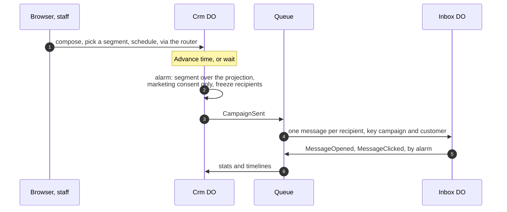

- "Delivered" is a row in the Inbox. Opens and clicks come from the seed's PRNG, so a seed gives the same open rate (Q21 · Q-crm-scope).
- **As built in PR 8 (2026-11-05).** The creation, the form of the request and the timers, in order:
  1. The campaign is drafted from templates only (a subject, a body and a segment by slug), and its id is the creation `Idempotency-Key`. Scheduling arms a `send:<campaign>` timer in Crm for the business time asked, which must be at least 15 minutes ahead.
  2. When the clock passes it, Crm's alarm decides `SendCampaign` under the key `timer:send:<campaign>`, with an `Audience` built from the projection at that moment: the segment's members whose consent is true. A second firing finds the timer deleted with the send, or the campaign no longer scheduled, and sends nothing. A firing too early is `not-due` and re-arms.
  3. `CampaignSent` carries the frozen recipients, the subject and the body. Its delivery to the Inbox makes one message per recipient, keyed by campaign and customer ([domain.md](domain.md#identifiers)), and each message's `MessageDelivered` is written to the Inbox's own outbox in the same transaction.
  4. The Inbox arms `open:<message>` and `click:<message>` timers from the seed's engagement draw (about 45% of messages open, 5 to 180 minutes after delivery, and about a third of those click 1 to 10 minutes later, from the domain's `engagement`), and its alarm records each at its own business time and relays `MessageOpened` and `MessageClicked`, from which Crm's campaign stats are the sets of message ids.
- **The rebuild, as built.** `POST .../rebuild` keeps the projection as a `shadow`, sets the projection back to the roster with the cursor at 0 and `total` the log's length, and arms a `rebuild` timer. Each alarm replays 200 log entries in one transaction, 300 ms apart, and `GET .../rebuild` shows `applied` of `total`. While it runs, a delivery is decided against the shadow and, if applied, appended to the log with `total` growing (an unknown reference still gets 503); a send waits for the first alarm after the rebuild and logs `sends_deferred`; and reads answer the partial projection with the header `Projection-State: rebuilding`, where the plan above said "rebuilding" on screen. At the end it appends `ProjectionRebuildFinished {events, ms}`, with `ms` read from the clock adapter, drops the shadow and logs `rebuild_finished` with `identical`: whether the replay matched the shadow byte for byte. A second start while one runs is 409 `rebuild`; a guest gets 403. The log is the one thing a rebuild never touches.
- **Rebuild projections**, the Backfill Lab's principle: truncate Crm's projections, set a cursor at the start of its log, replay 200 events per alarm with a progress bar. Commands keep working; reads show "rebuilding" until the cursor reaches the end.

### The nightly wipe

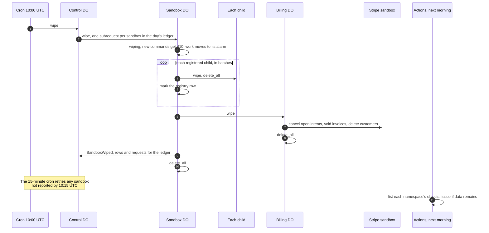

- Three layers: the cron through `Control`, each Sandbox's own 10:00 UTC timer, each child's 36 h backstop. Any one empties the sandbox (Q25 · Q-ttl).
- `Control` makes one subrequest per sandbox, and its cap of 300 new sandboxes a day keeps that far under Paid's 10,000 subrequests and the cron's 15 minutes of wall time.[^limits] Each Sandbox then works in its own alarm, so a half-done wipe resumes from the first unmarked child ([ADR 0005](adr/0005-a-private-sandbox-per-visitor-wiped-nightly.md)).
- Deletes count as rows written,[^dopricing] so a wipe costs about what the sandbox wrote; spike S5 measures it. A succeeded Stripe payment cannot be deleted and stays in Stripe's sandbox, synthetic. "Wipe now" is the same command for one sandbox.

### Time travel

Built in PR 6 and proven on `wrangler dev` 4.157.0 by `scripts/smoke-schedule.sh` (98 checks, 2026-11-05), except where a line says otherwise.

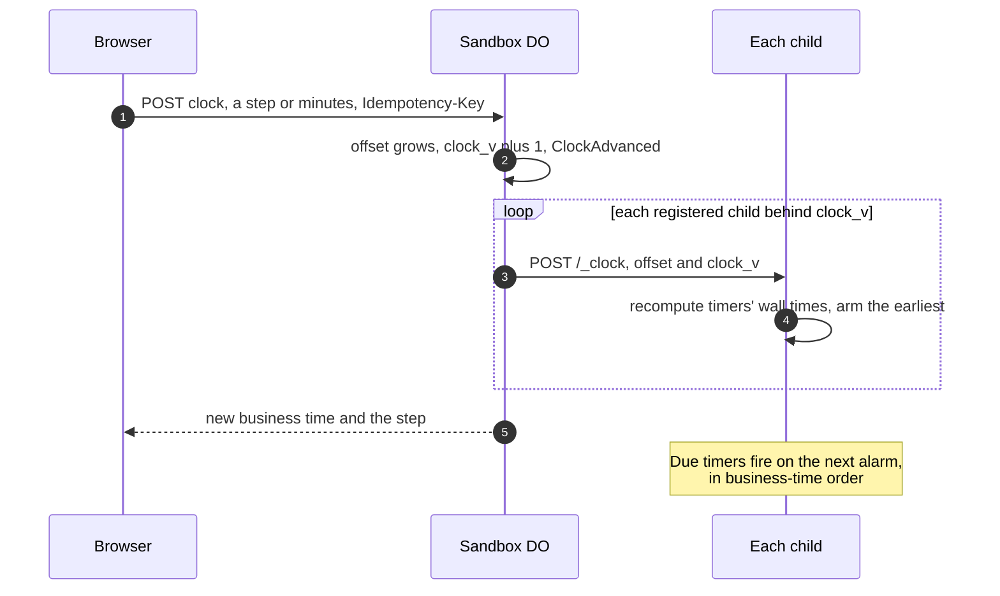

- Business time is wall time plus the offset (Q12 · Q-clock). It only grows, at most 14 days in total (1,209,600 s). The command takes exactly one of `step` (`15m`, `1h`, `1d`, `next-opening`) or `minutes`; both or neither is 422 `clock` with rule `not-positive`, as is zero minutes; a day past the 14th is `offset-cap`; a guest gets 403 `guest-scope`; a replayed key answers 200 with `Idempotent-Replayed` and moves nothing again. The response carries `step` in its wire form. The smoke drove `5m`, `1d` and `next-opening` (from a Sunday afternoon it lands on Tuesday 07:00, Monday being closed), day-by-day to the cap, and the refusal of the 15th day.
- **Children are told through `/_clock`.** The Sandbox calls `POST /_clock {clock_offset_s, clock_v, event?}` on every registered child whose `clock_v` is behind; each child writes the new offset and recomputes the wall time of every timer that has a business time, then re-arms its one alarm for the earliest. An update no newer than the one held changes nothing, so retries are safe, and a child that missed the call keeps an old `clock_v` in the registry for the Sandbox's alarm to retry. A 410 (an order registered and refused) counts as told.
- **What that does in each class.** The Schedule's `hold:<ref>` timers are set in business time, so a day's advance makes every unpaid hold due. The Order's expiry timer is recomputed the same way, so the Order expires an unpaid order, and the Schedule frees its place (its slot's `taken` drops and its log holds `SlotReleased`, reason `expired` or `hold_expired`). The Kitchen is the only child that reads `event`: it relays `ClockAdvanced` to the console's sockets, once per newer `clock_v`, which is how the console's event list shows the jump without a catalog route. The Simulator's timers are all wall time, so for it `/_clock` stores the offset and moves nothing.
- **What the bake list does.** An unpaid hold is never on a bake list, so a clock advance cannot take an expired order off one. What the advance does change is which days the board keeps: the snapshot's bake lists start at business today, so the days before it drop out. The smoke shows the order `expired`, its slot freed, the Schedule's log and that drop; the native flow test in `crates/app/src/scheduling_flow.rs` fakes the clock port (`FixedClock`) and shows an unpaid order's `Expire` refused as not due, then after a day emitting `OrderExpired`, then the Schedule's `Release` freeing the place, and the hold timer firing afterwards as a no-op.
- **The loop guard.** Every alarm handler ends with a counted re-arm; a command arms uncounted. Both compare against the alarm the platform already holds (`get_alarm()`), so arming the time already armed writes nothing. The count is per object per UTC day, once per distinct wall time, and the 101st alarm-driven re-arm is refused: the object logs `{"event":"alarm_guard","reason":"rearm-cap","object":<class>}` and stops arming. `Control`'s flag covers the whole demo and has no per-sandbox read-only path, so nothing is flagged read-only. The decision is the pure function `plan_arm` in `workers/api/src/objects/stream.rs`, proven natively by four unit tests: the 101st alarm-driven re-arm is refused while a command still arms; the same wall time twice counts once; a new UTC day resets the count; a past timer arms for now and no timer deletes the alarm. A smoke also proves idempotence: a `{minutes: 5}` advance replayed by its key moves the Order's `expiry` timer by 300 s exactly once, read from the state's SQLite file. Until 2026-11-09 the refusal inside an object, and its log line, were not driven end to end. Since then `scripts/smoke-crm.sh` drives it through existing routes: each rebuild step is an alarm run that re-arms the next, so rebuilds started one after another spend Crm's re-arms. On 2026-11-09 15 rebuilds took the day's ledger from 16 to 100, the next re-arm was refused, `alarm_guard` was logged once for `Crm`, and the rebuild it cut off read the same 2 s later (200 of 1,105 entries applied). No other smoke run logs `alarm_guard`, and `smoke-crm.sh` checks that none was logged before that section.
- **Moves:** expiries, hold expiries, slot dates, the bake list's day, catering lead times and reminders, invoice due dates, campaign schedules, simulated opens, the `at` of new events, and the days the dispatch screen lists (seven from business today). A `Dispatch` has no timer that moves with business time, so a clock update only changes its copy of the offset in `meta` (as built in PR 9, 2026-11-05).
- **Does not move:** platform alarms (re-armed on wall time), the wipe, the 36 h backstop, cookies, Turnstile tokens, Stripe's timestamps and webhook tolerance, `Control`'s UTC ledger, `recorded_at`, logs, the Simulator's alarm and minute ledger.
- **Daylight time.** Business time is shown at America/Denver's offset for the instant, in the Worker's clock (`workers/api/src/clock.rs`) and the domain's calendar alike. A clock advance of `1d` is 86,400 s of business time, so across a clock change the local time of day shifts by an hour ([domain.md](domain.md#money-and-time)).
- **The 14-day cap against the 14-business-day quote.** A quote is valid for 14 open days, 16 or more calendar days, so no clock advance within the cap can expire a quote made since the sandbox was born. `scripts/smoke-catering.sh` proves the expiry on the seed's quoted event instead, which was quoted a few days before birth, and tries up to 3 sandboxes to find one where it fits. A visitor who wants to watch a fresh quote expire cannot; see the question in [roadmap.md](roadmap.md#pr-7-catering-and-billing).

## Simulated traffic, the tour and the API for visitors

Three features turn a reader into an operator (Q40 · Q-traffic, Q41 · Q-tour, Q42 · Q-api-access): load the visitor can start and stop, a guide that names what they see, and the same commands from their own terminal. All three come with sign-in (Q45 · Q-guest-scope), and all three end at the wipe. The simulator arrives with the kitchen board in PR 4; the tour and the visitor API in PR 10, after dispatch ([roadmap.md](roadmap.md)). The tour became the live guide on 2026-11-10 ([the guide](#the-guide)).

### Simulated traffic

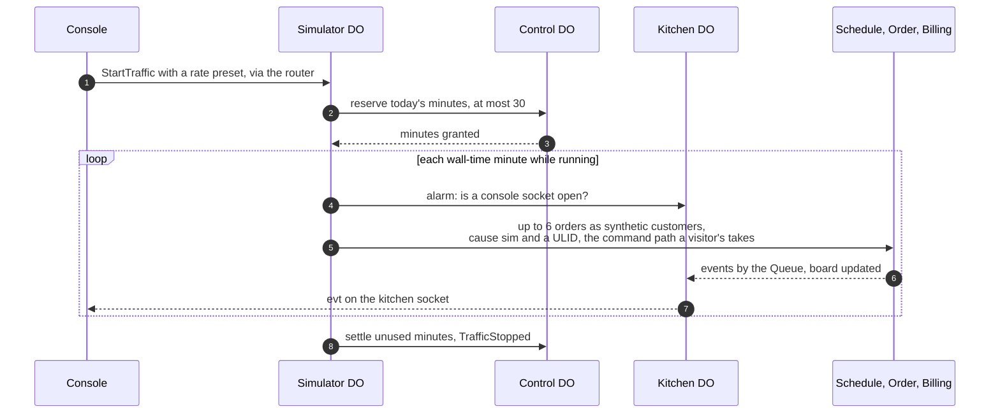

- **One object per sandbox,** `simulator:<sandbox>`, registered with the Sandbox on the first "Start traffic" like any other child. It holds the rate, the running flag, the minute ledger and its alarm. It starts stopped.
- **Alarm-driven.** Each run is a `Tick`: it draws the minute's commands from the seed's PRNG and the business clock (orders at the preset rate; in PR 4 orders only; PR 7 did not add the catering inquiry, which is still to do, and the pickup is PR 6's), issues them, records the minute and re-arms one wall-time minute later. Thirty ticks a day sit far under the loop guard's 100 re-arms.
- **Ordinary commands, the same path.** A synthetic customer is one of the 60 personas. Each command passes the checks the router applies after admission (validation, an idempotency key of `sim:<ulid>`, the object names, the free-text rules) and goes to the same objects; every event it causes carries `cause: sim:<ulid>`, so the activity screen and the guide can tell the visitor's actions from the simulator's. Simulated orders pay with Stripe's test payment method, confirmed by the API, so the webhook path runs as for the visitor's own order.[^testing] Since PR 6 each order's place is asked of the day's `Schedule` like a visitor's: the slots spread over 16 quarter hours from about 4 h out, and each moves to the next start the day takes (a window for a delivery, and never a closed day); a refusal is logged `sim_slot_full` with its rule and the order is not placed (without this, every simulated order was refused). PR 4 had no Billing, so its simulated orders stayed unpaid and expired after 15 minutes of business time; since PR 5 they are paid, one in six with a declining card (6 placed, 4 confirmed and 2 declined in `scripts/smoke-payments.sh`, 2026-11-05).
- **Bounded.** It runs only while the console is open: each `Tick` asks the Kitchen whether a console socket is open, a console without a socket sends a heartbeat `POST` every 30 s instead, and with neither for 90 s the `Tick` stops with reason `console_closed`. The start itself counts as a console sighting, so a new run has its first 90 s before it needs a socket or a heartbeat. At most 6 orders a minute and 30 minutes a sandbox a UTC day, reserved in `Control`'s `traffic(day, sandbox, minutes)` ledger. In PR 4 that ledger is the only budget charged; the DO-request and Queue budgets were never metered by `Control` and were struck on 2026-11-09, and PR 17's breaker reads the account's analytics instead ([cost.md](cost.md#guardrails)). The wipe stops it with everything else.

<a id="the-tour"></a>

### The guide

The tour of PR 10 was replaced on 2026-11-10 (#107) by a live guide, "Under the hood" ([ADR 0014](adr/0014-a-live-guide-in-place-of-the-tour.md)). It keeps the tour's content and checks and changes its form: instead of a drawer walked with Back and Next, it explains what the visitor just did, beside the thing they did it to.

- **A client-side island on every screen,** `apps/web/src/components/Guide.tsx`, mounted by `Base.astro` with `client:idle` and no third-party script, so it adds nothing to the CSP and costs $0 to serve. Its first load is a bar (the switch, the recorder's button, "Show me around" where a screen has a short path, and a polite live region) and the trace store; the notes, hotspots, recorder panel and entries are a deferred load of 30,897 B to 31,663 B gzipped (measured 2026-11-10, held under 40,000 B) that a dynamic import brings after mount, and only while the guide is on or the recorder is open. The first load is smaller than the tour's total, and a page with the guide on is larger, by 19,648 B to 21,731 B ([ADR 0008](adr/0008-astro-site-with-react-islands-on-an-assets-only-worker.md#postscript-2026-11-09)). On a phone the control is one button reading "Under the hood" beside its switch, showing on or off, in a row of the masthead's own under the links; it opens the whole control.
- **Entries are data.** One per explainable thing, `{ id, screen, target, title, what, why, whenNot, events, principle, api, triggers, happened?, facts? }`, in `apps/web/src/guide/`: 79 on 12 screens (counted later on 2026-11-10, after #137 and the gate's entry on the checkout and the catering page, one entry written once and drawn on both; 74 earlier that day, with a guest on the board and the board's command budget since R72): every tour step carried over, three for the order's page since #101, three for the landing page's path and the menu's start and categories, and one for the menu the checkout reads. `happened` is what a live note says its action set off (a hold placed, the clock's timers re-armed, a send deferred while a rebuild runs); `facts` are the standing facts the pages' own "How this works" paragraphs said until 2026-11-10, when the pages stopped explaining and the guide took every fact (a paragraph left a page only once an entry carried all of it; the dispatch page keeps one sentence, the windows rule and the gap's formula, that its table needs). `target` is a `data-tour` attribute the page already carries. `apps/web/test/guide.test.ts` checks each `api` against the generated OpenAPI document and each example body with `apps/web/src/lib/schema-check.ts`, each event against the catalog, each trigger against the write routes and the catalog, and the words' lengths: `what` at most three sentences, `why` and `whenNot` one each. Every write the page can make has an entry.
- **The trace store,** `apps/web/src/lib/trace.ts`, keeps the visitor's last 20 actions in memory. Its sources share one interface: the page's own writes (a hook in `send` in `apps/web/src/lib/api.ts` records the method, path, status, milliseconds and `Idempotency-Key`, never a body) and its story reads, a named list in `STORY_READS` (since 2026-11-10 the menu's alone, with its status, `Bakery-Cache`, `ETag` and the `If-None-Match` it sent; the page's other reads, polling among them, are not traced, so the recorder is not flooded), the kitchen socket's commands, answers and envelopes (`apps/web/src/lib/use-kitchen.ts`), and the activity feed's entries that are new since its last read. An event belongs to an action when its `cause` is the action's key or the id of an event that does; the simulator's `sim:` causes never match, so simulated traffic opens nothing. A request is the visitor's when it starts within 2 s of their click on a button or a form's submit. Since 2026-11-10 (#122) the server's flight recorder is a source too, as the next item says.
- **Live notes.** A visitor's write opens a dark note beside the card or control they pressed: each request or socket frame with its answer, time and key (ids cut to their last six characters), the object that decided it, each event the action writes as observed (with its sequence number), seen in the activity feed, or on its way, then why this tool, when not, and the essay. The note never covers its anchor: it sits on the side that has room, else docks in a corner clear of it (scrolling the anchor above it if no corner is clear), and the anchor gets a ring. Since 2026-11-10 (the fourth audit's G3) a note after a press covers none of the control pressed, the thing that shows its result (the card where it is now, a readout or line the page marks `data-guide-result`) and what is pressed next (the same control again or on the next card, and the control the page puts the focus on): it takes a place clear of every control where there is one, else one clear of those three beside its anchor, else the first corner clear of them, foot right first, the ring staying on the result. A note whose pressed control has gone once its answer is drawn sits by the page's result line if there is one (a refund, whose card leaves the board), and otherwise arrives folded to its one line, as does a note for a press made on the page before (G2, F6). A note never runs past the window's foot; taller than the room, it scrolls inside itself; its floating line is hidden while it is open. The first note of an entry in a visit shows why this tool and when not; a later one of the same entry shows its trace and one line that opens them (G12, in memory only). It is a named region, not a dialog; it takes no focus; it is announced once, politely, as one sentence; Escape closes it; it closes itself 8 s after its last change unless pinned or in use; on a phone it is a sheet over the lower third, above the bar. Its place is set through the style object after mount, as the policy requires.
- **Story reads** open a note when they happen, with no click, folded to one line until the visitor opens it (a note the page caused must not cover what the visitor came to do): the menu's read on the menu page and on the checkout says what answered (served from the cache, or the Catalog object answered and the cache was filled, or 304 for a current copy) with the header and ETag it saw, and the note's Ask again repeats the read with `If-None-Match` through a repeat the page's island registers in the store.
- **The flight recorder** is the third source of evidence (`apps/web/src/lib/recorder.ts`): a note for a write reads the recorder's hops three times in the first 3 s after the answer and, if an event is still unseen, four times more until about 30 s (`NOTE_READS_MS`), stopping once every event the write writes is observed; the recorder panel tails the recorder's socket, or reads every 5 seconds where the socket is refused. Since 2026-11-10 (the fourth audit's G4) a note waits only for what its write writes and the recorder can show: a route's own writes where they are fewer than its entry's events (`ROUTE_WRITES` in `apps/web/src/components/guide/match.ts`: paying makes the intent, and Stripe's webhook the rest after another press), and nothing for a write that names no sandbox (a new sandbox, a demo account) or is the sandbox's wipe, which the note says in words. An event not yet seen reads "on its way", after 3 s "not seen on the recorder yet; still listening", after about 30 s "not seen on the recorder in 30 s", never "did not happen"; the word "expected" is no longer shown; a retry and a dead letter are said as what they are ([ADR 0014](adr/0014-a-live-guide-in-place-of-the-tour.md#postscript-2026-11-10) has the bounds and the costs).
- **Hotspots** mark each target on the screen at the end of the words it explains (a paragraph's own last line, else its heading's; the gutter only for a target with no words, since 2026-11-10), and never where a control or a line of text is under them; they are not Tab stops (the fourth audit's G10, 2026-11-10: they live at the page's end in the document, far from their words), so a keyboard reaches every entry through the recorder (`spotPlaces` and `spotFits` in `apps/web/src/lib/guide.ts`, the page check in `apps/web/src/components/guide/clear.ts`); pointing at one, focusing it or pressing it opens the entry's standing note: what it is, its events, why and when not, the principle with its lab page, ADR and essay, and the same call as `curl`, masked on screen and whole in the copy.
- **The recorder** panel lists the visitor's actions, newest first, each opening into its hops, and every entry of the screen; it is the keyboard's and the screen reader's path to all a note shows.
- **The short path,** "Show me around", strings at most five entries a screen (`apps/web/src/guide/paths.ts`), scrolls each into view and waits for the visitor to do its thing; Next skips.
- **The switch** sits in a dock at the window's foot on a wide screen, moved to the end of the page once the island hydrates, so a keyboard reaches it after the main content and the footer and nothing of the guide stands between the nav and the page's main action (G10, 2026-11-10). On a phone (48rem and under) it is one button reading "Under the hood" beside its switch, in a row of the masthead's own under the links, the same place on every page, cart bar or not, that opens the whole control (G6, 2026-11-10); between a phone and a wide screen it sits at the left end of the menu's cart bar or in the masthead. It is on by default; turning it off stores `bakery-guide` = `off` in `sessionStorage` for the tab, which the privacy page states.
- **The decision table.** The How it's built page shows one row a principle (the tool, why here, when it is the wrong tool, the essay) from the entries named in `apps/web/src/guide/decisions.ts`, and still loads no script.
- **The links,** as the tour had them since PR 12: a principle's lab page from its name, its ADR from its number and the files in `docs/adr/`, its essay from `ESSAYS` in `apps/web/src/lib/links.ts`, and its section of `/how-its-built/` for one with no lab page.

### The API token

- **One per sandbox, shown and rotated in the console.** A bearer token signed with `SESSION_HMAC_KEY` through the session cookie's keyring, under its own purpose label so that neither can pass for the other. As built on 2026-11-05 its claims are `v` (1), `kind` (`"api"`), `signin` (how the visitor signed in; the cookie's `kind`, renamed), `acct`, `sbx`, `tid` (a 128-bit token id, which the cookie calls `sid`), `iat`, `exp` (24 h later), `kid` and `token_v` (the Sandbox's token version when it was signed), and no other field; a guest has none. It travels in `Authorization: Bearer`, lasts 24 h and dies with the sandbox. "Rotate" bumps `token_v` in the Sandbox and appends `ApiTokenRotated`; the router reads the Sandbox once per token request, for its state and `token_v`, so the old token stops at once with 401 `token` (reason `rotated`), and after the wipe a token gets 404.
- **The bearer path in the router** runs for every route that needs a session, before the Origin check and the cookie: the request's shape (a token in the query string or beside the cookie is 400 `token`; a token on a route that takes the cookie only is 401 `token`), the signature, purpose and expiry, the token's `sbx` against the path's `{id}` (404 on a mismatch), the per-token limit, then the one Sandbox read and the version check. The claims then become the session the route already reads (the token id in the session id's place), so no route has a second code path for a token; the route's own command-rate spend is skipped.
- **Rate-limited per token** with its own Rate Limiting binding, `TOKEN_LIMIT` (60 a minute, keyed by token id, every request counting, reads included), checked before the Sandbox is read. A request with a token and no cookie needs no CORS and no `Origin`: `curl` sends neither, and a browser never attaches a bearer token on its own. [security.md](security.md#the-api-token) owns the rules.
- **Every console action has an API equivalent.** An OpenAPI document generated by the `openapi` binary of `crates/contracts` from its `schemars` types and the route table, committed at `apps/web/public/docs/api/openapi.json` and checked with `--check` in `verify` (as built, 2026-11-09), is served as a static page at `/docs/api/` on the storefront, $0 like every page. ADR 0013, the API and socket contract v1, is written in PR 10.

## Bulkheads and failure modes

Five walls:

1. **Site and bakery are separate Workers and hostnames.** A bakery outage leaves ihaveasegway.com serving.
2. **Web and API are separate Workers.** Public pages keep serving while the API is down, read-only or detached.
3. **One sandbox cannot touch another.** Names come from the session or the API token, every child checks its sandbox id, and nothing crosses sandboxes.
4. **The zone works without the pipeline.** The kill rule changes in seconds from the dashboard.
5. **The pipeline is not in the request path.**

Two shared resources: the account's bill on Paid, which has no spend cap,[^pricing] so its ceiling of $100 a month is held by alerts at $10, $25, $50 and $100, `limits.cpu_ms`, the rate-limiting rule, the 15-minute breaker and `Control`'s caps ([ADR 0010](adr/0010-workers-paid-with-the-sites-guardrails.md), Q27 · Q-plan, Q28 · Q-budget); and the zone, with one writer, Joseph.

### Failure table

| Failure | Blast radius | What visitors see | Detection | Recovery |
|---|---|---|---|---|
| Analytics Engine SQL API down or its token missing | the status page's counters only | the page says stale (old numbers, with their time) or unavailable (no numbers); nothing else changes | `analytics_unconfigured` or `analytics_failed` in the cron's log; `counters_state` | the next good `*/15` run; [the runbook](operations.md#incident-the-status-page-says-stale-or-unavailable) |
| Stripe sandbox down | payments in every sandbox | checkout says payments are unavailable; orders expire at 15 min | Billing errors in Analytics Engine | none; expiry releases slots, late webhooks dedupe |
| Google or GitHub down | new sign-ins with that provider | an error; the other provider, guests and demo accounts work | sign-in failures by reason | wait; sessions last 24 h |
| Queue backlog | reactions everywhere | writes succeed; board and timelines lag, the drawer shows it | backlog; oldest outbox row | catches up; retention 4 days[^queues] |
| A consumer poisoning | one event, one subscriber | a missing row; a dead letter on the Queue screen | DLQ consumer logs | fix forward, redrive, or the wipe |
| An alarm loop | one object | a stuck timer | `alarm_guard`; rows written per object | the guard at 100 a day; the wipe |
| API deploy drops sockets | every live socket | the board reconnects to a fresh snapshot | deploy log | none; retried commands reuse their key |
| Bad web deploy | storefront and console | a broken page | Version URL smoke; prod-smoke | the `rollback` job ([delivery.md](delivery.md)) |
| DO class lifecycle change | API rollback, which cannot cross it[^rollback] | nothing, if shipped alone | CI refuses a class change bundled with others | expand, migrate, contract; nightly wipes make data migrations nearly free |
| Wipe fails halfway | one sandbox | 410 and an offer of a new sandbox | registry; the morning check | its alarm resumes; the 15-minute cron retries; backstops finish |
| Leaked deploy token | both Workers' code | possibly a hostile storefront or API | audit log; a deploy no run explains | revoke, reissue, redeploy `main` ([operations.md](operations.md)) |
| Leaked API token | one sandbox, synthetic only | commands the visitor did not send | per-token rate-limit denials; the activity screen | "Rotate" in the console; the wipe at the latest |
| Simulator over its share | one sandbox's minutes, then the day's budget | traffic stops; "today's traffic is used up" | `Control`'s ledger | none needed: 6 a minute, 30 minutes a day, console open only |
| Leaked Stripe sandbox key | the Stripe sandbox, synthetic only | odd test payments | Stripe dashboard; the Worker refuses non-sandbox keys | roll the key, update the secret |
| Cloudflare outage | everything, the site too | down | Cloudflare status; the site's monitor | wait; accepted concentration |
| GitHub outage | builds, deploys, the morning check | nothing | GitHub status | wait |
| A fall back to Free (Q27 · Q-plan chose Paid) | every sandbox | creation refused once `Control`'s share is spent | `Control`'s ledger | rows written bind first, 100,000 a day,[^dopricing] at about 20 sandboxes a day ([cost.md](cost.md)); 10 ms CPU and 50 subrequests[^limits] push argon2 and Clarke–Wright to the browser; no Email Service sends |

**The breaker, as built in PR 17 (2026-11-06).** The `*/15` cron calls `breaker::run` after the sweep and the status refresh, in the Worker and never inside an object. It reads the last complete 15-minute window from Cloudflare's GraphQL Analytics API (five meters, four requests), sends the reads to `Control`, which runs the pure rules in `crates/app/src/breaker.rs` against its stored `breaker_state` and answers the verdict. A rise sets the flag (`read-only`, then `off`; never lower) and, on `off`, the Worker enables the pre-built WAF rule through the Rulesets API. The state is public as `breaker` in `GET /v1/status`. A person resets it ([operations.md](operations.md#breaker-tripped)). The levels and arithmetic are in [cost.md](cost.md#guardrails).

**Kill switch**, the site's levels adapted: L0 `Control`'s caps and the cron breaker (automatic: the caps refuse admissions past their counts, the breaker raises the flag and, at `off`, enables L3; it never relaxes by itself; the row, request and Queue budgets were struck on 2026-11-09, [cost.md](cost.md#guardrails)), L1 flags, L2 redeploy (not built as a dispatch: use L1 `off`, or ship a change under `workers/api/` through the pipeline, which restarts every object; `ci.yml` at d778ff7, 2026-11-06), L3 the prebuilt WAF rule, L4 detach the API's Custom Domain, the switch the own hostname buys (Q8 · Q-api-host). [operations.md](operations.md) owns the runbook.

## Cross-cutting concerns

- **Security and privacy:** [security.md](security.md): threat model, CSP, CORS, auth, data and secrets inventories, Stripe safety.
- **Cost:** [cost.md](cost.md): prices, the per-sandbox meter, scenarios, denial of wallet.
- **Delivery:** [delivery.md](delivery.md): layout, pins, pipeline, previews, deploy and rollback.
- **Operations:** [operations.md](operations.md): access, observability, alerting, runbooks, calendar.

## Weaker designs and why

| Design | What goes wrong here | It trades away | It would be right if |
|---|---|---|---|
| D1 as one central database | Every sandbox writes one database; the wipe is a `DELETE` across shared tables; single writers disappear. D1 is alpha in workers-rs[^workersrs] | consistency per aggregate, security, testability | the bakery needed queries across sandboxes |
| One DO per sandbox holding everything | Sockets, rebuilds and sends serialize; the outbox connects nothing | latency, and the Queue Lab's principle | the demo were about one object |
| Direct object-to-object calls instead of the Queue | Order calls four subscribers before answering; one failure fails the order | availability, latency | subscribers were few, fast and in one failure domain |
| The API inside the web Worker | No Version URLs for a Worker with DOs;[^previews] a page fix redeploys every object | operability, availability | there were no static pages to protect |
| A same-origin `/api/*` route | A trade the site's lab made ([ADR 0009](https://github.com/IHaveASegway/website/blob/main/docs/adr/0009-lab-worker-same-origin.md)): no CORS, one CSP origin. A route runs before the custom-domain Worker[^customdomains] | operability: the hostname kill switch and a clean split, which Joseph asked for | preflights or a second origin became a real cost |
| KV for sessions | Eventually consistent, and a second writer beside the cookie | consistency, cost | revocation before 24 h were needed; even then an epoch in `Account` comes first |
| Workflows for the sagas | JavaScript and TypeScript only[^workflows] | the Rust rule ([ADR 0002](adr/0002-rust-for-every-backend.md)) | workers-rs bound Workflows and a saga outgrew alarms |
| A shared public bakery | Visitors see each other's orders and text; moderation becomes a job | security, privacy, cost | visitors needed to interact |
| Real email to visitors | The system would hold addresses; $0.35 per 1,000 past 3,000 a month[^email] | security, privacy, cost | never, while the bakery holds no personal data |

## Prior art for this shape

- **[tldraw sync](https://tldraw.dev/docs/sync):** one DO per room with SQLite storage, running tldraw.com.
- **[Liveblocks on Durable Objects](https://www.cloudflare.com/case-studies/liveblocks/):** rooms moved to DOs, crediting Hibernation for idle time off the bill; the Kitchen hibernates for the same reason.
- **[How Cloudflare built Queues](https://blog.cloudflare.com/how-we-built-cloudflare-queues/):** a queue whose storage is DOs; the outbox relays from one DO into it.
- **[Figma's multiplayer](https://www.figma.com/blog/how-figmas-multiplayer-technology-works/):** one authority per document; the board's snapshot on join follows it.
- **[Orleans](https://www.microsoft.com/en-us/research/publication/orleans-distributed-virtual-actors-for-programmability-and-scalability/):** actors that exist by name and activate on demand.
- **["Implementing Stripe-like Idempotency Keys in Postgres"](https://brandur.org/idempotency-keys) (blog, 2017):** `commands_seen` is the same idea in an object.
- **[The site's lab design](https://github.com/IHaveASegway/website/blob/main/docs/lab.md):** the DO rules, admission layers, protocol v1 and the nightly object check restated here.

## Patterns and further reading

- Bulkhead: [*Release It!*, 2nd ed.](https://pragprog.com/titles/mnee2/release-it-second-edition/), ch. 5.
- C4 model: [The C4 model](https://c4model.com/) (c4model.com).
- Virtual actor: ["Orleans: Distributed Virtual Actors"](https://www.microsoft.com/en-us/research/publication/orleans-distributed-virtual-actors-for-programmability-and-scalability/) (Microsoft Research, 2014).
- Transactional outbox: ["Pattern: Transactional outbox"](https://microservices.io/patterns/data/transactional-outbox.html) (microservices.io).
- Idempotent consumer: ["Pattern: Idempotent Consumer"](https://microservices.io/patterns/communication-style/idempotent-consumer.html) (microservices.io).
- Saga: ["Sagas"](https://www.cs.cornell.edu/andru/cs711/2002fa/reading/sagas.pdf) (SIGMOD 1987).
- CQRS: ["CQRS"](https://martinfowler.com/bliki/CQRS.html) (bliki, 2011).
- Event sourcing: ["Event Sourcing"](https://martinfowler.com/eaaDev/EventSourcing.html) (enterprise application architecture catalog, 2005).
- Lease and TTL: ["Leases"](https://dl.acm.org/doi/10.1145/74850.74870) (SOSP 1989).
- Admission control: [*Site Reliability Engineering*, ch. 21, "Handling Overload"](https://sre.google/sre-book/handling-overload/).
- Single writer: ["Single Writer Principle"](https://mechanical-sympathy.blogspot.com/2011/09/single-writer-principle.html) (Mechanical Sympathy blog, 2011).
- Client-side composition: ["Micro Frontends"](https://martinfowler.com/articles/micro-frontends.html) (article, 2019), "Run-time integration via JavaScript".

[^assets]: Free, unlimited, never invoke the Worker: [static assets billing](https://developers.cloudflare.com/workers/static-assets/billing-and-limitations/). As of 2026-11-04.
[^pricing]: Paid: $5 a month minimum, 10M requests then $0.30 per million, 30M CPU-ms then $0.02 per million, no spend cap: [Workers pricing](https://developers.cloudflare.com/workers/platform/pricing/). As of 2026-11-04.
[^limits]: 64 MiB uncompressed; startup 1 s (10021); 128 MB per isolate including Wasm memory; subrequests 50 Free, 10,000 Paid; CPU 10 ms Free, 30 s Paid by default; cron wall time 15 min: [Workers limits](https://developers.cloudflare.com/workers/platform/limits/) and [pricing](https://developers.cloudflare.com/workers/platform/pricing/). As of 2026-11-04.
[^dopricing]: Rows written Free 100,000 a day, Paid 50M a month then $1.00 per million; deletes count as writes; each `setAlarm()` one row; hibernating objects not billed for duration: [DO pricing](https://developers.cloudflare.com/durable-objects/platform/pricing/), updated 2026-10-18. As of 2026-11-04.
[^dolimits]: 10 GB per object on Paid; 500 classes on Paid; soft 1,000 requests a second per object; 2 MB rows; 100 columns; 100 bound parameters; Free uses SQLite-backed objects only: [DO limits](https://developers.cloudflare.com/durable-objects/platform/limits/). As of 2026-11-04.
[^sqlite]: 30 days of point-in-time recovery: [SQLite storage API](https://developers.cloudflare.com/durable-objects/api/sqlite-storage-api/). As of 2026-11-04.
[^alarms]: One alarm at a time per object, run at least once: [alarms](https://developers.cloudflare.com/durable-objects/api/alarms/). As of 2026-11-04.
[^queues]: An operation per 64 KB written, read or deleted, about 3 per message; retries add a read; retention 4 days by default, up to 14; batches up to 100: [Queues pricing](https://developers.cloudflare.com/queues/platform/pricing/). As of 2026-11-04.
[^workflows]: JavaScript and TypeScript only: [Workflows pricing](https://developers.cloudflare.com/workflows/reference/pricing/). As of 2026-11-04. Checked again on 2026-11-06: that page and the [Workflows overview](https://developers.cloudflare.com/workflows/) named no programming language (the overview's one code sample is TypeScript), so the claim stands as of 2026-11-04 and was not confirmed on 2026-11-06.
[^email]: Sending on Paid only, beta; 3,000 a month then $0.35 per 1,000; sends to verified destination addresses free on any plan: [Email Service pricing](https://developers.cloudflare.com/email-service/platform/pricing/), [Email Service](https://developers.cloudflare.com/email-service/). As of 2026-11-04.
[^logs]: Paid 7-day retention ([Workers pricing](https://developers.cloudflare.com/workers/platform/pricing/)); [Observability pricing](https://developers.cloudflare.com/observability/pricing/) from 2026-12-01. As of 2026-11-04.
[^customdomains]: Automatic certificates for multi-level subdomains, no Advanced Certificate Manager; the zone must be in the account; a route Worker runs first: [Custom Domains](https://developers.cloudflare.com/workers/configuration/routing/custom-domains/). As of 2026-11-04.
[^turnstile]: Free and unlimited: [Turnstile plans](https://developers.cloudflare.com/turnstile/plans/). As of 2026-11-04.
[^previews]: "Version URLs are not generated for Workers that implement a Durable Object": [Previews](https://developers.cloudflare.com/workers/configuration/previews/). As of 2026-11-04.
[^rollback]: Not across a DO class lifecycle change: [Rollbacks](https://developers.cloudflare.com/workers/configuration/versions-and-deployments/rollbacks/). As of 2026-11-04.
[^workersrs]: `worker` 0.8.7: `DurableObject` with `fetch`, `alarm`, `websocket_*`; `State::accept_web_socket`; `Storage::sql`, `set_alarm`, `delete_all`, `transaction`; `queue` entrypoint in beta; D1 alpha; Workflows and DO RPC not bound; no Tokio: [workers-rs](https://github.com/cloudflare/workers-rs), [docs.rs](https://docs.rs/worker/latest/worker/). As of 2026-11-04.
[^google]: [Google OpenID Connect](https://developers.google.com/identity/openid-connect/openid-connect). As of 2026-11-04.
[^github]: `scope` defaults to empty, `state` and PKCE with `S256` only, codes expire after 10 minutes: [Authorizing OAuth apps](https://docs.github.com/en/apps/oauth-apps/building-oauth-apps/authorizing-oauth-apps); a token without scopes still authenticates as its owner, and the user id is durable where the login can change: [REST API, users](https://docs.github.com/en/rest/users/users). As of 2026-11-04.
[^paymentelement]: [Payment Element](https://docs.stripe.com/js/elements_object/create_payment_element); Stripe recommends Checkout Sessions with it, and either API works in a sandbox ([Payment Element guide](https://docs.stripe.com/payments/payment-element)). As of 2026-11-04.
[^testing]: [Stripe sandboxes](https://docs.stripe.com/sandboxes): isolated, free, not processed by card networks; [test cards and test payment methods](https://docs.stripe.com/testing). As of 2026-11-04.
[^webhooks]: [Verify signatures manually](https://docs.stripe.com/webhooks#verify-manually). As of 2026-11-04.
