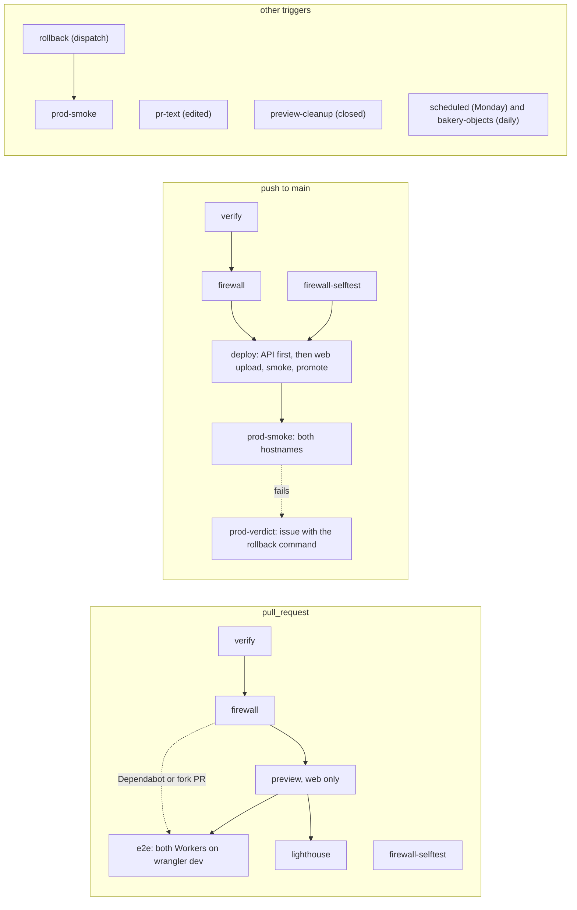

# Delivery

How a commit becomes the bakery: the repository layout, the toolchain pins, the pipeline that builds, gates, previews and deploys two Workers (the API holds every Durable Object (DO) class), the environments it writes to, and how a deploy is verified and undone. Until the launch pull request (PR 11) the pipeline is three jobs and nothing deploys ([speed first, Q44](#before-launch)); the rest of the page describes the pipeline as it stands from PR 11. It is written for one maintainer with one pull request in flight, and it follows the site's [delivery.md](https://github.com/IHaveASegway/website/blob/main/docs/delivery.md) wherever the bakery has the same problem. The deploy owner is decided in [ADR 0011](adr/0011-github-actions-owns-deploys-for-both-workers.md); the API's hostname and CORS in [ADR 0009](adr/0009-the-api-on-its-own-hostname.md); everything else on this page is a two-way door without an ADR. Header and CSP policy, the firewall's design and the secrets inventory are in [security.md](security.md); access setup and runbooks are in [operations.md](operations.md); prices are in [cost.md](cost.md); versions and their sources are in [stack.md](stack.md).

Status: Updated in PR 7 · 2026-11-05

Prices, limits and versions are as of 2026-11-04, with sources. Every YAML, JSONC and TOML block is a sketch: confirm against current docs when building.

## Shape

One pipeline, one writer per environment. GitHub Actions builds once per pipeline run: the web app's `dist/` and the API's wasm bundle. It runs every gate against those artifacts, runs the content firewall over them, and only then publishes. Two Workers ship from the one repository, with one deploy token. Nothing reaches a public URL without `verify` and `firewall` passing, and the publishing job `needs:` both, as the site's does. Before PR 11 there is no public URL and no publishing job.

| Data | System of record | Only writer | Readers | How it crosses |
|---|---|---|---|---|
| Web build, `apps/web/dist/` | the `verify` job's artifact for that run | `verify` | `firewall`, `preview`, `deploy`, `e2e`, `prod-smoke` | uploaded once, downloaded by each job; never rebuilt |
| API bundle, `workers/api/dist/` | the `verify` job's artifact (the output of `wrangler deploy --dry-run --outdir`) | `verify` | `firewall`, `e2e`, `deploy` | uploaded once; `deploy` uploads it with `--no-bundle` |
| Production versions | Cloudflare, Workers `bakery-web` and `bakery-api` | `deploy` and `rollback`; the dashboard only when GitHub is down | visitors | Wrangler and the Cloudflare API |
| Web previews | Cloudflare Worker Previews | `preview` creates, `preview-cleanup` deletes | `e2e`, the reviewer | Wrangler |

The data-flow rows describe the pipeline from PR 11. The web and API build rows are "build once". If every job built for itself, the bytes the firewall scanned and the bytes that went live could differ; a Rust build is the worse case, since a dependency resolved an hour later changes the wasm and nobody can diff it by eye. The scanned bundle is the published bundle.

## Repository layout

```text
bakery/
├── AGENTS.md · README.md · LICENSE (MIT) · SECURITY.md
├── .github/workflows/{ci.yml, pr-text.yml, scheduled.yml} · .github/dependabot.yml · .github/pull_request_template.md
├── .githooks/{pre-commit, pre-push} · scripts/firewall/ (copied from the site; Q34)
├── apps/web/            Astro 7 + React 19 islands → assets-only Worker "bakery-web" (wrangler.jsonc, src/, public/, e2e/, test/)
├── workers/api/         Rust Worker "bakery-api": Cargo.toml, wrangler.jsonc, src/{lib.rs, http/, objects/, queue.rs, cron.rs, auth/, stripe/}
├── crates/domain/       pure Rust: aggregates (decide/evolve), events, value objects, state machines; no platform dependency; cargo test
├── crates/app/          use cases and ports (traits): Clock, EventStore, Outbox, PaymentGateway, Mailbox, IdGen
├── crates/seed/         deterministic synthetic data: personas, menu, 90 days of history, venues, the 64 Salt Lake City places (from PR 9)
├── crates/contracts/    API types shared with the web app (serde, schemars → JSON Schema → TypeScript types at build)
├── tools/route-data/    the Salt Lake City data build (PR 9), copied from the site's pipeline: osmium, OSRM, d3-contour; its own lockfile; offline, output committed
├── docs/                this plan: README, product, domain, architecture, stack, security, cost, delivery, operations, roadmap, adr/
├── Cargo.toml (workspace) · rust-toolchain.toml · pnpm-workspace.yaml · package.json · .nvmrc
```

- **Workflows.** `ci.yml` is the pipeline below (three jobs until PR 11), `pr-text.yml` scans edited pull request text, and `scheduled.yml` holds the Monday audit and the morning object check (both from PR 11). Preview cleanup is a job of `ci.yml`.
- **`.githooks/` and `scripts/firewall/`** are copied from the site; the private rules are this repository's own secret ([operations.md](operations.md#9-local-hooks-and-the-private-firewall-file)).
- **`apps/web/`** is an assets-only Worker: no request runs Worker code ([ADR 0008](adr/0008-astro-site-with-react-islands-on-an-assets-only-worker.md)).
- **`workers/api/`** is the only crate that depends on the platform: the `worker` crate, the DO classes, the Queue consumer, the cron handler. It is a thin adapter over `crates/app`.
- **`crates/domain/`** is pure Rust with no platform dependency, tested natively with `cargo test` and `proptest`. Most tests run here: native tests are fast. `crates/app/` holds use cases and ports; time, storage, payments and mail are traits an adapter implements and a test replaces.
- **`tools/route-data/`** is the site's Route Lab pipeline (`tools/route-data/pipeline/` in [the site's repository](https://github.com/IHaveASegway/website)) copied in PR 9 and run offline on Geofabrik's Utah extract ([Geofabrik](https://download.geofabrik.de/), ODbL, as of 2026-11-04), clipped to Salt Lake City, with 64 curated public places. It has its own lockfile, outside both workspaces, and its output (the travel-time matrix, isochrones and place list) is committed; nothing of its tools ships. The Route Lab keeps its Seattle data in the site's repository.
- **`crates/seed/`** is one deterministic generator for the Worker and the tests. **`crates/contracts/`** holds the API's types once; a build step turns them into JSON Schema and then TypeScript, so the web app cannot drift.

A Cargo workspace from day one costs one file; splitting later means moving every path. The crates exist because their dependency rules differ, which a gate below enforces. No Turborepo, no `cargo-make`: `pnpm` scripts and `cargo` aliases cover it.

## Toolchain pins

One source per tool, because a version written in two places drifts. `actions/setup-node` reads `.nvmrc`; `pnpm/action-setup` reads `packageManager`; Rust installs from `rust-toolchain.toml`; Cargo-installed tools take their versions from `[workspace.metadata.tools]` in the root `Cargo.toml`. [stack.md](stack.md) says what each tool owns and what lost to it.

Pins as of 2026-11-04:

| Tool | Pin | Single source | Why | Source |
|---|---|---|---|---|
| Rust, and the `wasm32-unknown-unknown` target | stable 1.97 | `rust-toolchain.toml` | The current stable; Workers run wasm, with no Tokio | [Rust releases](https://github.com/rust-lang/rust/releases) |
| `worker` | 0.8.7, exact (`=0.8.7`) | `Cargo.toml` workspace dependencies | A 0.x crate; minor bumps break, so it moves by hand | [crates.io](https://crates.io/crates/worker) |
| `worker-build` | the release that matches `worker` 0.8.7 | `[workspace.metadata.tools]` | Builds the wasm and writes the JavaScript shim; confirm the matching version | [workers-rs](https://github.com/cloudflare/workers-rs) |
| `wasm-opt`, `wasm-bindgen` | `wasm-bindgen` =0.2.130 in `workers/api`, the version `worker` resolves, with the CLI worker-build downloads matching `Cargo.lock`; `wasm-opt` 132 as worker-build fetches it | `Cargo.lock` | Not installed by hand; the CLI and library must match. The size budget measures their output | [workers-rs](https://github.com/cloudflare/workers-rs) |
| `cargo-deny`, `cargo-audit` | latest on PR 2's day, exact | `[workspace.metadata.tools]` | Licenses, advisories, banned crates, sources; RustSec in `scheduled` too | [cargo-deny](https://github.com/EmbarkStudios/cargo-deny) |
| Node.js | 26 | `.nvmrc` | The site's pin; active LTS from 2026-10-28 | [nodejs/Release](https://github.com/nodejs/Release) |
| pnpm | 11.28.6 | `"packageManager"` in `package.json` | pnpm switches itself to the pinned version | [npm](https://www.npmjs.com/package/pnpm) |
| Wrangler | ^4.152.0 | pnpm catalog | Worker Previews need 4.135.0 or later; CI runs `pnpm exec wrangler` | [npm](https://www.npmjs.com/package/wrangler) |
| Astro | 7.4.2, exact | `apps/web/package.json` | The site's pin; majors wait for x.1 | [npm](https://www.npmjs.com/package/astro) |
| React, `@astrojs/react` | 19.3.1, 7.x | `apps/web/package.json` | Islands only; the JavaScript budget keeps them few | [npm](https://www.npmjs.com/package/react) |
| Vitest 5, Playwright | 5, 1.64.1 | pnpm catalog | Web unit tests (Worker logic is tested by `cargo test`); `e2e` and `prod-smoke` run in Playwright's image of the same version, from PR 11 | [npm](https://www.npmjs.com/package/@playwright/test) |
| osmium-tool, `@project-osrm/osrm` | 1.16.0 (apt); 26.6.5 (the newest that runs on Ubuntu 24.04's glibc) | `tools/route-data/` and its own lockfile, copied from the site | The Salt Lake City data build in PR 9, pinned as the site pins them; with `d3-contour` 4.0.2 and `polygon-clipping` 0.15.7. Offline: nothing ships | [site stack.md](https://github.com/IHaveASegway/website/blob/main/docs/stack.md), [osmium-tool](https://github.com/osmcode/osmium-tool), [npm](https://www.npmjs.com/package/@project-osrm/osrm), as of 2026-11-04 |

The sketches below are what PR 2 starts from.

```toml
# Cargo.toml, the workspace root (sketch — confirm against current docs when building)
[workspace]
resolver = "2"
members = ["crates/domain", "crates/app", "crates/seed", "crates/contracts", "workers/api"]

[workspace.dependencies]
worker = "=0.8.7"          # exact: a 0.x minor is a breaking change

[workspace.metadata.tools]  # read by one CI step; the single source for cargo-installed tools
worker-build = "0.8.7"      # confirm the release matching worker 0.8.7
cargo-deny = "<latest on PR 2's day>"
cargo-audit = "<latest on PR 2's day>"

[profile.release]
opt-level = "s"            # size first
lto = true
codegen-units = 1
panic = "abort"
```

`rust-toolchain.toml` holds `channel = "1.97"`, `components = ["rustfmt", "clippy"]` and `targets = ["wasm32-unknown-unknown"]`. `pnpm-workspace.yaml` lists `apps/*`, a `catalog` (Wrangler `^4.152.0`, Vitest 5, Playwright 1.64.1) and `allowBuilds`, the only packages whose install scripts may run.

```jsonc
// workers/api/wrangler.jsonc (sketch — confirm against current docs when building)
{
  "name": "bakery-api",
  "main": "build/worker/shim.mjs",              // worker-build's output
  "compatibility_date": "2026-11-04",           
  "routes": [{ "pattern": "api.bakery.ihaveasegway.com", "custom_domain": true }],
  "workers_dev": false,                          // the zone, with its WAF rule, is the only way in
  "preview_urls": false,
  "limits": { "cpu_ms": 300 },                   // set in PR 11 with Workers Paid: twice the planned argon2id hash, from spike S1; the Paid default is 30 s
  "observability": { "enabled": true, "logs": { "invocation_logs": false } },
  "durable_objects": { "bindings": [             // one per class, 14 in all (architecture.md)
    { "name": "CONTROL", "class_name": "Control" }, { "name": "SANDBOX", "class_name": "Sandbox" },
    { "name": "SIMULATOR", "class_name": "Simulator" }   // the 14th class (PR 4): synthetic traffic, one per sandbox, `simulator:<sandbox>`
  ] },
  "exports": {                                   // declarative class lifecycle: each change is a deploy and a rollback boundary
    "Control": { "type": "durable-object", "storage": "sqlite" }   // ...and the other 12, Simulator among them
  },
  "queues": {
    "producers": [{ "binding": "EVENTS", "queue": "bakery-events" }],
    "consumers": [{ "queue": "bakery-events", "max_batch_size": 10, "max_retries": 3, "dead_letter_queue": "bakery-events-dlq" }]
  },
  "triggers": { "crons": ["0 10 * * *", "*/15 * * * *"] },   // the wipe at 10:00 UTC; the breaker and retry sweep
  "ratelimits": [{ "name": "SESSION_LIMIT", "namespace_id": "1001", "simple": { "limit": 60, "period": 60 } }],
  "analytics_engine_datasets": [{ "binding": "METRICS", "dataset": "bakery_events" }],
  "vars": { "ALLOWED_ORIGIN": "https://bakery.ihaveasegway.com" }
  // "previews" only if spike S4 passes. No account_id, no secrets.
}
```

```jsonc
// apps/web/wrangler.jsonc (sketch), like the site's
{
  "name": "bakery-web",
  "compatibility_date": "2026-11-04",
  "assets": { "directory": "./dist", "not_found_handling": "404-page", "html_handling": "auto-trailing-slash" },   // no "main": assets only
  "routes": [{ "pattern": "bakery.ihaveasegway.com", "custom_domain": true }],
  "workers_dev": false,
  "preview_urls": true,      // Version URLs for the deploy smoke (from PR 11)
  "previews": {},
  "observability": { "enabled": true },
  "send_metrics": false      // and never "cache": { "enabled": true }, which bills every asset request
}
```

Custom Domains get certificates automatically, multi-level subdomains included, with no Advanced Certificate Manager subscription ([Cloudflare](https://developers.cloudflare.com/workers/configuration/routing/custom-domains/), as of 2026-11-04). The zone must be in the account (Q29 · Q-account), and neither hostname gets a route, because a route Worker would run before a custom-domain Worker.

## Pipeline

### Before launch

Q44 · Q-posture, Joseph's direction of 2026-11-04: speed first until launch. Nobody uses the bakery yet, so from PR 2 until PR 11 CI runs three jobs and nothing else, and Joseph reads each pull request on `wrangler dev`. The domain's native tests run inside `verify` and stay, because they cost nothing. The workflow `pr-text.yml` also runs, because it is the firewall reading edited pull request text, and a public repository cannot skip that.

| Job | Trigger | `needs` | Does |
|---|---|---|---|
| `verify` | PR; push to `main` | none | `pnpm install --frozen-lockfile`; `cargo fmt --check`, `clippy -D warnings`, `test --workspace --locked`, `deny check`, `audit`; the wasm build and its size budget; contracts diffed; the seed run twice; the fixture scan; `pnpm build` and `test`; the fitness functions below that need no browser and no edge. Uploads the artifacts once |
| `firewall` | as `verify` | `verify` | The full-history and artifact scan, as in the table below |
| `firewall-selftest` | as `verify` | none | Throwaway rules prove exits 0, 1 and 2 |

Arriving in PR 11, with the deploy token and the account on Workers Paid: `preview`, `e2e`, `lighthouse`, `deploy`, `rollback`, `prod-smoke`, `prod-verdict` and `preview-cleanup`, and `bakery-objects` (the morning object check) with them. Until then no job holds a Cloudflare credential, so the hardening rules about the deploy token are satisfied by there being none. Cost of the posture: a regression a browser test or a preview would have caught reaches Joseph's read, and nothing reaches an audience. Two-way door; revisit when PR 11 starts.

### From launch

Everything below is the pipeline as it stands from PR 11, the post-launch state.



Job names follow the site's `ci.yml`, whose steps are named in plain sentences ("Keep the build", "Content firewall", "Firewall self-test, with throwaway rules only", "Smoke production through the zone"); so are the bakery's.

| Job | Trigger | `needs` | Secrets (step `env:` only) | Does |
|---|---|---|---|---|
| `verify` | PR; push to `main`; weekly | none | none | `pnpm install --frozen-lockfile`; `cargo fmt --check`, `clippy -D warnings`, `test --workspace --locked`, `deny check`, `audit`; the wasm build; `wrangler deploy --dry-run --outdir workers/api/dist`; the wasm budgets; contracts diffed; the seed run twice; the fixture scan; `pnpm build` and `test`; byte budgets, contrast, image metadata, offline links; the fitness functions below. Uploads both artifacts once |
| `firewall` | as `verify` | `verify` | `FIREWALL_RULES` (the Dependabot copy on Dependabot PRs) | Full history and both artifacts; gitleaks installed after a sha256 check; `scripts/firewall/check.sh` over the tree, `dist/` and the API bundle, wasm strings included ([site ADR 0017](https://github.com/IHaveASegway/website/blob/main/docs/adr/0017-firewall-reads-webassembly.md)). Exits 1 and 2 fail |
| `firewall-selftest` | as `verify` | none | none | `scripts/firewall/test.sh` with throwaway rules proves exits 0, 1 and 2 and that no term is ever printed. `deploy` needs it |
| `preview` | PR from this repository, not Dependabot's | `firewall` | `CLOUDFLARE_API_TOKEN`, `CLOUDFLARE_ACCOUNT_ID` | Web only until spike S4: `wrangler preview --name pr-<n>`, waits for it, requires `X-Robots-Tag: noindex`, posts one comment. Publishes nothing until PR 11's first deploy from `main` has created production |
| `e2e` | PR | `verify`, `firewall`, `preview` (run or skipped) | `STRIPE_E2E_SECRET_KEY` (restricted sandbox key), in the payment step only | Playwright in its image at the lockfile's version. Both Workers run on `wrangler dev` from the scanned artifacts (web 8787, API 8788, local HTTPS), with Chromium's host resolver mapping both production hostnames to them, so the bytes under test keep their origins, cookies and CORS. Suites: public pages (axe, headers, CSP, 320 px), sign-in and sandbox, order to kitchen board over a real WebSocket, payment with the test card, the wipe; the API's integration tests run on the same `wrangler dev`. Dependabot and fork PRs have no Stripe key, so payment specs skip with an annotation and `main`'s run exercises them |
| `lighthouse` | PR from this repository, not Dependabot's | `preview` | none | Lighthouse against the web preview's URL; fails when a category misses the budget [stack.md](stack.md) names (confirm the settings when building) |
| `preview-cleanup` | PR closed, not Dependabot's | none | as `preview` | `wrangler preview delete --name pr-<n> --skip-confirmation`, and the API's preview and DO namespaces if S4 passes |
| `pr-text` | PR title or body edited | none | `FIREWALL_RULES` | `check.sh --pr-text` on title, body and branch name |
| `deploy` | push to `main` | `verify`, `firewall`, `firewall-selftest` | as `preview` | Group `deploy-production`, never cancelled; stops unless the commit is `main`'s tip. **Stage 1, the API,** when its paths changed since the live deployment's message: `wrangler deploy --no-bundle` of the scanned bundle, then a health and CORS check. **Stage 2, the web Worker,** after stage 1 passes or is skipped: `versions upload`, smoke the Version URL, `versions deploy <id>@100%` |
| `rollback` | dispatch with `worker` (`web` or `api`) and `rollback_to` | none | as `preview` | Only from `main`, only a version id, in the `deploy-production` group: `wrangler rollback <id> --message "rollback: <reason>" --yes` |
| `prod-smoke` | after `deploy` or `rollback` | those | none | In Playwright's image: waits for both hostnames, then runs the smoke table below through the zone |
| `prod-verdict` | when `prod-smoke` failed | `deploy`, `rollback`, `prod-smoke` | none | On the runner (`issues: write`): opens an `Incident:` issue with the exact rollback command for the Worker that changed |
| `scheduled` | Monday 07:17 UTC | none | none | Token-free zone audit, external links, `cargo audit` and `cargo deny check advisories` against the newest database, `compatibility_date` age for both Workers |
| `bakery-objects` | daily 12:17 UTC, from PR 11 | none | `CLOUDFLARE_READ_TOKEN` | Lists each sandbox-scoped namespace's objects and opens an issue for any holding data after the 10:00 UTC wipe ([operations.md](operations.md#the-nightly-wipe)) |

Every job has `permissions: {}` at the top and `contents: read` below, plus `pull-requests: write` for `preview` and `issues: write` for `prod-verdict` and `bakery-objects`.

Six notes on the graph:

- **The firewall sits before the preview,** because a preview is public the moment it exists. The wasm bundle is scanned too.
- **The API has no preview and no Version URL.** A Worker with a DO gets no Version URLs ([Cloudflare](https://developers.cloudflare.com/workers/configuration/previews/)), so the gate before traffic is `verify`'s native tests and `e2e` on `wrangler dev`, not a smoke on the edge. A web preview calls the production API, whose CORS allows only `https://bakery.ihaveasegway.com`, so on a preview the signed-in screens fail by design.
- **The API's deploy is conditional** on its paths changing since the commit the live API runs (read from the deployment's message), not since the previous push, which a replaced pending run could skip.
- **No cache in a job that holds the deploy token.** `preview`, `preview-cleanup`, `deploy` and `rollback` set `package-manager-cache: false` and never compile Rust; they upload what `verify` built. Only `verify` and `e2e` cache `~/.cargo` and `target/`, with `actions/cache` keyed on `Cargo.lock`.
- **Fork PRs** get no secrets, so `firewall` exits 2: fail closed. Dependabot PRs get no preview and no Stripe key.
- **Scheduled runs use 07:17 and 12:17,** not the hour, because GitHub delays and drops runs at the top of it ([GitHub](https://docs.github.com/en/actions/reference/workflows-and-actions/events-that-trigger-workflows)).

**Concurrency.** Pull request runs share `ci-pr-<n>` and cancel superseded runs. `deploy` and `rollback` share `deploy-production` and never cancel, so a deploy is not killed halfway and a rollback never races one. `scheduled.yml` jobs share `scheduled`, and `bakery-objects` never cancels.

### Actions minutes

As of 2026-11-04 Actions is free for public repositories on standard runners ([GitHub](https://docs.github.com/en/billing/concepts/product-billing/github-actions)), and this repository is public from its first push, so the pipeline costs nothing. Were it private, a pull request push would bill an estimated 25 minutes (a cold Rust build is the longest job, hence the `target/` cache) and a merge 12: about 1,200 minutes in a month of 40 pushes and 15 merges, inside the 2,000 a private Free account gets. PR 2 replaces these estimates with measured runs of its three jobs, and PR 11 with 10 runs of the full pipeline.

### Hardening rules

The site's eleven rules apply to both Workers, numbered as there ([delivery.md](https://github.com/IHaveASegway/website/blob/main/docs/delivery.md#hardening-rules)): (1) top-level `permissions: {}` with each job granting only its row; (2) a secret only in the `env:` of the steps that use it; (3) pull request text reaches scripts through `env:`, never `${{ }}` inside `run:`; (4) jobs that hold a secret use only GitHub-created actions plus `pnpm/action-setup`, with Wrangler from the lockfile and Rust from `rustup`, so third-party actions such as lychee run only in secret-free jobs; (5) the repository allows GitHub-created actions plus `pnpm/action-setup@*` and `lycheeverse/lychee-action@*`; (6) no `pull_request_target`, and no `workflow_run` that hands secrets to pull request code; (7) `persist-credentials: false`; (8) pull request runs cancel superseded ones and the deploy group never cancels; (9) `timeout-minutes` on every job, 25 for `verify` because a cold Rust build is slow; (10) SHA-pin an action the day it gets a tag-retarget advisory and rotate any secret its job could read; (11) no shared cache in a job that holds the deploy token. The bakery adds a twelfth:

12. **Cargo installs are `--locked` and `--version`-pinned.** Without both, `cargo install` resolves today's dependencies, not the audited ones.

## Environments

| Environment | URL | Built from | Data | Secrets | Writer | Lifetime |
|---|---|---|---|---|---|---|
| local | `astro dev` on 4321; `wrangler dev` for both Workers (web 8787, API 8788) | the working tree | local DO state, git-ignored | `.dev.vars`, git-ignored, names in `.dev.vars.example`; a Stripe sandbox key; Turnstile's test keys (confirm when building) | Joseph | a session |
| preview, one per pull request, from PR 11 | workers.dev, as Wrangler reports it; public, `noindex` | the PR head's `dist/` | none | none | `preview` only | until the PR closes |
| production, from PR 11 | `https://bakery.ihaveasegway.com`, `https://api.bakery.ihaveasegway.com` | `main`'s artifacts | production DOs; every sandbox wiped nightly | Worker secrets ([operations.md](operations.md#6-worker-secrets)) | `deploy` and `rollback` | permanent |

**Production does not exist before PR 11, and local is where every pull request is read:** each one is run on `wrangler dev` (web 8787, API 8788) and read by Joseph, with the secrets in `.dev.vars` and Stripe, Google, GitHub and Turnstile in their test or sandbox forms. Previews and production are not environments until the launch pull request creates them.

**No long-lived staging,** for the site's reasons ([delivery.md](https://github.com/IHaveASegway/website/blob/main/docs/delivery.md#environments)): a second copy to keep in sync that tests a different build from the one that ships. A preview per pull request covers the web Worker, and `wrangler dev` with `e2e` covers the API. The API is the weak point: no Version URL smoke on the edge. Risky changes are guarded by the flags in `Control` (L1) and by shipping DO class changes alone. Revisit if a class change needs a rehearsal on real storage; the first move is a throwaway second Worker name.

## Deploy, verify, roll back

### The web Worker

The site's blue/green in miniature ([site delivery.md](https://github.com/IHaveASegway/website/blob/main/docs/delivery.md#deploy-verify-roll-back)): stop unless the commit is `main`'s tip; record the live version id; `wrangler versions upload --tag <sha8>`; smoke the Version URL; check the tip again; `wrangler versions deploy <id>@100% --message main@<sha>`. Routes and custom domains are not part of a version, so PR 11's first deploy runs `wrangler deploy`, which creates the Worker and attaches `bakery.ihaveasegway.com`; until production exists, `preview` publishes nothing.

### The API

`wrangler deploy` of the scanned bundle, with `--no-bundle` and `--message main@<sha>` (confirm the flags when building).

- **No Version URL,** so no smoke on the edge before traffic.
- **Every deploy drops every live WebSocket.** The kitchen board reconnects and receives a snapshot (protocol v1). Kill-switch L2 uses this on purpose ([operations.md](operations.md#kill-switch-l0-to-l4)).
- **A DO class change is a rollback boundary:** creating, deleting, renaming or transferring a class cannot be rolled back across ([Cloudflare](https://developers.cloudflare.com/workers/configuration/versions-and-deployments/rollbacks/)). It ships alone, in its own pull request, deployed alone.
- **Expand, migrate, contract,** across pull requests: add the new column or class; move reads and writes and backfill; delete the old one later. Each step is a deploy a rollback can undo.
- **The API deploys first, then the web Worker.** The web app calls the API, and a new web build may need a new endpoint; the reverse order serves pages whose calls fail. So the API keeps every endpoint the previous web build calls for one deploy, and the contracts diff shows the change. If the API deploy fails, the web Worker stays on its old version.
- **Data is not rolled back.** Sandbox state is disposable within a night. Point-in-time recovery is not bound in workers-rs ([workers-rs](https://github.com/cloudflare/workers-rs), as of 2026-11-04).

### Smoke checks

From PR 11, run by `prod-smoke` through the zone after `deploy` or `rollback`, and a subset by `deploy` right after the API's deploy.

| Hostname | Check | Passes when |
|---|---|---|
| web | every page and file in the artifact; the 404 page; the other form of each URL | 200 with its canonical link and the headers in [security.md](security.md); HTML equal to the artifact byte for byte; unknown path serves the 404 page; slashless forms redirect |
| API | health | `GET /v1/health` answers 200 with the build commit and runs no DO |
| API | CORS preflight | `OPTIONS /v1/sandboxes` from `Origin: https://bakery.ihaveasegway.com` answers 204 with that exact origin and `Access-Control-Allow-Credentials: true`; from `https://example.com` it carries no `Access-Control-Allow-Origin` |
| API | sign-in redirect | `GET /v1/auth/google` answers 302 to Google's authorization endpoint with `scope=openid` only, a `state`, and a `__Host-` cookie that is `HttpOnly`, `Secure`, `SameSite=Strict` (path assumed until ADR 0013, written in PR 10) |
| API | GitHub sign-in redirect | `GET /v1/auth/github` answers 302 to GitHub's authorization endpoint with a `state` and no `scope`, and the same `__Host-` cookie attributes (path assumed until ADR 0013; [GitHub](https://docs.github.com/en/apps/oauth-apps/building-oauth-apps/creating-an-oauth-app), as of 2026-11-04) |
| API | Stripe webhook | `POST /v1/stripe/webhook` with a wrong signature answers 400 problem+json, proving the route and verifier are live. A signed test event from the Stripe dashboard is part of the monthly review and of every secret rotation, because CI holds no webhook secret |

The rollback targets and the DO caveat are in [operations.md](operations.md#rollback). Automatic rollback waits for evidence, as on the site: 20 green `prod-smoke` runs in a row, and a failure that repeats.

### compatibility_date

Bumped quarterly, per Worker, in a pull request that changes only the date ([operations.md](operations.md#compatibility_date-bump)); `scheduled` warns past 180 days. `nodejs_compat` is not set: the API is Rust and the web Worker has no script. The date a config may carry is bounded by the workerd inside the Wrangler the lockfile resolves: on 2026-11-04 Wrangler 4.152.0's workerd refused `2026-11-04` (its newest date was 2026-10-26) and 4.157.0's accepted it, so a date bump may need a Wrangler bump in the same pull request.

## Config as code

- **The storefront's headers** are `apps/web/public/_headers`, hand-edited, with the CSP [security.md](security.md) owns: `connect-src` names the API origin; `script-src` and `frame-src` allow Stripe's Elements and Turnstile, nothing else. `_headers` never applies to Worker responses, so the API sets its own in code.
- **The API's CORS is code,** one constant (`ALLOWED_ORIGIN`) and one function in `workers/api/src/http/`. It allows exactly `https://bakery.ihaveasegway.com` with credentials and checks `Origin` on every state-changing request: no wildcard, no reflected origin, a native test and a smoke check.
- **The cron schedule** is in `wrangler.jsonc`. The 15-minute wall limit applies to cron handlers ([Workers limits](https://developers.cloudflare.com/workers/platform/limits/), as of 2026-11-04), so the handler only asks `Control` to start work and returns.
- **Dependabot covers three ecosystems,** weekly on Monday, with the site's cooldowns (sketch — confirm against current docs when building):

```yaml
# .github/dependabot.yml
version: 2
updates:
  - package-ecosystem: cargo          # npm (covers pnpm) is the same block; github-actions uses default-days: 7
    directory: /
    schedule: { interval: weekly, day: monday, time: "06:00" }
    cooldown: { default-days: 3, semver-major-days: 14 }
    groups: { minor-and-patch: { update-types: [minor, patch], patterns: ["*"] } }
    ignore:                           # moved by hand, together
      - { dependency-name: worker }
      - { dependency-name: worker-build }
      - { dependency-name: wasm-bindgen }
```

The cooldown applies to version updates only; security updates arrive at once ([options reference](https://docs.github.com/en/code-security/dependabot/working-with-dependabot/dependabot-options-reference)). Dependabot sees only Dependabot secrets, so `FIREWALL_RULES` exists there too. Set by hand once, and recorded in [operations.md](operations.md#access-setup): Stripe's sandbox, Google's console and the GitHub OAuth app (PR 2); the zone's rate-limiting rule, the L3 WAF rule and Turnstile's production widget (PR 11).

## Quality gates as fitness functions

A fitness function is an executable check of an architectural property. A budget written only in a doc erodes one pull request at a time; as a CI check, a regression fails the pull request that causes it. The limits live with their owners; this table owns where each check runs and what it fails on. The site's checks (format, lint, link, headers, CSP, axe, firewall) apply here unchanged ([site delivery.md](https://github.com/IHaveASegway/website/blob/main/docs/delivery.md#quality-gates-and-budgets-as-fitness-functions)); the table lists the bakery's own.

| Check | Job | Fails when | Rule owner |
|---|---|---|---|
| Wasm size budget | `verify` | the `wasm-opt`ed `.wasm` exceeds the number in `workers/api/budgets.json`, the last measured size plus 25%: set in PR 2 from spike S1 (437,223 B on 2026-11-04), raised in PR 3 to 1,692,377 B from 1,353,901 B measured on 2026-11-05 (439,521 B before the sign-in stack). PR 4 measured 2,568,038 B on 2026-11-05 (2,316,525 B after its first stream, 1,353,901 B after PR 3), and set the budget to 2,895,656 B, its first stream's 2,316,525 B plus 25%, with the comment in `budgets.json` saying what the bytes buy. The bytes buy argon2id, RS256 on `rsa`, HMAC-SHA256, the three objects and the routes, about 39 KB of it the seed generator. PR 5 measured 3,013,075 B on 2026-11-05 and set the budget to 3,766,343 B, that plus 25%: the Billing aggregate and its ledger, Stripe's wire types, the form encoder, the webhook check and the request builders, and in the Worker the `Billing` object, the Stripe adapter, the payment, refund, ledger and webhook routes and the Simulator's payments, per the comment in `budgets.json`. That is 445,037 B over PR 4's 2,568,038 B (696,550 B over its first stream's 2,316,525 B), and worth a look before PR 6, since the budget is only a ceiling. PR 7 measured 4,113,149 B on 2026-11-05 (3,591,024 B at PR 6, per `budgets.json`), which is 522,125 B more, and set the budget to 5,141,436 B, that plus 25%: the catering aggregate with its timers and calendar helpers, Billing's invoices and Stripe Invoicing's request builders and readers, and in the Worker the `CateringEvent` object, the twelve catering routes, Billing's balance invoice, deposit refund and Stripe cleanup at the wipe, and the Sandbox's seeding of 8 events and 3 days, per the comment in `budgets.json`. The size is the last measured one, taken by the Worker stream; the `verify` job has not yet run it on GitHub. The platform limit is 64 MiB uncompressed ([limits](https://developers.cloudflare.com/workers/platform/limits/), as of 2026-11-04); size drives startup, so the budget is far tighter | this doc |
| Startup budget | `verify`, `e2e` | the Worker's cold start on `wrangler dev` exceeds 500 ms (half the platform's 1 s limit, error 10021 past it), or the deploy output reports more. Not yet measured in CI. PR 3's wasm is three times PR 2's (1,353,901 B against 439,521 B, 2026-11-05); measured locally on 2026-11-05 on three fresh `wrangler dev` 4.157.0 processes, the first request after "Ready" took 31 to 37 ms by Wrangler's own log and the second 7 ms, workerd on a Linux machine and not the edge, which PR 11 measures. PR 4's wasm is 2,568,038 B (2026-11-05): the first request after "Ready" took 41 to 65 ms by the same log on three fresh processes, at 2.3 MB. PR 5's wasm measured 3,013,075 B (2026-11-05, the `index_bg.wasm` of `worker-build --release`); its startup was not measured, so the figures above are PR 4's and the next measurement is still due. The jump over PR 4 is 445,037 B and is noted for a look | this doc |
| No timers or wall clock in objects | `verify` | `setTimeout`, `setInterval`, `Date::now`, `SystemTime`, `Instant::now` or a JavaScript `Date` call appears in `crates/domain`, `crates/app` or `workers/api/src/objects/`. Business time comes from the clock port; the one wall-clock adapter (`clock.rs`) is allow-listed. The grep runs from PR 3 over `crates/domain`, `crates/app` and `workers/api/src/objects`. Also: `crates/domain` and `crates/app` depend on no platform crate (`cargo metadata`) | [ADR 0002](adr/0002-rust-for-every-backend.md) |
| No live Stripe key | `verify`, `firewall`, runtime | a string with the prefix `sk_live_`, `rk_live_` or `pk_live_` appears anywhere in the tree, the bundles or a log fixture; the Worker also refuses a key that is not a sandbox key at start. As built in PR 5 (2026-11-05) the check is a `verify` step, "No live Stripe key in the tree or the bundles", over everything but `docs/` and its own file and over both built bundles, not yet run on GitHub; the `firewall` job's own rules are unchanged, and the runtime check is the key guard on every payment route | [security.md](security.md) |
| Worker config | `verify` | either config lacks `"workers_dev": false`; the API lacks `limits.cpu_ms` ([cost.md](cost.md)); or `observability.logs.invocation_logs` is not `false`, because invocation logs record location fields | [security.md](security.md) |
| SQLite-backed classes | `verify` | a class in `exports` or `durable_objects` is not `"storage": "sqlite"`, or a Rust class lacks an `exports` entry; the check over `wrangler.jsonc` runs from PR 3 | [ADR 0003](adr/0003-durable-objects-as-the-system-of-record.md) |
| JavaScript byte budgets, contrast | `verify` | eager or per-island JavaScript exceeds its page type's gzip budget; a token pair from the site's tokens misses WCAG AA | [stack.md](stack.md) |
| No personal data in fixtures | `verify` | `crates/seed` output, `e2e` fixtures or `test/` data contain an email-shaped, phone-shaped, URL-shaped or Luhn-valid card-number string, other than `hello@ihaveasegway.com` and the documented Stripe test numbers on an allow-list | [security.md](security.md) |
| The storefront's menu is the seed's | `verify` | `apps/web/src/data/menu.json`, committed, differs by a byte from what `node apps/web/scripts/menu.mjs` generates from the seed's menu; from PR 4 | [domain.md](domain.md#the-seed) |
| Seed determinism | `verify` | two runs of the seed with one seed differ by a byte; `verify` runs the seed twice and compares from PR 3 (2026-11-05: 581,403 bytes, identical) | [domain.md](domain.md) |
| Contracts in sync | `verify` | regenerating the TypeScript from `crates/contracts` differs from the committed output | this doc |
| Exact pins | `verify` | `worker` is not `=`-pinned, a lockfile is stale, or `cache.enabled` appears in a config | this doc |
| Smoke, CORS exactness | `deploy`, `prod-smoke` | any row of the smoke table fails, including a foreign origin getting an allow header | this doc |

Before PR 11 the checks that name `e2e`, `deploy` or `prod-smoke` have no job; the rest run in `verify` from PR 2, and Joseph's read on `wrangler dev` covers the screens.

Each check sees one layer: `verify` the build output, `e2e` both Workers under workerd but not the edge, `prod-smoke` the zone. No check sees a persona that resembles a real person or paraphrased identifying details; the pull request checklist and Joseph's phone read cover those.

### Local checks

Every check has a local command (README, "Commands"): `cargo test --workspace`, `cargo clippy --workspace -- -D warnings`, `pnpm test`, `pnpm e2e`, `pnpm firewall:test`. Fonts and line metrics differ between a Mac and CI, so layout checks can pass locally and fail there; the site's `e2e:linux` script runs the suite in CI's image, and the bakery copies it.

## Dependency policy

- **Exact pins, committed lockfiles.** `Cargo.lock` and `pnpm-lock.yaml` are committed; CI uses `--locked` and `--frozen-lockfile`. Nobody edits a lockfile by hand.
- **Dependabot grouped.** One pull request per ecosystem for minor and patch versions, merged every other Monday; security updates merge when CI passes; majors one at a time after 14 days.
- **Cargo majors one at a time,** each with `cargo test`, the size budget and the startup budget as evidence. A major that raises wasm size more than 10% needs a line saying what it buys.
- **workers-rs releases are read before adoption.** `worker`, `worker-build` and `wasm-bindgen` move together, by hand, after the release notes and the shim's diff; the site's [ADR 0014](https://github.com/IHaveASegway/website/blob/main/docs/adr/0014-typescript-on-workers.md) recorded two breaking releases in a year. A failing bump is reverted, not patched.
- **A new dependency comes with one line:** what it replaces, its weight in wasm or browser, its license, its last release. `cargo-deny` rejects licenses outside MIT, Apache-2.0, BSD and similar, and crates from outside crates.io.
- **Astro majors wait for x.1;** install scripts run only for `allowBuilds` packages. Procedure: [operations.md](operations.md#dependency-update).

## Patterns and further reading

- Build once, deploy the same artifact: Jez Humble and David Farley, *Continuous Delivery* (2010), chapter 5.
- Blue/green: Martin Fowler, "BlueGreenDeployment" (2010). Expand, migrate, contract: Danilo Sato, "ParallelChange" (2014).
- Fitness functions: Neal Ford, Rebecca Parsons and Patrick Kua, *Building Evolutionary Architectures* (2017).
- Least privilege for CI: GitHub Security Lab, "Keeping your GitHub Actions and workflows secure".
- Ports and adapters: Alistair Cockburn, "Hexagonal Architecture" (2005).
- The site's pipeline, from which this one is derived: [delivery.md](https://github.com/IHaveASegway/website/blob/main/docs/delivery.md) and [its ci.yml](https://github.com/IHaveASegway/website/blob/main/.github/workflows/ci.yml).
