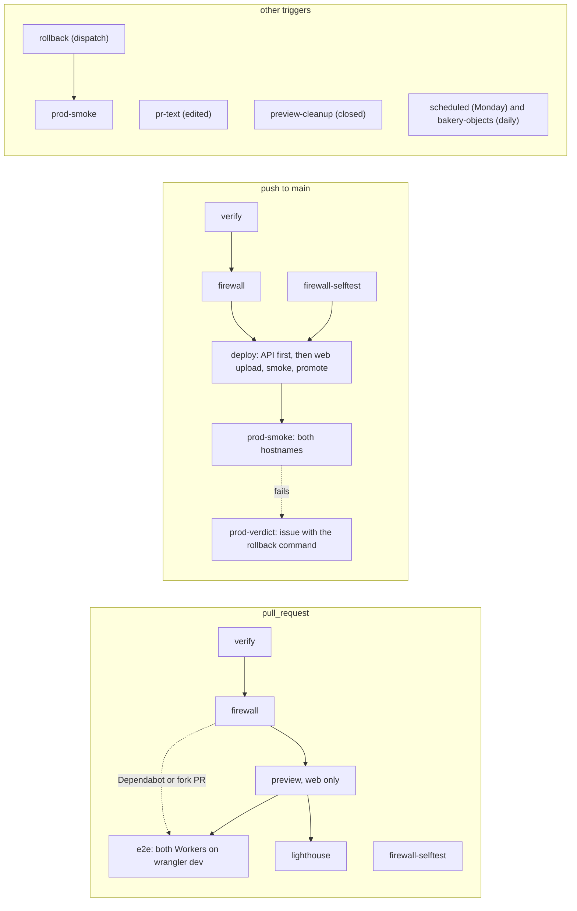

# Delivery

How a commit becomes the bakery: the repository layout, the toolchain pins, the pipeline that builds, gates, previews and deploys two Workers (the API holds every Durable Object (DO) class), the environments it writes to, and how a deploy is verified and undone. Until the launch pull request (PR 11) the pipeline is three jobs and nothing deploys ([speed first, Q44](#before-launch)); the rest of the page describes the pipeline as it stands from PR 11. It is written for one maintainer with one pull request in flight, and it follows the site's [delivery.md](https://github.com/IHaveASegway/website/blob/main/docs/delivery.md) wherever the bakery has the same problem. The deploy owner is decided in [ADR 0011](adr/0011-github-actions-owns-deploys-for-both-workers.md); the API's hostname and CORS in [ADR 0009](adr/0009-the-api-on-its-own-hostname.md); everything else on this page is a two-way door without an ADR. Header and CSP policy, the firewall's design and the secrets inventory are in [security.md](security.md); access setup and runbooks are in [operations.md](operations.md); prices are in [cost.md](cost.md); versions and their sources are in [stack.md](stack.md).

Status: Updated on 2026-11-08; reconciled with `ci.yml` and `scheduled.yml` at c80b97f on 2026-11-09. The pipeline has run as described here since the launch on 2026-11-06 (PR 11, #22); the later changes are dated in place.

Prices, limits and versions are as of 2026-11-04, with sources. Every YAML, JSONC and TOML block is a sketch: confirm against current docs when building.

## Shape

One pipeline, one writer per environment. GitHub Actions builds once per pipeline run: the web app's `dist/` and the API's wasm bundle. It runs every gate against those artifacts, runs the content firewall over them, and only then publishes. Two Workers ship from the one repository, with one deploy token. Nothing reaches a public URL without `verify` and `firewall` passing, and the publishing job `needs:` both, as the site's does. Before PR 11 there is no public URL and no publishing job.

| Data | System of record | Only writer | Readers | How it crosses |
|---|---|---|---|---|
| Web build, `apps/web/dist/` | the `verify` job's artifact for that run | `verify` | `firewall`, `preview`, `deploy`, `e2e`, `prod-smoke` | uploaded once, downloaded by each job; never rebuilt |
| API bundle, `workers/api/dist/` | the `verify` job's artifact (the output of `wrangler deploy --dry-run --outdir`) | `verify` | `firewall`, `e2e`, `deploy` | uploaded once; `deploy` uploads it with `--no-bundle` |
| Production versions | Cloudflare, Workers `bakery-web` and `bakery-api` | `deploy` and `rollback`; the dashboard only when GitHub is down | visitors | Wrangler and the Cloudflare API |
| Web previews | Cloudflare Worker Previews | `preview` creates, `preview-cleanup` deletes | `e2e`, the reviewer | Wrangler |

The data-flow rows describe the pipeline from PR 11. The web and API build rows are "build once". If every job built for itself, the bytes the firewall scanned and the bytes that went live could differ; a Rust build is the worse case, since a dependency resolved an hour later changes the wasm and nobody can diff it by eye. The scanned bundle is the published bundle.

## Repository layout

```text
bakery/
├── AGENTS.md · README.md · LICENSE (MIT) · SECURITY.md
├── .github/workflows/{ci.yml, pr-text.yml, scheduled.yml} · .github/dependabot.yml · .github/pull_request_template.md
├── .githooks/{pre-commit, pre-push} · scripts/firewall/ (copied from the site; Q34)
├── apps/web/            Astro 7 + React 19 islands → assets-only Worker "bakery-web" (wrangler.jsonc, src/, public/, e2e/, test/)
├── workers/api/         Rust Worker "bakery-api": Cargo.toml, wrangler.jsonc, src/{lib.rs, http/, objects/, queue.rs, cron.rs, auth/, stripe/}
├── crates/domain/       pure Rust: aggregates (decide/evolve), events, value objects, state machines; no platform dependency; cargo test
├── crates/app/          use cases and ports (traits): Clock, PaymentGateway
├── crates/seed/         deterministic synthetic data: personas, menu, 90 days of history, venues, the 64 Salt Lake City places (from PR 9)
├── crates/contracts/    API types shared with the web app (serde, schemars → JSON Schema → TypeScript types at build)
├── tools/route-data/    the Salt Lake City data build (PR 9): osmium and a self-hosted openrouteservice, Node 22 with no dependencies; offline, output committed
├── docs/                this plan: README, product, domain, architecture, stack, security, cost, delivery, operations, roadmap, adr/
├── Cargo.toml (workspace) · rust-toolchain.toml · pnpm-workspace.yaml · package.json · .nvmrc
```

- **Workflows.** `ci.yml` is the pipeline below (three jobs until PR 11), `pr-text.yml` scans edited pull request text, and `scheduled.yml` holds the Monday audit and the morning object check (both from PR 11), and, since 2026-11-09, the Monday and Thursday smokes. Preview cleanup is a job of `ci.yml`.
- **`.githooks/` and `scripts/firewall/`** are copied from the site; the private rules are this repository's own secret ([operations.md](operations.md#9-local-hooks-and-the-private-firewall-file)).
- **`apps/web/`** is an assets-only Worker: no request runs Worker code ([ADR 0008](adr/0008-astro-site-with-react-islands-on-an-assets-only-worker.md)). As built on 2026-11-09, every page takes one of three shells, chosen from its path in `src/layouts/Base.astro` (`src/lib/shell.ts`): prose for the essays, About and Privacy; shop, up to 1,120 px wide under a masthead, for the storefront's pages; and app, full width with a top bar and a sidebar, for the console. Since the same day the console is seven pages, one per workspace, each with its own island: `/app/` (the kitchen), `/app/money/`, `/app/menu/`, `/app/catering/`, `/app/customers/`, `/app/dispatch/` and `/app/system/`, and since 2026-11-10 `/app/start/`, the Kitchen's page where a Google or GitHub sign-in lands, which makes the session a sandbox when it has no live one and then shows itself at `/app/` ([architecture.md](architecture.md#sign-in-with-google-and-a-demo-account)); a link to a section of the old one-page console (`/app/#ledger-heading`) is sent to its page by a small script on `/app/`. The styles are four sheets: `src/styles/tokens.css` holds every colour and scale, `src/styles/components.css` the one class contract every screen uses (buttons and their variants, badges, panels, tables, chips, menus), `src/styles/console.css` the console's top bar, sidebar and workspaces, and `src/styles/global.css` the base, the shells and each screen's layout.
- **`workers/api/`** is the only crate that depends on the platform: the `worker` crate, the DO classes, the Queue consumer, the cron handler. It is a thin adapter over `crates/app`.
- **`crates/domain/`** is pure Rust with no platform dependency, tested natively with `cargo test` and `proptest`. Most tests run here: native tests are fast. `crates/app/` holds use cases and ports; time, storage, payments and mail are traits an adapter implements and a test replaces.
- **`tools/route-data/`** is the Salt Lake City data build, new in PR 9 and run offline (as built 2026-11-05, [ADR 0012](adr/0012-delivery-dispatch.md), amended): Node 22 with no npm dependency, so it has no lockfile and sits outside both workspaces; osmium-tool 1.16.0 clips the extract, and a self-hosted [openrouteservice](https://github.com/GIScience/openrouteservice/releases/tag/v9.10.0) v9.10.0 (Docker compose or a Maven-built jar) gives the snap, the matrix and the isochrones. The extract is [Geofabrik's Utah file](https://download.geofabrik.de/north-america/us/utah.html) when reachable, else the [openstreetmap.fr US West file](https://download.openstreetmap.fr/extracts/north-america/us-west-latest.osm.pbf), as this build used. Its output (the matrix, the isochrones and the place list) is committed, with the extract's checksums in `provenance.json`; nothing of its tools ships, and CI does not run it. The site's pipeline in [its repository](https://github.com/IHaveASegway/website) is reference only. The Route Lab keeps its Seattle data there. The rebuild steps are in [operations.md](operations.md#rebuild-the-salt-lake-city-data).
- **The dispatch solver is fetched, not committed.** `scripts/fetch-solver.mjs` runs as `apps/web`'s `prebuild`, fetches the site's solver folder at commit `34b4515260bdcca350a949f130a879b472ff90e0`, checks each of its 5 files' length and SHA-256 against `apps/web/solver.lock.json`, and writes `apps/web/public/app/dispatch/solver/vroom-1.15.0-870d7d5e/`, which `apps/web/.gitignore` keeps out of git. A mismatch leaves no folder and fails the build; a folder that already verifies is not fetched again, so an offline rebuild works. The first build needs GitHub reachable. Committing the 919,927 B `vroom.wasm`, as the site does, is the alternative and waits for Joseph.
- **`crates/seed/`** is one deterministic generator for the Worker and the tests. **`crates/contracts/`** holds the API's types once; a build step turns them into JSON Schema and then TypeScript, so the web app cannot drift.

A Cargo workspace from day one costs one file; splitting later means moving every path. The crates exist because their dependency rules differ, which a gate below enforces. No Turborepo, no `cargo-make`: `pnpm` scripts and `cargo` aliases cover it.

## Toolchain pins

One source per tool, because a version written in two places drifts. `actions/setup-node` reads `.nvmrc`; `pnpm/action-setup` reads `packageManager`; Rust installs from `rust-toolchain.toml`; Cargo-installed tools take their versions from `[workspace.metadata.tools]` in the root `Cargo.toml`. [stack.md](stack.md) says what each tool owns and what lost to it.

Pins as of 2026-11-04:

| Tool | Pin | Single source | Why | Source |
|---|---|---|---|---|
| Rust, and the `wasm32-unknown-unknown` target | stable 1.97 | `rust-toolchain.toml` | The current stable; Workers run wasm, with no Tokio | [Rust releases](https://github.com/rust-lang/rust/releases) |
| `worker` | 0.8.7, exact (`=0.8.7`) | `Cargo.toml` workspace dependencies | A 0.x crate; minor bumps break, so it moves by hand | [crates.io](https://crates.io/crates/worker) |
| `worker-build` | the release that matches `worker` 0.8.7 | `[workspace.metadata.tools]` | Builds the wasm and writes the JavaScript shim; confirm the matching version | [workers-rs](https://github.com/cloudflare/workers-rs) |
| `wasm-opt`, `wasm-bindgen` | `wasm-bindgen` =0.2.130 in `workers/api`, the version `worker` resolves, with the CLI worker-build downloads matching `Cargo.lock`; `wasm-opt` 132 as worker-build fetches it | `Cargo.lock` | Not installed by hand; the CLI and library must match. The size budget measures their output | [workers-rs](https://github.com/cloudflare/workers-rs) |
| `cargo-deny`, `cargo-audit` | latest on PR 2's day, exact | `[workspace.metadata.tools]` | Licenses, advisories, banned crates, sources; RustSec in `scheduled` too | [cargo-deny](https://github.com/EmbarkStudios/cargo-deny) |
| Node.js | 26 | `.nvmrc` | The site's pin; active LTS from 2026-10-28 | [nodejs/Release](https://github.com/nodejs/Release) |
| pnpm | 11.28.6 | `"packageManager"` in `package.json` | pnpm switches itself to the pinned version | [npm](https://www.npmjs.com/package/pnpm) |
| Wrangler | ^4.158.0 (as of 2026-11-09) | pnpm catalog | Worker Previews need 4.135.0 or later; CI runs `pnpm exec wrangler` | [npm](https://www.npmjs.com/package/wrangler) |
| Astro | 7.4.7, exact (as of 2026-11-09) | `apps/web/package.json` | The site's pin; majors wait for x.1 | [npm](https://www.npmjs.com/package/astro) |
| React, `@astrojs/react` | 19.3.1, 7.1.4 (as of 2026-11-10) | `apps/web/package.json` | Islands only; the JavaScript budget keeps them few | [npm](https://www.npmjs.com/package/react) |
| Vitest 5, Playwright | 5, 1.65.0 (as of 2026-11-09) | pnpm catalog | Web unit tests (Worker logic is tested by `cargo test`); `e2e` and `prod-smoke` run in Playwright's image of the same version, from PR 11 | [npm](https://www.npmjs.com/package/@playwright/test) |
| osmium-tool, openrouteservice | 1.16.0 (the build's report, 2026-11-05); v9.10.0, commit 8ed869459de157032edb146a6fc247379c428e23 | `tools/route-data/config.mjs`, `ors/compose.yml`, `ors/build-jar.sh`; no lockfile, no npm dependency | The Salt Lake City data build in PR 9. Offline: nothing ships. The ORS image digest is not pinned yet (no Docker daemon on the build machine) | [osmium-tool](https://github.com/osmcode/osmium-tool), [openrouteservice v9.10.0](https://github.com/GIScience/openrouteservice/releases/tag/v9.10.0), as of 2026-11-05 |
| VROOM solver folder | 1.15.0, folder `vroom-1.15.0-870d7d5e`, site commit 34b4515260bdcca350a949f130a879b472ff90e0 | `apps/web/solver.lock.json` | Fetched at build by `scripts/fetch-solver.mjs`, verified, git-ignored; the browser planner | [the site's solver folder](https://github.com/IHaveASegway/website/tree/34b4515260bdcca350a949f130a879b472ff90e0/apps/web/public/lab/routes/solver/vroom-1.15.0-870d7d5e), as of 2026-11-05 |

The sketches below are what PR 2 starts from.

```toml
# Cargo.toml, the workspace root (sketch — confirm against current docs when building)
[workspace]
resolver = "2"
members = ["crates/domain", "crates/app", "crates/seed", "crates/contracts", "workers/api"]

[workspace.dependencies]
worker = "=0.8.7"          # exact: a 0.x minor is a breaking change

[workspace.metadata.tools]  # read by one CI step; the single source for cargo-installed tools
worker-build = "0.8.7"      # confirm the release matching worker 0.8.7
cargo-deny = "<latest on PR 2's day>"
cargo-audit = "<latest on PR 2's day>"

[profile.release]
opt-level = "s"            # size first
lto = true
codegen-units = 1
panic = "abort"
```

`rust-toolchain.toml` holds `channel = "1.97"`, `components = ["rustfmt", "clippy"]` and `targets = ["wasm32-unknown-unknown"]`. `pnpm-workspace.yaml` lists `apps/*`, a `catalog` (Wrangler `^4.158.0`, Vitest 5, Playwright 1.65.0, as of 2026-11-09) and `allowBuilds`, the only packages whose install scripts may run.

```jsonc
// workers/api/wrangler.jsonc (a sketch; the file as built is workers/api/wrangler.jsonc, checked 2026-11-09)
{
  "name": "bakery-api",
  "main": "build/worker/shim.mjs",              // worker-build's output
  "compatibility_date": "2026-11-04",           
  "routes": [{ "pattern": "api.bakery.ihaveasegway.com", "custom_domain": true }],
  "workers_dev": false,                          // the zone, with its WAF rule, is the only way in
  "preview_urls": false,
  "limits": { "cpu_ms": 300 },                   // set in PR 11 with Workers Paid: a ceiling with headroom, not a measurement; the Paid default is 30 s
  "observability": { "enabled": true, "logs": { "invocation_logs": false } },
  "durable_objects": { "bindings": [             // one per class, 14 in all (architecture.md)
    { "name": "CONTROL", "class_name": "Control" }, { "name": "SANDBOX", "class_name": "Sandbox" },
    { "name": "SIMULATOR", "class_name": "Simulator" }   // the 14th class (PR 4): synthetic traffic, one per sandbox, `simulator:<sandbox>`
  ] },
  "exports": {                                   // declarative class lifecycle: each change is a deploy and a rollback boundary
    "Control": { "type": "durable-object", "storage": "sqlite" }   // ...and the other 12, Simulator among them
  },
  "queues": {
    "producers": [{ "binding": "EVENTS", "queue": "bakery-events" }],
    "consumers": [
      { "queue": "bakery-events", "max_batch_size": 10, "max_batch_timeout": 0, "max_retries": 3, "dead_letter_queue": "bakery-events-dlq" },
      { "queue": "bakery-events-dlq", "max_batch_size": 10, "max_retries": 3 }   // the DLQ writer, into the owning Sandbox's dead_letters
    ]
  },
  "triggers": { "crons": ["0 10 * * *", "*/15 * * * *"] },   // the wipe at 10:00 UTC; the retry sweep, the status page's snapshot refresh (PR 13) and, from PR 11, the breaker
  "ratelimits": [                               // four, as built: SANDBOX_CREATE_LIMIT 1, COMMAND_LIMIT 60, UPGRADE_LIMIT 6, TOKEN_LIMIT 60, each a minute
    { "name": "SANDBOX_CREATE_LIMIT", "namespace_id": "1001", "simple": { "limit": 1, "period": 60 } }   // ...and the other three
  ],
  "analytics_engine_datasets": [{ "binding": "METRICS", "dataset": "bakery_events" }],   // as built, 2026-11-06 (PR 13); `wrangler deploy --dry-run` lists it
  "vars": { "ALLOWED_ORIGIN": "https://bakery.ihaveasegway.com", "API_ORIGIN": "https://api.bakery.ihaveasegway.com" }
  // ...and, as built, the two OAuth client ids, the Stripe publishable key and API version, the four caps, the traffic minutes and the breaker's two lines
  // "previews" only if spike S4 passes. No account_id, no secrets.
}
```

```jsonc
// apps/web/wrangler.jsonc (sketch), like the site's
{
  "name": "bakery-web",
  "compatibility_date": "2026-11-04",
  "assets": { "directory": "./dist", "not_found_handling": "404-page", "html_handling": "auto-trailing-slash" },   // no "main": assets only
  "routes": [{ "pattern": "bakery.ihaveasegway.com", "custom_domain": true }],
  "workers_dev": false,
  "preview_urls": true,      // Version URLs for the deploy smoke (from PR 11)
  "previews": {},
  "observability": { "enabled": true },
  "send_metrics": false      // and never "cache": { "enabled": true }, which bills every asset request
}
```

Custom Domains get certificates automatically, multi-level subdomains included, with no Advanced Certificate Manager subscription ([Cloudflare](https://developers.cloudflare.com/workers/configuration/routing/custom-domains/), as of 2026-11-04). The zone must be in the account (Q29 · Q-account), and neither hostname gets a route, because a route Worker would run before a custom-domain Worker.

## Pipeline

### Before launch

Q44 · Q-posture, Joseph's direction of 2026-11-04: speed first until launch. Nobody uses the bakery yet, so from PR 2 until PR 11 CI runs three jobs and nothing else, and Joseph reads each pull request on `wrangler dev`. The domain's native tests run inside `verify` and stay, because they cost nothing. The workflow `pr-text.yml` also runs, because it is the firewall reading edited pull request text, and a public repository cannot skip that.

| Job | Trigger | `needs` | Does |
|---|---|---|---|
| `verify` | PR; push to `main` | none | `pnpm install --frozen-lockfile`; `cargo fmt --check`, `clippy -D warnings`, `test --workspace --locked`, `deny check`, `audit`; the wasm build and its size budget; contracts diffed; the seed run twice; the fixture scan; `pnpm build` and `test`; the fitness functions below that need no browser and no edge. Uploads the artifacts once |
| `firewall` | as `verify` | `verify` | The full-history and artifact scan, as in the table below |
| `firewall-selftest` | as `verify` | none | Throwaway rules prove exits 0, 1 and 2 |

Arriving in PR 11, with the deploy token and the account on Workers Paid: `preview`, `e2e`, `lighthouse`, `deploy`, `rollback`, `prod-smoke`, `prod-verdict` and `preview-cleanup`, and `bakery-objects` (the morning object check) and `audit` (the Monday audit) with them. As of 2026-11-06 they are written (`.github/workflows/ci.yml` and `scheduled.yml`, the launch branch at d778ff7) and dormant: each runs only while the repository variable `LAUNCHED` is `true` ([operations.md](operations.md#launch) step 4). Until then no job holds a Cloudflare credential, so the hardening rules about the deploy token are satisfied by there being none. Cost of the posture: a regression a browser test or a preview would have caught reaches Joseph's read, and nothing reaches an audience. Two-way door; revisit when PR 11 starts. As of 2026-11-09 this is history: `LAUNCHED` was set to `true` on 2026-11-06 and the launch jobs have run since run 116. The headers of `ci.yml` and `scheduled.yml` said it did not exist yet; `ci.yml`'s was corrected on 2026-11-09.

### From launch

Everything below is the pipeline as it stands from PR 11, the post-launch state.



Job names follow the site's `ci.yml`, whose steps are named in plain sentences ("Keep the build", "Content firewall", "Firewall self-test, with throwaway rules only", "Smoke production through the zone"); so are the bakery's.

| Job | Trigger | `needs` | Secrets (step `env:` only) | Does |
|---|---|---|---|---|
| `verify` | PR; push to `main`; weekly | none | none | `pnpm install --frozen-lockfile`; `cargo fmt --check`, `clippy -D warnings`, `test --workspace --locked`, `deny check`, `audit`; the wasm build; `wrangler deploy --dry-run --outdir workers/api/dist`; the wasm budgets; contracts diffed; the seed run twice; the fixture scan; `pnpm build` and `test`; byte budgets, contrast, image metadata, offline links; the fitness functions below. Uploads both artifacts once. As built (2026-11-09) `verify` also runs `cargo audit --deny warnings` (the ignore list in `.cargo/audit.toml`, the same as `deny.toml`'s), `scripts/image-metadata.mjs --tracked`, the offline link check `scripts/check-doc-links.mjs` (every relative link and `#anchor` in README.md, AGENTS.md, workers/api/README.md and docs/), a check that `worker` keeps its `=` pin, and a check that no `wrangler.jsonc` binds a KV namespace; the fixture scan is the seed's own test `no_string_in_the_seed_looks_like_personal_data` |
| `firewall` | as `verify` | `verify` | `FIREWALL_RULES` (the Dependabot copy on Dependabot PRs) | Full history and both artifacts; gitleaks installed after a sha256 check; `scripts/firewall/check.sh` over the tree, `dist/` and the API bundle, wasm strings included ([site ADR 0017](https://github.com/IHaveASegway/website/blob/main/docs/adr/0017-firewall-reads-webassembly.md)). Exits 1 and 2 fail |
| `firewall-selftest` | as `verify` | none | none | `scripts/firewall/test.sh` with throwaway rules proves exits 0, 1 and 2 and that no term is ever printed. `deploy` needs it. On a push to `main` the self-test runs only when `scripts/firewall/scanner-changed.sh` says the push changes the scanner; a pull request always runs it (since 2026-11-05) |
| `preview` | PR from this repository, not Dependabot's | `firewall` | `CLOUDFLARE_API_TOKEN`, `CLOUDFLARE_ACCOUNT_ID` | Web only until spike S4: `wrangler preview --name pr-<n>`, waits for it, requires `X-Robots-Tag: noindex`, posts one comment. Publishes nothing until PR 11's first deploy from `main` has created production, and nothing for a pull request that changes the scanner, whose self-test has not passed yet (`scanner-changed.sh`, as built 2026-11-09) |
| `e2e` | PR | `verify`, `firewall`, `preview` (run or skipped) | none (`STRIPE_E2E_SECRET_KEY` is named in a comment and read by nothing until S3) | Playwright in its image at the lockfile's version, checked against the lockfile. Both Workers run on `wrangler dev` from the scanned artifacts (web 8797, API 8798, local HTTPS), with Chromium's host resolver mapping both production hostnames to them and refusing every other name, so the bytes under test keep their origins, cookies and CORS. The suite and its shape are under [The e2e suite](#the-e2e-suite). Dependabot's PRs run it too, since it needs no secret. A grouped Dependabot bump that moves Playwright fails `e2e` until the image tag and digest move with it (#76, 2026-11-09) |
| `lighthouse` | when `preview` produced a URL | `preview` | none | Lighthouse CI against the web preview's URL, in Playwright's image for its Chromium; fails when a category's median of 3 runs misses a budget. The budgets are proposals: [Lighthouse](#lighthouse) |
| `preview-cleanup` | PR closed, from this repository, not Dependabot's | none | as `preview` | `wrangler preview delete --name pr-<n> --skip-confirmation`, and the API's preview and DO namespaces if S4 passes |
| `pr-text` | PR title or body edited | none | `FIREWALL_RULES` | `check.sh --pr-text` on title, body and branch name |
| `deploy` | push to `main` | `verify`, `firewall`, `firewall-selftest` | as `preview` | Group `deploy-production`, never cancelled; stops unless the commit is `main`'s tip. Before either stage it refuses a storefront bundle that carries Turnstile's test site key (#73, 2026-11-08); since then every merge has failed there until the repository variable is set (runs 209, 213 and 216, as of 2026-11-09). **Stage 1, the API,** when its paths changed since the live deployment's message: `wrangler deploy --no-bundle` of the scanned bundle, then a health and CORS check. **Stage 2, the web Worker,** after stage 1 passes or is skipped: `versions upload`, smoke the Version URL, `versions deploy <id>@100%` |
| `rollback` | dispatch with `worker` (`web` or `api`), `rollback_to` (a version id, a UUID) and `reason` | none | as `preview` | Only from `main`, only a version id, in the `deploy-production` group: `wrangler rollback <id> --name bakery-<worker> --message "rollback: <reason>" --yes` |
| `prod-smoke` | after `deploy` or `rollback` | those | none | In Playwright's image: waits for both hostnames, then runs the smoke table below through the zone |
| `prod-verdict` | when `prod-smoke` failed, or `deploy` failed after the API changed | `deploy`, `rollback`, `prod-smoke` | none | On the runner (`issues: write`): opens an `Incident:` issue with the exact rollback command (`--ref main` and the three inputs) for the Worker that changed, labelled `incident` only if that label exists |
| `audit` (in `scheduled.yml`) | Monday 07:17 UTC; a dispatch | none | none | `cargo audit` and `cargo deny check advisories` (both `--locked`, versions read from the Cargo metadata), `pnpm audit --audit-level moderate`, Dependabot pull requests open more than 14 days, Dependabot alerts when the token can read them, `compatibility_date` older than 180 days, and, from PR 12, the storefront's external links (`scripts/check-links.mjs`, below). On a finding it opens or updates "Weekly audit" and fails. A zone audit is not in it |
| `bakery-objects` (in `scheduled.yml`) | daily 04:47 (the baseline run) and 12:17 UTC; a dispatch, with `phase` `before` for a baseline | none | `CLOUDFLARE_READ_TOKEN` (as the token) and `CLOUDFLARE_ACCOUNT_ID`, one step | Since 2026-11-10 the 12:17 run reads `sandboxes_past_wipe` from the public `GET /v1/status`, `Control`'s count of sandboxes not wiped 2 hours after their nightly wipe, which needs no baseline: above 0 it opens or updates "Objects survived the wipe" and fails; a body without the field (an older API) gives a notice and opens nothing ([operations.md](operations.md#the-nightly-wipe)). The listing is a second opinion: the baseline run (04:47, or a dispatch with `phase` `before`) keeps a listing of the objects holding data (hashes, classes and counts) and its real start time, and the 12:17 run compares only with a baseline that started before 10:00 UTC; an object holding data at both times survived the wipe and opens the same issue. With no such baseline the listing opens nothing and says so in a notice. A listing error fails the job without an issue. The 12:17 run also fetches the public `GET /v1/status` with no token and, when `counters.dlq_24h` is above zero (state `live` or `stale`), opens or updates "Messages dead-lettered" and fails; `unavailable` opens nothing; a failed fetch fails the step ([operations.md](operations.md#observability)). After it, independent of it, the 12:17 run reads the same route's `breaker` and opens or updates "Breaker tripped" when it has tripped ([operations.md](operations.md#breaker-tripped)) |
| `smokes` (in `scheduled.yml`, since 2026-11-09) | Monday and Thursday 17:37 UTC; a dispatch (`-f job=smokes`, from any ref) | none | none | Builds the API's WebAssembly and the seed generator once, then runs every `scripts/smoke-*.sh` on `wrangler dev` with the fakes through `scripts/smoke-all.sh`, one after the other, a failure not stopping the rest. The table of counts and seconds goes to the step summary, the logs to the `smoke-logs` artifact (7 days). A failed script, or a build that failed before them, opens or updates "Weekly smokes failed", naming each failed script with its count line, and fails the job; a green run closes nothing, as with `audit` ([operations.md](operations.md#weekly-smokes-failed)). Not on pull requests: the scripts alone took 20 minutes one after the other on 2026-11-09 (a local run) (decided 2026-11-09, after a `smoke-crm.sh` check had failed on main unnoticed until it was run by hand, #86). Monday as well as Thursday because the bakery is closed on Mondays and the seed and several rules behave differently that day, and the first run found exactly a Monday-only failure (`smoke-dispatch.sh`, 2026-11-09) that a Thursday-only job would never have caught |

Every workflow has `permissions: {}` at the top and each job grants only what [the table below](#the-jobs-as-written) says.

Six notes on the graph:

- **The firewall sits before the preview,** because a preview is public the moment it exists. The wasm bundle is scanned too.
- **The API has no preview and no Version URL.** A Worker with a DO gets no Version URLs ([Cloudflare](https://developers.cloudflare.com/workers/configuration/previews/)), so the gate before traffic is `verify`'s native tests and `e2e` on `wrangler dev`, not a smoke on the edge. A web preview calls the production API, whose CORS allows only `https://bakery.ihaveasegway.com`, so on a preview the signed-in screens fail by design.
- **The API's deploy is conditional** on its paths changing since the commit the live API runs (read from the deployment's message), not since the previous push, which a replaced pending run could skip.
- **No cache in a job that holds the deploy token.** `preview`, `preview-cleanup`, `deploy` and `rollback` set `package-manager-cache: false` and never compile Rust; they upload what `verify` built. Only `verify` caches `~/.cargo` and `target/`, with `actions/cache` keyed on `Cargo.lock`; `e2e` caches the pnpm store (as built, 2026-11-09).
- **Fork PRs** get no secrets, so `firewall` exits 2: fail closed. Dependabot PRs get no preview and no Stripe key.
- **Scheduled runs use 07:17 and 12:17,** not the hour, because GitHub delays and drops runs at the top of it ([GitHub](https://docs.github.com/en/actions/reference/workflows-and-actions/events-that-trigger-workflows)).

**Concurrency.** A pull request's runs share `ci-refs/pull/<n>/merge` and cancel superseded runs; its closed run (`preview-cleanup`) is in `ci-closed-pr-<n>`, because on a merged pull request `github.ref` is the base branch, and in the shared group that run cancelled the merge's own push run on `main` (2026-11-06, run 116: nothing deployed until the push run was re-run by hand). `deploy` and `rollback` share `deploy-production` and never cancel, so a deploy is not killed halfway and a rollback never races one. `scheduled.yml` jobs share `scheduled`, and `bakery-objects` never cancels.

### The jobs as written

As of 2026-11-09, from `.github/workflows/ci.yml` and `scheduled.yml` at c80b97f (first written on 2026-11-06 from the launch branch at d778ff7, the PR 11 preparation, in draft PR #17). The first runs against the account were launch day's, 2026-11-06 (run 116, PR 22's merge, and the pull requests after it); what they confirmed is in the last bullet below. Every job in the second group needs `vars.LAUNCHED == 'true'`; the three before it do not. The table above says what each job does; this one says when it runs, what it holds and how long it may take. Timeouts other than `verify`'s 25 minutes are the workflow's own choices, set on 2026-11-05 and not measured.

| Job | Runs when | Secrets | GitHub token permissions | Timeout (minutes) |
|---|---|---|---|---|
| `verify` | PR (not closed); push to `main`; Monday 07:17 UTC | none | contents read | 25 |
| `firewall` | as `verify` | `FIREWALL_RULES` | contents read | 10 |
| `firewall-selftest` | as `verify` | none | contents read | 15 |
| `preview` | PR from this repository, not Dependabot's, not closed; needs `firewall` | `CLOUDFLARE_API_TOKEN`, `CLOUDFLARE_ACCOUNT_ID` | contents read, pull-requests write | 10 |
| `e2e` | PR, Dependabot's too; needs `verify` and `firewall`, `preview` succeeded or skipped | none | contents read | 20 |
| `lighthouse` | `preview` produced a URL | none | contents read | 25 (since #57) |
| `preview-cleanup` | PR closed, same filters as `preview` | the two Cloudflare secrets | contents read | 5 |
| `deploy` | push to `main`; needs `verify`, `firewall`, `firewall-selftest` | the two Cloudflare secrets | contents read | 20 |
| `rollback` | dispatch from `main` with `worker`, `rollback_to`, `reason` | the two Cloudflare secrets | contents read | 10 |
| `prod-smoke` | after `deploy` (if it ran) or a `rollback` | none | contents read | 15 (since #50) |
| `prod-verdict` | `prod-smoke` failed, or `deploy` failed after the API changed | none | contents read, issues write | 5 |
| `bakery-objects` | daily 04:47 and 12:17 UTC | `CLOUDFLARE_READ_TOKEN` (as the token), `CLOUDFLARE_ACCOUNT_ID` | contents read, actions read, issues write | 10 |
| `audit` | Monday 07:17 UTC | none | contents read, issues write, pull-requests read, security-events read | 25 |
| `smokes` | Monday and Thursday 17:37 UTC (since 2026-11-09) | none | contents read, issues write | 60 (sized from a local run on 2026-11-09; the arithmetic is in the workflow) |

- **Dormant by default.** Without `LAUNCHED` set to `true`, the launch jobs and the scheduled runs are skipped, and `verify`, `firewall` and `firewall-selftest` run as they have since PR 2. A `workflow_dispatch` of `scheduled.yml` runs the chosen job (`bakery-objects`, `audit` or, since 2026-11-09, `smokes`) whatever `LAUNCHED` says: the pre-launch dry run ([operations.md](operations.md#launch)). The three older jobs carry `if: github.event_name != 'workflow_dispatch' && github.event.action != 'closed'`, because the `closed` and dispatch triggers are new and `firewall` exits 2 on a dispatch.
- **The external-link check, `audit`'s last check (PR 12, as written on 2026-11-06).** A step after the Dependabot step installs with `pnpm install --frozen-lockfile`, runs `pnpm --filter web build`, and runs `node scripts/check-links.mjs` (Node 22, no dependency). The script reads what the build wrote, every `*.html` under `apps/web/dist`, and collects each `href` and `src` that starts with `http://` or `https://`, minus the bakery's own hostnames (`bakery.ihaveasegway.com` and its subdomains, which `prod-smoke` owns and which do not resolve before launch), with the fragment dropped. It does not read the guide's entries (the tour's steps until 2026-11-09): their links reach it through the How it's built page, which is made by the same function, and `apps/web/test/dist.test.ts` fails the build if a principle's lab or ADR link is missing from that page. It fetches each URL once, 4 at a time, with `HEAD` and then `GET` if the `HEAD` is refused or not 2xx, following redirects, with a 20 s timeout and one retry, and a user agent that names the repository. It exits 1 and prints each URL that did not answer 2xx, with its status and the pages that link it; 2 when `dist` is missing or holds no external link; `--list` prints the links and fetches nothing. The step never fails the job itself: a build failure, exit 1 and any other exit each append a line to the findings file ("external link: <url> (<status>), linked from <pages>" or "the external-link check could not run"), so a broken link opens or updates the one "Weekly audit" issue and fails the job through the same last step as the rest. It holds no secret and needs no permission beyond the job's, and the job's 25-minute timeout is unchanged. On 2026-11-06 it found 22 links and all answered 2xx (run by hand: no workflow has run, `LAUNCHED` being unset). A link that is only broken for a day, a rate limit from GitHub, is a finding that clears the next Monday; the check does not retry beyond its one. The step's shell was read by actionlint and not by shellcheck, which that machine lacks. It has not yet run on GitHub (2026-11-09): no scheduled `audit` run has started.
- **Concurrency.** A dispatch has a group of its own (`ci-dispatch-<ref>`), so a rollback never queues behind a 25-minute `main` run; `deploy` and `rollback` share `deploy-production`.
- **Actions are pinned by commit** in the launch jobs, with the release in a comment (checkout v7.0.1, setup-node v7.1.0, upload-artifact v7.0.2, download-artifact v8.0.2, pnpm/action-setup v6.1.1); the three older jobs keep their tags. Playwright's image is pinned by digest as well as by tag (`v1.64.1-noble`).
- **When the API deploys.** Stage 1 runs when `workers/api/`, `crates/`, `Cargo.toml`, `Cargo.lock` or `rust-toolchain.toml` changed since the commit named in the live deployment's message. Any change under `workers/api/` counts, its README included: #72, a docs change, redeployed the API on 2026-11-08, which drops every socket. `pnpm-lock.yaml` is not on the list, so a Wrangler bump does not redeploy the API. A change to a Durable Object class (the class sets compared) fails the job if the range also touches anything outside those paths and `docs/`, and skips the web stage.
- **What launch day confirmed (2026-11-06, runs 116 to 126).** The deploy token's permissions, the two assumed ones included, let the first `wrangler deploy` create both Workers, bind the two queues (created in the dashboard the same day, before the deploy) and attach both Custom Domains. The JSON of `wrangler deployments list --json` is what the `deploy` job reads: the re-run's deploy found the API live at its commit from the deployment's message and skipped stage 1. The "Current Version ID" line held for both Workers' first deploys, and on the first web deploy after the first (run 126, the merge of #47) the "Worker Version ID" and Version URL lines of `wrangler versions upload` held too: the six pages were smoked on the Version URL, byte for byte against the artifact, and the version was promoted at 100%, all inside eight seconds, with `prod-smoke` green after it. `wrangler preview --json` printed a workers.dev URL the job could read, the preview (`pr-<n>-bakery-web` on the account's workers.dev subdomain) answered with `noindex` under `workers_dev: false` and `preview_urls: true`, and the job's one comment was posted (PR 47). The read token listed the Durable Object namespaces. Two things went wrong and are fixed: the closed run cancelling the push run (#46), and the `lighthouse` step's bash array in the container's `sh` (#48). One thing the first deploy taught: a new hostname can outrun the API stage's two-minute health check. Since #50 that check waits up to ten minutes, printing a line about every 30 s, when a Worker had no version before the run (`first_attach`), and `prod-smoke` waits as long for both hostnames (`SMOKE_WAIT_MS`); every later deploy keeps the two-minute waits ([operations.md](operations.md#launch), step 8).
- **Confirmed since:** `wrangler preview delete --worker-name` works without a config (run 217, the close of #75, 2026-11-08, printed that preview `pr-75` was deleted).
- **Still to confirm, as of 2026-11-09:** that ten minutes covers a first attach, which #50's longer waits have not yet met (the next Worker created); whether the objects endpoint reports `hasStoredData` (the first `bakery-objects` run); that the workflow token can read Dependabot alerts with `security-events: read` (the first `audit` run); that a pending rollback is never replaced in `deploy-production` (GitHub replaces a pending job when another queues, and `deploy`'s tip check limits the damage).

### The e2e suite

Run by the `e2e` job and locally with `pnpm --filter web e2e` (`apps/web/e2e/run.mjs`; it needs the two built artifacts). As of 2026-11-06, run here for the first time since its preparation (Node 22.23.4, `wrangler dev` 4.157.0, Playwright 1.64.1 with the sandbox's Chromium): 31 tests in 4 specs, 31 of 31 in 35.2 s of Playwright time (37.6 s wall clock with the servers) after the four pages below joined the `public` spec, and 27 of 27 twice before they did (45.8 s and 34.3 s). With the breaker essay's page added (PR 18, 2026-11-06, same machine): 32 tests in 4 specs, 32 of 32 in 37.7 s of Playwright time (40.8 s wall clock). As of 2026-11-05, on the preparation stream's machine: 11 tests in 4 specs, and the last three runs passed 11 of 11 in 25.0, 21.8 and 23.4 s of Playwright time (26 to 30 s wall clock with the servers), at a machine load of 2.4 to 3.4. Two earlier runs at a load of 4.8 to 6.5 failed on a 30 s seeding poll and on a race between two correct outcomes of "Wipe now"; the poll now waits 60 s, test and expect timeouts are 90 s and 20 s, and the wipe test accepts either answer. Headless Chromium, `deviceScaleFactor` 1, traces on failure only, a 5-minute global budget. The job has not run on GitHub.

As of 2026-11-10 the run holds rather than cross the daily wipe. Every sandbox is wiped at 10:00:00 UTC, by its own alarm as well as the cron, and that includes `wrangler dev`: on 2026-11-10 a sandbox made just before 10:00 was wiped under a running test and `e2e` failed on `410 (Gone)` answers. So `apps/web/e2e/run.mjs` logs one line and waits until 5 seconds after 10:00:00 UTC when the next wipe is less than 8 minutes away (`apps/web/e2e/wipe-hold.mjs`; `E2E_WIPE_GUARD_S` sets the window in seconds, 0 never holds). The suite took 5.8 minutes for 82 tests on GitHub's runner on 2026-11-10 and the job's limit is 20 minutes, so a hold and a run fit. The smoke scripts do not hold: a smoke run that crosses 10:00 UTC loses its sandboxes and should be started at another minute.

As of 2026-11-09 the last sentence above is history: the job has run on GitHub on every pull request since launch, in about 2 minutes (run 215, 2026-11-08).

| Spec | Covers |
|---|---|
| `public` | 35 pages (as of 2026-11-10, the list in `apps/web/e2e/public.spec.ts`) carry [security.md](security.md)'s headers, with no HSTS (every built page but the 404, since 2026-11-06: the public pages, the fourteen essays, the API reference, the inbox, the console and the dispatch screen, and since 2026-11-09 the order's status page, which reads as not found, and since 2026-11-10 the sign-in's landing, `/app/start/`, which goes on to the sign-in page, each as a visitor with no session); the 404 page |
| `signin` | a demo account created through the form, signed out, signed in again with the username and password, and the console on the sandbox the account's creation made (since 2026-11-10, audit G11; before then a "New sandbox" press made it) until the board says Live |
| `shop-follow-through` | the audit of 2026-11-10's shop findings, measured (added 2026-11-10): at 390 and 1280 px a pressed inbox subject opens its message directly under its own row, its heading in view and focused, for the first, a middle and the last message, and Escape, Close and the subject again give the focus back; the order page's receipt link (`/inbox/?receipt=<order id>`) opens that order's receipt; the inbox with no sandbox sends the visitor to the menu; a new demo account's one press reaches a live Kitchen board with "You have no sandbox" never drawn, and the card's two actions stand at least 8 px apart; on the menu, after Add, the way to the cart is the next Tab stop, and it shows the cart heading's focus ring; a first sign-in with Google or with GitHub (the fake providers, a new id each) reaches a live Kitchen board at `/app/` with no press and "You have no sandbox" never drawn, a return with a live sandbox makes no second one, the landing with no session goes to the sign-in page, a sandbox refused by the one-a-minute limit is said over the empty state, and `/app/` itself still shows the empty state to a session with no sandbox |
| `order` | an order placed and paid from the page as the storefront calls the API; the confirm is made at the fake Stripe with `pm_card_visa`, and the card moves from Pending to Confirmed over the socket with no reload, with `OrderPaid` in the feed. The Payment Element is not mounted: Stripe.js comes from js.stripe.com, which this browser cannot reach, and the fake is not Stripe |
| `wipe` | "Wipe now"; then the 10:00 cron through `/cdn-cgi/local/scheduled`, after which `list-objects.mjs` exits 0 and shows `Control` was listed |
| `console-nav`, `console-focus`, `console-drafts`, `console-words` | the console's navigation, focus, menu drafts and wording, added by #70 and #74 (2026-11-08); since 2026-11-09 `console-nav` opens the menu's short path on a phone and checks that the first card sits above the guide's sheet, with axe run while the note is open |
| `guide` | the live guide (added 2026-11-09, [ADR 0014](adr/0014-a-live-guide-in-place-of-the-tour.md)): pressing a card's button on the kitchen board opens a note beside the card, never over it, naming the frame sent, its answer, the event that came back with its sequence number, why this tool and when not; the note takes no focus and Escape closes it; the recorder reaches the same by keyboard; at checkout, placing an order opens a note with the request, its status, its time and its key, the events shown as expected; with the switch off nothing opens, and it stays off after a reload. Axe runs with a note open and with the recorder open |
| `dispatch` | two deliveries placed and paid for the next open day show in `/app/dispatch/` as confirmed stops; a proposal asked for with four vans plans every confirmed stop of the day, and the screen's vans, stops, units and minutes are the API's (added 2026-11-09) |
| `catering` | the console's catering queue lists the seeded events; an inquiry sent from `/catering/` joins it as an inquiry and is quoted from its card (added 2026-11-09) |
| `clock` | "Advance 1 day" on the console: the API's offset grows by a day, the clock line reads a day later, the capacity editor's first day moves on, and `ClockAdvanced` shows in the feed (added 2026-11-09) |
| `slots` | the checkout's slot picker (step 2 of three since 2026-11-09, the days as chips) with the clock moved to 8:00 am on an open day: a past slot is greyed out as too soon, a slot cut to no places reads full, a later free one can be chosen, and the API refuses the two greyed-out ones (409, `lead-time` and `slot-full`) (added 2026-11-09) |
| `order-status` | an order placed through the checkout's three steps, paid at the fake Stripe, followed on `/order/?id=<order id>`: the tracker moves from Placed to Paid, In production, Ready and Picked up as a staff page moves the card, over the kitchen socket with no reload, and the page stops listening at the end; with three consoles open the page gives its socket up (four is the Kitchen's limit) and still follows the order by reading it; an order not in the session's sandbox reads as not found. Stripe.js is stubbed so its refusal to load here is not a console error (added 2026-11-09) |
| `crm` | the console's CRM panels as the signed-in staff account: the customers list and the first customer's timeline, the five segments with their sizes, and the lead pipeline's counts each equal the API's answer; a catering inquiry made through the staff route is quoted from the queue's card and the pipeline panel moves it from Inquiry to Quoted (the panel has no control of its own; it looks again every ten seconds). Axe runs on each panel with no rule excluded (added 2026-11-09, R46) |
| `axe-at-rest` | the accessibility helper's own rule (added 2026-11-10): muted words on a card held half faded in fail a plain axe read, and a card that arrives while axe is reading makes `expectNoAxeViolations` read again; with nothing moving it reads once |
| `api-reference` | the API reference's `content-visibility` (added 2026-11-10): far sections are skipped by the browser and still in the accessibility tree, a link or a hash lands on the heading of a first, middle and last schema and of an operation at 390 and 1,280 px, nothing moves sideways at 320, 390 and 1,280 px while the page is walked top to bottom and back, its height settles, on paper no section is skipped, and at 768, 1,024 and 1,280 px no word in one of the reference's tables is broken in two. `expectNoAxeViolations` lays everything out for its read (a stylesheet it adopts and removes), since axe called a few links in skipped sections too close to their neighbours |

As of 2026-11-09 the suite is these 10 specs with 20 test definitions (`apps/web/e2e/`; the `public` spec defines one test per page in a loop, so a run reports more), and a full local run reported 46 tests, all passed, in 2.5 minutes of Playwright time. Two of the specs are new: a campaign made, scheduled and sent through the staff routes with the clock stepped, found in the inbox page (`console-campaign.spec.ts`), and a second visitor's cookie getting a 404 problem document for the first visitor's sandbox (`cross-sandbox.spec.ts`).

As of 2026-11-09, later the same day, four more specs cover the dispatch screen, the catering queue, the clock control and the slot picker (the table above): 14 specs with 24 test definitions. Two full local runs on this machine reported 50 tests, all passed, in 2.9 and 3.0 minutes of Playwright time (174.4 s and 180.6 s wall clock with the servers), with Chromium 153 named by `E2E_CHROMIUM_PATH`; the `prod-smoke` rehearsal passed 38 of 38 the same way. The suite now uses about 3 of its 5 minutes. The axe helper waits for running animations before it reads the page, since a board card fading in failed one contrast check. The public spec runs axe-core (WCAG 2.0 A and AA, 2.1 AA, 2.2 AA) on every page it visits, and the console specs on the screens they open (`expectNoAxeViolations` in `fixtures.ts`). `e2e` has run on every pull request since launch, in about 2 minutes (run 215, 2026-11-08).

Later on 2026-11-09 the `crm` spec covered the last console screens that had none: 15 specs with 25 test definitions. A full local run reported 51 tests, all passed, in 3.7 minutes of Playwright time (223.1 s wall clock with the servers), inside the 5-minute budget; the spec alone passed three times in 28.6 to 32.1 s of Playwright time. Most of its time is the sandbox's seeding and the pipeline panel's ten-second look.

Later still on 2026-11-09 the console became seven pages, and the specs that open it go to the page that holds what they test, with the same assertions; the `public` spec loads each of the seven pages. A full local run reported 56 tests, all passed, in 3.7 minutes of Playwright time (226.5 s wall clock with the servers). The same day `slots` was made to wait for the menu's island to hydrate before it adds to the cart, and the catering queue was made to keep the keyboard's focus through its own redraws; each spec then passed ten runs in a row.

On 2026-11-09, still later, the suite's limit (`globalTimeout` in `apps/web/e2e/playwright.config.ts`) became 10 minutes, because the suite had outgrown 5 on a busy machine: with the `guide` spec, 16 specs and 54 tests, two full runs on this machine (one worker, the machine's load average 4 to 6) stopped at the 5-minute limit after 42 and 50 tests had passed and none had failed, and the rest passed alone; a run needs about 5.5 minutes there, while CI ran #101's 55 tests in 3.4 minutes. One worker stays, and the `e2e` job's own limit stays 20 minutes. On 2026-11-10 the limit became 15 minutes: with 127 tests in 22 specs a full run on that machine stopped at 10 minutes after 124 had passed and none had failed, and the next took 11.5 minutes, while CI ran 103 tests in 7.9 minutes that day. The nightly-wipe test's wait for its own sandbox became two minutes the same day, because the wipe goes through every sandbox the run has made and that test's is the newest: about 6 s alone, 30 s after 103 tests in CI, and longer than its old 30 s wait after 127.

On 2026-11-10 CI measured the wipe's share itself. In pull request #146's run of 117 tests the API's `wipe_point` line read 62 sandboxes, 2,993 objects and 29.7 s, which is 0.3 s inside the old 30 s wait, and the nightly-wipe test failed there and in #148's run of 121 tests the same hour; the two runs took 8.9 and 9.1 minutes of Playwright time against the old 10-minute limit. The same day the `guide` spec's read of what the note covers after Start ordering became a poll: the note is placed again on the frame after the gate goes, and in #146's run one read 10 ms after the checkout appeared found it still open over the cart's link.

Later on 2026-11-10 the accessibility helper learned to read a page at rest. In pull request #148's run the Customers page's segment cards arrived while axe was already reading; a card fades in for 200 ms (`card-in` in `apps/web/src/styles/components.css`), and the muted lines of all five cards failed contrast at once. The helper waited for running animations before its read, which cannot see a card that is not there yet. `expectNoAxeViolations` now counts each animation that starts, reads once the page is at rest, and reads again, three times at most, when one started during a read or still runs after it; an animation that loops is not waited for. The `axe-at-rest` spec holds the reason and the rule.

The same evening pull request #150's first run failed one phone check of the guide: a note's sheet did not fold when the page was scrolled under it. The run's trace (run 42870249987, 2026-11-10) shows the suite's wheel 23 ms after the note showed. The guide attached its listener for the visitor going on in a passive effect, which React runs a moment after it draws, and on the runner the wheel came first: the sheet stayed over the page until its 8 s ran out (`LINGER_MS` in `Note.tsx`) and left no line. The listener now goes on in the commit that draws the note (a layout effect in `Layer.tsx`), so a note on the screen always hears the page. `guide.spec.ts` has a check in which the page itself sends a wheel in the very task that draws the note; it failed on the build before the change and passes after it. A look in a blank page the same day (Chromium build 1248, a listener attached while the main thread was kept busy for 400 ms) showed that a wheel does reach a listener that is already attached, so the late listener was the whole gap.

- **Every test is guarded:** a CSP violation or console error fails it, except API statuses the test declares (401 on public pages, 410 after a wipe, 404 for the 404 page).
- **Origins.** The production origins over local HTTPS; a small relay passes the fake Stripe's plain-HTTP webhooks to the HTTPS API; Turnstile's script is a local stand-in that passes at once, as the test site key does; each test gets its own client address because sandbox creation is limited to one a minute per address. Until 2026-11-09 a hash of the test's title picked one of 254 TEST-NET-1 addresses (192.0.2.x), and two titles could share one (#85). Since then `apps/web/e2e/addresses.ts` hands out the worker's index and a counter inside the IPv6 documentation prefix 2001:db8::/32 (RFC 3849), refuses to give an address twice, and `apps/web/test/e2e-addresses.test.ts` checks that none repeat. Ports: web 8797, API 8798, fake providers 8799, fake Stripe 8800, relay 8801, inspectors 9347 and 9348; the smoke scripts keep 8787 to 8791, and `scripts/smoke-status.sh` (PR 13) adds 8792 for `scripts/fake-analytics.mjs`, the fake SQL API.
- **Another font.** Since 2026-11-10 `E2E_FONT="DejaVu Sans" pnpm --filter web e2e` renders the pages in that face instead of the machine's `system-ui` (`apps/web/e2e/fixtures.ts` sets `--font-ui` through the CSSOM before any page script runs; unset, nothing changes). It shows what a wider face does to a layout. It is not the runner's font: see the next line.
- **The runner's font.** Playwright's image on GitHub's runner has no DejaVu. Its fonts are the ones Playwright installs for Chromium, and with only those `system-ui`, `sans-serif` and even bold resolve to WenQuanYi Zen Hei, a CJK face with one weight: nothing renders bold there, lines break in other places than in Inter or DejaVu Sans, and its glyph box is taller than a 1.2 line (22 px for an 18 px heading on a 21.6 px line), so two lines of one heading overlap by a fraction of a pixel. Three browser tests of pull request #143 failed only there on 2026-11-10, and the last cause was that overlap: the guide refused a mark as lying on the line above. To render as the runner does on another machine, fetch the five packages without installing them (`apt-get download fonts-wqy-zenhei fonts-liberation fonts-ipafont-gothic fonts-tlwg-loma-otf fonts-freefont-ttf` on Ubuntu 24.04), unpack each with `dpkg -x`, write a fontconfig file that names those folders and Unifont's and includes the machine's `conf.d` with the packages' own `.conf` files, check it with `FONTCONFIG_FILE=<file> fc-match system-ui`, and run `E2E_FONTCONFIG=<file> pnpm --filter web e2e` (`apps/web/e2e/playwright.config.ts` passes it to the browser as `FONTCONFIG_FILE`; unset, nothing changes). On 2026-11-10 a page loaded that way matched the runner's failure frame line for line. A layout rule that depends on a font's metrics also gets a test that forces the metric in any font, as `guide.spec.ts` tightens a title's lines. That check itself then failed on the runner the same day: it had been run only in Inter, where the mark cleared the sentence under the tightened title by a hair, and in the runner's font the mark reached one pixel into that sentence and was rightly refused. The check now keeps that sentence where it was, and a check that forces a metric is run in the runner's font too before it is pushed.
- **Another Chromium.** Playwright 1.65.0 wants its own Chromium build (its launch error named build 1254 on 2026-11-09), and a machine without it fails at launch. `E2E_CHROMIUM_PATH=/path/to/chrome pnpm --filter web e2e` runs the suite on another binary: `apps/web/e2e/playwright.config.ts` and the `prod-smoke` config pass it as `launchOptions.executablePath`. CI leaves it unset, since Playwright's image has the matching build. On 2026-11-09 a cloud session's machine ran the whole suite with `/opt/pw-browsers/chromium` (Chrome for Testing 153, build 1243) and ran the `signin` spec with build 1248's `chrome` (156); without the variable every test failed at launch. A run on another build tests that build, not the lockfile's.
- **No proxy.** Chromium follows the proxy environment variables and its host-resolver rules do not apply through a proxy, so the runner passes `--no-proxy-server` and removes the proxy variables from Playwright's environment. A runner behind a proxy would otherwise send the public hostnames out.
- **`prod-smoke`'s rehearsal.** `E2E_SUITE=prod-smoke pnpm --filter web e2e` runs the production smoke spec against `wrangler dev`: 37 of 37 passed on 2026-11-06 with the breaker essay's page added to its list (PR 18), 36 of 36 with the four pages above (32 of 32 before them, the same day; 16 of 16 on 2026-11-05). It refuses to start without `SMOKE_TARGET=production` or `SMOKE_LOCAL=1`.
- **What `wrangler dev` does not show.** It applies the `_headers` rules as written. Production applied the rule for `/` alone beside `/*` rather than in its place, so on 2026-11-06 the start page got two policies in production and one locally, and the rehearsal passed with the file that failed (#42, [security.md](security.md#the-storefronts-policy)). #47 removed every rule without a splat. Since #50 `prod-smoke` checks that every page in its list, and the 404, answers with exactly one `Content-Security-Policy` header, counted in `headersArray()` because `headers()` joins repeated headers into one.

### Lighthouse

Lighthouse CI 0.15.1, the pin [stack.md](stack.md) names (0.16.0 is out), runs in `tools/lighthouse/`, which has its own `pnpm-workspace.yaml`, lockfile and `allowBuilds: {}`; only the `lighthouse` job installs it. Adding it to the workspace brought 7 new `pnpm audit` advisories (5 of them high) on 2026-11-05, against main's 1 moderate. Reports are saved with the filesystem target, so nothing is uploaded to public storage.

The budgets are proposals, in `apps/web/lighthouserc.json`; neither this page nor stack.md named a figure before 2026-11-06. Each is the median of 3 runs, and the `is-crawlable` audit is skipped because previews are `noindex` by design (Cloudflare's own header on a `workers.dev` preview, [security.md](security.md#robots-and-previews)). Measured on 2026-11-05 on `wrangler dev`, offline, by the preparation stream:

| Category | Proposed minimum | Measured |
|---|---|---|
| Performance | 0.90 | 0.99 to 1 |
| Accessibility | 0.95 | **0.89 on `/`**, 0.95 to 0.96 on the other pages |
| Best practices | 0.95 | 0.96 |
| SEO | 0.90 | 1 |

Since the link styling fix, every page meets the four budgets (run 159, 2026-11-08); the paragraph below is the 2026-11-05 finding that led to it. `/` failed the proposed accessibility budget then. Every page failed the `link-in-text-block` audit (links that rely on colour alone), so a fix to the storefront's link styling clears it; that is a storefront change and was not made. Until it is, the `lighthouse` job fails on its first run, or Joseph lowers the proposal; `lighthouse` is not among the checks the ruleset requires, so it does not block a merge ([operations.md](operations.md#7-github-repository-settings) requires `e2e`, not `lighthouse`). Best practices loses a point for a 404 on `/favicon.ico` (the site has no favicon) and for the anonymous `/v1/session` 401 that pages log.

The job measures twenty-five pages as of 2026-11-10 (`apps/web/lighthouse-pages.txt`): `/`, `/menu/`, `/catering/`, `/checkout/`, `/privacy/`, `/signin/`, `/about/`, `/how-its-built/`, the fourteen essays (`/how-its-built/single-writer/`, `/outbox/`, `/cache/`, `/rebuild/`, `/routes/`, `/idempotency/`, `/sagas/`, `/leases/`, `/admission/`, `/time-travel/`, `/lag/`, `/sandbox/`, `/api/`, `/breaker/`), `/status/` and `/docs/api/`. The first six were the whole list until 2026-11-06; nine were added that day after a local run found every one meeting the four budgets, and the eight essays of PR 15 and PR 16 were added the same day with the pages, unmeasured until the launch-day run ([roadmap.md](roadmap.md#pr-12-the-lab-links-and-how-its-built), PR 12's Lighthouse line). The breaker essay (PR 18) was added on 2026-11-06 and measured locally the same day, median of 3 runs against `wrangler dev` serving `apps/web/dist`: `/how-its-built/breaker/` scored 100/100/100/100 for performance, accessibility, best practices and SEO, and `/status/`, now with the tour, 100/100/96/100 (the 96 is the unreachable API call named below). That run also found the 404 on `/favicon.ico` named above, and `apps/web/public/favicon.svg` with a `rel="icon"` link in `Base.astro` closed it, so the point it cost is no longer lost. What still logs a console error on `/menu/`, `/catering/`, `/checkout/` and `/status/` is the browser's call to the API hostname, which a local run cannot reach (the anonymous `/v1/session` 401 on the preview). The job's time limit is twenty-five minutes since 2026-11-08: a Lighthouse run took 11 to 27 s against the preview that day (runs 146 and 147 of `ci.yml`), so the seventy-two runs need about fifteen minutes after a minute of setup, and the ten-minute limit cancelled both runs during the fifteenth page, the job's conclusion `cancelled` on #54 and #55, which merged on the required checks. The first run inside the new limit was run 159 (#58, 2026-11-08): the step took 15 min 13 s for the twenty-four pages and every page met the four budgets. On 2026-11-10 `/how-its-built/tools/` joined the list, which makes twenty-five pages; measured locally that day as the script runs it, median of 3 runs against `wrangler dev` serving `apps/web/dist`, it scored 100/100/100/100 for performance, accessibility, best practices and SEO.

Two runs of this job failed on 2026-11-10 with no verdict, both with Lighthouse 12.6.1 (the version in `tools/lighthouse/pnpm-lock.yaml`, read on 2026-11-10) printing "Runtime error encountered: Something went wrong with recording the trace over your page load" (NO_NAVSTART) and exiting 1: run 42732186709 on `/how-its-built/routes/` and run 42738698838 on `/how-its-built/idempotency/`, each on that page's third run, after two passing runs of it. The pages differ, both are static, neither redirected, and the first job passed when it was run again, so the tool failed to record a trace; one such failure threw away about fifteen minutes and every other page's result, because `lhci autorun` collects all twenty-four pages in one process. The step now calls `scripts/lighthouse-pages.sh`, which collects each page with its own `lhci collect --additive`. When a collect fails and its output holds "Runtime error encountered", it prints a `::warning title=Lighthouse runtime error::` annotation naming the page and the error code, removes the report files that failed collect saved (so the page is still judged on its configured 3 runs), and collects that page once more. A second failure, or any failure that is not a runtime error, fails the job at once with the output shown. Then it runs `lhci assert` and `lhci upload` with the same `lighthouserc.json` as before, once, after every page, and an assertion failure is never retried. The budgets, the 3 runs a page and the job's time limit are untouched. `scripts/lighthouse-pages.test.sh` proves the retry with a fake `lhci` and no network, and `verify` runs it on every push. Since 2026-11-10 one `verify` step runs every `scripts/*.test.sh`, this one and `scripts/wipe-check.test.sh` today, so a new script test needs no change to the workflow, which matters because a pull request that changes `ci.yml` gets no preview. A local run of the script on 2026-11-10 against the two pages `/about/` and `/how-its-built/routes/` took 76 s and asserted 1 for each of the four categories ([roadmap.md](roadmap.md#remaining-work), R76).

As of 2026-11-10 the pages are listed in `apps/web/lighthouse-pages.txt`, one path a line, and the step reads that file; they were arguments in `ci.yml`, and a pull request that changes `ci.yml` gets no preview (`scripts/firewall/scanner-changed.sh`), so a new page could not be measured in the pull request that adds it. `apps/web/test/lighthouse-pages.test.ts` fails when the build emits a page that is neither in the list nor excluded in the test with its reason ([roadmap.md](roadmap.md#remaining-work), R83).

On 2026-11-10 the API reference at `/docs/api/` was the one page of the twenty-five that sat at the performance budget. In `ci.yml` run 42870981448 its three runs scored 0.84, 0.85 and 0.89 against the 0.90 minimum and the job failed; the re-run passed. The three reports (read on 2026-11-10, mobile form factor, simulated throttling) agree: first and largest contentful paint were 1,227 to 1,834 ms and layout shift was about a thousandth, but total blocking time was 638, 572 and 376 ms, with 855 to 932 ms in "Style & Layout" and long tasks of 171 to 423 ms. The page has 17,260 elements, 256 tables among them, and the browser laid out every one at load although almost all are far below the window. The page now says which parts to skip: the 76 operations (`.api-op`) and the 127 schemas (`.api-schema`) have `content-visibility: auto` with `contain-intrinsic-block-size: auto <height>` in `apps/web/src/styles/global.css`, so the browser lays out and paints a section only when it is near the window and keeps the height it measured once it has laid the section out. The estimates are the median section heights, read in Chromium 156 (Playwright's build 1248) on 2026-11-10 with every section laid out, in Inter: 1,035 px for an operation and 186 px for a schema at 1,280 px wide, 2,279 and 377 px at 390 px, where the tables stack (the runner's font reads 996 and 181, 2,189 and 369; the size the browser measures replaces the estimate once a section has been laid out). The sections that carry a `data-tour` mark, and everything above the operations, are not skipped themselves: the guide places a mark by reading its section's box, and the token's and the socket's marks sit on the same line of their heading, within a pixel, at 390 and 1,280 px in Inter and in the runner's font (frames and offsets read on 2026-11-10). Print has its own rule (`content-visibility: visible` in `@media print`), so the whole document still prints. No script was added.

Measured locally on 2026-11-10, five runs of each, interleaved (before, after, before, after) against a static server on one machine, with `lhci collect` and the repository's `lighthouserc.json` (one run a collect; mobile, simulated throttling, benchmarkIndex 2,193 to 2,361): the medians were performance 0.95 before and 1 after (0.91 to 0.98 before, 1 on all five after), total blocking time 244 ms before and 0 after (155 to 360 before, 0 to 16 after), "Style & Layout" 991 ms before and 153 ms after, long tasks 4 before and 1 after. A run of `scripts/lighthouse-pages.sh` on the built page, as the job runs it, asserted all four budgets. A count that does not depend on the machine's speed, with `checkVisibility({ contentVisibilityAuto: true })` (it answers false for an element inside a skipped section, where a bounding box does not): 256 of 256 tables laid out right after load before, 1 of 256 after, at 390 and at 1,280 px. `apps/web/e2e/api-reference.spec.ts` holds what must stay true: a link or a hash lands on a far section's heading, a far section's heading is in the accessibility tree before it is scrolled to, nothing moves sideways at 320, 390 and 1,280 px, and on paper no section is skipped.

Do not use the property on a short page, where there is nothing to skip and the cost is the estimate's error; on a block that a script measures every frame, since a skipped block has no box to read; or on a block whose height the estimate would get badly wrong, since the scrollbar and the position of a link's target move while the page is scrolled until the sections have been laid out once. The operations here run from 515 to 4,913 px at 390 px wide and the schemas from 54 to 2,784 px (read 2026-11-10), and the median is a fair guess for most.

The same pull request found the reference's tables breaking words in two. `main` has `overflow-wrap: anywhere`, so that a long token cannot push a page sideways; in a table that also tells the browser a column may be one letter wide, and at 768, 1,024 and 1,280 px it squeezed the short columns until "Required", "string" and "yes" stood on two lines: more than 400 of the 16,033 words in the page's 256 tables, counted on 2026-11-10 with a script that asks each word for its line boxes. The three table shapes (`.params-table`, `.schema-table` and the socket's `.frames-table`) now have `overflow-wrap: break-word`, which still breaks a word that cannot fit but does not count that break when the columns are sized. After it no word is broken at those widths in Inter or in the runner's font, no table needs its scroll box, and nothing moves sideways; under 40rem the rows stack as before.

### Actions minutes

As of 2026-11-04 Actions is free for public repositories on standard runners ([GitHub](https://docs.github.com/en/billing/concepts/product-billing/github-actions)), and this repository is public from its first push, so the pipeline costs nothing. Were it private, a pull request push would bill an estimated 25 minutes (a cold Rust build is the longest job, hence the `target/` cache) and a merge 12: about 1,200 minutes in a month of 40 pushes and 15 merges, inside the 2,000 a private Free account gets. PR 2 replaces these estimates with measured runs of its three jobs, and PR 11 with 10 runs of the full pipeline. PR 11 did not; measured on 2026-11-08 instead: `verify` 448 to 597 s, `firewall-selftest` about 250 s, `e2e` 102 to 126 s, `lighthouse` about 890 s. The repository is public, so the minutes cost nothing.

### Hardening rules

The site's eleven rules apply to both Workers, numbered as there ([delivery.md](https://github.com/IHaveASegway/website/blob/main/docs/delivery.md#hardening-rules)): (1) top-level `permissions: {}` with each job granting only its row; (2) a secret only in the `env:` of the steps that use it; (3) pull request text reaches scripts through `env:`, never `${{ }}` inside `run:`; (4) jobs that hold a secret use only GitHub-created actions plus `pnpm/action-setup`, with Wrangler from the lockfile and Rust from `rustup`, so third-party actions such as lychee run only in secret-free jobs; (5) the repository allows GitHub-created actions plus `pnpm/action-setup@*` and `lycheeverse/lychee-action@*`; (6) no `pull_request_target`, and no `workflow_run` that hands secrets to pull request code; (7) `persist-credentials: false`; (8) pull request runs cancel superseded ones and the deploy group never cancels; (9) `timeout-minutes` on every job, 25 for `verify` because a cold Rust build is slow; (10) SHA-pin an action the day it gets a tag-retarget advisory and rotate any secret its job could read; (11) no shared cache in a job that holds the deploy token. The bakery adds a twelfth:

12. **Cargo installs are `--locked` and `--version`-pinned.** Without both, `cargo install` resolves today's dependencies, not the audited ones.

## Environments

| Environment | URL | Built from | Data | Secrets | Writer | Lifetime |
|---|---|---|---|---|---|---|
| local | `astro dev` on 4321; `wrangler dev` for both Workers (web 8787, API 8788) | the working tree | local DO state, git-ignored | `.dev.vars`, git-ignored, names in `.dev.vars.example`; a Stripe sandbox key; Turnstile's test keys (confirm when building) | Joseph | a session |
| preview, one per pull request, from PR 11 | workers.dev, as Wrangler reports it; public, `noindex` | the PR head's `dist/` | none | none | `preview` only | until the PR closes |
| production, from PR 11 | `https://bakery.ihaveasegway.com`, `https://api.bakery.ihaveasegway.com` | `main`'s artifacts | production DOs; every sandbox wiped nightly | Worker secrets ([operations.md](operations.md#6-worker-secrets)) | `deploy` and `rollback` | permanent |

**Production does not exist before PR 11, and local is where every pull request is read:** each one is run on `wrangler dev` (web 8787, API 8788) and read by Joseph, with the secrets in `.dev.vars` and Stripe, Google, GitHub and Turnstile in their test or sandbox forms. Previews and production are not environments until the launch pull request creates them.

**No long-lived staging,** for the site's reasons ([delivery.md](https://github.com/IHaveASegway/website/blob/main/docs/delivery.md#environments)): a second copy to keep in sync that tests a different build from the one that ships. A preview per pull request covers the web Worker, and `wrangler dev` with `e2e` covers the API. The API is the weak point: no Version URL smoke on the edge. Risky changes are guarded by the flags in `Control` (L1) and by shipping DO class changes alone. Revisit if a class change needs a rehearsal on real storage; the first move is a throwaway second Worker name.

## Deploy, verify, roll back

### The web Worker

The site's blue/green in miniature ([site delivery.md](https://github.com/IHaveASegway/website/blob/main/docs/delivery.md#deploy-verify-roll-back)): stop unless the commit is `main`'s tip; record the live version id; `wrangler versions upload --tag <sha8>`; smoke the Version URL; check the tip again; `wrangler versions deploy <id>@100% --message main@<sha>`. Routes and custom domains are not part of a version, so PR 11's first deploy runs `wrangler deploy`, which creates the Worker and attaches `bakery.ihaveasegway.com`; until production exists, `preview` publishes nothing.

### The API

`wrangler deploy` of the scanned bundle, with `--no-bundle` and `--message main@<sha>` (confirm the flags when building). Wrangler always runs a config's `build.command`, so `scripts/api-deploy-config.mjs` writes `workers/api/dist/wrangler.json` next to the bundle: the reviewed config with `build` removed, `main: shim.js` and `no_bundle: true`. `deploy` and `e2e` both use it, and `BUILD_COMMIT` is passed with `--var`, so `/v1/health` reports the commit. **No `--keep-vars`:** a deploy without it deletes variables set only in the dashboard, so every public var (`GOOGLE_CLIENT_ID`, `GITHUB_CLIENT_ID`, `STRIPE_PUBLISHABLE_KEY`, `API_ORIGIN`, `ALLOWED_ORIGIN`) is a `vars` entry in `wrangler.jsonc` at launch ([operations.md](operations.md#6-worker-secrets)).

- **No Version URL,** so no smoke on the edge before traffic.
- **Every deploy drops every live WebSocket.** The kitchen board reconnects and receives a snapshot (protocol v1). Kill-switch L2 relies on this, but as of 2026-11-06 it is not a dispatch: a redeploy needs a fresh `verify` and `firewall` run, so it goes through a merge ([operations.md](operations.md#kill-switch-l0-to-l4)).
- **A DO class change is a rollback boundary:** creating, deleting, renaming or transferring a class cannot be rolled back across ([Cloudflare](https://developers.cloudflare.com/workers/configuration/versions-and-deployments/rollbacks/)). It ships alone, in its own pull request, deployed alone.
- **Expand, migrate, contract,** across pull requests: add the new column or class; move reads and writes and backfill; delete the old one later. Each step is a deploy a rollback can undo.
- **The API deploys first, then the web Worker.** The web app calls the API, and a new web build may need a new endpoint; the reverse order serves pages whose calls fail. So the API keeps every endpoint the previous web build calls for one deploy, and the contracts diff shows the change. If the API deploy fails, the web Worker stays on its old version.
- **Data is not rolled back.** Sandbox state is disposable within a night. Point-in-time recovery is not bound in workers-rs ([workers-rs](https://github.com/cloudflare/workers-rs), as of 2026-11-04).

### Smoke checks

From PR 11, run by `prod-smoke` through the zone after `deploy` or `rollback`, and a subset by `deploy` right after the API's deploy.

| Hostname | Check | Passes when |
|---|---|---|
| web | every page and file in the artifact; the 404 page; the other form of each URL | 200 with its canonical link and the headers in [security.md](security.md); HTML equal to the artifact byte for byte; unknown path serves the 404 page; slashless forms redirect. As built (2026-11-09), every page (not every file) is compared and the 404 is checked; slashless redirects and canonical links are not |
| API | health | `GET /v1/health` answers 200 with the build commit and runs no DO |
| API | CORS preflight | `OPTIONS /v1/sandboxes` from `Origin: https://bakery.ihaveasegway.com` answers 204 with that exact origin and `Access-Control-Allow-Credentials: true`; from `https://example.com` it carries no `Access-Control-Allow-Origin` |
| API | sign-in redirect | `GET /v1/auth/google/start?return=/app/` answers 302 to Google's authorization endpoint with `scope=openid` only, a `state`, and a `__Host-oauth` cookie that is `HttpOnly`, `Secure` and `SameSite=Lax` (`Lax`, not `Strict`, because the provider's redirect back is a cross-site navigation, which a `Strict` cookie would miss; [security.md](security.md), [ADR 0006](adr/0006-sign-in-that-learns-nothing.md); `prod-smoke` checks `Lax`, 2026-11-06). The `__Host-session` cookie set at the callback is the `Strict` one (the path confirmed by ADR 0013's route table) |
| API | GitHub sign-in redirect | `GET /v1/auth/github/start` answers 302 to GitHub's authorization endpoint with a `state` and no `scope`, and the same `__Host-` cookie attributes (the path confirmed by ADR 0013's route table; [GitHub](https://docs.github.com/en/apps/oauth-apps/building-oauth-apps/creating-an-oauth-app), as of 2026-11-04) |
| API | Stripe webhook | `POST /v1/stripe/webhook` with a wrong signature answers 400 problem+json, proving the route and verifier are live. A signed test event from the Stripe dashboard is part of the monthly review and of every secret rotation, because CI holds no webhook secret |

The rollback targets and the DO caveat are in [operations.md](operations.md#rollback). Automatic rollback waits for evidence, as on the site: 20 green `prod-smoke` runs in a row, and a failure that repeats.

### compatibility_date

Bumped quarterly, per Worker, in a pull request that changes only the date ([operations.md](operations.md#compatibility_date-bump)); `scheduled` warns past 180 days. `nodejs_compat` is not set: the API is Rust and the web Worker has no script. The date a config may carry is bounded by the workerd inside the Wrangler the lockfile resolves: on 2026-11-04 Wrangler 4.152.0's workerd refused `2026-11-04` (its newest date was 2026-10-26) and 4.157.0's accepted it, so a date bump may need a Wrangler bump in the same pull request.

## Config as code

- **The storefront's headers** are generated into `dist/_headers` from `apps/web/src/policy.ts` at build, with each page's inline hashes (`apps/web/astro.config.mjs`); there is no hand-edited `apps/web/public/_headers` (as built, 2026-11-09). The CSP is the one [security.md](security.md) owns: `connect-src` names the API origin; `script-src` and `frame-src` allow Stripe's Elements and Turnstile, nothing else. `_headers` never applies to Worker responses, so the API sets its own in code.
- **The API's CORS is code,** one constant (`ALLOWED_ORIGIN`) and one function in `workers/api/src/http/`. It allows exactly `https://bakery.ihaveasegway.com` with credentials and checks `Origin` on every state-changing request: no wildcard, no reflected origin, a native test and a smoke check.
- **The cron schedule** is in `wrangler.jsonc`. The 15-minute wall limit applies to cron handlers ([Workers limits](https://developers.cloudflare.com/workers/platform/limits/), as of 2026-11-04), so the handler only asks `Control` to start work and returns.
- **Dependabot covers three ecosystems,** weekly on Monday, with the site's cooldowns (sketch — confirm against current docs when building):

```yaml
# .github/dependabot.yml
version: 2
updates:
  - package-ecosystem: cargo          # npm (covers pnpm) is the same block; github-actions uses default-days: 7
    directory: /
    schedule: { interval: weekly, day: monday, time: "06:00" }
    cooldown: { default-days: 3, semver-major-days: 14 }
    groups: { minor-and-patch: { update-types: [minor, patch], patterns: ["*"] } }
    ignore:                           # moved by hand, together
      - { dependency-name: worker }
      - { dependency-name: worker-build }
      - { dependency-name: wasm-bindgen }
```

The cooldown applies to version updates only; security updates arrive at once ([options reference](https://docs.github.com/en/code-security/dependabot/working-with-dependabot/dependabot-options-reference)). Dependabot sees only Dependabot secrets, so `FIREWALL_RULES` exists there too. Set by hand once, and recorded in [operations.md](operations.md#access-setup): Stripe's sandbox, Google's console and the GitHub OAuth app (PR 2); the zone's rate-limiting rule, the L3 WAF rule and Turnstile's production widget (PR 11).

## Quality gates as fitness functions

A fitness function is an executable check of an architectural property. A budget written only in a doc erodes one pull request at a time; as a CI check, a regression fails the pull request that causes it. The limits live with their owners; this table owns where each check runs and what it fails on. The site's checks (format, lint, link, headers, CSP, axe, firewall) apply here unchanged ([site delivery.md](https://github.com/IHaveASegway/website/blob/main/docs/delivery.md#quality-gates-and-budgets-as-fitness-functions)); the table lists the bakery's own.

| Check | Job | Fails when | Rule owner |
|---|---|---|---|
| Wasm size budget | `verify` | the `wasm-opt`ed `.wasm` exceeds the number in `workers/api/budgets.json`, the last measured size plus 25%: set in PR 2 from spike S1 (437,223 B on 2026-11-04), raised in PR 3 to 1,692,377 B from 1,353,901 B measured on 2026-11-05 (439,521 B before the sign-in stack). PR 4 measured 2,568,038 B on 2026-11-05 (2,316,525 B after its first stream, 1,353,901 B after PR 3), and set the budget to 2,895,656 B, its first stream's 2,316,525 B plus 25%, with the comment in `budgets.json` saying what the bytes buy. The bytes buy argon2id, RS256 on `rsa`, HMAC-SHA256, the three objects and the routes, about 39 KB of it the seed generator. PR 5 measured 3,013,075 B on 2026-11-05 and set the budget to 3,766,343 B, that plus 25%: the Billing aggregate and its ledger, Stripe's wire types, the form encoder, the webhook check and the request builders, and in the Worker the `Billing` object, the Stripe adapter, the payment, refund, ledger and webhook routes and the Simulator's payments, per the comment in `budgets.json`. That is 445,037 B over PR 4's 2,568,038 B (696,550 B over its first stream's 2,316,525 B), and worth a look before PR 6, since the budget is only a ceiling. PR 6 measured 3,591,024 B on 2026-11-05 (`index_bg.wasm` of `worker-build --release`), 577,949 B over PR 5's 3,013,075 B, and set the budget to 4,488,780 B, that plus 25%: the domain's calendar, clock steps and Schedule aggregate with its production plan, and in the Worker the `Schedule` object with its hold timers, the hold at placement and its release, the schedule and capacity routes, the clock's steps, the consumer's day resolution, the Sandbox's seven seeded days, the Kitchen's bake lists and the loop guard's planner, per the comment in `budgets.json`. `wrangler deploy --dry-run` listed 3582.21 KiB, 1041.33 KiB gzipped, with the `SCHEDULE` binding (the same day). That is two PRs in a row over 400 KB; the budget stays a ceiling and the look at what the bytes buy is still due The platform limit is 64 MiB uncompressed ([limits](https://developers.cloudflare.com/workers/platform/limits/), as of 2026-11-04); size drives startup, so the budget is far tighter | this doc | PR 7 measured 4,113,149 B on 2026-11-05 (3,591,024 B at PR 6, per `budgets.json`), which is 522,125 B more, and set the budget to 5,141,436 B, that plus 25%: the catering aggregate with its timers and calendar helpers, Billing's invoices and Stripe Invoicing's request builders and readers, and in the Worker the `CateringEvent` object, the twelve catering routes, Billing's balance invoice, deposit refund and Stripe cleanup at the wipe, and the Sandbox's seeding of 8 events and 3 days, per the comment in `budgets.json`. The size is the last measured one, taken by the Worker stream; the `verify` job has not yet run it on GitHub. The platform limit is 64 MiB uncompressed ([limits](https://developers.cloudflare.com/workers/platform/limits/), as of 2026-11-04); size drives startup, so the budget is far tighter | this doc | PR 8 measured 5,031,202 B on 2026-11-05 (the `wasm-opt`ed module of `worker-build --release`, 4,113,149 B at PR 7, so 918,053 B more) and set the budget to 6,289,002 B, that plus 25%. The bytes buy the domain's `Customer`, the Crm projection with its segments, templates, campaign aggregate and rebuild, and the Inbox with its message templates and engagement draw, the seed's history envelopes, 240 messages and directory, and in the Worker the `Customer`, `Crm` and `Inbox` objects, the eighteen CRM, campaign, inbox and rebuild routes, the consumer's customer resolution and the Sandbox's seeding of Crm and the Inbox, per the comment in `budgets.json`. That is 22.3% over PR 7 (918,053 of 4,113,149 B), and worth a look before PR 9, since the budget is only a ceiling; PR 8's startup time was not measured, so the next measurement is still due The platform limit is 64 MiB uncompressed ([limits](https://developers.cloudflare.com/workers/platform/limits/), as of 2026-11-04); size drives startup, so the budget is far tighter Stripped on 2026-11-05: a spike (`scratchpad` report, 2026-11-05) found the wasm name section to be 24% of the module (1,005,312 of 4,113,149 B at PR 7), kept by `worker-build`'s `--debuginfo` and nothing at run time; `strip = "symbols"` in the release profile removes it, so PR 8's code measures 3,812,321 B against 5,031,202 B with names (gzip about 1.07 MB), and the budget is re-based at 4,765,401 B. The numbers before this line were taken with names in the module; the step down is names, not code. A trap in production now shows `wasm-function[N]` frames, the exports and imports keeping their names; `opt-level = "z"` would take another 300 KB but is not adopted until its CPU cost on argon2id and the RS256 check is measured. | this doc |
| Startup budget | `verify`, `deploy` | the API's local startup profile, or the startup time a deploy reports, exceeds 500 ms. That is half the platform's limit of 1 s, past which Cloudflare refuses the deploy with error 10021 ([limits](https://developers.cloudflare.com/workers/platform/limits/#worker-startup-time), as of 2026-11-09). Two checks, as built on 2026-11-09. In `verify`, after the bundle step, "The API's startup stays inside its budget" runs `wrangler check startup` (Wrangler 4.158.0, the lockfile's, per its `--help` on 2026-11-09) on a copy of the scanned bundle, so the artifact keeps the bytes `firewall` scans. It loads the bundle in a local workerd with no credential and no upload and writes a CPU profile of the startup phase; the step fails when the profile's window, start to end, exceeds 500 ms. A runner's CPU is not Cloudflare's, so that figure is a guide. Three runs of the step on a Linux machine on 2026-11-09, on the bundle of `main` at `d1076f0` (4487.14 KiB, 1520.08 KiB gzipped, as the command reports it), gave 34, 36 and 32 ms, about 6 s each. In `deploy`, Wrangler prints Cloudflare's own figure as `Worker Startup Time: <n> ms` for each upload and deploy. Each stage reads it from the log it already keeps, writes it to the job summary and fails above 500 ms; a missing line warns and the summary says the figure was not checked. The web Worker's figure is read after its version upload and before its smoke and promotion, so an over-budget version is never promoted. The API is live before its figure can be read, so its step, "Stage 1's startup time", flags a release whose startup crossed the budget: the job fails, `prod-verdict` opens the Incident with the rollback command, and the response is the [rollback runbook](operations.md#rollback). The deploy in run [42692584919](https://github.com/IHaveASegway/bakery/actions/runs/42692584919) printed 4 ms for `bakery-api` and 0 ms for `bakery-web` (read 2026-11-09). Earlier figures, on `wrangler dev` 4.157.0 by Wrangler's own log of the first request after "Ready", all on 2026-11-05: 31 to 37 ms at PR 3's 1,353,901 B of wasm, 41 to 65 ms at PR 4's 2,568,038 B, and a median of 48.5 ms (39 to 86 ms, ten processes) at PR 7's 4,113,149 B | this doc |
| No timers or wall clock in objects | `verify` | `setTimeout`, `setInterval`, `Date::now`, `SystemTime`, `Instant::now` or a JavaScript `Date` call appears in `crates/domain`, `crates/app` or `workers/api/src/objects/`. Business time comes from the clock port; the one wall-clock adapter (`clock.rs`) is allow-listed. The grep runs from PR 3 over `crates/domain`, `crates/app` and `workers/api/src/objects`. Also: `crates/domain` and `crates/app` depend on no platform crate (`cargo metadata`) | [ADR 0002](adr/0002-rust-for-every-backend.md) |
| No live Stripe key | `verify`, `firewall`, runtime | a string with the prefix `sk_live_`, `rk_live_` or `pk_live_` appears anywhere in the tree, the bundles or a log fixture; the Worker also refuses a key that is not a sandbox key at start. As built in PR 5 (2026-11-05) the check is a `verify` step, "No live Stripe key in the tree or the bundles", over everything but `docs/` and its own file and over both built bundles, not yet run on GitHub; the `firewall` job's own rules are unchanged, and the runtime check is the key guard on every payment route | [security.md](security.md) |
| Worker config | `verify` | either config lacks `"workers_dev": false`; the API lacks `limits.cpu_ms` ([cost.md](cost.md)); or `observability.logs.invocation_logs` is not `false`, because invocation logs record location fields. As built (2026-11-09) `apps/web/test/wrangler.test.ts` checks `workers_dev`, `account_id`, the cache setting, `cpu_ms` and the API's `invocation_logs: false` | [security.md](security.md) |
| SQLite-backed classes | `verify` | a class in `exports` or `durable_objects` is not `"storage": "sqlite"`, or a Rust class lacks an `exports` entry; the check over `wrangler.jsonc` runs from PR 3 | [ADR 0003](adr/0003-durable-objects-as-the-system-of-record.md) |
| JavaScript byte budgets, contrast | `verify` | eager or per-island JavaScript exceeds its page type's gzip budget; a token pair from the site's tokens misses WCAG AA. As built on 2026-11-09, `apps/web/test/dist.test.ts` holds the budgets per page class and `apps/web/test/tokens.test.ts` every text, control and status pair the components use, in both schemes. The three shells and the component layer moved no budget: measured on 2026-11-09 with that test's sum, the console grew from 136,394 B to 137,999 B gzipped and no other page by more than 300 B, while the stylesheet every page loads grew from 6,413 B to 10,656 B gzipped. With the console as seven pages (measured the same day), the largest console page is the kitchen at 122,232 B, the others 108,361 B (money) to 121,630 B (catering), and the console class's budget moved down from 170,000 B to 153,000 B, the largest plus a quarter. Since the live guide (2026-11-09) the class budgets hold the first load only, and a test of its own holds the guide's deferred layer, which loads while the guide is on or its recorder is open, at 29,000 B (measured 22,603 B to 23,092 B). The first load is smaller than the tour's total and the page with the guide on is larger: the console 126,926 B first, 149,798 B with the guide on, against the tour's 136,394 B; the start page 80,312 B, 103,404 B and 94,187 B ([ADR 0008](adr/0008-astro-site-with-react-islands-on-an-assets-only-worker.md#postscript-2026-11-09) has every class). The order's status page (`/order/`, 2026-11-09) is a class of its own, measured at 97,911 B with its budget at 123,000 B, a quarter over; the checkout's three steps measured 122,775 B against its 149,000 B budget, from 119,710 B. Measured again on 2026-11-10, with the guide on that page and the console as seven pages: the order's page 105,912 B first and 137,029 B with the guide on, the checkout 112,270 B and 143,387 B, the kitchen 111,625 B and 142,742 B, the deferred layer 30,897 B to 31,663 B under 40,000 B ([ADR 0008](adr/0008-astro-site-with-react-islands-on-an-assets-only-worker.md#postscript-2026-11-09) has every class) | [stack.md](stack.md) |
| No WebAssembly committed: the dispatch solver | `verify` | a file in the built `dist/` solver folder differs from `apps/web/solver.lock.json` by length or SHA-256, or the folder has an extra file; or an `_astro` bundle holds `wasm-unsafe-eval`. The solver is fetched at build, so it respects the line the firewall keeps for `bakery-api`. As built 2026-11-05: `apps/web/test/solver-lock.test.ts` (16 tests, with tamper cases) and `dist.test.ts`; that the folder stays untracked rests on `apps/web/.gitignore` alone, and no test checks it yet | [security.md](security.md) |
| The dispatch gap | `verify` | the server's plan (the savings construction and its improvement pass) for seed 42's busy Saturday, born 2026-11-04, 2026-11-07, 2026-11-08 or 2026-11-10, drives more than 25% longer than VROOM's windowed plan of the same 63 stops on 4 vans, drives longer than its construction, or fails the validator. `apps/web/test/dispatch-gap.test.ts` runs `scripts/dispatch-gap.mjs` on the problem `cargo run -p bakery-seed --example dispatch-problem` writes; the test skips with a message without cargo or the solver. As built 2026-11-09: 328 against 290 minutes, a gap of 13.1%, before the seed changed on 2026-11-10. Since 2026-11-10 (roadmap R95): 388 against 359, 360 against 361, 410 against 363 and 436 against 387, gaps of 8.1%, -0.3%, 12.9% and 12.7%, in about 12 s with the example built | [ADR 0012](adr/0012-delivery-dispatch.md#revisit-if) |
| No personal data in fixtures | `verify` | `crates/seed` output, `e2e` fixtures or `test/` data contain an email-shaped, phone-shaped, URL-shaped or Luhn-valid card-number string, other than `hello@ihaveasegway.com` and the documented Stripe test numbers on an allow-list | [security.md](security.md) |
| The storefront's menu is the seed's | `verify` | `apps/web/src/data/menu.json`, committed, differs by a byte from what `node apps/web/scripts/menu.mjs` generates from the seed's menu; from PR 4 | [domain.md](domain.md#the-seed) |
| Seed determinism | `verify` | two runs of the seed with one seed differ by a byte; `verify` runs the seed twice and compares from PR 3 (2026-11-05: 581,403 bytes, identical) | [domain.md](domain.md) |
| Contracts in sync | `verify` | regenerating the TypeScript from `crates/contracts` differs from the committed output | this doc |
| Exact pins | `verify` | `worker` is not `=`-pinned, a lockfile is stale, or `cache.enabled` appears in a config. As built (2026-11-09) `verify`'s step "The worker crate is pinned exactly" asserts the `=` pin in `[workspace.dependencies]` and that `workers/api/Cargo.toml` takes it from the workspace; `--locked` and `--frozen-lockfile` catch a stale lockfile | this doc |
| Smoke, CORS exactness | `deploy`, `prod-smoke` | any row of the smoke table fails, including a foreign origin getting an allow header | this doc |

Before PR 11 the checks that name `e2e`, `deploy` or `prod-smoke` have no job; the rest run in `verify` from PR 2, and Joseph's read on `wrangler dev` covers the screens.

Each check sees one layer: `verify` the build output, `e2e` both Workers under workerd but not the edge, `prod-smoke` the zone. No check sees a persona that resembles a real person or paraphrased identifying details; the pull request checklist and Joseph's phone read cover those.

As built (2026-11-09) the startup budget has two CI steps: `verify` profiles the API's bundle locally with `wrangler check startup`, and `deploy` reads Cloudflare's own figure from each stage's output (the table's row).

### Local checks

Every check has a local command (README, "Commands"): `cargo test --workspace`, `cargo clippy --workspace -- -D warnings`, `pnpm test`, `pnpm e2e`, `pnpm firewall:test`. Fonts and line metrics differ between a Mac and CI, so layout checks can pass locally and fail there; the site's `e2e:linux` script runs the suite in CI's image, and the bakery copies it.

## Dependency policy

- **Exact pins, committed lockfiles.** `Cargo.lock` and `pnpm-lock.yaml` are committed; CI uses `--locked` and `--frozen-lockfile`. Nobody edits a lockfile by hand.
- **Dependabot grouped.** One pull request per ecosystem for minor and patch versions, merged every other Monday; security updates merge when CI passes; majors one at a time after 14 days.
- **Cargo majors one at a time,** each with `cargo test`, the size budget and the startup budget as evidence. A major that raises wasm size more than 10% needs a line saying what it buys.
- **workers-rs releases are read before adoption.** `worker`, `worker-build` and `wasm-bindgen` move together, by hand, after the release notes and the shim's diff; the site's [ADR 0014](https://github.com/IHaveASegway/website/blob/main/docs/adr/0014-typescript-on-workers.md) recorded two breaking releases in a year. A failing bump is reverted, not patched.
- **A new dependency comes with one line:** what it replaces, its weight in wasm or browser, its license, its last release. `cargo-deny` rejects licenses outside MIT, Apache-2.0, BSD and similar, and crates from outside crates.io.
- **Astro majors wait for x.1;** install scripts run only for `allowBuilds` packages. Procedure: [operations.md](operations.md#dependency-update).

## Patterns and further reading

- Build once, deploy the same artifact: *Continuous Delivery* (book, 2010), chapter 5.
- Blue/green: "BlueGreenDeployment" (bliki, 2010). Expand, migrate, contract: "ParallelChange" (bliki, 2014).
- Fitness functions: *Building Evolutionary Architectures* (book, 2017).
- Least privilege for CI: "Keeping your GitHub Actions and workflows secure" (GitHub Security Lab).
- Ports and adapters: "Hexagonal Architecture" (essay, 2005).
- The site's pipeline, from which this one is derived: [delivery.md](https://github.com/IHaveASegway/website/blob/main/docs/delivery.md) and [its ci.yml](https://github.com/IHaveASegway/website/blob/main/.github/workflows/ci.yml).
