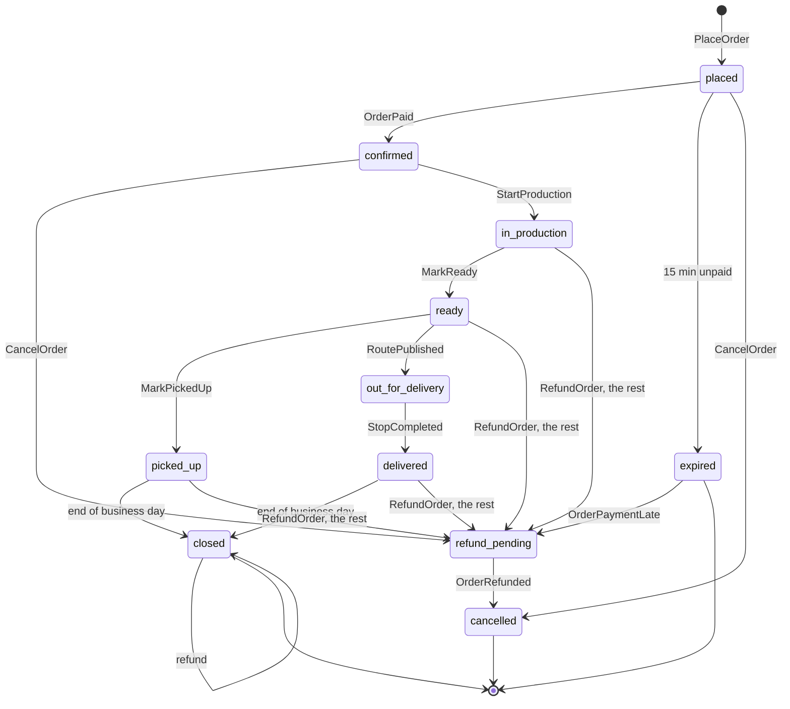
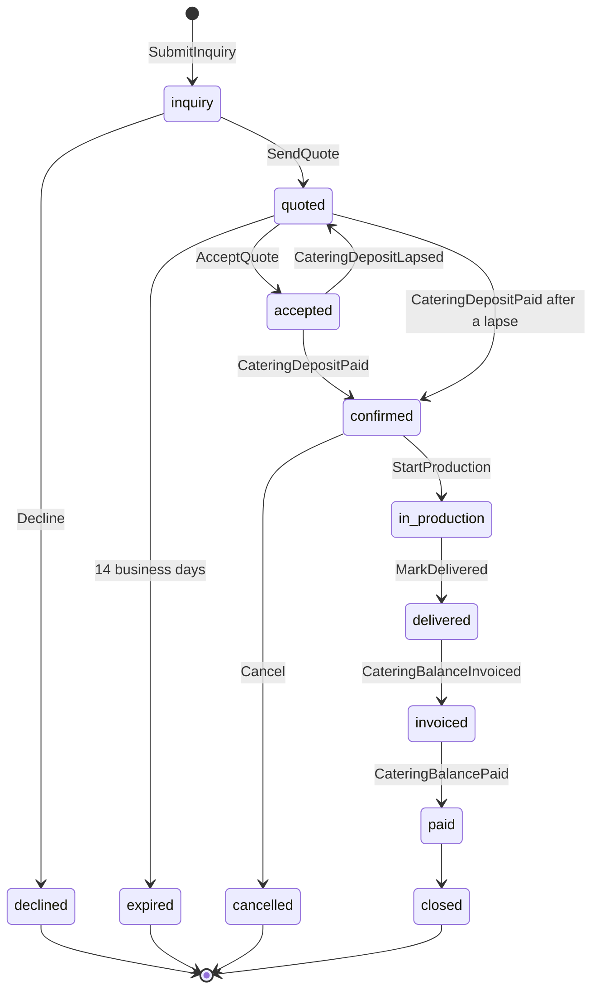
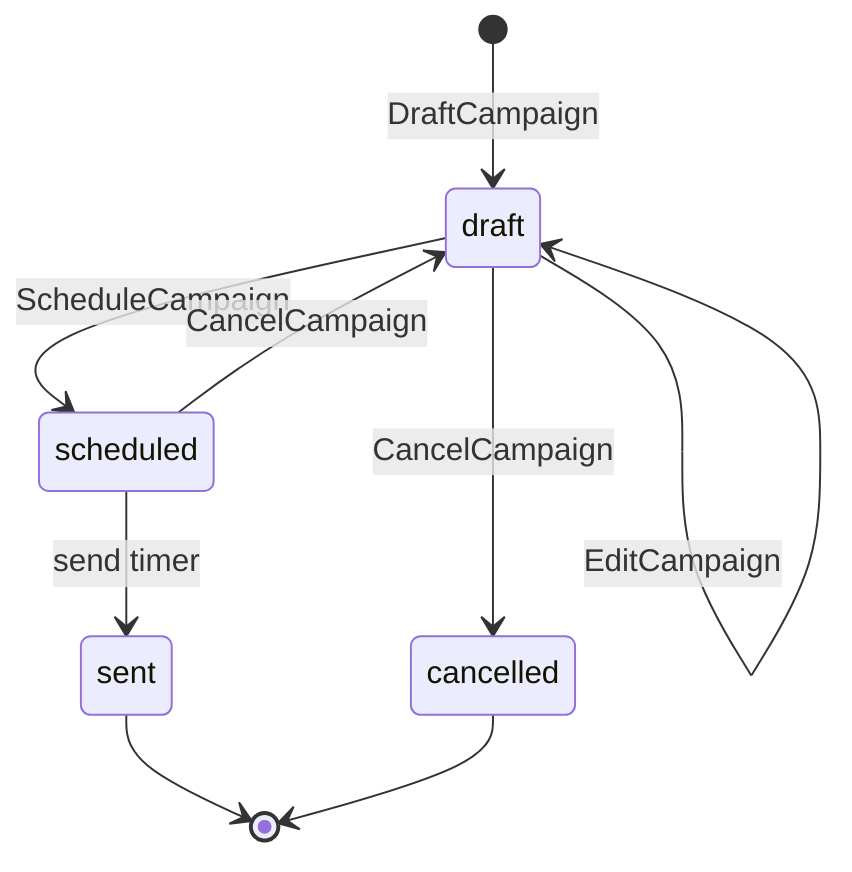
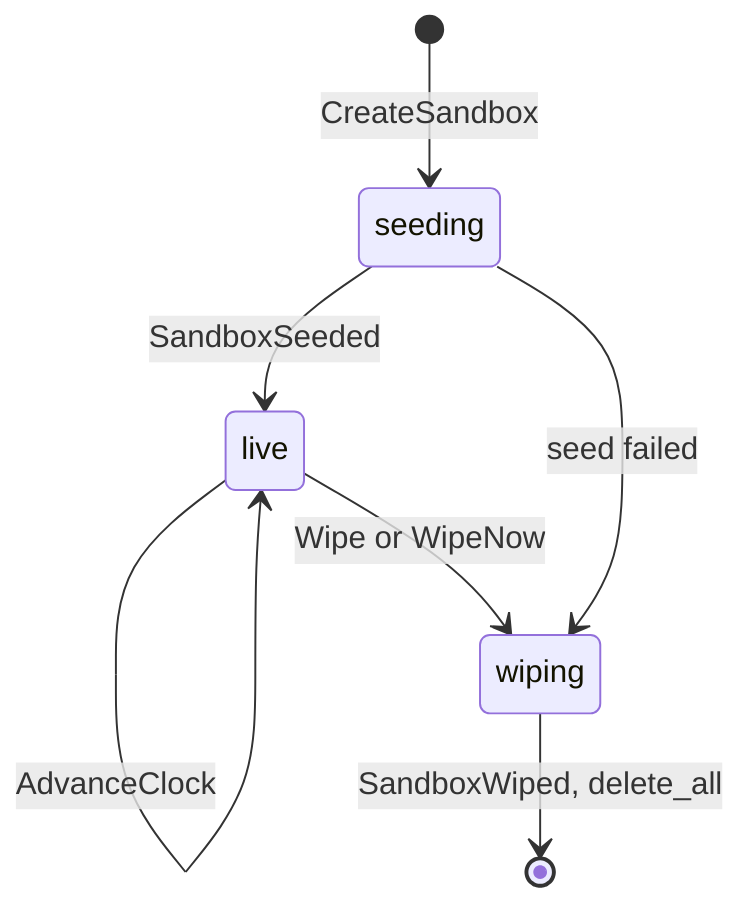
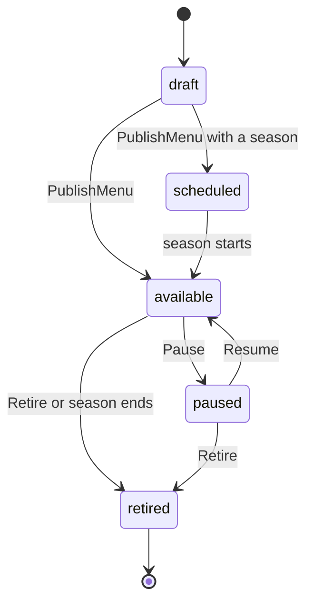
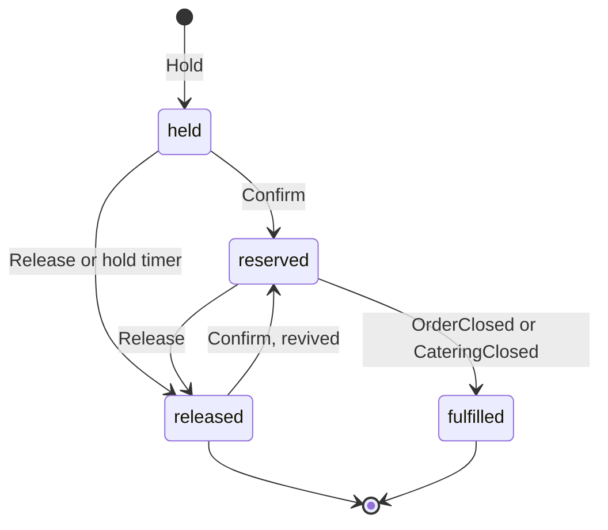

# Domain

The made-up bakery's language and rules: the terms every doc, screen and type uses, the aggregates and the Durable Object (DO) that hosts each, their commands, events, invariants and state machines, the event catalog and its envelope, how money, time and identifiers are represented, how idempotency works at every boundary, what a sandbox is born with, and which of the site's Lab principles runs where. The code that implements it is `crates/domain` (aggregates as `decide` and `evolve`, events, value objects) and `crates/seed`; how objects, the Queue and the Workers fit together is [architecture.md](architecture.md). Why the bakery exists is [product.md](product.md).

Status: Updated in PR 16 · 2026-11-06

Prices, limits and versions are as of 2026-11-04, with sources. Every menu price, package price and tax rate on this page is the made-up bakery's demo data, not a platform price.

## The story

The made-up bakery is Proof of Concept Bakery, "Proof of Concept" for short (Q2 · Q-name). It is a neighborhood bakery in Salt Lake City, the made-up bakery's city, Joseph's choice of 2026-11-04 (Q3 · Q-city), on a map and among 64 public places built for it with the site's Route Lab pipeline ([the seed](#the-seed)). Its kitchen starts before dawn and its counter opens at 07:00, Tuesday to Sunday. It sells breads, pastries, cakes, savory bakes and drinks, for pickup in 15-minute slots or delivery in 2-hour windows. On weekdays it delivers a handful of orders with one van; on Saturdays it runs four vans and 63 stops, the shape of the Route Lab's busiest day. It caters breakfasts, pastry tables, lunches and celebrations at six made-up venues, at most two events a day, booked at least a week ahead. Its 60 regular customers have made-up names, preferences, consent flags and loyalty points.

Everything in it is synthetic. No customer, venue, address or card belongs to a real person or business. Delivery addresses are 64 public places in Salt Lake City from OpenStreetMap, by their map label, with no street address anywhere.

The demo has two kinds of visitor. One reads: the public pages, the "How it's built" page, and the tour, whose steps link each screen to its lab page and ADR (Q41 · Q-tour). The other plays: they open a private sandbox and switch between being a customer at the storefront and being Proof of Concept's staff in the console (Q4 · Q-personas); they can move the sandbox's clock forward to see tomorrow (Q12 · Q-clock), start simulated traffic to watch the screens move (Q40 · Q-traffic), and do any of it again through the API with their own token (Q42 · Q-api-access).

## Ubiquitous language

One definition each. Code, API fields, screens and docs use these words and no synonyms.

| Term | Definition | Context |
|---|---|---|
| Sandbox | One visitor's private copy of the bakery: a family of DOs born from a seed and wiped at the next 10:00 UTC | Platform |
| Account | A visitor's identity: the HMAC of a Google `sub`, a GitHub user id or a demo username (later, of a normalized email address; Q43 · Q-email-signin), and nothing else | Platform |
| Persona | The role a visitor plays in a sandbox: a customer (one of the 60) or staff | Platform |
| Menu item | Something the bakery sells, with a category, allergens, a lead time and availability rules | Storefront |
| Variant | A sellable form of a menu item with its own price, such as a single croissant or a box of six | Storefront |
| Slot | A 15-minute pickup interval with a capacity in orders | Scheduling |
| Window | A 2-hour delivery interval for one zone, sharing that zone's daily capacity in stops | Scheduling |
| Order | A customer's request for lines, for one slot or window, paid once, with a lifecycle from placed to closed | Ordering |
| Line | One variant and a quantity in an order, priced at placement | Ordering |
| Production plan | The quantities to bake for one business day, projected from reserved orders and catering | Scheduling |
| Bake list | The production plan as the kitchen board shows it, grouped by item and start time | Ordering |
| Catering event | A booked job: a date, a headcount, a package and a venue, with a quote, a deposit and a balance | Catering |
| Package | A priced catering menu per head, such as the breakfast spread | Catering |
| Venue | One of six made-up places where catering is delivered, each pinned to a place | Catering |
| Quote | The staff's priced offer for a catering event, valid for 14 business days, or until the day before the event if that comes first | Catering |
| Deposit | 25% of a quote's total, paid to confirm a catering event | Billing |
| Balance | A quote's total minus its deposit, invoiced after delivery | Billing |
| Invoice | A Stripe Invoicing document for a balance, in the Stripe sandbox | Billing |
| Payment | One Stripe PaymentIntent and its outcome, for an order, a deposit or a balance | Billing |
| Refund | Money returned against a payment, full or partial, never more than was paid | Billing |
| Route | One van's ordered stops for a business day | Fulfillment |
| Stop | One delivery: an order and a place | Fulfillment |
| Customer | A synthetic persona with a profile, preferences, consent flags and a loyalty balance | CRM |
| Timeline | One customer's events in business-time order, as a projection | CRM |
| Segment | A rule over the customer projection, such as "ordered a cake in the last 30 days" | CRM |
| Campaign | A message composed by staff, sent to a frozen segment at a scheduled business time | CRM |
| Message | One delivered item in the inbox: a receipt, a reminder, a quote, an invoice or a campaign | CRM |
| Inbox | The sandbox's simulated mailbox, where every message lands, with simulated opens and clicks | CRM |
| Loyalty | Points a customer earns from paid orders, one per whole dollar | CRM |
| Business time | The sandbox's clock: wall time plus the sandbox's offset, which only grows | Platform |
| Wall time | The real time, UTC, which platform alarms, the wipe and the logs use | Platform |
| Seed | The 64-bit number from which `crates/seed` generates a sandbox's entire starting state | Platform |
| Place | One of 64 public places in Salt Lake City from OpenStreetMap, named by index and map label, with no coordinates or street address | Fulfillment |
| Simulated customer | A persona whose commands the `Simulator` issues on its alarm while traffic runs; its events carry `cause: sim:<ulid>` | Platform |
| Tour | The guided walkthrough on every screen: what is shown, the events the last action produced, the principle with its lab page and ADR, and the same action as an API request | Presentation |
| API token | A per-sandbox bearer token, signed like the session cookie, that lets the visitor send the console's commands from `curl` or a script; 24 h, and never past the wipe | Platform |

## Aggregates and their objects

An aggregate is a consistency boundary: one object decides every change to it, in one transaction. Each command carries an idempotency key ([idempotency](#idempotency)); the rule for each source is fixed:

- **From a client:** the `Idempotency-Key` header, a ULID the client makes per intent and reuses on every retry.
- **From an event:** `<event id>:<subscriber class>`.
- **From an alarm:** `<timer id>`, the row in the object's `timers` table.
- **Creating an aggregate:** the Sandbox maps the client's key to the ULID it registers, so a retried "place order" finds the same order.

### Order

Hosted by `Order`, one object per order (`order:<sandbox>:<ULID>`). It protects the order's lines, prices, payment status and lifecycle.

| Command | From | Emits | Rejected when |
|---|---|---|---|
| `PlaceOrder` | customer | `OrderPlaced` | no held slot or window; a line outside the menu version; lead time not met; note fails the free-text rules |
| `CancelOrder` | customer before payment; customer or staff before production | `OrderCancelled`, or `OrderRefundRequested` once paid | in production or later |
| `RecordPayment` | `PaymentSucceeded` | `OrderPaid`, or `OrderPaymentLate` when expired or cancelled | a second payment for a paid order; an amount that differs from the total (`amount-mismatch`) |
| `Expire` | the expiry timer | `OrderExpired` | already paid |
| `StartProduction`, `MarkReady`, `MarkPickedUp` | staff, from the board | `OrderProductionStarted`, `OrderReady`, `OrderPickedUp` | out of order |
| `MarkOutForDelivery`, `MarkDelivered` | `RoutePublished`, `StopCompleted` | `OrderOutForDelivery`, `OrderDelivered` | a pickup order |
| `RefundOrder` | staff, full or partial | `OrderRefundRequested`, with `OrderCancelled` when it is the rest of an unclosed order | the amount exceeds paid minus refunded (`refund-exceeds-paid`); any state but `confirmed`, `in_production`, `ready`, `picked_up`, `delivered` and `closed` (`out-of-order`) |
| `RecordRefund` | `RefundIssued` | `OrderRefunded` | an unknown refund |
| `Close` | the end-of-day timer | `OrderClosed` | not picked up or delivered |

Invariants:

- 1 to 20 lines, each a quantity of 1 to 24; prices are copied from the menu version named at placement and never change after.
- `total_cents = subtotal_cents + tax_cents`, tax computed once on the subtotal ([money](#money-and-time)).
- The slot's start is at least the longest lead time among the lines after placement, in business time.
- Exactly one payment counts. Refunds sum to at most what was paid.
- An unpaid order expires 15 minutes of business time after placement (Q13 · Q-order-flow).



Notes from building `Order` in PR 4 (2026-11-05), each a reading of this section and not a change to it:

- **Two edges the diagram implies but does not draw.** `cancelled --> refund_pending` when a payment lands after the order was cancelled (`OrderPaymentLate`, as for `expired`), and a self-loop on `refund_pending` for a partial refund requested while one is already pending.
- **A cancelled paid order emits two events together:** `OrderCancelled` and `OrderRefundRequested`, in one commit.
- **`RefundOrder` by staff was accepted only in `closed`.** PR 5 widened it (below).
- **`Expire` before `held_until` is rejected as not due.** The timer's own run, after the held time, is accepted, and a second run is a replay under the key `timer:expiry`.

Notes from building `Billing` and the refunds in PR 5 (2026-11-05), each a reading of this section and not a change to it unless it says so:

- **`RefundOrder` is now accepted in `confirmed`, `in_production`, `ready`, `picked_up`, `delivered` and `closed`** (`crates/domain/src/order.rs`, proven by the domain's tests and by `scripts/smoke-payments.sh` for a confirmed order). This widens the PR 4 note above, which took the first sentence of the catalog's row literally. A partial refund leaves the state as it is. A refund of all that is left, in a state before `closed`, is a cancellation by staff: `OrderCancelled` and `OrderRefundRequested` together, state `refund_pending`, then `cancelled` on `OrderRefunded`. In `closed` the order stays `closed`. The diagram gains four edges for it.
- **`out_for_delivery` is refused (`out-of-order`).** The build took the explicit list of states, which leaves it out, over the words "every paid, non-terminal state", which would include it. It stays refused until Joseph says which reading he meant.
- **`RecordPayment` refuses an amount that differs from the order's total** as `amount-mismatch` and emits nothing. Billing creates the intent from the total, so a mismatch is a bug; the Worker logs the refusal and answers the event 200, so Stripe does not retry it.
- **A known gap, closed by PR 8.** A seeded paid order has no Stripe payment, because the seed writes its history into no `Billing` yet. A staff refund of one answers 409 `no-stripe-payment`, and a customer's cancellation of a seeded confirmed order stays `refund_pending`: `Billing` logs `refund_skipped` and no money is returned, since none was taken. PR 8, which writes the seed's history into `Billing` and `Crm`, closes it. The seed's daily totals are stored in `Billing`'s `history` table and appear in no response yet, because the ledger's lines each need a Stripe id.
- **`webhook-later` is unproven.** A webhook `Billing` cannot apply yet (an unknown intent, a refund before its payment) answers 409 `webhook-later` so Stripe retries. The code does it; `scripts/smoke-payments.sh` has no check for it.

Notes from the console audit of 2026-11-08 (findings 7 and 14), each a change to this section:

- **A delivery is delivered only once it is ready.** The diagram's edges stand: `ready --> out_for_delivery` on `RoutePublished`, `out_for_delivery --> delivered` on `StopCompleted`. Before, a stop could be completed while its order was still `confirmed`: the Order refused both commands as `out-of-order` and the kitchen board kept the card in Confirmed with "Start production". Now the Dispatch refuses the completion (`not-ready`, [Dispatch](#dispatch)) until the order is ready. A plan published while an order was still being made leaves that order `ready` when the kitchen finishes it, not out for delivery; when its stop is completed, `StopCompleted` carries the stop's route and the Order runs `MarkOutForDelivery` and then `MarkDelivered` in one commit, so the order passes through `out_for_delivery` and the board moves (`workers/api/src/objects/order.rs`).
- **Seeded payments are in the ledger.** The seed's open orders past `placed` are paid at birth, and `Billing` is now seeded with their payments (`PaymentIntentCreated`, `PaymentIntentRecorded` and `PaymentSucceeded`, with the intent id `seed:<payment>`, written with no outbox rows), so the ledger, the board and the timelines agree from birth. Stripe never saw them, so a staff refund of a seeded order still answers 409 `no-stripe-payment`, and a customer's cancellation of one stays `refund_pending` (`refund_skipped`, rule `seeded-payment`), as before.

### CateringEvent

Hosted by `CateringEvent`, one object per inquiry (`catering:<sandbox>:<ULID>`). It protects the job's quote, money due and lifecycle, and runs the saga by alarm ([architecture.md](architecture.md#the-catering-saga)).

| Command | From | Emits |
|---|---|---|
| `SubmitInquiry` | customer: date, headcount 10 to 200, package, venue, brief | `CateringInquiryReceived` |
| `SendQuote`, `Decline` | staff, from `inquiry` | `CateringQuoteSent`, `CateringDeclined` |
| `AcceptQuote` | customer, from `quoted` | `CateringQuoteAccepted` |
| `LapseDeposit` | the deposit hold's timer, 15 minutes after the acceptance | `CateringDepositLapsed` |
| `RecordDeposit` | `PaymentSucceeded` with purpose `deposit` | `CateringDepositPaid` |
| `FireReminder` | a reminder timer | `CateringReminderDue` |
| `StartProduction`, `MarkDelivered` | staff | `CateringProductionStarted`, `CateringDelivered` |
| `RecordInvoice`, `RecordBalance` | `InvoiceIssued`, `PaymentSucceeded` with purpose `balance` | `CateringBalanceInvoiced`, `CateringBalancePaid` then `CateringClosed` |
| `Cancel` | customer or staff, from `confirmed` | `CateringCancelled` |
| `ExpireQuote` | the quote timer | `CateringQuoteExpired` |

Invariants (as built in PR 7, and the notes under the diagram say how each was read): the date is at least 7 business days after the inquiry; the day holds at most 2 confirmed events, held and reserved in that day's `Schedule` (Q16 · Q-catering); `deposit_cents` is 25% of the quote's total rounded half-up, and `balance_cents = total_cents - deposit_cents`, so the two always sum to the quote; a cancellation more than 7 days before the date refunds the deposit, within 7 days it does not. Reminders: a follow-up 3 business days after a quote, one 2 days before the event, one when the invoice is 7 days old.



Notes from building `CateringEvent` and the balance invoices in PR 7 (2026-11-05), each a reading of this section and not a change to it unless it says so. The aggregate is `crates/domain/src/catering.rs`; its module doc says the same at greater length.

- **A business day is an open day,** Tuesday to Sunday, counted from the day after the one in question. "At least 7 business days" means the date is at least the 7th open day after the inquiry's day, so an inquiry on a Tuesday may name the Wednesday of the next week, and an event 6 days out is refused. A quote is valid until 07:00, the opening, of the 14th open day after the quote's day, or until midnight starting the day before the event if that comes first (since the console audit of 2026-11-08, which saw a quote for 2026-11-19 valid until 2026-11-27): no deposit can confirm an event once its production day has begun, a quote sent after that moment is refused `quote-expired`, and its expiry gives the reason `the day before the event`; the follow-up is due at the opening of the 3rd; `event_soon` at the opening of the day two calendar days before the event.
- **The quote.** `SendQuote` with no total prices the package at its per-head price times the headcount: the made-up bakery's prices are $9.50 a head for the pastry platter, $14.50 for the breakfast spread, $18.50 for lunch boxes and $12.50 for celebration cake and coffee (`PACKAGES`, as of 2026-11-05), so 40 heads of breakfast spread quote 58,000 cents. Staff may give a total instead; it must be at least 1 cent (`quote-total`). The deposit is 25% rounded half-up and the balance the rest. A repeat quote is refused, since the diagram draws no edge from `quoted` back to a quote.
- **The deposit hold.** `AcceptQuote` holds one of the day's two catering places in that day's `Schedule`, keyed by the catering id, and the aggregate records when the hold lapses (`lapses_at`, 15 minutes of business time later). `LapseDeposit` at that time moves `accepted` back to `quoted` and emits `CateringDepositLapsed`; the Schedule then releases the place if it is still only held. A later `AcceptQuote`, while the quote is valid, holds it again.
- **A deposit after a lapse still confirms,** the new edge `quoted --> confirmed`, because the money moved; the Schedule's `Confirm` takes the released place back. A deposit for the wrong amount is `amount-mismatch`, and a second payment with another id is `out-of-order`; the same payment again is a no-op. **A deposit that lands after the quote expired** is also `out-of-order` in the aggregate, and the Worker answers it by refunding the whole amount at Stripe (the way an `Order` treats a late payment) and logging `deposit_late`; the event stays `expired`. This is the decision on the domain stream's question 2, for Joseph to confirm.
- **Cancellation is taken from `confirmed` only,** by the customer or by staff, with a reason from a list (`customer_change`, `venue_lost`, `other`). The deposit is refunded when the event's date is more than 7 calendar days after the day of the cancellation; the flag is on the event (`refund_deposit`) so `Billing` needs nothing else. Re-quoting, declining a quoted inquiry and cancelling before the deposit are all `out-of-order`, as the diagram draws it (the domain stream's question 6, left as drawn). A refund of a paid balance is not offered: `Billing` refuses it (question 4, left as it was).
- **Production and delivery keep to the event's days** (since the console audit of 2026-11-08, which started production and marked delivered 8 days before the event). The domain stream's docs left the timing open, so the rule is the smallest that forbids that: `StartProduction` is refused `too-early` before the calendar day before the event, and `MarkDelivered` before the event day, both read in business time and both naming the first day allowed. The seed's own times, production at 05:00 and delivery at 11:00 on the event day, are inside it. The saga's timers are unchanged.
- **The invoice falls due 7 days after the event's date** (`invoice_due`, the date plus 7; it was the delivery day plus 7 until 2026-11-08, the same day now that delivery cannot come early), so a late "delivered" does not move the terms, and the `invoice_due` reminder, "when the invoice is 7 days old", is due at the opening of the due date. It is one decision, not two (question 5).
- **Timers that no longer apply are no-ops,** not errors: `LapseDeposit`, `ExpireQuote` and `FireReminder` emit nothing when their condition does not hold, early or stale, and a reminder fires once. Repeating `AcceptQuote`, `StartProduction`, `MarkDelivered` or `Decline` in the state it leads to also emits nothing. The object computes its timer rows from the state alone (`timers`, `reminders`), so no event needs a clock.
- **Events carry the times they arm.** `CateringQuoteSent` has `follow_up_at`, `CateringQuoteAccepted` has `lapses_at`, `CateringDelivered` has `customer`, `balance_cents` and `due` (what `Billing`, which subscribes to it, needs to raise the invoice), and `CateringCancelled` has `by` and `reason`. All are additions within envelope version 1.
- **The balance is an invoice, and its payment is the invoice.** `Billing` raises it from `CateringDelivered`, under the delivery envelope's id, so a redelivery raises the same one; `InvoiceIssued` comes back as `RecordInvoice`. The balance's payment id is the invoice's id, and `invoice.paid` becomes `PaymentSucceeded` with purpose `balance`. `invoice.voided` becomes `PaymentCanceled`, and a paid event for a void invoice has no effect.
- **Tests.** The 18 edges of the diagram (the start, the 12 state changes the diagram drew before PR 7, `quoted --> confirmed`, and a reminder that leaves the state as it is in `quoted`, `confirmed`, `in_production` and `invoiced`) are each walked by `every_edge_of_the_diagram_is_walked`, which fails if one is missing or another is taken; `no_sequence_reaches_an_undefined_state` runs 512 random sequences of up to 80 commands at random business times and checks every step against that list, that a replayed log gives the state, that deposit plus balance is the quote, that a terminal state has no timer and that a repeated command at the same time changes nothing.

### Campaign

Hosted by `Crm`, one object per sandbox (`crm:<sandbox>`), as a table of campaigns. This bends "one object per aggregate" on purpose: a send must read Crm's segment projection at the moment it fires, a sandbox holds a handful of campaigns, and a class of its own would add a hop and a class per preview. Crm stays the only writer of campaigns, so the single-writer rule holds.

Commands: `DraftCampaign`, `EditCampaign`, `ScheduleCampaign` (a business time at least 15 minutes ahead), `CancelCampaign`, `SendCampaign` (the timer). Events: `CampaignDrafted` and `CampaignEdited` (added by PR 8, Crm's own record, routed nowhere), `CampaignScheduled`, `CampaignCancelled`, `CampaignSent`. Subjects and bodies are chosen from fixed templates, never typed; segments are a fixed list (`everyone`, `cake-last-30-days`, `delivery-customers`, `lapsed-60-days`, `catering-leads`) evaluated over Crm's projection at the send's business time. Invariants: recipients are customers whose `marketing` consent is true at send time; the recipient list is frozen and stored with `CampaignSent`, so a rebuild reproduces the stats; one message per recipient per campaign, keyed by campaign and customer.



**As built in PR 8 (2026-11-05, `crates/domain/src/crm.rs`).** The aggregate is `Campaigns` over a table of `Campaign {subject, body, segment, state, send_at, recipients}`. Its rules, each with a test in `crates/domain/src/crm/tests.rs` or in `workers/api/src/objects/crm.rs`:

- **Draft and edit.** `DraftCampaign` with the same content under the same id again is a no-op; other content under that id is refused as `campaign-exists`. `EditCampaign` works on a draft only. Both events, `CampaignDrafted` and `CampaignEdited`, carry the subject, body and segment and are routed nowhere: they are Crm's own record, as `PaymentIntentRecorded` is Billing's.
- **Schedule and cancel.** `ScheduleCampaign` needs a `send_at` at least 15 minutes after now, else `schedule-too-soon`, which names the earliest time allowed (the Worker rounds it up to a whole minute). `CancelCampaign` takes a scheduled campaign back to draft, makes a draft cancelled, does nothing to a cancelled one and is refused on a sent one as `out-of-order`.
- **Send.** `SendCampaign` takes an `Audience`, and `Audience::of(projection, segment, now)` is the only way to build one: the segment's members whose `marketing` is true at that moment, in a type whose fields are private, so a send cannot skip consent. Sent when the campaign is not scheduled, a second firing included, it emits nothing; before `send_at` it is `not-due`, which the Worker re-arms on; with the wrong segment it is `audience`. `CampaignSent` freezes the recipients and carries the subject and the body, since the Inbox has no other way to learn the body. The refusal slugs are `unknown-campaign`, `campaign-exists`, `out-of-order`, `schedule-too-soon`, `not-due`, `audience` and `overflow`.
- **Templates, never typed.** Six subjects (`weekend-bake`, `cake-week`, `new-season`, `we-miss-you`, `catering-season`, `thank-you`) and six bodies (`announcement`, `fresh-bread`, `cake-orders`, `seasonal-menu`, `come-back`, `catering-invite`) are enums in the domain, with their text in the domain. Every body starts "Hello from Proof of Concept." and none uses a customer's name, an address or a link; a test renders every template and passes the free-text check on each. A request names a template by its slug, so a campaign carries no free text at all.
- **Segments**, as rules over Crm's projection at the send's business time, none applying consent (the campaign does): `everyone`; `cake-last-30-days`, a counted order with a cake line whose slot is on or after now minus 30 days, with no upper bound, so a future cake order counts; `delivery-customers`, any counted delivery order; `lapsed-60-days`, no counted order with a slot on or after now minus 60 days, those who never ordered included; and `catering-leads`, a lead at inquiry, quoted or accepted. A counted order is a paid one, or one closed in the seed's history, and not cancelled, and its date is its slot's.
- **Stats** are sets of message ids (delivered, opened, clicked) learned from the Inbox's events, so a rebuild reproduces them from the log.

**The activity feed, since the console audit of 2026-11-08 (findings 13 and 36).** The feed listed only the system's events (clock moves, faults, menu and capacity changes, payment intents, routes, traffic, token rotations), though the console says it shows an order paid, a campaign sent and a rebuild finished. It now also has a row for every `OrderPaid` ("Order paid: $11.28, delivery") and every catering step Crm hears of (the inquiry, the quote, its acceptance or expiry, the decline, the deposit, the balance invoiced and paid, the close and the cancellation), both kept in the projection, so a rebuild reproduces them. A campaign sent and a rebuild finished are Crm's own events, not deliveries, so they are read from Crm's own stream when the feed is asked for (`crm::activity_feed`), and a rebuild still reproduces the projection byte for byte. Counts agree with their nouns: "Routes proposed: 1 van, 22 minutes". Catering production and delivery are not routed to Crm, so they are not in the feed.

### Sandbox

Hosted by `Sandbox` (`sandbox:<ULID>`). It protects the sandbox's lifecycle, its registry of children, its seed and its business clock.

Commands: `CreateSandbox` (Turnstile for guests; admitted by `Control`), `RegisterChild`, `AdvanceClock` (15 minutes, 1 hour, 1 day, or next opening), `RotateApiToken` (signed-in visitors), `SetFault`, `RedriveDeadLetter`, `WipeNow`, `Wipe` (from `Control` at 10:00 UTC, the Sandbox's own timer, or the 36 h backstop). Events: `SandboxSeeded`, `ClockAdvanced`, `ApiTokenRotated`, `FaultSet`, `SandboxWiped`. Invariants: the offset only grows and stays within 14 days (Q12 · Q-clock); the token version only grows, and a token naming an older one is refused; a child exists only once registered; once wiping, every command is refused with 410; a sandbox never outlives the next 10:00 UTC (Q25 · Q-ttl).



**AdvanceClock, as built in PR 6 (2026-11-05).** The command takes exactly one of a step or a whole number of minutes. The steps are `15m`, `1h`, `1d` and `next-opening`; a count of minutes is the older form and is kept (`Minutes(15)` writes `15m`). `1d` is 86,400 s of business time, so across the spring-forward night Saturday 07:00 Mountain standard time becomes Sunday 08:00 Mountain daylight time, which a domain test pins. `next-opening` is the next 07:00 on an open day strictly after business now, so from a Sunday afternoon it lands on Tuesday 07:00. Two rules refuse it, both answered 422 `clock` and named in the problem: `not-positive` (no step and no minutes, both, or zero minutes) and `offset-cap` (the offset would pass 14 days, 1,209,600 s, Q12 · Q-clock). The Sandbox's `ClockAdvanced` carries `from`, `to`, `clock_v` and the step in its wire form ([architecture.md](architecture.md#time-travel)).

### MenuItem availability

Hosted by `Catalog` (`catalog:<sandbox>`). It protects what may be sold when: price, lead time, the days of the week an item is baked, its daily cap and any season. The count left today lives in that day's `Schedule`, which decrements it at each hold, so a sold-out item is a Schedule fact the storefront reads (Q5 · Q-menu).

Commands: `EditItem`, `SetPrice`, `SetAvailability`, `Pause`, `Resume`, `Retire`, `PublishMenu`. Events: `MenuItemChanged`, `MenuPublished` (the version bump that invalidates the cached menu). Invariants: prices are positive integer cents; a cake's lead time is at least 48 h; a seasonal item is available only inside its season; edits are drafts until `PublishMenu`, so orders always name a published version.



Season, as built in PR 4 (2026-11-05): a season is a recurring `MM-DD` window that repeats every year, not the first and last business date this section first described. That is the current reading, chosen by the domain stream, and Joseph can reverse it.

### Schedule reservation

Hosted by `Schedule`, one object per sandbox and business day (`schedule:<sandbox>:<YYYY-MM-DD>`). It protects capacity: orders per slot, stops per zone, items per day, catering events per day (Q10 · Q-slots, Q11 · Q-production).

Commands: `Hold` (synchronous, from the router, keyed by the order or catering id), `Retake` (the placement's retry whose hold was released before any Order was placed; since the hardening after PR 13), `Confirm` (from `OrderPaid` or `CateringDepositPaid`), `Release` (from `OrderExpired`, `OrderCancelled`, `CateringCancelled`, `CateringDepositLapsed`, or the hold's own timer), `Fulfil` (from `OrderClosed` or `CateringClosed`), `SetCapacity` (staff), `RefreshCaps` (from `MenuPublished`). Events: `SlotHeld`, `SlotReserved`, `SlotReleased`, `SlotFulfilled`, `CapacityChanged`, `CapsRefreshed`, `BakeListChanged`. Invariants: held, reserved and fulfilled places never exceed capacity, except by a revival (below); a hold lasts 15 minutes of business time; a lowered capacity never cancels existing reservations, it only stops new holds; the production plan is recomputed in the same transaction as any reservation change.



**As built in PR 6 (2026-11-05)**, in `crates/domain/src/schedule.rs` and `calendar.rs`; the Worker object that hosts it is [architecture.md](architecture.md#durable-object-topology).

- **The bakery day.** America/Denver under the 2007 US rule, computed with no time-zone crate: open 07:00 to 15:00 Tuesday to Sunday, 32 pickup slots on the quarter hour (07:00 to 14:45), delivery windows of 2 hours starting 09:00, 11:00 and 13:00, three zones `z1` to `z3`. A closed day refuses every hold (`closed-day`).
- **Capacity defaults.** 6 orders per pickup slot, 20 stops per delivery zone a day, 2 catering events a day. Six in a quarter hour is one hand-over every 2.5 minutes, about what one person serving can manage; 20 a zone is 60 stops across the three, close to the busy Saturday's 63 ([the seed](#the-seed)); 2 catering events is the rule already in [the story](#the-story). They are the made-up bakery's numbers, a decision of the domain stream in PR 6 that staff can change from the console and Joseph can reverse.
- **What counts.** Held, reserved and fulfilled places all count against capacity; only released ones do not. A zone's 20 stops are shared by its three windows. The bake list counts reserved and fulfilled places only, the confirmed orders Q11 names: a hold is not on it. A catering place's line is the package's slug with the headcount as its quantity, and since 2026-11-08 it is marked `catering: true` so a screen can say "for 40 people" rather than "40 ×". The Kitchen shows a day's bake list once it hears a Schedule event for that day (a reservation or a release); moving the clock to a day with nothing reserved shows no list for it.
- **Item caps.** `RefreshCaps` copies every item's daily cap from the published menu. The Worker sends it when the seed writes the seven days, on `MenuPublished` to every registered day from business today on, and, since the hardening after PR 13 (2026-11-06), at the birth of every later day: a day first touched by a hold, a read or a capacity change asks the Catalog once for its published menu and writes `CapsRefreshed` before that first command, in the same transaction, so it is capped like a seeded day. When the menu cannot be read the day is not born and the touch is refused (500 to the visitor, `schedule_birth_refused` logged with reason `caps-unavailable`), the safer choice for a demo that must not promise a bake its menu caps; a gone Catalog is the gone sandbox's 410. Proven on `wrangler dev` by `scripts/smoke-schedule.sh` (a day first touched by the order that fills the menu's lowest cap refuses the next one `item-cap`, and so does a day born before a publish). An order line counts by its quantity summed per item, so a box of six croissants counts as one croissant (a reading to confirm, see the questions in [roadmap.md](roadmap.md#pr-6-scheduling-production-and-time-travel)). Every `MenuPublished` of a newer version writes `CapsRefreshed`, even when the caps are the same, so the day names the menu version its caps follow (since the console audit of 2026-11-08, where a price-only publish left the day saying version 1 after the menu reached 3). An item with no cap, before the first refresh or absent from the menu, is uncapped. A hold over an item's remaining cap is refused `item-cap`, naming the item and how many are free.
- **The check order in `Hold`.** Closed day, then zone and slot validity (`unknown-zone`, `zone-required`, `no-such-slot`), then the same reference again (the same body is a no-op, a different one `ref-held`), then capacity (`slot-full`), then item caps. A slot hold drops any zone it is given; a catering hold accepts any start on the day.
- **A lost hold** (the hardening after PR 13, 2026-11-06). A placement retried with its `Idempotency-Key` after its place was released, by the hold's timer past 15 business minutes or by the router giving it back after the Order refused, and before any Order was placed, is decided as `Retake`: the same place (start, zone and lines; another is `ref-held`) is held again with the retry's own `expires_at` when the day has room, and the order is placed on that live hold; with no room in the slot, zone or catering day it is refused `hold-lost`, naming `next_free` as `slot-full` does (a full zone names none). An item at its cap is refused `item-cap`, naming the item and how many are free, as a first hold is: the cap covers the whole day, so no later start would take those lines (since 2026-11-06; before, it was `hold-lost` with no `next_free`, which the property test caught because later slots had room). A place still held, reserved or fulfilled is left alone. A retry of an order that was placed replays at the Order and asks for no place. Taking the place again, not refusing it, is the choice: the visitor asked once, the place was free, and the order is then held exactly as a first attempt would be.
- **`next_free`.** When a pickup slot is full, the refusal names the first later slot on the same day with a place free, so two orders racing for the last place get one reservation and one refusal naming, for example, 10:15 when 10:00 is gone. It is `None` for a window (the zone's stops are shared, so when one window is full all three are) and for catering, and when no later slot has room.
- **The hold's timer.** The Order's `held_until` is 15 minutes of business time after placement, and the hold's `expires_at` is that same instant. `held_expiries()` lists the timers to arm, one per held place; at `expires_at` the object decides `Release` with reason `hold_expired`. A `hold_expired` before `expires_at`, or on a place that is no longer held, changes nothing.
- **Revival.** `Confirm` of a place the hold timer already released reserves it again, past capacity if need be, because the payment already moved money; the event says `revived: true`, and it is the one way a count passes its capacity. The alternative, refusing the place and refunding the payment, is a question for Joseph.
- **`SetCapacity`'s target grammar.** `slot:HH:MM` (a quarter-hour start), `zone:z1` to `zone:z3`, `item:<slug>` (writes the day's item cap until the next `RefreshCaps` of a newer menu version replaces it) or `catering`. Anything else is `bad-target`. An `item:<slug>` the day's caps do not list, an item the published menu does not sell, is `unknown-item` (422), so a typo is not logged as a cap (since the console audit of 2026-11-08, which set `item:no-such-thing`). A lowered capacity never releases a place: taken stays, free is zero.
- **`Fulfil`** of a held or released place changes nothing. If `OrderClosed` reached the Schedule before `OrderPaid`, the place would stay reserved and not fulfilled; both count against capacity, so capacity stays safe.
- **The 18:00 plan lock** that [Money and time](#money-and-time) describes is not built: the docs do not say what it refuses, and a hard lock contradicts a same-day order with a 2 h lead.

### Dispatch

As built in PR 9 (2026-11-05; `crates/domain/src/dispatch.rs`, [ADR 0012](adr/0012-delivery-dispatch.md)). Hosted by `Dispatch`, one object per sandbox and bakery day (`dispatch:<sandbox>:<YYYY-MM-DD>`). It holds the day's stops, the server's proposed plan, the browser's submitted plan and the published plan, and it is the one place a plan becomes the record: whoever made a plan, only one that passes the validator is published. A stop is one delivery order at one of the 64 places, sized in **units** (the order's line quantities summed), and a van's capacity counts units: 250 a van as seeded, which the busy Saturday needs (400 to about 790 units across the seeds the domain stream swept on 2026-11-05, with one order reaching 74), where 20 would not fit.

| Command | From | Emits | Rejected when |
|---|---|---|---|
| `AddStop` | `OrderPlaced` for a delivery (a pickup has no stop) | `StopAdded`, provisional | `wrong-day`: the window is on another bakery day. Nothing for an order already added or removed |
| `ConfirmStop` | `OrderPaid` | `StopConfirmed` | never; nothing for a stop already confirmed, delivered or removed |
| `RemoveStop` | `OrderExpired`, `OrderCancelled` | `StopRemoved`, reason `expired` or `cancelled` | never; nothing for a stop already removed or delivered |
| `Propose {vans, capacity}` | staff | `RouteProposed`: the Clarke–Wright plan over the confirmed stops, which becomes the day's vans and capacity | `vans` (not 1 to 4), `capacity` (0), `no-stops`, `place-unknown` |
| `SubmitPlan {routes}` | staff, with the plan the browser's VROOM made | `PlanSubmitted`, minutes recomputed from the matrix | `no-stops`, and the validator's rules below, `window` among them |
| `Publish {plan, departed}` | staff, `plan` being `proposed` or `submitted` | `RoutePublished` as `plan_v + 1`, superseding the last | `no-plan`, `stop-missing`, `no-stops`, the validator's rules again, and `published` when `departed` |
| `CompleteStop {stop}` | staff, or a driver | `StopCompleted`, with the stop's route | `no-plan`, `stop-unknown`, `not-ready` (the stop's order is not ready yet). Nothing the second time |

Events: `StopAdded`, `StopConfirmed`, `StopRemoved`, `RouteProposed`, `PlanSubmitted`, `RoutePublished` and `StopCompleted` ([the catalog](#the-event-catalog)). The first three and `PlanSubmitted` have no subscriber and are the Dispatch's own log, like the Schedule's `SlotHeld`. The stop's status runs provisional, confirmed, then removed or completed.

The rules, by the slug a problem document names them with (a refused command is a `dispatch` problem; [security.md](security.md#sandbox-isolation) lists the statuses):

| Slug | The rule |
|---|---|
| `vans` | A day plans with 1 to 4 vans; a plan names each van once, numbered from 1 to the day's vans |
| `capacity` | A van carries at least 1 unit |
| `no-stops` | There are confirmed stops to plan |
| `place-unknown` | Each stop's place is in the travel-time matrix |
| `route-ends` | Each van starts and ends at the bakery, place 0 |
| `wrong-day` | A stop's window is on the day's own bakery date |
| `stop-unknown` | A plan names only confirmed stops of this day (a provisional, removed, delivered or unknown one is refused), and a completion names a stop number the published plan has |
| `stop-twice` | A stop appears once |
| `over-capacity` | No van carries more units than the capacity |
| `stop-missing` | Every confirmed stop not yet delivered appears |
| `no-plan` | A publish names a plan that exists, and a completion needs a published plan |
| `published` | A plan is not replaced once a van has left |
| `window` | Each van reaches every stop by its delivery window's close: the vans leave at 09:00, a van early at a door waits for the window to open, and it spends 3 minutes at each door (since 2026-11-08) |
| `not-ready` | A stop is completed only once its order is ready, out for delivery or delivered (since 2026-11-08) |

Invariants: a published plan covers every confirmed, undelivered stop exactly once, within capacity, each route from the bakery and back to it, and no more vans than the day has, because the validator holds for every plan before it is stored and again at publish, since stops may have come and gone between; a client's totals are never read, so a plan's minutes are always recomputed from the matrix, and a browser plan carrying a total is refused; a stop's number is its position in the published plan counted from 1 across the vans in van order, the `stop` of `OrderOutForDelivery`, of `StopCompleted` and of the complete-stop request, and a republish renumbers; publishing again with a key already used emits nothing, so one key stores one plan and appends one `RoutePublished`; a `ConfirmStop` or `RemoveStop` that arrives before its `AddStop` is recorded, so the stop arrives confirmed or never, and a removed stop is never added again; a delivered stop drops out of later plans. `departed` is not in the log: the object reads the published plan's Orders (any out for delivery, delivered or closed) and hands the fact to `Publish`, as it hands `Propose` the matrix. The matrix rides in the command and is never stored. `last_back` is 09:00 plus the longest van's drive minutes plus `SERVICE_MINUTES` (3) for each of its stops, the route data's `serviceSeconds` of 180; a van's `minutes`, and the comparison's, stay drive minutes.

**Delivery windows, since the console audit of 2026-11-08 (finding 6).** A published plan visited a 13:00 to 15:00 stop before an 11:00 to 13:00 one and said the last van was back at 9:47, before either window opened: nothing in planning or checking knew the windows. Now a van's day is worked out door by door (`crates/domain/src/dispatch/windows.rs`): it leaves at 09:00, starts serving a stop when it arrives or when the stop's window opens, whichever is later, spends 3 minutes there, and drives on. The validator refuses a plan that starts serving a stop after its window has closed (`window`), for the browser's plan and the server's alike, when it is stored and again at publish, which now carries the matrix too. The savings heuristic makes a join, a merge or an insertion only when the route it makes is on time, so a route serves its stops in window order, and a stop it can place nowhere on time is tried again on the finished routes, or alone on a van not yet in use, before it is left unassigned. `last_back` follows the same arithmetic, waits included: the two-stop day above comes back at 13:00 plus 3 minutes and the drive home. The seed's busy Saturday (63 stops, 4 vans of 250 units) still plans every stop for the ten seeds and three birth dates its test sweeps. The window a browser solver must respect is in the contract: `StopView.window`, the window's start as a business time (RFC 3339 with the bakery's offset), and its close 120 minutes later.

**Completing a stop, since the same audit (finding 7).** The object asks the stop's Order for its status before `CompleteStop`, as it asks for `departed` before a publish, and hands the aggregate whether the order is ready, out for delivery, delivered or closed; otherwise the completion is refused `not-ready` (409). `StopCompleted` carries the stop's route, `van-<n>`, an addition within envelope v1, so an order that became ready after the plan was published goes out for delivery on its way to delivered ([Order](#order)).

### Simulator

Hosted by `Simulator`, one object per sandbox (`simulator:<sandbox>`), registered with the Sandbox on the first "Start traffic" (Q40 · Q-traffic). It protects the rate, the running flag and the minute ledger; the orders it causes belong to their own aggregates ([architecture.md](architecture.md#simulated-traffic)).

| Command | From | Emits | Rejected when |
|---|---|---|---|
| `StartTraffic(rate)` | a signed-in visitor, from the console; a rate preset in orders a minute | `TrafficStarted` | a guest sandbox; a rate above 6; already running; no minutes left today in `Control`'s ledger |
| `StopTraffic` | the visitor; a `Tick` that finds the console closed or the minutes spent; the wipe | `TrafficStopped` | not running |
| `Tick` | its alarm, once a wall-time minute while running | the commands of the minute's synthetic customers, each to its own aggregate | not running |

Invariants: at most 6 orders a minute; at most 30 minutes of traffic a sandbox a UTC day, reserved in `Control`'s ledger when it starts and settled when it stops; it runs only while the console's socket or heartbeat was seen in the last 90 s; every command it issues carries an idempotency key and a `cause` of `sim:<ulid>`; the wipe stops it.

The other aggregates are small enough to need no diagram: `Customer` (preferences, consent, loyalty: earn-only for now, redemption later), `Billing`'s payments (requires payment, succeeded, failed, canceled, refunded) and `Inbox`'s messages (delivered, opened, clicked).

## The event catalog

Every event, past tense, by producer. Types: `id` is a ULID string, `cents` an `i64`, `time` an ISO 8601 string in business time, `date` a business date `YYYY-MM-DD`. Subscribers are wired in `crates/app`'s routing table; anything not listed has no subscriber but Crm's log.

| Event | Producer | Data | Subscribers | What each does |
|---|---|---|---|---|
| `SandboxSeeded` | Sandbox | `seed: u64, born: date, rows: u32` | Crm | marks the history start for timelines |
| `ClockAdvanced` | Sandbox | `from: time, to: time, clock_v: u32, step: string?` | Crm | logs the jump on the activity screen (children get the offset by command) |
| `FaultSet` | Sandbox | `fault: string, on: bool` | Crm | logs it |
| `ApiTokenRotated` | Sandbox | `token_v: u32` | Crm | logs it; the token itself is never in an event |
| `SandboxWiped` | Sandbox | `objects: u16, rows_deleted: u32` | Control | adds to the daily ledger |
| `MenuItemChanged` | Catalog | `item: string, fields: object` | Crm | logs it |
| `MenuPublished` | Catalog | `version: u32, items: u16, item: string?` | Schedule (today on) | refreshes daily caps from the version |
| `OrderPlaced` | Order | `order: id, customer: id, kind: pickup or delivery, slot: time, zone: string?, lines: [{item, variant, qty: u16, unit_cents}], subtotal_cents, tax_cents, total_cents, note: string?, menu_version: u32?, held_until: time?` | Kitchen; Crm; Dispatch (delivery); Inbox | adds a pending card with the note; timeline row; adds a provisional stop; remembers the order's customer, kind and item count for its messages |
| `OrderPaid` | Order | `payment: id, amount_cents` | Schedule; Kitchen; Crm; Customer; Inbox; Dispatch | confirms the hold; card to the board; timeline; loyalty; receipt; confirms the stop (a pickup has none) |
| `OrderPaymentLate` | Order | `payment: id, amount_cents: cents?` | Crm | logs the compensation |
| `OrderRefundRequested` | Order | `payment: id, amount_cents, reason: string` | Billing | refunds at Stripe |
| `OrderExpired` | Order | `held_until: time` | Schedule; Billing; Kitchen; Dispatch | releases; cancels the intent; removes the card; removes the stop |
| `OrderCancelled` | Order | `by: customer or staff` | Schedule; Kitchen; Dispatch; Crm | releases; removes; removes; timeline |
| `OrderProductionStarted` | Order | `{}` | Kitchen; Crm | moves the card; timeline |
| `OrderReady` | Order | `{}` | Kitchen; Inbox; Crm | moves the card; "ready" message; timeline |
| `OrderOutForDelivery` | Order | `route: string, stop: u16` | Kitchen; Inbox | moves the card; "on its way" message |
| `OrderPickedUp`, `OrderDelivered` | Order | `at_stop: u16?` | Kitchen; Crm | clears the card; timeline |
| `OrderRefunded` | Order | `refund: id, amount_cents, full: bool` | Crm; Customer; Inbox | timeline; reverses loyalty; refund notice |
| `OrderClosed` | Order; the seed for history | `total_cents, refunded_cents`; history only: `lines, customer: id, kind, slot: time, zone: string?` | Schedule; Crm | fulfils the reservation; customer stats |
| `SlotHeld` | Schedule | `kind: slot, window or catering, date, start: time, ref: id, zone: string?, lines: [{item, qty: u32}], expires_at: time` | none | the hold, in the Schedule's own log; its timer is armed for `expires_at` |
| `SlotReserved` | Schedule | `kind: slot, window or catering, date, start: time, ref: id, revived: bool?` | Kitchen | bake list totals |
| `SlotReleased` | Schedule | `kind, date, start: time, ref: id, reason: string` | Kitchen | bake list totals |
| `SlotFulfilled` | Schedule | `kind, date, start: time, ref: id` | none | the place is spent; it still counts against capacity |
| `CapacityChanged` | Schedule | `target: string, capacity: u16` | Crm | logs it |
| `CapsRefreshed` | Schedule | `menu_version: u32, caps: [{item, daily_cap: u32}]` | none | the day's item caps, from the published menu |
| `BakeListChanged` | Schedule | `date, version: u32, lines: [{item, qty: u32, start: time, catering: bool?}]` | Kitchen | redraws the bake list |
| `CateringInquiryReceived` | CateringEvent | `catering: id, customer: id, date, headcount: u16, package: string, venue: string, brief: string?` | Crm; Inbox | lead pipeline; acknowledgement |
| `CateringQuoteSent` | CateringEvent | `total_cents, deposit_cents, valid_until: time, follow_up_at: time` | Crm; Inbox | pipeline stage; the quote message |
| `CateringQuoteAccepted` | CateringEvent | `lapses_at: time` | Crm | pipeline stage |
| `CateringDepositLapsed` | CateringEvent | `{}` | Schedule | releases the day's held place; the quote is open again |
| `CateringQuoteExpired` | CateringEvent | `reason: string?` | Crm; Inbox | lost lead; notice |
| `CateringDeclined` | CateringEvent | `reason: too_soon, over_capacity or other` | Crm; Inbox | lost lead; notice |
| `CateringDepositPaid` | CateringEvent | `payment: id, amount_cents` | Schedule; Crm; Inbox | reserves the day; won lead; receipt |
| `CateringReminderDue` | CateringEvent | `kind: follow_up, event_soon or invoice_due` | Inbox | reminder message |
| `CateringProductionStarted` | CateringEvent | `{}` | Kitchen | adds to the board |
| `CateringDelivered` | CateringEvent | `customer: id, balance_cents, due: date` | Billing; Kitchen | issues the balance invoice; clears |
| `CateringBalanceInvoiced` | CateringEvent | `invoice: id, amount_cents, due: date` | Inbox; Crm | invoice message; pipeline |
| `CateringBalancePaid`, `CateringClosed` | CateringEvent | `payment: id?` | Schedule; Crm; Inbox | fulfils; customer stats; receipt |
| `CateringCancelled` | CateringEvent | `refund_deposit: bool, by: customer or staff, reason: customer_change, venue_lost or other` | Schedule; Billing; Crm | releases the day; refunds if true; lost |
| `PaymentIntentCreated` | Billing | `payment: id, purpose: order, deposit or balance, ref: id, amount_cents` | Crm | logs it |
| `PaymentIntentRecorded` | Billing | `payment: id, intent: string` | none | Billing's own record of the intent Stripe made; the client secret is never in an event |
| `PaymentSucceeded` | Billing | `payment: id, purpose, ref: id, amount_cents, stripe_event: string, intent: string` | Order or CateringEvent, by purpose | records the payment |
| `PaymentFailed` | Billing | `payment: id, purpose, ref: id, code: string, stripe_event: string` | Order or CateringEvent; Inbox | keeps waiting; a "card declined" notice |
| `PaymentCanceled` | Billing | `payment: id, purpose, ref: id, stripe_event: string?` | Crm | logs it |
| `RefundRequested` | Billing | `refund: id, payment: id, purpose, ref: id, amount_cents, reason: string` | none | Billing's own record that a refund was asked of Stripe |
| `RefundIssued` | Billing | `refund: id, payment: id, purpose, ref: id, amount_cents, stripe_refund: string, stripe_event: string?` | Order or CateringEvent | records the refund |
| `InvoiceIssued` | Billing | `invoice: id, ref: id, amount_cents, due: date, customer: id, stripe_invoice: string, stripe_customer: string` | CateringEvent | records the invoice |
| `StopAdded` | Dispatch | `date, order: id, customer: id, place: u8, window: time, zone: string, units: u32` | none | the provisional stop, in the Dispatch's own log |
| `StopConfirmed`, `StopRemoved` | Dispatch | `date, order: id`; removed only: `reason: expired or cancelled` | none | the stop's status, in the Dispatch's own log, kept even when it arrives before `StopAdded` |
| `RouteProposed` | Dispatch | `date, plan_v: u16, vans: u8, minutes: u32, capacity: u32?, routes: [{van: u8, stops: [order id]}]?, unassigned: [order id]?` | Crm | logs it |
| `PlanSubmitted` | Dispatch | `date, plan_v: u16, vans: [{van: u8, stops: [order id]}], minutes: u32` | none | the browser's validated plan, in the Dispatch's own log |
| `RoutePublished` | Dispatch | `date, plan_v: u16, source: server or browser, vans: [{van: u8, stops: [order id]}], minutes: u32, publish: id?` | Order (each stop); Kitchen | out for delivery; van labels |
| `StopCompleted` | Dispatch | `date, stop: u16, order: id, route: string?` | Order | delivered (out for delivery first when the order was only ready) |
| `CustomerRegistered` | Customer | `customer: id, profile: {display_name, preferences: [item], home_zone, place, billing_line}, marketing: bool, opening_points: u32` | none | the Customer's own record of its first touch, from the seed's persona |
| `ConsentChanged` | Customer | `marketing: bool` | Crm | segment input |
| `LoyaltyPointsEarned` | Customer | `order: id, points: i32, refund: id?` | Crm | timeline, balance column |
| `CampaignDrafted`, `CampaignEdited` | Crm | `campaign: id, subject: string, body: string, segment: string` | none | Crm's own record of a draft and its edits |
| `CampaignScheduled`, `CampaignCancelled` | Crm | `campaign: id, segment: string, send_at: time?` | Crm | campaign list |
| `CampaignSent` | Crm | `campaign: id, recipients: [customer id], subject: string, body: string?` | Inbox | one message per recipient |
| `ProjectionRebuildFinished` | Crm | `events: u32, ms: u32` | none | the rebuild's result on screen |
| `MessageDelivered` | Inbox | `message: id, to: customer id, kind: string, ref: id` | Crm | timeline |
| `MessageOpened`, `MessageClicked` | Inbox | `message: id, campaign: id?` | Crm | campaign stats |
| `TrafficStarted` | Simulator | `rate: u8, minutes_left: u16` | Crm | logs it on the activity screen |
| `TrafficStopped` | Simulator | `reason: stop, console_closed, minutes_spent or wipe; minutes: u16, orders: u16` | Crm | logs the run's totals |

The order note and the catering brief ride in their events but are stored only by the Kitchen (the note) and by staff screens reading the aggregate (the brief). The consumer strips both before delivering to any other subscriber ([free text](#free-text-and-personal-data)).

## The envelope

Every event has one shape, in each object's `events` and `outbox` tables and on the Queue. It is `v` 1; adding an optional field stays `v` 1 (PR 4 added four: `OrderPlaced.menu_version`, `OrderPlaced.held_until`, `OrderPaymentLate.amount_cents` and `MenuPublished.item`; PR 8 added six: `OrderClosed.customer`, `OrderClosed.kind`, `OrderClosed.slot` and `OrderClosed.zone`, for the seed's history only, `LoyaltyPointsEarned.refund` and `CampaignSent.body`; PR 9 added four, so the Dispatch's log folds: `RouteProposed.capacity`, `RouteProposed.routes`, `RouteProposed.unassigned` and `RoutePublished.publish`, the publishing command's id), and renaming or redefining anything is `v` 2 (tolerant reader, as in the site's protocol v1).

```json
{
  "v": 1,
  "id": "01JC8Z6K3W9QF2N4T7XRB5M0HD",
  "sandbox": "01JC8YV2D4QK7S1M9E3PZ6W8AN",
  "stream": "order:01JC8Z5R0T2B6Y8C4V1N3K7QXE",
  "seq": 2,
  "type": "OrderPaid",
  "at": "2026-11-07T12:12:10-07:00",
  "recorded_at": "2026-11-04T19:12:10.318Z",
  "data": { "payment": "01JC8Z6F1A5H3D7K9M2P4R6T8V", "amount_cents": 1870 },
  "cause": "01JC8Z6F0WQ3E5R7T9Y1V3K5P7"
}
```

- `id` is the event's ULID and the key of every `seen` table.
- `stream` is the producing object's name; `seq` is gap-free within it.
- `at` is business time, three days ahead here because the visitor advanced the clock; `recorded_at` is wall time.
- `cause` is the command id, or for a reaction the id of the event that caused it, so a chain can be traced; a command the `Simulator` issued is `sim:<ulid>`.
- An envelope must stay under the 2 MB row limit;[^dolimits] the largest, a `RoutePublished` for 63 stops, is under 4 KB.

## Money and time

**Money** is an integer count of US cents, `i64`, everywhere: in Rust (`Cents(i64)`), in SQLite (`INTEGER`), on the wire (a JSON integer named `*_cents`). There are no floats and one currency, USD. Rates are basis points: tax defaults to 1,000 bp (10.00%), a flat demo rate the sandbox's staff can change in the console; the deposit is 2,500 bp. Tax is computed once per order on the subtotal and rounded half-up to the cent. Splits are computed as one part and a remainder, so a deposit and its balance always sum to the quote. A catering **business day** is an open day, Tuesday to Sunday, counted from the day after: the 7-business-day lead, the 14-business-day quote and the 3-business-day follow-up all count that way ([CateringEvent](#cateringevent)).

**Business time and wall time.** Business time is wall time plus the sandbox's offset, held by the Sandbox and copied to each child ([architecture.md](architecture.md#time-travel)). Since PR 6 it is shown at America/Denver's offset for that instant, whatever the date: the Worker's clock and the domain's calendar both read the same rule, where PR 4 and PR 5 wrote `-07:00` all year. Every domain rule reads business time through the `Clock` port in `crates/app`: lead times, expiries, slots, reminders, quotes, campaigns. Platform alarms, the wipe, cookies, Stripe's timestamps and logs use wall time.

**The bakery day** is a calendar date in America/Denver, Salt Lake City's time zone. The bakery opens 07:00 to 15:00, Tuesday to Sunday; pickup slots run on the quarter hour; delivery windows are 09:00, 11:00 and 13:00 for each of three zones; tomorrow's production plan locks at 18:00 the day before (not built in PR 6, [Schedule reservation](#schedule-reservation)). The nightly wipe at 10:00 UTC is 03:00 Mountain standard time, 04:00 in summer, a wall-time fact the bakery day never sees.

**On the wire** every time is an ISO 8601 string: business times with the bakery's Mountain offset, `-07:00` in standard time and `-06:00` in daylight time (`2026-11-07T09:42:10-07:00`, `2026-07-14T14:45:00-06:00`), wall times in UTC with `Z`, dates as `YYYY-MM-DD`. Durations are integer seconds or minutes, named for their unit (`hold_s`, `minutes`).

## Identifiers

Aggregates, events and commands use ULIDs: 128 bits, 26 characters of Crockford base32, sortable by creation time.[^ulid] Menu items and variants use stable slugs from the seed (`croissant`, `croissant/box-6`), venues `v1` to `v6`, and the 64 places their index, such as `p17`.

Object names are derived by the server only ([architecture.md](architecture.md#object-naming)):

| Object | Name |
|---|---|
| Control | `control` |
| Account | `account:<HMAC of "google:" + sub, "github:" + id or "demo:" + username, hex>` |
| Sandbox | `sandbox:<id>` |
| Catalog, Kitchen, Billing, Crm, Inbox, Simulator | `catalog:<sandbox>`, `kitchen:<sandbox>`, `billing:<sandbox>`, `crm:<sandbox>`, `inbox:<sandbox>`, `simulator:<sandbox>` |
| Order, CateringEvent, Customer | `order:<sandbox>:<ulid>`, `catering:<sandbox>:<ulid>`, `customer:<sandbox>:<ulid>` |
| Schedule, Dispatch | `schedule:<sandbox>:<date>`, `dispatch:<sandbox>:<date>` |

**Message ids (PR 8, 2026-11-05).** An Inbox message's id is a function of its cause and its recipient, so a redelivered event makes the same message and not a second one: it keeps the time part of the cause's ULID, which is the event's id (a campaign's id for a campaign message), and takes 80 bits mixed from both ids and the recipient's. A campaign message is keyed by (campaign, customer); every other message by (event id, customer). The function is `message_id` in `crates/domain/src/inbox.rs`, and the seed uses the same one over the history event's id.

**Why a client never names an object.** A name is an object: any string the client could choose would create one, with its own storage and its own bill, and nothing would list it for the wipe. The sandbox id in every name comes from the signed session, so one visitor cannot address another's bakery. An aggregate's ULID is accepted only if the Sandbox's registry holds it. And because the registry is the one list of children, the wipe can delete everything a sandbox made. The site's lab wrote the same rule for the same reasons ([lab.md](https://github.com/IHaveASegway/website/blob/main/docs/lab.md#durable-object-rules), rule 8).

## Idempotency

Every boundary that can repeat a message has a key and a table.

| Boundary | Key | Kept in | On a repeat |
|---|---|---|---|
| HTTP command | `Idempotency-Key` header, a ULID, required on every POST | the target object's `commands_seen`, with the stored result; creation keys in `Control`, checked at admission | the stored result again, with `Idempotent-Replayed: true`; a reused key with a different body gets 422 problem+json |
| Socket command | the `cmd` frame's ULID `id` | the Kitchen's last 64 ids, then the Order's `commands_seen` | `ack` again, as in the site's protocol v1 |
| Call to Stripe | Stripe's `Idempotency-Key` header, always led by the sandbox id: `<sandbox>:<ref>:<purpose>:<n>` to create an intent, and the purpose suffixed with the call for the others: `<sandbox>:<ref>:<purpose>-confirm:<n>`, `-cancel:<n>`, `-refund:<ordinal>` (`n` is the payment's attempt, `ordinal` the refund's), and for a balance invoice `<sandbox>:<catering>:balance-invoice:<n>` with `:item` and `:finalize` added for the invoice's two other calls, `balance-void:<n>` and `balance-pay:<n>`; a persona's Stripe customer is `<sandbox>:<persona>:customer`, and deleting one carries no key | Stripe | Stripe returns the first result[^brandur]; a key reused on a different body gets 400 `idempotency_error` ([Stripe](https://docs.stripe.com/api/idempotent_requests), as of 2026-11-05), which is why no two calls share one |
| Stripe webhook | the Stripe event id | Billing's `webhooks_seen` | 200, no effect |
| Queue delivery | the envelope's `id` | each subscriber's `seen` | ack, no effect |
| Alarm | the `timers` row id | the object's `timers` | the row is gone, so nothing runs |

All of them live and die with the sandbox, so none needs pruning. A command and its key are recorded in the same transaction as its events, so a crash between them cannot leave one without the other.

## The seed

`crates/seed` turns a 64-bit seed and a birth date into a sandbox's entire starting state (Q26 · Q-seed). It uses a seeded PRNG and no clock, no network and no input but those two values; [stack.md](stack.md) picks the PRNG crate. Two sandboxes with the same seed and birth date are identical byte for byte, ULIDs included, since their random parts come from the PRNG and their time parts from the generated business times. A test in `crates/seed` serializes one sandbox twice and compares the bytes.

**Menu: 24 items in 5 categories** (Q5 · Q-menu):

| Category | Items | Lead time | Variants |
|---|---|---|---|
| Breads | 6: country loaf, seeded rye, baguette, focaccia, brioche loaf, sandwich loaf | 2 h; 12 h for more than 4 of one loaf | whole, half where it makes sense |
| Pastries | 7: croissant, pain au chocolat, almond croissant, morning bun, cardamom knot (seasonal), fruit danish, scone | 2 h | single, box of 6 |
| Cakes | 4: chocolate layer, lemon olive oil, carrot, seasonal fruit tart (seasonal) | 48 h | 6-inch, 9-inch, slice (2 h) |
| Savory | 4: ham and cheese croissant, quiche slice, hand pie, focaccia sandwich | 2 h | single |
| Drinks | 3: drip coffee, latte, chai | 0, pickup only | small, large |

48 variants. Allergens use the nine major US food allergens. Each item has a daily cap and the days it is baked. No photos: each item is a technical drawing (Q7 · Q-images).

**Customers: 60 synthetic personas.** Names are generated from two word lists in `crates/seed` (given-name-like words such as plants and weather, family-name-like words such as landforms and crafts), never from any list of real people, and checked for duplicates. Each persona gets preferences, a marketing consent flag (about 70% true), a home zone and one of the 64 places as a delivery address. The visitor's customer persona is one of them.

**History: 90 days of orders** with a weekly rhythm: closed Mondays, about 6 orders Tuesday to Friday, about 10 on Sundays and about 18 on Saturdays, and the most recent Saturday like the Route Lab's busy Saturday, 63 delivery orders across 4 vans. That is about 720 orders, written as one `OrderClosed` event each, with its lines and payment, into Crm's log, and as daily totals into Billing. Today's open orders (12) are live `Order` objects in various states, and the coming week's seven `Schedule` days and today's `Dispatch` exist from the start; later days are created on first touch.

**Catering: 8 events across the lifecycle**: an inquiry, a quote, an accepted quote awaiting its deposit, two confirmed, one delivered and invoiced, one paid and closed, and one declined. **Venues: 6 made-up names**, such as Harbor Loft and Orchard Pavilion, each pinned to one of the 64 places.

**Delivery addresses** are 64 public places in Salt Lake City from OpenStreetMap, of which the bakery is one, with no coordinates or street addresses in any served file. As built on 2026-11-05 ([ADR 0012](adr/0012-delivery-dispatch.md), [tools/route-data/out/README.md](../tools/route-data/out/README.md)): a new build with a self-hosted [openrouteservice v9.10.0](https://github.com/GIScience/openrouteservice/releases/tag/v9.10.0) (no API key), osmium-tool 1.16.0 to clip and pick, over the [openstreetmap.fr US West extract](https://download.openstreetmap.fr/extracts/north-america/us-west-latest.osm.pbf) (the mirror, because Geofabrik's Utah file was unreachable from the build machine; replication timestamp 2026-11-05T00:58:30Z; ODbL). The places are chosen by a written rule: parks (33), stations (14), gardens (8), libraries (7), one viewpoint and one square, the square being the bakery's spot (index 0); none a business, a residence, a university or a church, and none snapped farther than 500 m from a road (1,000 m for viewpoints). Each place is a drop-off spot, never somebody's home. The label the map and the matrix show is the place's public OpenStreetMap `name` ("The bakery" for index 0), and the made-up address is what the staff screens show for a customer. A stop's `place` is the place's index in the matrix (0 to 63). The seed names a place `p<n>`, which `place_label` and `place_index` in `crates/domain` map to index n−1, and the API shows the matrix's label for it, falling back to `p<n>` when the matrix has none. The seed draws `p1` to `p64`, and as built on 2026-11-05 the Worker pass kept that draw: `p1` is index 0, the bakery's own square, so a seeded delivery drawn `p1` is a zero-minute stop at the bakery. `TravelMatrix::place_index` takes `p<n>` as index n−1 whatever the fixture's labels say, and the API shows the label "The bakery" for it. Whether the seed should draw `p2` to `p64` instead is Joseph's call, an open question in [the roadmap](roadmap.md#pr-9-dispatch), because changing the draw changes the seed's output. The served files, `route-data.json` and `isochrones.json`, hold labels, kinds and integer view units (a 2000 by 1123 box, 15.216 m a unit); `crates/seed/data/salt-lake-city/` also holds `matrix.json`, in whole minutes. The OSM element ids and the extract's checksums are in `provenance.json`, which is not served. The dispatch screen credits "© OpenStreetMap contributors; routing by openrouteservice (self-hosted)" with a link to OpenStreetMap's copyright page, as the ODbL asks. The travel times are free-flow, with no traffic. The site's Route Lab keeps its own Seattle data.

**Seed history versus `OrderClosed` (PR 4, 2026-11-05).** The seed's history record is not yet the `OrderClosed` event: it has no `refunded_cents`, its lines carry no `item` and use `qty: u32` where the event has `u16`, and it names `slot_start` where the event says `slot`. PR 8 reconciles the two when it writes the history into Crm's log.

**As built in PR 6 (2026-11-05).** The seed is daylight-aware: a business time such as 14:45 on 2026-07-14 carries `-06:00`, a winter one `-07:00`, and a time before midnight (a placement is the slot minus its lead) counts elapsed minutes from the day's local midnight and shows at the offset of that instant. The history of the standard birth date reaches back 90 days into August, which is daylight time, so the one pinned value that moved is the first order's ULID, `01KZE0H7D0AHWTMASY3YGTFWD7` to `01KZDX3BS0AHWTMASY3YGTFWD7`: its placement time is an hour earlier and only the ULID's time part changed. The random draws are unchanged, so the customers' names and the history's length (722 orders, 2,173 lines for seed 42 and birth date 2026-11-07, run on 2026-11-05) stand. A summer-born sandbox is proven by the alignment test `crates/app/tests/seed_alignment.rs`, which replays the seed's week through the Schedule for five seeds and dates, three in winter and two in summer (2026-07-14 and 2027-06-19), and requires every slot hold to be one of the day's 32 starts.

**The seven `Schedule` days** are the seven open days from the birth date, skipping Mondays (the standard birth date, a Saturday, gives 2026-11-07, 11-08, then Tuesday 11-10 to Saturday 11-14, eight calendar days; born on a Monday or Tuesday the week starts on Tuesday). Each has the default capacities (6, 20 and 2), all 24 items' daily caps (30 to 200 a day, 1,720 across the menu) and the open orders whose slot falls on it as places: a pickup is a `slot` hold and a delivery a `window` hold, `held` for an order only placed and `reserved` for every other open state, with its lines summed per item. For seed 42 and birth date 2026-11-07 all 12 open orders land on the birth day (10 slots and 2 windows, 2 held and 10 reserved) and the other six days are empty (run on 2026-11-05). A test pins that every open order is on exactly one day and no day is over capacity for twelve pairs of seed and birth date. The seed gives a place no `expires_at`: the Worker sets the hold's expiry to the Order's `held_until`, 15 minutes after the later of the placement and the birth, in business time.

**Resolved in PR 8 (2026-11-05).** `bakery_seed::history_envelopes` writes each history record as an `OrderClosed` envelope in the catalog's shape: `total_cents`, `refunded_cents: 0`, `lines` with `item` and `qty: u16`, and, because no `OrderPlaced` reaches Crm for a history order, the history-only `customer`, `kind`, `slot` (the record's `slot_start`) and `zone`. Its stream is `order:<sandbox>:<id>` at `seq` 1, its `at` and `recorded_at` are the slot's end (the pickup slot's 15 minutes, the delivery window's 2 hours), since an order closes after it is fulfilled and never before, and its `cause` is `seed:<seed>`. The event id is derived from the order id, so no draw is added and no pinned value moved. `bakery_seed::seed_messages` writes the Inbox's 240 messages: the receipts of the 240 most recent history orders, delivered at placement, with ids from the Inbox's own rule and opens and clicks from the seed.

**Simulated traffic starts stopped.** No `Simulator` exists at seed; a signed-in visitor's first "Start traffic" registers one (Q40 · Q-traffic).

**Approximate rows written at seed, as built on 2026-11-06** (sources: `workers/api/src/objects/sandbox.rs` for the 36 children, `crates/seed/src/dispatch.rs` for the Dispatch; the other rows are PR 4's estimates, not recounted; the sum is 40 + 106 + 460 + 120 + 13 + 72 + 107 + 13 + 942 + 241 + 4 = 2,118), for [cost.md](cost.md), which prices the same table:

| Object | Instances | Tables | Rows |
|---|---|---|---|
| Sandbox | 1 | meta, a registry of 36, the clock, timers (planned 34 and 38) | 40 |
| Catalog | 1 | 5 categories, 24 items, 48 variants, 24 availability rules, the version, events | 106 |
| Schedule | 10 | 32 slots, 6 windows, capacities, 5 plan lines each (the PR 4 estimate; the day's real rows are not counted yet, spike S5); 7 days and 3 catering days, planned 7 × 46 = 322 | 460 |
| Order | 12 open | 3 events, state, 3 lines, a key, a timer, outbox rows each | 120 |
| Kitchen | 1 | the board, a timer | 13 |
| CateringEvent | 8 | 5 events, state, the quote, 2 timers each | 72 |
| Billing | 1 | 90 daily totals, 16 deposits and balances | 107 |
| Dispatch | 1 | the open deliveries' stops (2 for seed 42 born 2026-11-07, both paid), 1 proposal: 5 events, with their outbox rows, a meta row and 2 timer rows (planned 10 stops, 2 plans) | 13 |
| Crm | 1 | 720 history events, 60 customers, 60 loyalty rows, segments, memberships, campaigns | 942 |
| Inbox | 1 | 240 messages | 241 |
| Account, Control | shared | the sandbox pointer; the ledger | 4 |
| Customer | 0 | created on first touch | 0 |
| Simulator | 0 | created stopped, on the first "Start traffic" | 0 |
| Total | 37 objects (the Sandbox and 36 children) | | 2,118, about 2,100 (planned 34 objects, 1,978) |

That is close to the 2,000 rows [cost.md](cost.md) starts from (the plan counted 1,978 for 34 objects; the 3 catering days and the larger registry add 140); spike S5 measures the real figure, wipe included.

**As built in PR 6 (2026-11-05).** A sandbox now seeds 22 children in four batches: the Catalog, the Kitchen and `Billing`, then the 7 `Schedule` days, then the 12 open orders (`workers/api/src/objects/sandbox.rs`). A `Schedule` day holds its place for each open order under the order's own id.

**As built in PR 5 (2026-11-05).** A sandbox seeded 15 children in three batches of 7 (`workers/api/src/objects/sandbox.rs`, and its test that the plan is the Catalog, the Kitchen and `Billing` first, then the 12 open orders), where PR 4 seeded 14 in two. `Billing`'s seed is the 90 daily totals, in its `history` table (day, orders, cents); the 16 deposits and balances arrive with the catering PR. Those totals appear in no response yet.

**As built in PR 7 (2026-11-05).** Each of the 8 catering records now carries the persona who asked (`customer`, picked from the event id's random part, so no PRNG draw was added and every value pinned before it stands) and, from the state it has reached on, `quoted_at` (two hours after `created_at`), `accepted_at` (an hour later), `deposit_payment` (five minutes after the acceptance), `delivered_at` (11:00 on the event day), `invoice` (an hour after delivery; it is also the balance's payment id) and `invoice_due` (the event day plus 7). Its brief is always null, since free text is never seeded. `seed_commands` in `crates/seed` turns a record into the commands, with their business times, that take an empty `CateringEvent` to that state through the aggregate's own `decide`, firing any reminder that falls due between two steps; the Worker replays them, so every seeded log is one the aggregate could have written. A test replays all 8 events for 33 seed and date pairs, a summer date and a Monday birth among them, and lands on the seeded state, quote, deposit and invoice every time; another holds the domain's `PACKAGES` and `VENUES` equal to the seed's. Two runs of `bakery-seed 42 2026-11-07` were byte-identical at 614,580 B on 2026-11-05 (581,403 B on PR 3's run), and the output with the new catering fields removed is identical to the output before them.

A sandbox now seeds 33 children in five batches of 7 (`workers/api/src/objects/sandbox.rs`): the 15 of PR 5, the 7 `Schedule` days of PR 6, the 8 `CateringEvent` objects and 3 more `Schedule` days, one for each of the accepted and the two confirmed events, which hold their places. The Worker puts those places in the Schedule itself, from the seed's records, so the seed's PRNG is untouched. The seeded catering events are written to their own logs with no outbox rows: relaying them would raise a Stripe invoice for every seeded delivery at every birth, and nothing subscribes to them until PR 8. Three consequences, written down and not hidden:

- **The accepted event is born with a live deposit hold.** Its acceptance is replayed at the birth time, so its place is held for 15 minutes of business time and a visitor can pay its deposit. This is the decision on the domain stream's question 1.
- **Seeded invoiced and closed events have no `Billing` records.** There is no invoice or deposit behind them, so `pay-balance` on a seeded invoiced event answers 409, and cancelling a seeded confirmed event refunds nothing (`Billing` logs `refund_skipped` with `no-deposit`). It is PR 5's gap for seeded paid orders again, and PR 8 closes both.
- **A reminder already due at birth fires on the first alarm.** The quoted event's follow-up, or an old invoice's due reminder, may be due when the sandbox is born.

The row estimates above were not measured again: the Schedule is now 10 objects, not 7, and a CateringEvent's rows depend on the commands replayed. Spike S5 measures the real figure.

**As built in PR 8 (2026-11-05).** The tables above were written before the code, and these are the differences it showed (`bakery_seed` and `workers/api/src/objects/sandbox.rs`):

- **35 children in five batches of 7,** where the diagram and the table say 34 objects: the Catalog, the Kitchen, `Billing`, `Crm` and the `Inbox`, then the 7 `Schedule` days, the 12 open orders, the 8 catering events and the 3 catering days. Crm and the Inbox are seeded before the orders, not last, because a seeded paid order's `LoyaltyPointsEarned` would otherwise reach a Crm that does not exist yet and be lost. The `Customer` objects are still created on first touch, and seeding touches some (a seeded paid order's `OrderPaid` reaches its customer), so `children` ends above 35; the smoke scripts assert `>= 35` where they asserted 33, and the count at the end is not a constant of the seed.
- **The history is 722 `OrderClosed` events for seed 42** (714 for seed 8), as the pin `PINNED_HISTORY_LEN` says, where the text above says about 720. `history_envelopes` writes them with the event at the slot's end, as the paragraph above says. The 240 messages are the receipts of the 240 most recent history orders by slot, delivered at the payment's time and not at placement as that paragraph says; their ids come from the Inbox's rule ([identifiers](#identifiers)).
- **What is kept in Crm:** the roster, which is the 60 personas' display names, home zones, consent flags and opening points, as reference data no event carries, so that a rebuild keeps it; the log of applied events; and the projection. A persona's loyalty balance is its opening points plus every `LoyaltyPointsEarned`, and Crm does not recount the history.
- **Seeded engagement:** an open or a click of a seeded message that falls before the sandbox's birth is written into the message; one still ahead would get a timer in the Inbox. For seeds 42 and 8 none is ahead, so the Inbox's seeding armed no timer, and `scripts/smoke-crm.sh` counted 111 of 240 opened and 38 clicked for seed 8, the same in two sandboxes. The Rows column above for Crm (942) and the Inbox (241) is the estimate; the real counts were not measured in this pull request (spike S5 measures them).
- **A catering event's events** are not relayed by an outbox in the seed, so each seeded event's log is read right after it is seeded and handed to Crm and, for its facts only, to the Inbox. The seed's 240 messages are its history, so the seeded catering events make no new messages.


**As built in PR 9 (2026-11-05).** A sandbox seeds 36 children in six batches of up to 7 (`workers/api/src/objects/sandbox.rs`, and its test that the plan has 36 and takes six runs): the Catalog, the Kitchen, `Billing`, Crm and the Inbox first, then the 7 Schedule days, then today's Dispatch, the 12 open orders, the 8 catering events and the 3 days that hold their places. The Dispatch day for business today is among them, seeded by `bakery_seed::seed_dispatch` with one stop for each open delivery order, confirmed when the order is paid, and the server's proposal (4 vans on a Saturday, 1 otherwise, 250 units a van); nothing is published, because a published plan would send the seeded ready orders out for delivery. A day with no confirmed delivery has no proposal. The Dispatch goes before the orders so an order's events find its stop's day already born. The seed's JSON is unchanged, 614,580 B and byte-identical to PR 8's, because the dispatch day makes no new draw. The row above counts the day for seed 42, where the open orders give 2 deliveries; the figure of 10 stops this table first assumed would need new draws, and so move pinned values.

**The birth minute, since the console audit of 2026-11-08 (findings 10, 14 and 37).** The generator knows the birth date, not the minute, so a sandbox born at 09:26 showed receipts dated 11:23 that morning and a pending order whose 08:15 slot had passed. The Worker now hands what it generated to `Generated::born_at` with the birth's business time (`crates/seed/src/lib.rs`): an open order placed later than two minutes before the birth is placed then instead and paid a minute after, keeping its slot, so its lead only grows and no message, timeline row or stop is dated after the birth; an order only placed whose slot starts less than 15 minutes after the birth is paid instead, with a payment id built from its order id, so nothing new is drawn; and the `Schedule` days are derived again. The seed's JSON, which the determinism check compares, is unchanged, since `bakery-seed` prints what the generator draws. The open orders' payments are also `Billing`'s first events ([Order](#order)), so the ledger shows them.

## The principle map

Where each Lab principle runs in Proof of Concept (Q33 · Q-principles). Every screen's tour links its lab page and its ADR, in the step that was the "How this works" drawer, and each lab page links back (Q32 · Q-links, Q41 · Q-tour).

**As built in PR 12 (2026-11-06).** The table is the page `/how-its-built/` as data: `PRINCIPLE_TABLE` in `apps/web/src/lib/how-its-built.ts` holds one row per principle with its lab name and one ADR, `lib/links.ts` turns the lab name into the site's URL and the ADR number into its file on GitHub, and the tour's cards read the same objects, so a tour step and the page cannot link differently. The page has one section per row below, in this order, with the anchors `#queue`, `#cache`, `#backfill`, `#routes`, `#raft`, `#idempotency-keys`, `#sagas`, `#leases`, `#admission`, `#cqrs`, `#load` and `#time-travel`; idempotency keys on payments and webhooks has a section of its own, `#payment-keys`, and the Raft section also linked the essay at `/how-its-built/single-writer/`. **PR 14 (2026-11-06) gave every lab principle an essay:** `/how-its-built/outbox/` (Queue Lab), `/how-its-built/cache/` (Cache Lab), `/how-its-built/rebuild/` (Backfill Lab) and `/how-its-built/routes/` (Route Lab) join `/how-its-built/single-writer/` (Raft Lab), each section links its own by title. The five are in `ESSAYS` in `lib/links.ts`. **PR 15 (2026-11-06) gave four principles with no lab page an essay of their own:** `/how-its-built/idempotency/` (idempotency keys, and payment keys on the same page), `/how-its-built/sagas/`, `/how-its-built/leases/` and `/how-its-built/admission/`, so `ESSAYS` holds ten ids over nine pages (`ESSAY_PAGES` lists each page once). A principle has an essay exactly when its id is in `ESSAYS`, and each essay with no lab page links the lab's index and says so. **PR 16 (2026-11-06) gave the last principles an essay, so every principle has one since PR 16:** `/how-its-built/lag/` (CQRS and load you can watch, one page for both), `/how-its-built/time-travel/`, and, for the three sections that are how the demo is run and not lab principles (`#sandbox`, `#no-personal-data` and `#api`, which are not rows of this table), `/how-its-built/sandbox/` (the sandbox and no personal data, one page for both) and `/how-its-built/api/`. `ESSAYS` holds sixteen ids over thirteen pages (counted on 2026-11-06), and the keys of `ESSAYS` are exactly the ids of `PRINCIPLE_TABLE`, which a test holds. **PR 18 (2026-11-06) added the breaker:** `PRINCIPLE_TABLE` gains a `breaker` row in the demo group, after `api` ("A breaker that reads the platform’s meter", no lab page yet, [0010](adr/0010-workers-paid-with-the-sites-guardrails.md)), with the anchor `#breaker` on How it’s built and the essay at `/how-its-built/breaker/`; like `#sandbox`, `#no-personal-data` and `#api` it is not a row of the table below. `ESSAYS` now holds seventeen ids over fourteen pages (counted on 2026-11-06). The tour needs a step for every principle, so the status page, which had no tour, gained one (`status` in `SCREENS`, one step on the Breaker line). Where this table lists two ADRs the page links one: Queue 0004, Backfill 0003, admission control 0005, time travel 0004, and idempotency keys 0004 for commands and 0007 for payments. `scripts/check-links.mjs` fetches every external link the built pages hold, the lab pages and the ADRs among them, each Monday ([delivery.md](delivery.md#the-jobs-as-written)); on 2026-11-06 it found 22 and all answered 2xx. "The story" is unchanged: the About page says the same (Salt Lake City, the counter's 07:00 to 15:00 from the bakery day below, 63 stops on Saturdays, six venues, 60 customers, 64 places), and its "who built it" names nobody.

| Lab page on the site | Principle | Where it runs | What the visitor can do to see it | ADR |
|---|---|---|---|---|
| Queue Lab, `/lab/queue/` | transactional outbox, idempotent consumer, dead-letter queue | every aggregate's `outbox`; `bakery-events`; the `seen` tables; `bakery-events-dlq`; the essay at `/how-its-built/outbox/` | turn on the Inbox fault, place an order, watch three retries, a dead letter and a redrive; resend a command with the same key | [0003](adr/0003-durable-objects-as-the-system-of-record.md), [0004](adr/0004-queues-between-objects-and-alarms-for-time.md) |
| Cache Lab, `/lab/cache/` | cache invalidation by version | `Catalog`'s `ETag`; the Cache API keyed by sandbox and version; `MenuPublished`; the essay at `/how-its-built/cache/` | change a price, publish, watch the version and the cache miss | [0003](adr/0003-durable-objects-as-the-system-of-record.md) |
| Backfill Lab, `/lab/backfill/` | rebuilding derived data from a log | Crm's rebuild, batch by batch; the essay at `/how-its-built/rebuild/` | press "Rebuild projections" and watch the cursor; compare stats before and after | [0003](adr/0003-durable-objects-as-the-system-of-record.md), [0004](adr/0004-queues-between-objects-and-alarms-for-time.md) |
| Route Lab, `/lab/routes/` | vehicle routing, and computing where it is free | VROOM in the browser; Clarke–Wright in `Dispatch`; the object publishes; the essay at `/how-its-built/routes/` | plan Saturday's 63 stops both ways, compare, publish one | [0012](adr/0012-delivery-dispatch.md) |
| Raft Lab, `/lab/raft/` | consensus, and when it is unnecessary | the essay at `/how-its-built/single-writer/`: a single-writer object needs no consensus | open two tabs and try to take the last place in a slot | [0003](adr/0003-durable-objects-as-the-system-of-record.md) |
| none yet | idempotency keys | commands, Stripe calls, webhooks; the essay at `/how-its-built/idempotency/` | "Send again" in the drawer replays a request with its key | [0004](adr/0004-queues-between-objects-and-alarms-for-time.md), [0007](adr/0007-stripe-sandbox-and-a-payment-element-that-collects-nothing.md) |
| none yet | sagas by alarm | `CateringEvent`; the essay at `/how-its-built/sagas/` | run a catering job end to end with time travel | [0004](adr/0004-queues-between-objects-and-alarms-for-time.md) |
| none yet | leases and TTLs | slot holds, the 36 h backstop, the nightly wipe; the essay at `/how-its-built/leases/` | let a checkout lapse; watch the wipe countdown | [0005](adr/0005-a-private-sandbox-per-visitor-wiped-nightly.md) |
| none yet | admission control | Turnstile, rate limits, `Control`'s budgets; the essay at `/how-its-built/admission/` | see today's sandbox budget in the drawer | [0005](adr/0005-a-private-sandbox-per-visitor-wiped-nightly.md), [0010](adr/0010-workers-paid-with-the-sites-guardrails.md) |
| none yet | CQRS | aggregates write, `Crm` reads; the essay at `/how-its-built/lag/` | an order and its timeline row side by side, with the lag | [0003](adr/0003-durable-objects-as-the-system-of-record.md) |
| none yet | load you can watch: lag between writes and projections | the `Simulator`, the Queue, Crm's projections; the essay at `/how-its-built/lag/` | start traffic; watch the board fill, then the customer list and the activity feed (reloaded every 10 s) trail the orders; no screen shows a Queue backlog (checked 2026-11-06) | [0004](adr/0004-queues-between-objects-and-alarms-for-time.md) |
| none yet | time travel with a logical clock | the Sandbox's offset; the essay at `/how-its-built/time-travel/` | advance a day; watch expiries, reminders and tomorrow's bake list fire in order | [0004](adr/0004-queues-between-objects-and-alarms-for-time.md), [0005](adr/0005-a-private-sandbox-per-visitor-wiped-nightly.md) |


## Free text and personal data

The bakery holds no personal data by construction (Q14 · Q-free-text, [ADR 0005](adr/0005-a-private-sandbox-per-visitor-wiped-nightly.md)). Two fields accept free text; everything else is a choice from a list: personas, venues, places, packages, items, dates, slots, segments and campaign templates.

| Field | Cap | Stored in | Shown to |
|---|---|---|---|
| Order note | 140 characters | the `Order`; the `Kitchen` board | staff, on the board |
| Catering brief | 500 characters | the `CateringEvent` | staff, on the catering screen |

Characters are Unicode scalar values after NFC normalization. Control characters other than a newline are removed. A value is rejected on write, with 422 problem+json that names the matched class and never echoes the text, when it contains:

| Class | Pattern, in words |
|---|---|
| Email address | a run of non-space characters, an `@`, and a domain with a dot |
| Phone number | 7 or more digits once spaces, dots, dashes, parentheses and a leading plus are removed from a run |
| Card number | 13 to 19 digits in a run, with or without spaces or dashes, whether or not it passes Luhn |
| URL | `http://`, `https://`, `www.`, or a word followed by a dot and a common top-level domain |

**As built in PR 7 (2026-11-05).** The brief is checked inside the aggregate, on `SubmitInquiry`, so no route can skip it. A refusal is 422 `catering` whose `detail` ends "The rule is <slug>." (`brief-too-long`, `brief-email`, `brief-phone`, `brief-card-number` or `brief-url`) and never holds the text; `scripts/smoke-catering.sh` greps each refusal's body and the Worker's whole log for the brief's text and finds none. The brief rides in `CateringInquiryReceived` and the consumer strips it for every subscriber. The storefront's form shows a live count and a hint for each class, and a hint warns without blocking, so the API stays the check and a false positive cannot lock a visitor out. Two readings of the table: the card-number class does not test Luhn (the checker refuses 13 to 19 digits whether or not they pass, as the table says), and NFC normalization is not done, because the domain crate carries no Unicode tables, so a decomposed accent counts as two characters and a brief can only be refused early, never let through long (`crates/domain/src/free_text.rs`).

The text is rendered as text, never as markup or a link. It never enters a log line, a metric, a projection or an inbox message, and it goes with the sandbox at the next wipe. Stripe receives synthetic billing details only (Q18 · Q-payment-ui). [security.md](security.md) owns the data inventory.

Why so little: free text is where personal data arrives uninvited. A list cannot carry a phone number. Two short, checked fields keep the order note and the catering brief, which make the bakery feel real, and the patterns catch the common mistakes; a determined visitor can still type a name, which is why the text is visible to no one but that visitor and gone within a day.

## Weaker models

| Model | What goes wrong | It trades away | It would be right if |
|---|---|---|---|
| One shared bakery for every visitor | Visitors see each other's orders and notes; one visitor fills the board for all; free text needs moderation; nothing can be wiped without wiping everyone | security, privacy, cost | visitors needed to see each other |
| Orders as rows in one table, with no event log | State without history: no outbox to relay from, nothing to rebuild projections from, no timeline, and every subscriber reads the table | evolvability, testability, the Queue and Backfill Labs' principles | the bakery had one screen and no reactions |
| A CRM that reads the aggregates directly | Every timeline asks dozens of `Order` objects; a slow object slows the screen; reads compete with writes | latency, cost, availability | there were a few aggregates and no projections to show |
| A clock that cannot be advanced | Expiries, reminders, quote lapses and tomorrow's bake list take minutes, days or weeks to see, inside a sandbox that lives less than a day | testability, and most of what a visitor came to see | the demo only had instant flows |

## Patterns and further reading

- Ubiquitous language and aggregates: Eric Evans, [*Domain-Driven Design Reference*](https://domainlanguage.com/wp-content/uploads/2016/05/DDD_Reference_2015-03.pdf) (2015).
- Aggregate design (small aggregates, reference by id, eventual consistency between them): Vaughn Vernon, ["Effective Aggregate Design"](https://www.dddcommunity.org/library/vernon_2011/) (2011).
- Event sourcing: Martin Fowler, ["Event Sourcing"](https://martinfowler.com/eaaDev/EventSourcing.html) (2005).
- CQRS: Martin Fowler, ["CQRS"](https://martinfowler.com/bliki/CQRS.html) (2011).
- Idempotence: Pat Helland, ["Idempotence Is Not a Medical Condition"](https://queue.acm.org/detail.cfm?id=2187821) (ACM Queue, 2012).
- Derived data: Martin Kleppmann, [*Designing Data-Intensive Applications*](https://dataintensive.net/), Part III, "Derived Data".

[^dolimits]: A row, string or blob up to 2 MB; 100 columns; 100 bound parameters: [Durable Objects limits](https://developers.cloudflare.com/durable-objects/platform/limits/). As of 2026-11-04.
[^ulid]: [ULID specification](https://github.com/ulid/spec): 48 bits of millisecond time and 80 random bits, Crockford base32. As of 2026-11-04.
[^brandur]: Stripe's idempotency keys: [Stripe API, idempotent requests](https://docs.stripe.com/api/idempotent_requests); the design behind them: Brandur Leach, ["Implementing Stripe-like Idempotency Keys in Postgres"](https://brandur.org/idempotency-keys). As of 2026-11-04.
