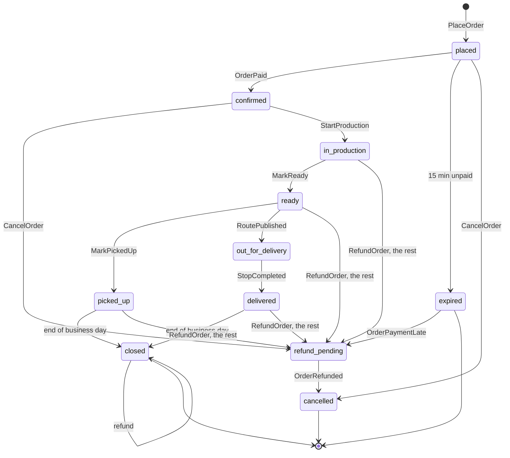
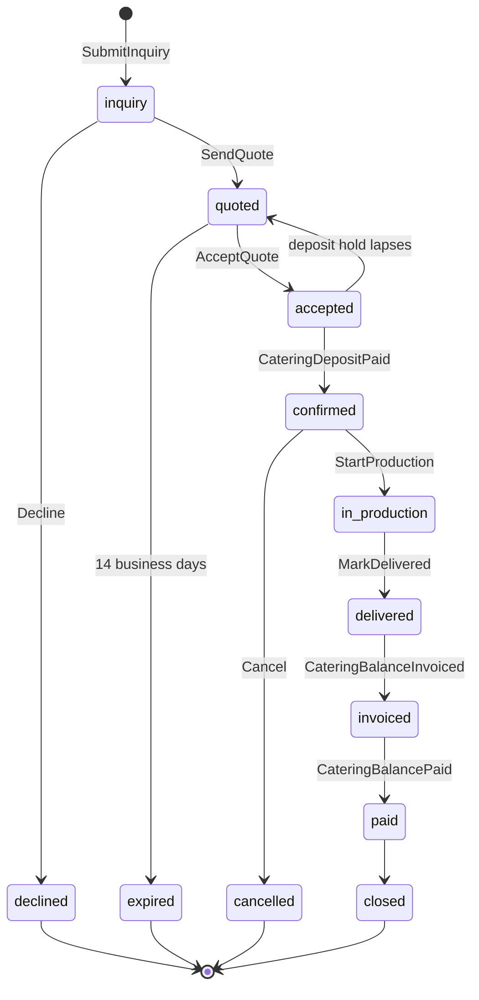
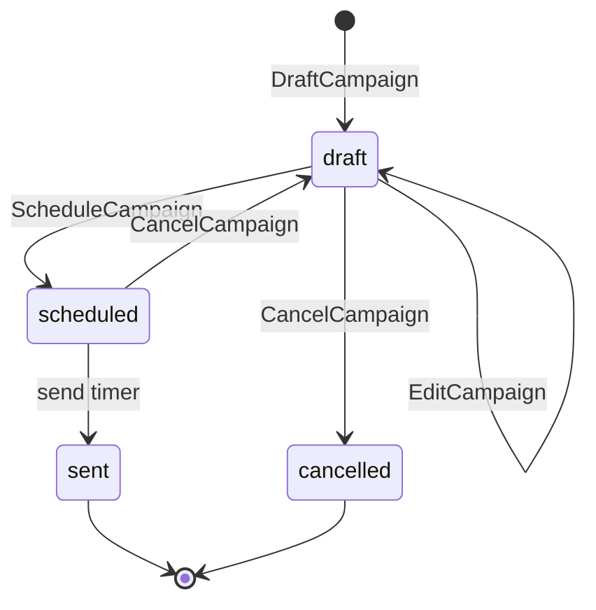
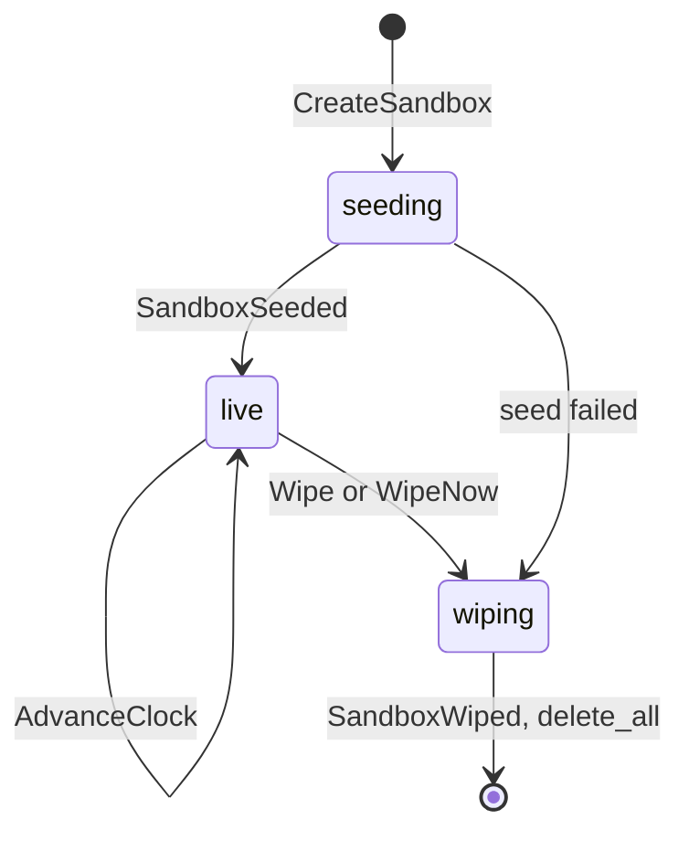
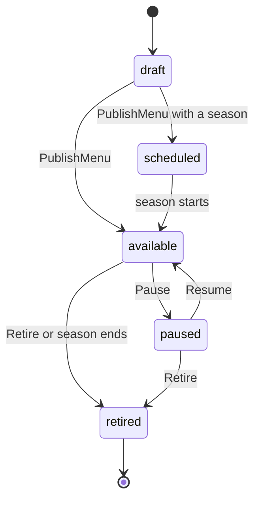
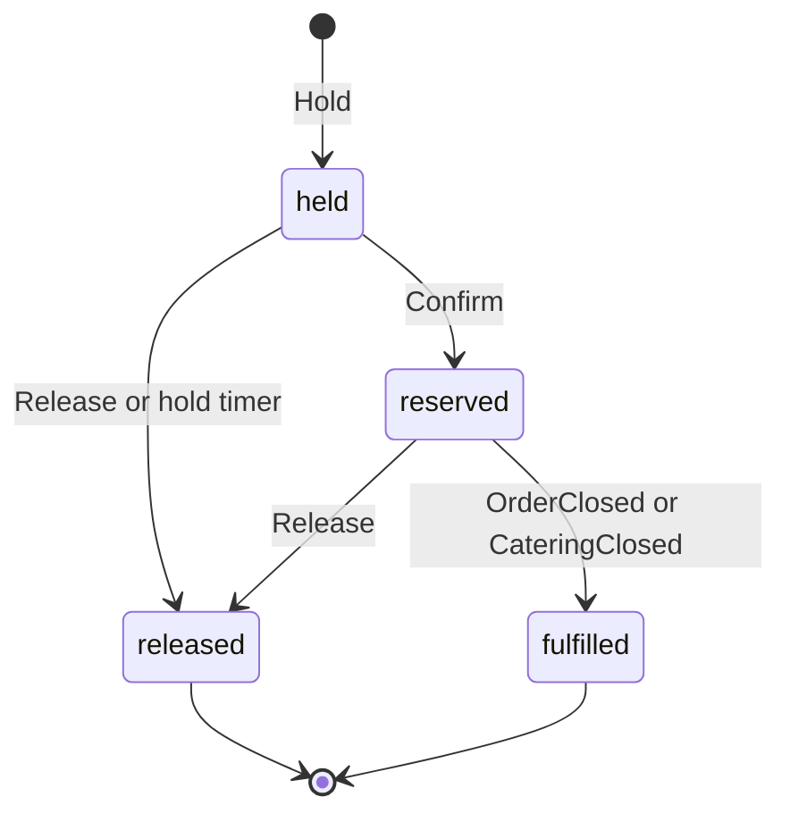

# Domain

The made-up bakery's language and rules: the terms every doc, screen and type uses, the aggregates and the Durable Object (DO) that hosts each, their commands, events, invariants and state machines, the event catalog and its envelope, how money, time and identifiers are represented, how idempotency works at every boundary, what a sandbox is born with, and which of the site's Lab principles runs where. The code that implements it is `crates/domain` (aggregates as `decide` and `evolve`, events, value objects) and `crates/seed`; how objects, the Queue and the Workers fit together is [architecture.md](architecture.md). Why the bakery exists is [product.md](product.md).

Status: Updated in PR 5 · 2026-11-05

Prices, limits and versions are as of 2026-11-04, with sources. Every menu price, package price and tax rate on this page is the made-up bakery's demo data, not a platform price.

## The story

The made-up bakery is Proof of Concept Bakery, "Proof of Concept" for short (Q2 · Q-name). It is a neighborhood bakery in Salt Lake City, the made-up bakery's city, Joseph's choice of 2026-11-04 (Q3 · Q-city), on a map and among 64 public places built for it with the site's Route Lab pipeline ([the seed](#the-seed)). Its kitchen starts before dawn and its counter opens at 07:00, Tuesday to Sunday. It sells breads, pastries, cakes, savory bakes and drinks, for pickup in 15-minute slots or delivery in 2-hour windows. On weekdays it delivers a handful of orders with one van; on Saturdays it runs four vans and 63 stops, the shape of the Route Lab's busiest day. It caters breakfasts, pastry tables, lunches and celebrations at six made-up venues, at most two events a day, booked at least a week ahead. Its 60 regular customers have made-up names, preferences, consent flags and loyalty points.

Everything in it is synthetic. No customer, venue, address or card belongs to a real person or business. Delivery addresses are 64 public places in Salt Lake City from OpenStreetMap, by their map label, with no street address anywhere.

The demo has two kinds of visitor. One reads: the public pages, the "How it's built" page, and the tour, whose steps link each screen to its lab page and ADR (Q41 · Q-tour). The other plays: they open a private sandbox and switch between being a customer at the storefront and being Proof of Concept's staff in the console (Q4 · Q-personas); they can move the sandbox's clock forward to see tomorrow (Q12 · Q-clock), start simulated traffic to watch the screens move (Q40 · Q-traffic), and do any of it again through the API with their own token (Q42 · Q-api-access).

## Ubiquitous language

One definition each. Code, API fields, screens and docs use these words and no synonyms.

| Term | Definition | Context |
|---|---|---|
| Sandbox | One visitor's private copy of the bakery: a family of DOs born from a seed and wiped at the next 10:00 UTC | Platform |
| Account | A visitor's identity: the HMAC of a Google `sub`, a GitHub user id or a demo username (later, of a normalized email address; Q43 · Q-email-signin), and nothing else | Platform |
| Persona | The role a visitor plays in a sandbox: a customer (one of the 60) or staff | Platform |
| Menu item | Something the bakery sells, with a category, allergens, a lead time and availability rules | Storefront |
| Variant | A sellable form of a menu item with its own price, such as a single croissant or a box of six | Storefront |
| Slot | A 15-minute pickup interval with a capacity in orders | Scheduling |
| Window | A 2-hour delivery interval for one zone, sharing that zone's daily capacity in stops | Scheduling |
| Order | A customer's request for lines, for one slot or window, paid once, with a lifecycle from placed to closed | Ordering |
| Line | One variant and a quantity in an order, priced at placement | Ordering |
| Production plan | The quantities to bake for one business day, projected from reserved orders and catering | Scheduling |
| Bake list | The production plan as the kitchen board shows it, grouped by item and start time | Ordering |
| Catering event | A booked job: a date, a headcount, a package and a venue, with a quote, a deposit and a balance | Catering |
| Package | A priced catering menu per head, such as the breakfast spread | Catering |
| Venue | One of six made-up places where catering is delivered, each pinned to a place | Catering |
| Quote | The staff's priced offer for a catering event, valid for 14 business days | Catering |
| Deposit | 25% of a quote's total, paid to confirm a catering event | Billing |
| Balance | A quote's total minus its deposit, invoiced after delivery | Billing |
| Invoice | A Stripe Invoicing document for a balance, in the Stripe sandbox | Billing |
| Payment | One Stripe PaymentIntent and its outcome, for an order, a deposit or a balance | Billing |
| Refund | Money returned against a payment, full or partial, never more than was paid | Billing |
| Route | One van's ordered stops for a business day | Fulfillment |
| Stop | One delivery: an order and a place | Fulfillment |
| Customer | A synthetic persona with a profile, preferences, consent flags and a loyalty balance | CRM |
| Timeline | One customer's events in business-time order, as a projection | CRM |
| Segment | A rule over the customer projection, such as "ordered a cake in the last 30 days" | CRM |
| Campaign | A message composed by staff, sent to a frozen segment at a scheduled business time | CRM |
| Message | One delivered item in the inbox: a receipt, a reminder, a quote, an invoice or a campaign | CRM |
| Inbox | The sandbox's simulated mailbox, where every message lands, with simulated opens and clicks | CRM |
| Loyalty | Points a customer earns from paid orders, one per whole dollar | CRM |
| Business time | The sandbox's clock: wall time plus the sandbox's offset, which only grows | Platform |
| Wall time | The real time, UTC, which platform alarms, the wipe and the logs use | Platform |
| Seed | The 64-bit number from which `crates/seed` generates a sandbox's entire starting state | Platform |
| Place | One of 64 public places in Salt Lake City from OpenStreetMap, named by index and map label, with no coordinates or street address | Fulfillment |
| Simulated customer | A persona whose commands the `Simulator` issues on its alarm while traffic runs; its events carry `cause: sim:<ulid>` | Platform |
| Tour | The guided walkthrough on every screen: what is shown, the events the last action produced, the principle with its lab page and ADR, and the same action as an API request | Presentation |
| API token | A per-sandbox bearer token, signed like the session cookie, that lets the visitor send the console's commands from `curl` or a script; 24 h, and never past the wipe | Platform |

## Aggregates and their objects

An aggregate is a consistency boundary: one object decides every change to it, in one transaction. Each command carries an idempotency key ([idempotency](#idempotency)); the rule for each source is fixed:

- **From a client:** the `Idempotency-Key` header, a ULID the client makes per intent and reuses on every retry.
- **From an event:** `<event id>:<subscriber class>`.
- **From an alarm:** `<timer id>`, the row in the object's `timers` table.
- **Creating an aggregate:** the Sandbox maps the client's key to the ULID it registers, so a retried "place order" finds the same order.

### Order

Hosted by `Order`, one object per order (`order:<sandbox>:<ULID>`). It protects the order's lines, prices, payment status and lifecycle.

| Command | From | Emits | Rejected when |
|---|---|---|---|
| `PlaceOrder` | customer | `OrderPlaced` | no held slot or window; a line outside the menu version; lead time not met; note fails the free-text rules |
| `CancelOrder` | customer before payment; customer or staff before production | `OrderCancelled`, or `OrderRefundRequested` once paid | in production or later |
| `RecordPayment` | `PaymentSucceeded` | `OrderPaid`, or `OrderPaymentLate` when expired or cancelled | a second payment for a paid order; an amount that differs from the total (`amount-mismatch`) |
| `Expire` | the expiry timer | `OrderExpired` | already paid |
| `StartProduction`, `MarkReady`, `MarkPickedUp` | staff, from the board | `OrderProductionStarted`, `OrderReady`, `OrderPickedUp` | out of order |
| `MarkOutForDelivery`, `MarkDelivered` | `RoutePublished`, `StopCompleted` | `OrderOutForDelivery`, `OrderDelivered` | a pickup order |
| `RefundOrder` | staff, full or partial | `OrderRefundRequested`, with `OrderCancelled` when it is the rest of an unclosed order | the amount exceeds paid minus refunded (`refund-exceeds-paid`); any state but `confirmed`, `in_production`, `ready`, `picked_up`, `delivered` and `closed` (`out-of-order`) |
| `RecordRefund` | `RefundIssued` | `OrderRefunded` | an unknown refund |
| `Close` | the end-of-day timer | `OrderClosed` | not picked up or delivered |

Invariants:

- 1 to 20 lines, each a quantity of 1 to 24; prices are copied from the menu version named at placement and never change after.
- `total_cents = subtotal_cents + tax_cents`, tax computed once on the subtotal ([money](#money-and-time)).
- The slot's start is at least the longest lead time among the lines after placement, in business time.
- Exactly one payment counts. Refunds sum to at most what was paid.
- An unpaid order expires 15 minutes of business time after placement (Q13 · Q-order-flow).



Notes from building `Order` in PR 4 (2026-11-05), each a reading of this section and not a change to it:

- **Two edges the diagram implies but does not draw.** `cancelled --> refund_pending` when a payment lands after the order was cancelled (`OrderPaymentLate`, as for `expired`), and a self-loop on `refund_pending` for a partial refund requested while one is already pending.
- **A cancelled paid order emits two events together:** `OrderCancelled` and `OrderRefundRequested`, in one commit.
- **`RefundOrder` by staff was accepted only in `closed`.** PR 5 widened it (below).
- **`Expire` before `held_until` is rejected as not due.** The timer's own run, after the held time, is accepted, and a second run is a replay under the key `timer:expiry`.

Notes from building `Billing` and the refunds in PR 5 (2026-11-05), each a reading of this section and not a change to it unless it says so:

- **`RefundOrder` is now accepted in `confirmed`, `in_production`, `ready`, `picked_up`, `delivered` and `closed`** (`crates/domain/src/order.rs`, proven by the domain's tests and by `scripts/smoke-payments.sh` for a confirmed order). This widens the PR 4 note above, which took the first sentence of the catalog's row literally. A partial refund leaves the state as it is. A refund of all that is left, in a state before `closed`, is a cancellation by staff: `OrderCancelled` and `OrderRefundRequested` together, state `refund_pending`, then `cancelled` on `OrderRefunded`. In `closed` the order stays `closed`. The diagram gains four edges for it.
- **`out_for_delivery` is refused (`out-of-order`).** The build took the explicit list of states, which leaves it out, over the words "every paid, non-terminal state", which would include it. It stays refused until Joseph says which reading he meant.
- **`RecordPayment` refuses an amount that differs from the order's total** as `amount-mismatch` and emits nothing. Billing creates the intent from the total, so a mismatch is a bug; the Worker logs the refusal and answers the event 200, so Stripe does not retry it.
- **A known gap, closed by PR 8.** A seeded paid order has no Stripe payment, because the seed writes its history into no `Billing` yet. A staff refund of one answers 409 `no-stripe-payment`, and a customer's cancellation of a seeded confirmed order stays `refund_pending`: `Billing` logs `refund_skipped` and no money is returned, since none was taken. PR 8, which writes the seed's history into `Billing` and `Crm`, closes it. The seed's daily totals are stored in `Billing`'s `history` table and appear in no response yet, because the ledger's lines each need a Stripe id.
- **`webhook-later` is unproven.** A webhook `Billing` cannot apply yet (an unknown intent, a refund before its payment) answers 409 `webhook-later` so Stripe retries. The code does it; `scripts/smoke-payments.sh` has no check for it.

### CateringEvent

Hosted by `CateringEvent`, one object per inquiry (`catering:<sandbox>:<ULID>`). It protects the job's quote, money due and lifecycle, and runs the saga by alarm ([architecture.md](architecture.md#the-catering-saga)).

| Command | From | Emits |
|---|---|---|
| `SubmitInquiry` | customer: date, headcount 10 to 200, package, venue, brief | `CateringInquiryReceived` |
| `SendQuote`, `Decline` | staff | `CateringQuoteSent`, `CateringDeclined` |
| `AcceptQuote` | customer | `CateringQuoteAccepted` |
| `RecordDeposit` | `PaymentSucceeded` | `CateringDepositPaid` |
| `FireReminder` | a reminder timer | `CateringReminderDue` |
| `StartProduction`, `MarkDelivered` | staff | `CateringProductionStarted`, `CateringDelivered` |
| `RecordInvoice`, `RecordBalance` | `InvoiceIssued`, `PaymentSucceeded` | `CateringBalanceInvoiced`, `CateringBalancePaid` then `CateringClosed` |
| `Cancel` | customer or staff | `CateringCancelled` |
| `ExpireQuote` | the quote timer | `CateringQuoteExpired` |

Invariants: the date is at least 7 business days after the inquiry; the day holds at most 2 confirmed events, held and reserved in that day's `Schedule` (Q16 · Q-catering); `deposit_cents` is 25% of the quote's total rounded half-up, and `balance_cents = total_cents - deposit_cents`, so the two always sum to the quote; a cancellation more than 7 days before the date refunds the deposit, within 7 days it does not. Reminders: a follow-up 3 business days after a quote, one 2 days before the event, one when the invoice is 7 days old.



### Campaign

Hosted by `Crm`, one object per sandbox (`crm:<sandbox>`), as a table of campaigns. This bends "one object per aggregate" on purpose: a send must read Crm's segment projection at the moment it fires, a sandbox holds a handful of campaigns, and a class of its own would add a hop and a class per preview. Crm stays the only writer of campaigns, so the single-writer rule holds.

Commands: `DraftCampaign`, `EditCampaign`, `ScheduleCampaign` (a business time at least 15 minutes ahead), `CancelCampaign`, `SendCampaign` (the timer). Events: `CampaignDrafted` and `CampaignEdited` (added by PR 8, Crm's own record, routed nowhere), `CampaignScheduled`, `CampaignCancelled`, `CampaignSent`. Subjects and bodies are chosen from fixed templates, never typed; segments are a fixed list (`everyone`, `cake-last-30-days`, `delivery-customers`, `lapsed-60-days`, `catering-leads`) evaluated over Crm's projection at the send's business time. Invariants: recipients are customers whose `marketing` consent is true at send time; the recipient list is frozen and stored with `CampaignSent`, so a rebuild reproduces the stats; one message per recipient per campaign, keyed by campaign and customer.



### Sandbox

Hosted by `Sandbox` (`sandbox:<ULID>`). It protects the sandbox's lifecycle, its registry of children, its seed and its business clock.

Commands: `CreateSandbox` (Turnstile for guests; admitted by `Control`), `RegisterChild`, `AdvanceClock` (15 minutes, 1 hour, 1 day, or next opening), `RotateApiToken` (signed-in visitors), `SetFault`, `RedriveDeadLetter`, `WipeNow`, `Wipe` (from `Control` at 10:00 UTC, the Sandbox's own timer, or the 36 h backstop). Events: `SandboxSeeded`, `ClockAdvanced`, `ApiTokenRotated`, `FaultSet`, `SandboxWiped`. Invariants: the offset only grows and stays within 14 days (Q12 · Q-clock); the token version only grows, and a token naming an older one is refused; a child exists only once registered; once wiping, every command is refused with 410; a sandbox never outlives the next 10:00 UTC (Q25 · Q-ttl).



### MenuItem availability

Hosted by `Catalog` (`catalog:<sandbox>`). It protects what may be sold when: price, lead time, the days of the week an item is baked, its daily cap and any season. The count left today lives in that day's `Schedule`, which decrements it at each hold, so a sold-out item is a Schedule fact the storefront reads (Q5 · Q-menu).

Commands: `EditItem`, `SetPrice`, `SetAvailability`, `Pause`, `Resume`, `Retire`, `PublishMenu`. Events: `MenuItemChanged`, `MenuPublished` (the version bump that invalidates the cached menu). Invariants: prices are positive integer cents; a cake's lead time is at least 48 h; a seasonal item is available only inside its season; edits are drafts until `PublishMenu`, so orders always name a published version.



Season, as built in PR 4 (2026-11-05): a season is a recurring `MM-DD` window that repeats every year, not the first and last business date this section first described. That is the current reading, chosen by the domain stream, and Joseph can reverse it.

### Schedule reservation

Hosted by `Schedule`, one object per sandbox and business day (`schedule:<sandbox>:<YYYY-MM-DD>`). It protects capacity: orders per slot, stops per zone, items per day, catering events per day (Q10 · Q-slots, Q11 · Q-production).

Commands: `Hold` (synchronous, from the router, keyed by the order or catering id), `Confirm` (from `OrderPaid` or `CateringDepositPaid`), `Release` (from `OrderExpired`, `OrderCancelled`, `CateringCancelled`, or the hold's own timer), `SetCapacity` (staff). Events: `SlotReserved`, `SlotReleased`, `CapacityChanged`, `BakeListChanged`. Invariants: held plus reserved never exceeds capacity; a hold lasts 15 minutes of business time; a lowered capacity never cancels existing reservations, it only stops new holds; the production plan is recomputed in the same transaction as any reservation change.



### Dispatch

As built in PR 9 (2026-11-05; `crates/domain/src/dispatch.rs`, [ADR 0012](adr/0012-delivery-dispatch.md)). Hosted by `Dispatch`, one object per sandbox and bakery day (`dispatch:<sandbox>:<YYYY-MM-DD>`). It holds the day's stops, the server's proposed plan, the browser's submitted plan and the published plan, and it is the one place a plan becomes the record: whoever made a plan, only one that passes the validator is published. A stop is one delivery order at one of the 64 places, sized in **units** (the order's line quantities summed), and a van's capacity counts units: 250 a van as seeded, which the busy Saturday needs (400 to about 790 units across the seeds the domain stream swept on 2026-11-05, with one order reaching 74), where 20 would not fit.

| Command | From | Emits | Rejected when |
|---|---|---|---|
| `AddStop` | `OrderPlaced` for a delivery (a pickup has no stop) | `StopAdded`, provisional | `wrong-day`: the window is on another bakery day. Nothing for an order already added or removed |
| `ConfirmStop` | `OrderPaid` | `StopConfirmed` | never; nothing for a stop already confirmed, delivered or removed |
| `RemoveStop` | `OrderExpired`, `OrderCancelled` | `StopRemoved`, reason `expired` or `cancelled` | never; nothing for a stop already removed or delivered |
| `Propose {vans, capacity}` | staff | `RouteProposed`: the Clarke–Wright plan over the confirmed stops, which becomes the day's vans and capacity | `vans` (not 1 to 4), `capacity` (0), `no-stops`, `place-unknown` |
| `SubmitPlan {routes}` | staff, with the plan the browser's VROOM made | `PlanSubmitted`, minutes recomputed from the matrix | `no-stops`, and the validator's rules below |
| `Publish {plan, departed}` | staff, `plan` being `proposed` or `submitted` | `RoutePublished` as `plan_v + 1`, superseding the last | `no-plan`, `stop-missing`, `no-stops`, the validator's rules again, and `published` when `departed` |
| `CompleteStop {stop}` | staff, or a driver | `StopCompleted` | `no-plan`, `stop-unknown`. Nothing the second time |

Events: `StopAdded`, `StopConfirmed`, `StopRemoved`, `RouteProposed`, `PlanSubmitted`, `RoutePublished` and `StopCompleted` ([the catalog](#the-event-catalog)). The first three and `PlanSubmitted` have no subscriber and are the Dispatch's own log, like the Schedule's `SlotHeld`. The stop's status runs provisional, confirmed, then removed or completed.

The rules, by the slug a problem document names them with (a refused command is a `dispatch` problem; [security.md](security.md#sandbox-isolation) lists the statuses):

| Slug | The rule |
|---|---|
| `vans` | A day plans with 1 to 4 vans; a plan names each van once, numbered from 1 to the day's vans |
| `capacity` | A van carries at least 1 unit |
| `no-stops` | There are confirmed stops to plan |
| `place-unknown` | Each stop's place is in the travel-time matrix |
| `route-ends` | Each van starts and ends at the bakery, place 0 |
| `wrong-day` | A stop's window is on the day's own bakery date |
| `stop-unknown` | A plan names only confirmed stops of this day (a provisional, removed, delivered or unknown one is refused), and a completion names a stop number the published plan has |
| `stop-twice` | A stop appears once |
| `over-capacity` | No van carries more units than the capacity |
| `stop-missing` | Every confirmed stop not yet delivered appears |
| `no-plan` | A publish names a plan that exists, and a completion needs a published plan |
| `published` | A plan is not replaced once a van has left |

Invariants: a published plan covers every confirmed, undelivered stop exactly once, within capacity, each route from the bakery and back to it, and no more vans than the day has, because the validator holds for every plan before it is stored and again at publish, since stops may have come and gone between; a client's totals are never read, so a plan's minutes are always recomputed from the matrix, and a browser plan carrying a total is refused; a stop's number is its position in the published plan counted from 1 across the vans in van order, the `stop` of `OrderOutForDelivery`, of `StopCompleted` and of the complete-stop request, and a republish renumbers; publishing again with a key already used emits nothing, so one key stores one plan and appends one `RoutePublished`; a `ConfirmStop` or `RemoveStop` that arrives before its `AddStop` is recorded, so the stop arrives confirmed or never, and a removed stop is never added again; a delivered stop drops out of later plans. `departed` is not in the log: the object reads the published plan's Orders (any out for delivery, delivered or closed) and hands the fact to `Publish`, as it hands `Propose` the matrix. The matrix rides in the command and is never stored. `last_back` is 09:00 plus the longest van's drive minutes plus `SERVICE_MINUTES` (3) for each of its stops, the route data's `serviceSeconds` of 180; a van's `minutes`, and the comparison's, stay drive minutes.

### Simulator

Hosted by `Simulator`, one object per sandbox (`simulator:<sandbox>`), registered with the Sandbox on the first "Start traffic" (Q40 · Q-traffic). It protects the rate, the running flag and the minute ledger; the orders it causes belong to their own aggregates ([architecture.md](architecture.md#simulated-traffic)).

| Command | From | Emits | Rejected when |
|---|---|---|---|
| `StartTraffic(rate)` | a signed-in visitor, from the console; a rate preset in orders a minute | `TrafficStarted` | a guest sandbox; a rate above 6; already running; no minutes left today in `Control`'s ledger |
| `StopTraffic` | the visitor; a `Tick` that finds the console closed or the minutes spent; the wipe | `TrafficStopped` | not running |
| `Tick` | its alarm, once a wall-time minute while running | the commands of the minute's synthetic customers, each to its own aggregate | not running |

Invariants: at most 6 orders a minute; at most 30 minutes of traffic a sandbox a UTC day, reserved in `Control`'s ledger when it starts and settled when it stops; it runs only while the console's socket or heartbeat was seen in the last 90 s; every command it issues carries an idempotency key and a `cause` of `sim:<ulid>`; the wipe stops it.

The other aggregates are small enough to need no diagram: `Customer` (preferences, consent, loyalty: earn-only for now, redemption later), `Billing`'s payments (requires payment, succeeded, failed, canceled, refunded) and `Inbox`'s messages (delivered, opened, clicked).

## The event catalog

Every event, past tense, by producer. Types: `id` is a ULID string, `cents` an `i64`, `time` an ISO 8601 string in business time, `date` a business date `YYYY-MM-DD`. Subscribers are wired in `crates/app`'s routing table; anything not listed has no subscriber but Crm's log.

| Event | Producer | Data | Subscribers | What each does |
|---|---|---|---|---|
| `SandboxSeeded` | Sandbox | `seed: u64, born: date, rows: u32` | Crm | marks the history start for timelines |
| `ClockAdvanced` | Sandbox | `from: time, to: time, clock_v: u32` | Crm | logs the jump on the activity screen (children get the offset by command) |
| `FaultSet` | Sandbox | `fault: string, on: bool` | Crm | logs it |
| `ApiTokenRotated` | Sandbox | `token_v: u32` | Crm | logs it; the token itself is never in an event |
| `SandboxWiped` | Sandbox | `objects: u16, rows_deleted: u32` | Control | adds to the daily ledger |
| `MenuItemChanged` | Catalog | `item: string, fields: object` | Crm | logs it |
| `MenuPublished` | Catalog | `version: u32, items: u16, item: string?` | Schedule (today on) | refreshes daily caps from the version |
| `OrderPlaced` | Order | `order: id, customer: id, kind: pickup or delivery, slot: time, zone: string?, lines: [{item, variant, qty: u16, unit_cents}], subtotal_cents, tax_cents, total_cents, note: string?, menu_version: u32?, held_until: time?` | Kitchen; Crm; Dispatch (delivery); Inbox | adds a pending card with the note; timeline row; adds a provisional stop; remembers the order's customer, kind and item count for its messages |
| `OrderPaid` | Order | `payment: id, amount_cents` | Schedule; Kitchen; Crm; Customer; Inbox; Dispatch | confirms the hold; card to the board; timeline; loyalty; receipt; confirms the stop (a pickup has none) |
| `OrderPaymentLate` | Order | `payment: id, amount_cents: cents?` | Crm | logs the compensation |
| `OrderRefundRequested` | Order | `payment: id, amount_cents, reason: string` | Billing | refunds at Stripe |
| `OrderExpired` | Order | `held_until: time` | Schedule; Billing; Kitchen; Dispatch | releases; cancels the intent; removes the card; removes the stop |
| `OrderCancelled` | Order | `by: customer or staff` | Schedule; Kitchen; Dispatch; Crm | releases; removes; removes; timeline |
| `OrderProductionStarted` | Order | `{}` | Kitchen; Crm | moves the card; timeline |
| `OrderReady` | Order | `{}` | Kitchen; Inbox; Crm | moves the card; "ready" message; timeline |
| `OrderOutForDelivery` | Order | `route: string, stop: u16` | Kitchen; Inbox | moves the card; "on its way" message |
| `OrderPickedUp`, `OrderDelivered` | Order | `at_stop: u16?` | Kitchen; Crm | clears the card; timeline |
| `OrderRefunded` | Order | `refund: id, amount_cents, full: bool` | Crm; Customer; Inbox | timeline; reverses loyalty; refund notice |
| `OrderClosed` | Order; the seed for history | `total_cents, refunded_cents`; history only: `lines, customer: id, kind, slot: time, zone: string?` | Schedule; Crm | fulfils the reservation; customer stats |
| `SlotHeld` | Schedule | `kind: slot, window or catering, date, start: time, ref: id, zone: string?, lines: [{item, qty: u32}], expires_at: time` | none | the hold, in the Schedule's own log; its timer is armed for `expires_at` |
| `SlotReserved` | Schedule | `kind: slot, window or catering, date, start: time, ref: id, revived: bool?` | Kitchen | bake list totals |
| `SlotReleased` | Schedule | `kind, date, start: time, ref: id, reason: string` | Kitchen | bake list totals |
| `SlotFulfilled` | Schedule | `kind, date, start: time, ref: id` | none | the place is spent; it still counts against capacity |
| `CapacityChanged` | Schedule | `target: string, capacity: u16` | Crm | logs it |
| `CapsRefreshed` | Schedule | `menu_version: u32, caps: [{item, daily_cap: u32}]` | none | the day's item caps, from the published menu |
| `BakeListChanged` | Schedule | `date, version: u32, lines: [{item, qty: u32, start: time}]` | Kitchen | redraws the bake list |
| `CateringInquiryReceived` | CateringEvent | `catering: id, customer: id, date, headcount: u16, package: string, venue: string, brief: string?` | Crm; Inbox | lead pipeline; acknowledgement |
| `CateringQuoteSent` | CateringEvent | `total_cents, deposit_cents, valid_until: time` | Crm; Inbox | pipeline stage; the quote message |
| `CateringQuoteAccepted` | CateringEvent | `{}` | Crm | pipeline stage |
| `CateringDepositLapsed` | CateringEvent | `{}` | Schedule | releases the day's held place; the quote is open again |
| `CateringQuoteExpired`, `CateringDeclined` | CateringEvent | `reason: string?` | Crm; Inbox | lost lead; notice |
| `CateringDepositPaid` | CateringEvent | `payment: id, amount_cents` | Schedule; Crm; Inbox | reserves the day; won lead; receipt |
| `CateringReminderDue` | CateringEvent | `kind: follow_up, event_soon or invoice_due` | Inbox | reminder message |
| `CateringProductionStarted` | CateringEvent | `{}` | Kitchen | adds to the board |
| `CateringDelivered` | CateringEvent | `{}` | Billing; Kitchen | issues the balance invoice; clears |
| `CateringBalanceInvoiced` | CateringEvent | `invoice: id, amount_cents, due: date` | Inbox; Crm | invoice message; pipeline |
| `CateringBalancePaid`, `CateringClosed` | CateringEvent | `payment: id?` | Schedule; Crm; Inbox | fulfils; customer stats; receipt |
| `CateringCancelled` | CateringEvent | `refund_deposit: bool` | Schedule; Billing; Crm | releases the day; refunds if true; lost |
| `PaymentIntentCreated` | Billing | `payment: id, purpose: order, deposit or balance, ref: id, amount_cents` | Crm | logs it |
| `PaymentIntentRecorded` | Billing | `payment: id, intent: string` | none | Billing's own record of the intent Stripe made; the client secret is never in an event |
| `PaymentSucceeded` | Billing | `payment: id, purpose, ref: id, amount_cents, stripe_event: string, intent: string` | Order or CateringEvent, by purpose | records the payment |
| `PaymentFailed` | Billing | `payment: id, purpose, ref: id, code: string, stripe_event: string` | Order or CateringEvent; Inbox | keeps waiting; a "card declined" notice |
| `PaymentCanceled` | Billing | `payment: id, purpose, ref: id, stripe_event: string?` | Crm | logs it |
| `RefundRequested` | Billing | `refund: id, payment: id, purpose, ref: id, amount_cents, reason: string` | none | Billing's own record that a refund was asked of Stripe |
| `RefundIssued` | Billing | `refund: id, payment: id, purpose, ref: id, amount_cents, stripe_refund: string, stripe_event: string?` | Order or CateringEvent | records the refund |
| `InvoiceIssued` | Billing | `invoice: id, ref: id, amount_cents, due: date` | CateringEvent | records the invoice |
| `StopAdded` | Dispatch | `date, order: id, customer: id, place: u8, window: time, zone: string, units: u32` | none | the provisional stop, in the Dispatch's own log |
| `StopConfirmed`, `StopRemoved` | Dispatch | `date, order: id`; removed only: `reason: expired or cancelled` | none | the stop's status, in the Dispatch's own log, kept even when it arrives before `StopAdded` |
| `RouteProposed` | Dispatch | `date, plan_v: u16, vans: u8, minutes: u32, capacity: u32?, routes: [{van: u8, stops: [order id]}]?, unassigned: [order id]?` | Crm | logs it |
| `PlanSubmitted` | Dispatch | `date, plan_v: u16, vans: [{van: u8, stops: [order id]}], minutes: u32` | none | the browser's validated plan, in the Dispatch's own log |
| `RoutePublished` | Dispatch | `date, plan_v: u16, source: server or browser, vans: [{van: u8, stops: [order id]}], minutes: u32, publish: id?` | Order (each stop); Kitchen | out for delivery; van labels |
| `StopCompleted` | Dispatch | `date, stop: u16, order: id` | Order | delivered |
| `CustomerRegistered` | Customer | `customer: id, profile: {display_name, preferences: [item], home_zone, place, billing_line}, marketing: bool, opening_points: u32` | none | the Customer's own record of its first touch, from the seed's persona |
| `ConsentChanged` | Customer | `marketing: bool` | Crm | segment input |
| `LoyaltyPointsEarned` | Customer | `order: id, points: i32, refund: id?` | Crm | timeline, balance column |
| `CampaignDrafted`, `CampaignEdited` | Crm | `campaign: id, subject: string, body: string, segment: string` | none | Crm's own record of a draft and its edits |
| `CampaignScheduled`, `CampaignCancelled` | Crm | `campaign: id, segment: string, send_at: time?` | Crm | campaign list |
| `CampaignSent` | Crm | `campaign: id, recipients: [customer id], subject: string, body: string?` | Inbox | one message per recipient |
| `ProjectionRebuildFinished` | Crm | `events: u32, ms: u32` | none | the rebuild's result on screen |
| `MessageDelivered` | Inbox | `message: id, to: customer id, kind: string, ref: id` | Crm | timeline |
| `MessageOpened`, `MessageClicked` | Inbox | `message: id, campaign: id?` | Crm | campaign stats |
| `TrafficStarted` | Simulator | `rate: u8, minutes_left: u16` | Crm | logs it on the activity screen |
| `TrafficStopped` | Simulator | `reason: stop, console_closed, minutes_spent or wipe; minutes: u16, orders: u16` | Crm | logs the run's totals |

The order note and the catering brief ride in their events but are stored only by the Kitchen (the note) and by staff screens reading the aggregate (the brief). The consumer strips both before delivering to any other subscriber ([free text](#free-text-and-personal-data)).

## The envelope

Every event has one shape, in each object's `events` and `outbox` tables and on the Queue. It is `v` 1; adding an optional field stays `v` 1 (PR 4 added four: `OrderPlaced.menu_version`, `OrderPlaced.held_until`, `OrderPaymentLate.amount_cents` and `MenuPublished.item`; PR 8 added six: `OrderClosed.customer`, `OrderClosed.kind`, `OrderClosed.slot` and `OrderClosed.zone`, for the seed's history only, `LoyaltyPointsEarned.refund` and `CampaignSent.body`; PR 9 added four, so the Dispatch's log folds: `RouteProposed.capacity`, `RouteProposed.routes`, `RouteProposed.unassigned` and `RoutePublished.publish`, the publishing command's id), and renaming or redefining anything is `v` 2 (tolerant reader, as in the site's protocol v1).

```json
{
  "v": 1,
  "id": "01JC8Z6K3W9QF2N4T7XRB5M0HD",
  "sandbox": "01JC8YV2D4QK7S1M9E3PZ6W8AN",
  "stream": "order:01JC8Z5R0T2B6Y8C4V1N3K7QXE",
  "seq": 2,
  "type": "OrderPaid",
  "at": "2026-11-07T12:12:10-07:00",
  "recorded_at": "2026-11-04T19:12:10.318Z",
  "data": { "payment": "01JC8Z6F1A5H3D7K9M2P4R6T8V", "amount_cents": 1870 },
  "cause": "01JC8Z6F0WQ3E5R7T9Y1V3K5P7"
}
```

- `id` is the event's ULID and the key of every `seen` table.
- `stream` is the producing object's name; `seq` is gap-free within it.
- `at` is business time, three days ahead here because the visitor advanced the clock; `recorded_at` is wall time.
- `cause` is the command id, or for a reaction the id of the event that caused it, so a chain can be traced; a command the `Simulator` issued is `sim:<ulid>`.
- An envelope must stay under the 2 MB row limit;[^dolimits] the largest, a `RoutePublished` for 63 stops, is under 4 KB.

## Money and time

**Money** is an integer count of US cents, `i64`, everywhere: in Rust (`Cents(i64)`), in SQLite (`INTEGER`), on the wire (a JSON integer named `*_cents`). There are no floats and one currency, USD. Rates are basis points: tax defaults to 1,000 bp (10.00%), a flat demo rate the sandbox's staff can change in the console; the deposit is 2,500 bp. Tax is computed once per order on the subtotal and rounded half-up to the cent. Splits are computed as one part and a remainder, so a deposit and its balance always sum to the quote.

**Business time and wall time.** Business time is wall time plus the sandbox's offset, held by the Sandbox and copied to each child ([architecture.md](architecture.md#time-travel)). Every domain rule reads business time through the `Clock` port in `crates/app`: lead times, expiries, slots, reminders, quotes, campaigns. Platform alarms, the wipe, cookies, Stripe's timestamps and logs use wall time.

**The bakery day** is a calendar date in America/Denver, Salt Lake City's time zone. The bakery opens 07:00 to 15:00, Tuesday to Sunday; pickup slots run on the quarter hour; delivery windows are 09:00, 11:00 and 13:00 for each of three zones; tomorrow's production plan locks at 18:00 the day before. The nightly wipe at 10:00 UTC is 03:00 Mountain standard time, 04:00 in summer, a wall-time fact the bakery day never sees.

**On the wire** every time is an ISO 8601 string: business times with the bakery's Mountain offset, `-07:00` in standard time and `-06:00` in summer (`2026-11-07T09:42:10-07:00`), wall times in UTC with `Z`, dates as `YYYY-MM-DD`. Durations are integer seconds or minutes, named for their unit (`hold_s`, `minutes`).

## Identifiers

Aggregates, events and commands use ULIDs: 128 bits, 26 characters of Crockford base32, sortable by creation time.[^ulid] Menu items and variants use stable slugs from the seed (`croissant`, `croissant/box-6`), venues `v1` to `v6`, and the 64 places their index, such as `p17`.

Object names are derived by the server only ([architecture.md](architecture.md#object-naming)):

| Object | Name |
|---|---|
| Control | `control` |
| Account | `account:<HMAC of "google:" + sub, "github:" + id or "demo:" + username, hex>` |
| Sandbox | `sandbox:<id>` |
| Catalog, Kitchen, Billing, Crm, Inbox, Simulator | `catalog:<sandbox>`, `kitchen:<sandbox>`, `billing:<sandbox>`, `crm:<sandbox>`, `inbox:<sandbox>`, `simulator:<sandbox>` |
| Order, CateringEvent, Customer | `order:<sandbox>:<ulid>`, `catering:<sandbox>:<ulid>`, `customer:<sandbox>:<ulid>` |
| Schedule, Dispatch | `schedule:<sandbox>:<date>`, `dispatch:<sandbox>:<date>` |

**Why a client never names an object.** A name is an object: any string the client could choose would create one, with its own storage and its own bill, and nothing would list it for the wipe. The sandbox id in every name comes from the signed session, so one visitor cannot address another's bakery. An aggregate's ULID is accepted only if the Sandbox's registry holds it. And because the registry is the one list of children, the wipe can delete everything a sandbox made. The site's lab wrote the same rule for the same reasons ([lab.md](https://github.com/IHaveASegway/website/blob/main/docs/lab.md#durable-object-rules), rule 8).

## Idempotency

Every boundary that can repeat a message has a key and a table.

| Boundary | Key | Kept in | On a repeat |
|---|---|---|---|
| HTTP command | `Idempotency-Key` header, a ULID, required on every POST | the target object's `commands_seen`, with the stored result; creation keys in `Control`, checked at admission | the stored result again, with `Idempotent-Replayed: true`; a reused key with a different body gets 422 problem+json |
| Socket command | the `cmd` frame's ULID `id` | the Kitchen's last 64 ids, then the Order's `commands_seen` | `ack` again, as in the site's protocol v1 |
| Call to Stripe | Stripe's `Idempotency-Key` header: `<ref>:<purpose>:<n>` to create an intent, and the purpose suffixed with the call for the others: `<ref>:<purpose>-confirm:<n>`, `<ref>:<purpose>-cancel:<n>`, `<ref>:<purpose>-refund:<ordinal>` (`n` is the payment's attempt, `ordinal` the refund's) | Stripe | Stripe returns the first result[^brandur]; a key reused on a different body gets 400 `idempotency_error` ([Stripe](https://docs.stripe.com/api/idempotent_requests), as of 2026-11-05), which is why no two calls share one |
| Stripe webhook | the Stripe event id | Billing's `webhooks_seen` | 200, no effect |
| Queue delivery | the envelope's `id` | each subscriber's `seen` | ack, no effect |
| Alarm | the `timers` row id | the object's `timers` | the row is gone, so nothing runs |

All of them live and die with the sandbox, so none needs pruning. A command and its key are recorded in the same transaction as its events, so a crash between them cannot leave one without the other.

## The seed

`crates/seed` turns a 64-bit seed and a birth date into a sandbox's entire starting state (Q26 · Q-seed). It uses a seeded PRNG and no clock, no network and no input but those two values; [stack.md](stack.md) picks the PRNG crate. Two sandboxes with the same seed and birth date are identical byte for byte, ULIDs included, since their random parts come from the PRNG and their time parts from the generated business times. A test in `crates/seed` serializes one sandbox twice and compares the bytes.

**Menu: 24 items in 5 categories** (Q5 · Q-menu):

| Category | Items | Lead time | Variants |
|---|---|---|---|
| Breads | 6: country loaf, seeded rye, baguette, focaccia, brioche loaf, sandwich loaf | 2 h; 12 h for more than 4 of one loaf | whole, half where it makes sense |
| Pastries | 7: croissant, pain au chocolat, almond croissant, morning bun, cardamom knot (seasonal), fruit danish, scone | 2 h | single, box of 6 |
| Cakes | 4: chocolate layer, lemon olive oil, carrot, seasonal fruit tart (seasonal) | 48 h | 6-inch, 9-inch, slice (2 h) |
| Savory | 4: ham and cheese croissant, quiche slice, hand pie, focaccia sandwich | 2 h | single |
| Drinks | 3: drip coffee, latte, chai | 0, pickup only | small, large |

48 variants. Allergens use the nine major US food allergens. Each item has a daily cap and the days it is baked. No photos: each item is a technical drawing (Q7 · Q-images).

**Customers: 60 synthetic personas.** Names are generated from two word lists in `crates/seed` (given-name-like words such as plants and weather, family-name-like words such as landforms and crafts), never from any list of real people, and checked for duplicates. Each persona gets preferences, a marketing consent flag (about 70% true), a home zone and one of the 64 places as a delivery address. The visitor's customer persona is one of them.

**History: 90 days of orders** with a weekly rhythm: closed Mondays, about 6 orders Tuesday to Friday, about 10 on Sundays and about 18 on Saturdays, and the most recent Saturday like the Route Lab's busy Saturday, 63 delivery orders across 4 vans. That is about 720 orders, written as one `OrderClosed` event each, with its lines and payment, into Crm's log, and as daily totals into Billing. Today's open orders (12) are live `Order` objects in various states, and the coming week's seven `Schedule` days and today's `Dispatch` exist from the start; later days are created on first touch.

**Catering: 8 events across the lifecycle**: an inquiry, a quote, an accepted quote awaiting its deposit, two confirmed, one delivered and invoiced, one paid and closed, and one declined. **Venues: 6 made-up names**, such as Harbor Loft and Orchard Pavilion, each pinned to one of the 64 places.

**Delivery addresses** are 64 public places in Salt Lake City from OpenStreetMap, of which the bakery is one, with no coordinates or street addresses in any served file. As built on 2026-11-05 ([ADR 0012](adr/0012-delivery-dispatch.md), [tools/route-data/out/README.md](../tools/route-data/out/README.md)): a new build with a self-hosted [openrouteservice v9.10.0](https://github.com/GIScience/openrouteservice/releases/tag/v9.10.0) (no API key), osmium-tool 1.16.0 to clip and pick, over the [openstreetmap.fr US West extract](https://download.openstreetmap.fr/extracts/north-america/us-west-latest.osm.pbf) (the mirror, because Geofabrik's Utah file was unreachable from the build machine; replication timestamp 2026-11-05T00:58:30Z; ODbL). The places are chosen by a written rule: parks (33), stations (14), gardens (8), libraries (7), one viewpoint and one square, the square being the bakery's spot (index 0); none a business, a residence, a university or a church, and none snapped farther than 500 m from a road (1,000 m for viewpoints). Each place is a drop-off spot, never somebody's home. The label the map and the matrix show is the place's public OpenStreetMap `name` ("The bakery" for index 0), and the made-up address is what the staff screens show for a customer. A stop's `place` is the place's index in the matrix (0 to 63). The seed names a place `p<n>`, which `place_label` and `place_index` in `crates/domain` map to index n−1, and the API shows the matrix's label for it, falling back to `p<n>` when the matrix has none. The seed draws `p1` to `p64`, and as built on 2026-11-05 the Worker pass kept that draw: `p1` is index 0, the bakery's own square, so a seeded delivery drawn `p1` is a zero-minute stop at the bakery. `TravelMatrix::place_index` takes `p<n>` as index n−1 whatever the fixture's labels say, and the API shows the label "The bakery" for it. Whether the seed should draw `p2` to `p64` instead is Joseph's call, an open question in [the roadmap](roadmap.md#pr-9-dispatch), because changing the draw changes the seed's output. The served files, `route-data.json` and `isochrones.json`, hold labels, kinds and integer view units (a 2000 by 1123 box, 15.216 m a unit); `crates/seed/data/salt-lake-city/` also holds `matrix.json`, in whole minutes. The OSM element ids and the extract's checksums are in `provenance.json`, which is not served. The dispatch screen credits "© OpenStreetMap contributors; routing by openrouteservice (self-hosted)" with a link to OpenStreetMap's copyright page, as the ODbL asks. The travel times are free-flow, with no traffic. The site's Route Lab keeps its own Seattle data.

**Seed history versus `OrderClosed` (PR 4, 2026-11-05).** The seed's history record is not yet the `OrderClosed` event: it has no `refunded_cents`, its lines carry no `item` and use `qty: u32` where the event has `u16`, and it names `slot_start` where the event says `slot`. PR 8 reconciles the two when it writes the history into Crm's log.

**Resolved in PR 8 (2026-11-05).** `bakery_seed::history_envelopes` writes each history record as an `OrderClosed` envelope in the catalog's shape: `total_cents`, `refunded_cents: 0`, `lines` with `item` and `qty: u16`, and, because no `OrderPlaced` reaches Crm for a history order, the history-only `customer`, `kind`, `slot` (the record's `slot_start`) and `zone`. Its stream is `order:<sandbox>:<id>` at `seq` 1, its `at` and `recorded_at` are the slot's end (the pickup slot's 15 minutes, the delivery window's 2 hours), since an order closes after it is fulfilled and never before, and its `cause` is `seed:<seed>`. The event id is derived from the order id, so no draw is added and no pinned value moved. `bakery_seed::seed_messages` writes the Inbox's 240 messages: the receipts of the 240 most recent history orders, delivered at placement, with ids from the Inbox's own rule and opens and clicks from the seed.

**Simulated traffic starts stopped.** No `Simulator` exists at seed; a signed-in visitor's first "Start traffic" registers one (Q40 · Q-traffic).

**Approximate rows written at seed**, for [cost.md](cost.md), which prices the same table:

| Object | Instances | Tables | Rows |
|---|---|---|---|
| Sandbox | 1 | meta, a registry of 34, the clock, timers | 38 |
| Catalog | 1 | 5 categories, 24 items, 48 variants, 24 availability rules, the version, events | 106 |
| Schedule | 7 | 32 slots, 6 windows, capacities, 5 plan lines each | 322 |
| Order | 12 open | 3 events, state, 3 lines, a key, a timer, outbox rows each | 120 |
| Kitchen | 1 | the board, a timer | 13 |
| CateringEvent | 8 | 5 events, state, the quote, 2 timers each | 72 |
| Billing | 1 | 90 daily totals, 16 deposits and balances | 107 |
| Dispatch | 1 | the open deliveries' stops (2 for seed 42 born 2026-11-07), 1 proposal | 13 |
| Crm | 1 | 720 history events, 60 customers, 60 loyalty rows, segments, memberships, campaigns | 942 |
| Inbox | 1 | 240 messages | 241 |
| Account, Control | shared | the sandbox pointer; the ledger | 4 |
| Customer | 0 | created on first touch | 0 |
| Simulator | 0 | created stopped, on the first "Start traffic" | 0 |
| Total | 34 objects | | 1,978, about 2,000 |

That is close to the 2,000 rows [cost.md](cost.md) starts from; spike S5 measures the real figure, wipe included.

**As built in PR 5 (2026-11-05).** A sandbox seeds 15 children in three batches of 7 (`workers/api/src/objects/sandbox.rs`, and its test that the plan is the Catalog, the Kitchen and `Billing` first, then the 12 open orders), where PR 4 seeded 14 in two. `Billing`'s seed is the 90 daily totals, in its `history` table (day, orders, cents); the 16 deposits and balances arrive with the catering PR. Those totals appear in no response yet.

**As built in PR 9 (2026-11-05).** A sandbox seeds 36 children in six batches of up to 7 (`workers/api/src/objects/sandbox.rs`, and its test that the plan has 36 and takes six runs): the Catalog, the Kitchen, `Billing`, Crm and the Inbox first, then the 7 Schedule days, then today's Dispatch, the 12 open orders, the 8 catering events and the 3 days that hold their places. The Dispatch day for business today is among them, seeded by `bakery_seed::seed_dispatch` with one stop for each open delivery order, confirmed when the order is paid, and the server's proposal (4 vans on a Saturday, 1 otherwise, 250 units a van); nothing is published, because a published plan would send the seeded ready orders out for delivery. A day with no confirmed delivery has no proposal. The Dispatch goes before the orders so an order's events find its stop's day already born. The seed's JSON is unchanged, 614,580 B and byte-identical to PR 8's, because the dispatch day makes no new draw. The row above counts the day for seed 42, where the open orders give 2 deliveries; the figure of 10 stops this table first assumed would need new draws, and so move pinned values.

## The principle map

Where each Lab principle runs in Proof of Concept (Q33 · Q-principles). Every screen's tour links its lab page and its ADR, in the step that was the "How this works" drawer, and each lab page links back (Q32 · Q-links, Q41 · Q-tour).

| Lab page on the site | Principle | Where it runs | What the visitor can do to see it | ADR |
|---|---|---|---|---|
| Queue Lab, `/lab/queue/` | transactional outbox, idempotent consumer, dead-letter queue | every aggregate's `outbox`; `bakery-events`; the `seen` tables; `bakery-events-dlq` | turn on the Inbox fault, place an order, watch three retries, a dead letter and a redrive; resend a command with the same key | [0003](adr/0003-durable-objects-as-the-system-of-record.md), [0004](adr/0004-queues-between-objects-and-alarms-for-time.md) |
| Cache Lab, `/lab/cache/` | cache invalidation by version | `Catalog`'s `ETag`; the Cache API keyed by sandbox and version; `MenuPublished` | change a price, publish, watch the version and the cache miss | [0003](adr/0003-durable-objects-as-the-system-of-record.md) |
| Backfill Lab, `/lab/backfill/` | rebuilding derived data from a log | Crm's rebuild, batch by batch | press "Rebuild projections" and watch the cursor; compare stats before and after | [0003](adr/0003-durable-objects-as-the-system-of-record.md), [0004](adr/0004-queues-between-objects-and-alarms-for-time.md) |
| Route Lab, `/lab/routes/` | vehicle routing, and computing where it is free | VROOM in the browser; Clarke–Wright in `Dispatch`; the object publishes | plan Saturday's 63 stops both ways, compare, publish one | [0012](adr/0012-delivery-dispatch.md) |
| Raft Lab, `/lab/raft/` | consensus, and when it is unnecessary | an essay: a single-writer object needs no consensus | open two tabs and try to take the last place in a slot | [0003](adr/0003-durable-objects-as-the-system-of-record.md) |
| none yet | idempotency keys | commands, Stripe calls, webhooks | "Send again" in the drawer replays a request with its key | [0004](adr/0004-queues-between-objects-and-alarms-for-time.md), [0007](adr/0007-stripe-sandbox-and-a-payment-element-that-collects-nothing.md) |
| none yet | sagas by alarm | `CateringEvent` | run a catering job end to end with time travel | [0004](adr/0004-queues-between-objects-and-alarms-for-time.md) |
| none yet | leases and TTLs | slot holds, the 36 h backstop, the nightly wipe | let a checkout lapse; watch the wipe countdown | [0005](adr/0005-a-private-sandbox-per-visitor-wiped-nightly.md) |
| none yet | admission control | Turnstile, rate limits, `Control`'s budgets | see today's sandbox budget in the drawer | [0005](adr/0005-a-private-sandbox-per-visitor-wiped-nightly.md), [0010](adr/0010-workers-paid-with-the-sites-guardrails.md) |
| none yet | CQRS | aggregates write, `Crm` reads | an order and its timeline row side by side, with the lag | [0003](adr/0003-durable-objects-as-the-system-of-record.md) |
| none yet | load you can watch: lag between writes and projections | the `Simulator`, the Queue, Crm's projections | start traffic; watch the board fill, the Queue's backlog grow and timelines trail the orders | [0004](adr/0004-queues-between-objects-and-alarms-for-time.md) |
| none yet | time travel with a logical clock | the Sandbox's offset | advance a day; watch expiries, reminders and tomorrow's bake list fire in order | [0004](adr/0004-queues-between-objects-and-alarms-for-time.md), [0005](adr/0005-a-private-sandbox-per-visitor-wiped-nightly.md) |


## Free text and personal data

The bakery holds no personal data by construction (Q14 · Q-free-text, [ADR 0005](adr/0005-a-private-sandbox-per-visitor-wiped-nightly.md)). Two fields accept free text; everything else is a choice from a list: personas, venues, places, packages, items, dates, slots, segments and campaign templates.

| Field | Cap | Stored in | Shown to |
|---|---|---|---|
| Order note | 140 characters | the `Order`; the `Kitchen` board | staff, on the board |
| Catering brief | 500 characters | the `CateringEvent` | staff, on the catering screen |

Characters are Unicode scalar values after NFC normalization. Control characters other than a newline are removed. A value is rejected on write, with 422 problem+json that names the matched class and never echoes the text, when it contains:

| Class | Pattern, in words |
|---|---|
| Email address | a run of non-space characters, an `@`, and a domain with a dot |
| Phone number | 7 or more digits once spaces, dots, dashes, parentheses and a leading plus are removed from a run |
| Card number | 13 to 19 digits in a run, with or without spaces or dashes, whether or not it passes Luhn |
| URL | `http://`, `https://`, `www.`, or a word followed by a dot and a common top-level domain |

The text is rendered as text, never as markup or a link. It never enters a log line, a metric, a projection or an inbox message, and it goes with the sandbox at the next wipe. Stripe receives synthetic billing details only (Q18 · Q-payment-ui). [security.md](security.md) owns the data inventory.

Why so little: free text is where personal data arrives uninvited. A list cannot carry a phone number. Two short, checked fields keep the order note and the catering brief, which make the bakery feel real, and the patterns catch the common mistakes; a determined visitor can still type a name, which is why the text is visible to no one but that visitor and gone within a day.

## Weaker models

| Model | What goes wrong | It trades away | It would be right if |
|---|---|---|---|
| One shared bakery for every visitor | Visitors see each other's orders and notes; one visitor fills the board for all; free text needs moderation; nothing can be wiped without wiping everyone | security, privacy, cost | visitors needed to see each other |
| Orders as rows in one table, with no event log | State without history: no outbox to relay from, nothing to rebuild projections from, no timeline, and every subscriber reads the table | evolvability, testability, the Queue and Backfill Labs' principles | the bakery had one screen and no reactions |
| A CRM that reads the aggregates directly | Every timeline asks dozens of `Order` objects; a slow object slows the screen; reads compete with writes | latency, cost, availability | there were a few aggregates and no projections to show |
| A clock that cannot be advanced | Expiries, reminders, quote lapses and tomorrow's bake list take minutes, days or weeks to see, inside a sandbox that lives less than a day | testability, and most of what a visitor came to see | the demo only had instant flows |

## Patterns and further reading

- Ubiquitous language and aggregates: Eric Evans, [*Domain-Driven Design Reference*](https://domainlanguage.com/wp-content/uploads/2016/05/DDD_Reference_2015-03.pdf) (2015).
- Aggregate design (small aggregates, reference by id, eventual consistency between them): Vaughn Vernon, ["Effective Aggregate Design"](https://www.dddcommunity.org/library/vernon_2011/) (2011).
- Event sourcing: Martin Fowler, ["Event Sourcing"](https://martinfowler.com/eaaDev/EventSourcing.html) (2005).
- CQRS: Martin Fowler, ["CQRS"](https://martinfowler.com/bliki/CQRS.html) (2011).
- Idempotence: Pat Helland, ["Idempotence Is Not a Medical Condition"](https://queue.acm.org/detail.cfm?id=2187821) (ACM Queue, 2012).
- Derived data: Martin Kleppmann, [*Designing Data-Intensive Applications*](https://dataintensive.net/), Part III, "Derived Data".

[^dolimits]: A row, string or blob up to 2 MB; 100 columns; 100 bound parameters: [Durable Objects limits](https://developers.cloudflare.com/durable-objects/platform/limits/). As of 2026-11-04.
[^ulid]: [ULID specification](https://github.com/ulid/spec): 48 bits of millisecond time and 80 random bits, Crockford base32. As of 2026-11-04.
[^brandur]: Stripe's idempotency keys: [Stripe API, idempotent requests](https://docs.stripe.com/api/idempotent_requests); the design behind them: Brandur Leach, ["Implementing Stripe-like Idempotency Keys in Postgres"](https://brandur.org/idempotency-keys). As of 2026-11-04.
