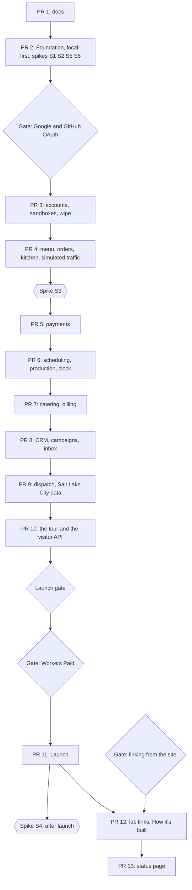

# Roadmap

What gets built, in which pull request and in what order; when each pull request counts as done; which platform questions are tested before code depends on them; and where Joseph decides before work continues. It is the plan for Proof of Concept Bakery, the made-up bakery (named on 2026-11-04, Q2 · Q-name; "Proof of Concept" from here on): its ordering, scheduling, catering, billing and CRM system, every backend in Rust on Cloudflare Workers with state in Durable Objects (DOs), modelled on the site's [roadmap](https://github.com/IHaveASegway/website/blob/main/docs/roadmap.md). Scope details live in the docs that own each topic. [product.md](product.md) holds the full table of open decisions (Q1 to Q45); this file says which of them each pull request proceeds on. Joseph answered the blocking ones on 2026-11-04.

Status: Draft for review in PR 1 · 2026-11-04

Prices, limits and versions are as of 2026-11-04, with sources. Estimates are estimates until the outside view corrects them.

## How we work

The site's rules ([How we work](https://github.com/IHaveASegway/website/blob/main/docs/roadmap.md#how-we-work), Q36 · Q-process), restated for a repository that is public from its first push.

- **One pull request in flight.** The next starts when the previous merges. One person has no one to hand half-finished work to, and with throughput fixed, more work in progress only lengthens each piece (Little's law). Dependabot's grouped minor and patch pull requests are maintenance, merged every other Monday, and do not count; a major version is a pull request of its own. Cost: a blocked pull request stops everything. Two-way door; revisit if one sits blocked over a week while other work is ready. **Relaxed for agent-built branches, as the site relaxed it on 2026-10-23:** while one pull request waits on Joseph's manual checks (a phone read, a Stripe or Google console step), the next may be built on a branch stacked on it, and spikes run outside the repository. 
- **Speed first until launch (Q44 · Q-posture, Joseph's direction of 2026-11-04).** Nobody uses the bakery yet, so until the launch pull request (PR 11) CI runs `verify` (format, clippy, `cargo test`, the wasm build, the Astro build), `firewall` and `firewall-selftest`, and nothing else: no previews, no `e2e`, no Lighthouse, no deploy jobs. Joseph reads each pull request on `wrangler dev`. The domain's native tests stay, because they cost nothing. Previews for the web Worker, a small `e2e` suite, `prod-smoke` and the deploy jobs arrive in PR 11; API previews wait for spike S4, after launch. Cost: a broken screen is caught by Joseph's read and not by a browser test; with no production, a miss costs rework and not an incident. Two-way door; revisit when PR 11 starts.
- **A branch per pull request,** named for its scope. This one is `docs/plan`.
- **Never push to `main`.** A local pre-push hook refuses it (from PR 2), and the repository's ruleset refuses it on GitHub ([operations.md](operations.md#7-github-repository-settings)); from PR 11, `deploy` needs `verify`, `firewall` and `firewall-selftest` ([delivery.md](delivery.md#pipeline)).
- **No force pushes.** The repository is public, so a pushed branch is readable before CI scans it, and a force push leaves the replaced commits reachable by SHA. Fix forward; merge `main` into the branch instead of rebasing.
- **An ADR for every decision that meets the threshold in [ADR 0001](adr/0001-record-architecture-decisions.md)** (costly to reverse, a technology or plan a reviewer would question, or a moved boundary), written in the pull request that makes it and Accepted by the pull request that first builds on it.
- **Open decisions are due before the pull request they block.** This is the last responsible moment. Joseph answered every blocking decision on 2026-11-04 ([product.md](product.md#decided)); the rest proceed on their recommendation, and a different answer later costs rework in the pull request it touches.
- **Spikes before dependence** ([spikes](#spikes)), and **time budgeted in focused days** ([time budget](#time-budget)).
- **"Write about it" is part of done.** Every pull request leaves a field note of 30 minutes or less. This repository has no blog; the notes go to the site's writing plan.
- **A Claude Code cloud session commits without the hooks, and says so.** Joseph's decision of 2026-10-25 for the site, adopted here: the session's machine has no private rules file, so the hooks would refuse every commit. CI's `firewall` job scans every push, but a pushed branch is public before the scan runs. So the session reads its own changes against the pull request checklist's firewall classes before each commit, never sets `core.hooksPath`, and states in the pull request that it committed without the hooks ([security.md](security.md)). Commits use `TZ=UTC`, the GitHub noreply identity and no `Co-authored-by` address outside `scripts/firewall/allowed-identities.txt`.

### Definition of done, every pull request

The per-PR checklists add to this one.

- [ ] CI is green. Until the launch pull request (PR 11) that means three jobs, `verify`, `firewall` and `firewall-selftest`; from PR 11 it also means `preview`, `e2e` and the rest ([delivery.md](delivery.md#pipeline)). PR 1 has no CI; its docs were read against the firewall's classes before commit.
- [ ] Joseph has read the pull request on `wrangler dev` for both Workers, on a phone-width screen and a desktop, against the pull request template's content checklist (paraphrase, screenshots, a persona that resembles someone real). Copy gets this read on a later day than it was written. From PR 11 the web preview carries the public pages; signed-in screens stay on `wrangler dev` until the API has previews (spike S4, after launch).
- [ ] The doc that owns each topic touched is updated in the same pull request; if an ADR changed, so did the [ADR index](adr/README.md).
- [ ] The ADRs built on are Accepted, and the decisions needed are marked decided in product.md, dated.
- [ ] A field note is drafted, and the actual focused days go in the [phases table](#phases-and-pull-requests).
- [ ] For this repository: `cargo test` and `cargo clippy -D warnings` are clean; the wasm size and startup budgets are green ([delivery.md](delivery.md#quality-gates-as-fitness-functions)); no personal data is in any fixture.

### Time budget

A focused day is about five hours of uninterrupted work. Several evenings add up to one. The five hours are an assumption, corrected from the actuals.

The estimates below add up to 55–76 focused days. Recurring work comes on top: about 2 hours a month of maintenance ([operations.md](operations.md#maintenance-calendar) itemizes it and says where it overruns) and about 3 hours of field notes. The site's own queue draws on the same hours. Q38 · Q-time asks how many Joseph has; it decides the calendar more than any estimate:

| Hours a month | Left for building | Calendar for 55–76 focused days |
|---|---|---|
| 20 | 15 h, 3 focused days | about 18–25 months |
| 40 | 35 h, 7 focused days | about 8–11 months |

At 20 hours the last pull request lands about two years out. The plan answers with a cut order ([risks](#risks-to-the-plan)); speed first until launch (Q44) is the other answer, because the first thing Joseph can read end to end arrives at PR 11 and not at PR 2. Solo estimates run optimistic (the planning fallacy); the remedy is the outside view: **after PR 2 and again after PR 3,** divide actual by estimated focused days and scale every remaining estimate by that ratio; the second ratio replaces the first. The site's PR 3 ran near three times its estimate, so these ranges are wide.

## Phases and pull requests

| Phase | Pull request | Scope | Est. (focused days) | Actual | Blocked by |
|---|---|---|---|---|---|
| 0 | [PR 1 The plan](#pr-1-the-plan-docs) | `docs/` (this pull request) | done | — | — |
| 1 | [PR 2 Foundation](#pr-2-foundation) | Local-first: Cargo and pnpm workspaces; `bakery-api` with one `Control` object and `/v1/health`, and a `bakery-web` placeholder Home, both on `wrangler dev`; CI `verify`, `firewall` and `firewall-selftest`; the firewall; hooks; Dependabot; the Stripe sandbox and the Google and GitHub OAuth clients; spikes S1, S2, S5, S6 | 5–7 | — | nothing: the blocking questions were answered on 2026-11-04 |
| 2 | [PR 3 Accounts, sandboxes and the wipe](#pr-3-accounts-sandboxes-and-the-wipe) | Google and GitHub sign-in, demo accounts, Turnstile, `Sandbox` and `Account`, guest scope, the seed crate, the nightly wipe, the privacy page's text | 5–7 | — | PR 2; the Google and GitHub OAuth gate |
| 3 | [PR 4 Menu, orders and the kitchen board](#pr-4-menu-orders-and-the-kitchen-board) | `Catalog`, `Order`, `Kitchen`, the outbox, the Queue and consumer, the menu cache, the live board, menu and cart, simulated traffic (`Simulator`) | 7–9 | — | PR 3 |
| 3 | [PR 5 Payments](#pr-5-payments) | Stripe sandbox, `Billing`, Payment Element checkout, webhooks, refunds, receipts, the key guard | 4–6 | — | PR 4; spike S3 |
| 4 | [PR 6 Scheduling, production and time travel](#pr-6-scheduling-production-and-time-travel) | `Schedule`, slots and windows, the bake list, the clock | 4–5 | — | PR 5 |
| 4 | [PR 7 Catering and billing](#pr-7-catering-and-billing) | `CateringEvent`, quotes, deposits, invoices, reminders, the calendar | 5–7 | — | PR 6 |
| 5 | [PR 8 CRM, campaigns and the inbox](#pr-8-crm-campaigns-and-the-inbox) | `Customer`, `Crm`, `Inbox`, segments, campaigns, loyalty, rebuild | 6–8 | — | PR 7 |
| 5 | [PR 9 Dispatch](#pr-9-dispatch) | `Dispatch`, the savings heuristic, VROOM in the browser, the comparison, the Salt Lake City data build | 6–8 | — | PR 8 |
| 6 | [PR 10 The tour and the visitor API](#pr-10-the-tour-and-the-visitor-api) | The guided tour on every screen; the per-sandbox bearer token; the OpenAPI document at `/docs/api/`; ADR 0013 | 4–6 | — | PR 9 |
| 7 | [PR 11 Launch](#pr-11-launch) | Workers Paid, the deploy token, custom domains, zone rules, `deploy` and `prod-smoke`, the morning object check, budget alerts, web previews, a small `e2e` suite, the privacy page live | 4–6 | — | PR 10; the Launch gate; the Workers Paid gate |
| 8 | [PR 12 The lab links and How it's built](#pr-12-the-lab-links-and-how-its-built) | The tour's lab and ADR links; the site's PRs adding "Running in the bakery"; the essay on single-writer objects and consensus | 3–4 | — | PR 11; the linking gate |
| 8 | [PR 13 The status page](#pr-13-the-status-page) | `/status/` with live counters | 2–3 | — | PR 12 |

No pull request is blocked by an open decision any more. PR 3 waits for the OAuth gate, and PR 11 for the Launch gate and the Workers Paid gate ([decision gates](#decision-gates)). The rest proceed on their recommendations, each due before the pull request [product.md](product.md#open-decisions) names: Q45 · Q-guest-scope before PR 3, Q40 · Q-traffic before PR 4, Q41 · Q-tour and Q42 · Q-api-access before PR 10. Q39 · Q-template was skipped on 2026-11-04 at Joseph's request, and Q43 · Q-email-signin is explicitly later.

The order is Q37 · Q-order-of-work, as renumbered on 2026-11-04: build locally, deploy when it is good. The wipe and sign-in come before any feature, because every feature stores data in a sandbox, and a sandbox that cannot be wiped must not exist. Payments come before catering, because deposits and invoices are payments. Dispatch reads confirmed orders and catering, so it comes late and is cut third. The tour comes after the screens it describes, and launch after the tour, so that the first public day shows a bakery a visitor can be shown around. The order is a two-way door; it was wrong if a pull request sits blocked on a later one's code.

## Pull requests

### PR 1: The plan (docs/)

Phase 0 · estimate: done (this pull request) · blocked by: nothing

**Scope.** `docs/`: the index, product, domain, architecture, stack, security, cost, delivery, operations, this roadmap and twelve Proposed ADRs (0013 is reserved for the API and socket contract v1, written in PR 10).

**Done when:**
- [x] Every planned doc exists and every relative link resolves.
- [x] All twelve ADRs are Proposed, and every open decision in product.md names what it blocks.
- [x] Joseph answered the blocking decisions on 2026-11-04 ([product.md](product.md#decided)).

**What it teaches.** The architect's pass written down before code. **ADRs**; **one-way and two-way doors**; the **last responsible moment**; **bounded contexts** with **one aggregate per object** ([domain.md](domain.md)).

### PR 2: Foundation

Phase 1 · estimate: 5–7 focused days, spikes included · blocked by: nothing: the blocking questions were answered on 2026-11-04

**Scope.** Local-first: nothing is deployed, no token is created, no zone record is written, and the account stays on Workers Free. Spikes S1, S2, S5 and S6 first ([spikes](#spikes)); S3 runs before PR 5 and S4 after launch. The Cargo workspace (`crates/domain`, `app`, `seed`, `contracts`, `workers/api`) and the pnpm workspace (`apps/web`) at the pins in [delivery.md](delivery.md#toolchain-pins). `bakery-api`: `GET /v1/health` and one SQLite-backed `Control` object, on `wrangler dev`. `bakery-web`: an Astro 7 placeholder Home on an assets-only Worker, on `wrangler dev`. CI with `verify`, `firewall` and `firewall-selftest` and the hardening rules ([delivery.md](delivery.md#before-launch)). The site's firewall with this repository's private rules, and the local hooks. Dependabot for cargo, npm and actions. Created early because local development needs them: the Stripe sandbox, the Google OAuth client and the GitHub OAuth app, with Turnstile's test keys ([operations.md](operations.md#access-setup)); their secrets live in `.dev.vars`, never in the repository.

**Done when:**
- [ ] S1, S2, S5 and S6 have a dated Result; a failed spike has changed its owning doc.
- [ ] `GET /v1/health` on `wrangler dev` answers 200 with the build commit; a request with `Origin: https://bakery.ihaveasegway.com` gets exact CORS headers and any other origin gets none.
- [ ] The placeholder Home on `wrangler dev` carries the headers in [security.md](security.md).
- [ ] The Stripe sandbox and both OAuth clients exist; a sandbox-key test passes locally and no key is in the tree.
- [ ] `firewall-selftest` proves exits 0, 1 and 2; the pre-push hook refuses `main`; Dependabot has opened a pull request per ecosystem.
- [ ] `cargo test`, `cargo clippy -D warnings` and `cargo deny check` pass on five crates, and CI shows `verify`, `firewall` and `firewall-selftest` green.

**What it teaches.** The **walking skeleton**: the thinnest runnable slice through every layer, local first because nobody is waiting on it. **Build once, scan the bytes you will ship.** **Least privilege**, by creating no deploy credential until one is needed. **Fitness functions**: a budget checked by the build cannot erode one pull request at a time. **Expand, migrate, contract** for DO classes, since each class change is a rollback boundary.

### PR 3: Accounts, sandboxes and the wipe

Phase 2 · estimate: 5–7 focused days · blocked by: PR 2; the Google and GitHub OAuth gate. Proceeds on the recommendation for Q45 · Q-guest-scope

**Scope.** Google sign-in with `scope=openid` alone (S2 decides the fallback), GitHub sign-in with the numeric user `id` only (no `user` scope; the token is used once for `GET /user` and discarded; the id is HMAC'd like Google's `sub`; [GitHub](https://docs.github.com/en/apps/oauth-apps/building-oauth-apps/creating-an-oauth-app), as of 2026-11-04), and demo accounts with a generated username and an argon2id-hashed password ([ADR 0006](adr/0006-sign-in-that-learns-nothing.md)); the host-only session cookie. Turnstile on guest sandbox and demo-account creation. Guest scope (Q45): a guest browses, orders and pays with a test card; sign-in unlocks the console's writes, the API token and simulated traffic, and a sandbox that follows the account across devices; guest sandboxes have a tighter cap in `Control` (100 a day of the 300). `Account`, `Sandbox`, `Control`'s daily ledger and caps. The `seed` crate: personas, menu, made-up venues and 90 days of history, deterministic per seed (Q26 · Q-seed); delivery zones are labels until PR 9 adds the Salt Lake City places. The nightly wipe at 10:00 UTC, the 36 h backstop alarm and "Wipe now", driven locally through the scheduled handler on `wrangler dev`; the morning object check arrives with the deploy jobs in PR 11. The privacy page's text ([ADR 0005](adr/0005-a-private-sandbox-per-visitor-wiped-nightly.md)), reviewed here and published at launch.

**Done when:**
- [ ] After Google or GitHub sign-in the API holds `HMAC(secret, sub)` or `HMAC(secret, github id)` and nothing else; a test asserts no `email`, `name`, `login` or `picture` reaches storage or a log.
- [ ] A demo account signs in on a second browser; a canary password never appears in a log.
- [ ] A guest sandbox needs Turnstile; the 101st guest sandbox and the 301st sandbox of any kind in a UTC day are refused with problem+json; a guest's request for a console write is refused with the rule named.
- [ ] Two seed runs produce identical bytes: about 90 days of orders, 60 customers, 8 catering events.
- [ ] After the scheduled handler's wipe on `wrangler dev` no sandbox-scoped object holds data; a deliberately orphaned object is found by the listing script that PR 11 turns into the morning check.
- [ ] "Wipe now" empties one sandbox within the time the privacy page states, and the page's text has been read by Joseph.

**What it teaches.** **Admission control** in layers: Turnstile, the rate-limit binding, `Control`'s caps, a tighter cap for the anonymous. **Leases and TTLs**: a nightly deadline with an alarm backstop. **Data minimisation by construction.** **Pseudonymous identifiers** with a keyed hash. **Deterministic seeds.** **Single-writer aggregates**: `Sandbox` owns its children's registry, so the wipe has one place to start.

### PR 4: Menu, orders and the kitchen board

Phase 3 · estimate: 7–9 focused days · blocked by: PR 3. Proceeds on the recommendation for Q40 · Q-traffic

**Scope.** `Catalog` (about 24 items in 5 categories, variants, allergens, lead times, the menu version), `Order` (event log, state machine, idempotency keys, the 15-minute expiry alarm), `Kitchen` (the board on the Hibernation API, protocol v1). The transactional outbox, the relay to the Queue `bakery-events`, the consumer, per-subscriber `seen` tables, `bakery-events-dlq` after 3 retries ([ADR 0004](adr/0004-queues-between-objects-and-alarms-for-time.md)). The menu cache keyed by sandbox and version, invalidated by `MenuPublished`. The storefront's menu, drawn items (Q7 · Q-images) and cart. Simulated traffic (Q40): a `Simulator` object per sandbox, the 14th DO class (`simulator:<sandbox>`), started and stopped from the console ("Start traffic", with the labs' kind of rate presets, signed-in visitors only under Q45), which on its alarm issues ordinary commands as synthetic customers (orders, a catering inquiry, a pickup) in business time, so the board, timelines and projections move while the visitor watches. Its events carry `cause: sim:<ulid>`. Guardrails: it runs only while the console is open (a socket or a heartbeat), at most 6 orders a minute, at most 30 minutes of traffic a sandbox a day counted in `Control`'s ledger, and the wipe stops it. Its cost, about 8 rows and 3 Queue operations an order, is in [cost.md](cost.md).

**Done when:**
- [ ] The same `Idempotency-Key` twice returns one order and appends one event.
- [ ] A consumer killed mid-batch redelivers; each subscriber's effect happens once.
- [ ] A poisoned message reaches the DLQ after 3 retries and the alert test fires.
- [ ] A menu change bumps the version; the next read misses once, then hits; a current ETag gets 304.
- [ ] A second browser sees a board change within one second; a reconnect gets a snapshot; an idle board hibernates.
- [ ] An unpaid order expires after 15 minutes of business time, and the alarm is safe to fire twice.
- [ ] No object contains `setTimeout`, `setInterval` or `Date::now`; CI checks it.
- [ ] The `Simulator` stops when the console closes; a 7th order in a minute and a 31st minute in a day are refused and logged; the wipe stops it; every event it causes carries a `sim:` cause.

**What it teaches.** The **transactional outbox**. **At-least-once delivery with idempotent consumers.** The **dead-letter queue.** **CQRS**: aggregates write, projections read. **Cache invalidation by event** and **versioned keys**. **Hibernation** as a billing property. **Snapshot on join.** The Queue Lab and Cache Lab principles in production code. **Load shaped by a guarded generator.**

### PR 5: Payments

Phase 3 · estimate: 4–6 focused days · blocked by: PR 4; the Stripe gate; spike S3

**Scope.** The `PaymentGateway` port and a Stripe adapter. `Billing`: ledger, payment intents, webhook events seen, refunds. The Payment Element with `fields.billingDetails: 'never'` and synthetic details at `confirmPayment`. Webhook verification in Rust (HMAC-SHA256 over `t.payload`, 5-minute tolerance, [Stripe](https://docs.stripe.com/webhooks#verify-manually), as of 2026-11-04), idempotent by event id. Full and partial refunds, receipts to the inbox, and the key guard ([ADR 0007](adr/0007-stripe-sandbox-and-a-payment-element-that-collects-nothing.md)).

**Done when:**
- [ ] The test card 4242 4242 4242 4242 ([Stripe testing](https://docs.stripe.com/testing)) pays an order in a test on `wrangler dev`, and Joseph's read confirms no name or email field appears; the Playwright payment spec arrives in PR 11.
- [ ] A webhook replayed 5 times changes the ledger once; a body altered by one byte, and a timestamp 6 minutes old, are rejected.
- [ ] A partial and a full refund each append one `RefundIssued`; a refunded order's ledger nets to zero.
- [ ] A live-key prefix in any variable, fixture or log fails `verify`, and a Worker started with one refuses payment routes.

**What it teaches.** **Idempotency keys** at both edges. **Verifying a webhook** against the raw body. **Ports and adapters.** **Append-only ledgers**: a refund is a new entry. **Reconciliation.** **Blast-radius control** by a key guard.

### PR 6: Scheduling, production and time travel

Phase 4 · estimate: 4–5 focused days · blocked by: PR 5

**Scope.** `Schedule`: 15-minute pickup slots and 2-hour delivery windows per zone, staff-set capacities (Q10 · Q-slots). The bake list per day, projected from confirmed orders and catering with lead-time rules (Q11 · Q-production). The per-sandbox business clock and "time travel", with platform alarms on wall time re-armed when the clock moves, at most 100 a day per object (Q12 · Q-clock).

**Done when:**
- [ ] Two orders racing for the last slot: one reserves, one gets 409 naming the next free slot.
- [ ] A cake for tomorrow is refused with the 48 h rule named; for the day after, it appears on that day's bake list.
- [ ] Advancing the clock a day expires an unpaid order and changes the bake list, with the clock port faked in tests.
- [ ] Re-arming is idempotent, and the 101st re-arm in a day is refused with a logged reason.

**What it teaches.** **Capacity as a reservation problem** with one writer. **Projections from events.** **A logical clock as a port.** **Alarms as a timer wheel** with an explicit re-arm budget.

### PR 7: Catering and billing

Phase 4 · estimate: 5–7 focused days · blocked by: PR 6

**Scope.** `CateringEvent`: inquiry (date, headcount, package, a made-up venue), staff quote, 25% deposit, confirmed, production, delivered, balance invoice, paid, closed; declined and cancelled paths. Reminders by alarm. The calendar: 2 events a day, 7-day lead time. The 500-character brief, pattern-checked on write (Q14 · Q-free-text).

**Done when:**
- [ ] Every transition in [domain.md](domain.md) has a test; a property test finds no sequence reaching an undefined state.
- [ ] A deposit delivered by two webhooks is recorded once.
- [ ] A third event on a day, and an event 6 days out, are refused with the rule named.
- [ ] A reminder fires when the clock passes it; cancelling deletes the alarm.
- [ ] Deposit plus balance equals the quote; a brief holding an email, phone, card number or URL is rejected.

**What it teaches.** The **saga by alarm**: a long-running process as a state machine in one object, advanced by events and timers, with compensation for declined and cancelled paths. **Process managers** against choreography. **Property-based testing** of state machines.

### PR 8: CRM, campaigns and the inbox

Phase 5 · estimate: 6–8 focused days · blocked by: PR 7

**Scope.** `Customer` (synthetic profile, consent flags, loyalty), `Crm` (customer list, timelines, segments, campaign stats, the rebuild cursor), `Inbox` (messages, simulated opens and clicks). Segments as rules over the projection. Campaigns: compose, schedule, send to the sandbox inbox. A catering lead pipeline. Loyalty points. "Rebuild projections" with a progress bar (Q21 · Q-crm-scope). Real sends only to Joseph's own verified address, off by default (Q22).

**Done when:**
- [ ] Dropping every `Crm` table and rebuilding reproduces the projections byte for byte, with progress shown.
- [ ] A segment changes membership when an event arrives; a consent flag excludes a customer from a campaign.
- [ ] A campaign scheduled for tomorrow sends once when the clock passes it, even if the alarm fires twice.
- [ ] No `Mailbox` implementation can address a non-sandbox recipient (test).

**What it teaches.** **Projections are disposable; the log is not.** **Replaying a log** with a cursor (the Backfill Lab). **Consent as data** a send must check. **The `Mailbox` port**: sending is an adapter, and the system holds no addresses.

### PR 9: Dispatch

Phase 5 · estimate: 6–8 focused days, about 2 of them the data build · blocked by: PR 8 · third to be cut

**Scope.** `Dispatch` per sandbox and day: stops from confirmed deliveries, the proposed plan from a Clarke–Wright savings heuristic in Rust, and the published plan ([ADR 0012](adr/0012-delivery-dispatch.md)). VROOM in the browser for interactive planning. A page comparing the two (Q9 · Q-dispatch). **The Salt Lake City data build** (Q3 · Q-city, Joseph's choice of 2026-11-04; spike S7 first): the site's pipeline, `tools/route-data/pipeline/` (osmium, OSRM's car profile, d3-contour), copied from [the site's repository](https://github.com/IHaveASegway/website) into `tools/route-data/` with its own lockfile, run offline on Geofabrik's Utah extract ([Geofabrik](https://download.geofabrik.de/), ODbL, as of 2026-11-04) clipped to the city. The steps: download and clip the extract; curate 64 public places (parks, stations, libraries, squares; none a business or a residence) and have Joseph review them as synthetic-safe against the firewall's classes; build the 64 by 64 travel-time matrix with OSRM's car profile; build the isochrones; copy the solver files the Route Lab ships; commit the output as a fixture in `crates/seed` and as static data for the dispatch screen, with OpenStreetMap's attribution on the page. The Route Lab keeps its Seattle data; the two builds share no output.

**Done when:**
- [ ] The build reruns from the committed script and reproduces the committed output; the matrix covers 64 places and the isochrones render.
- [ ] The 64 places are listed in the seed with a source line each, and Joseph has read them.
- [ ] A property test over 100 generated instances: every stop once, capacity respected.
- [ ] Publishing twice with one key stores one plan and appends one `RoutePublished`.
- [ ] The comparison shows both totals, and handles the browser solver being unavailable.

**What it teaches.** **Heuristics against exact solvers.** **The object decides**: the browser proposes, the aggregate validates and stores. The Route Lab's principle in production. Reading an **optimality gap**. **Reproducible data builds**: a committed script, a pinned extract date and a lockfile, so the matrix can be rebuilt by a stranger.

### PR 10: The tour and the visitor API

Phase 6 · estimate: 4–6 focused days · blocked by: PR 9. Proceeds on the recommendations for Q41 · Q-tour and Q42 · Q-api-access

**Scope.** A guided walkthrough on every screen (Q41), a client-side island with no third party. Each step says what the visitor is looking at, which events the last action produced, the principle with its lab page and ADR, and how to do the same thing through the API with a copyable request that carries the visitor's own token. The "How this works" drawer becomes a step of the tour. API access (Q42): a per-sandbox bearer token the console shows and can rotate, signed like the session cookie (same claims, `Authorization: Bearer`, 24 h, dies with the sandbox, signed with `SESSION_HMAC_KEY`, so no new secret), rate-limited per token. An OpenAPI document generated from `crates/contracts` and served as a static page at `/docs/api/` on the storefront; every console action has an API equivalent. ADR 0013, the API and socket contract v1, is written here.

**Done when:**
- [ ] Every screen has a tour.
- [ ] Every console action has an API call in the docs.
- [ ] A token works with `curl` and dies with the sandbox.
- [ ] A rotated token stops working.

**What it teaches.** **Documentation as a feature**, and an **API as a first-class client**: the console and a visitor's `curl` call the same contract. **Contract-first types**: one source (`crates/contracts`) for the schema, the TypeScript and the docs. **Capability tokens** with a short life and per-token rate limits.

### PR 11: Launch

Phase 7 · estimate: 4–6 focused days · blocked by: PR 10; the Launch gate; the Workers Paid gate

**Scope.** Everything that needs the account, the zone or a public URL, in the order of the [Launch runbook](operations.md#launch). The account to Workers Paid, with the site's superseding ADR merged ([ADR 0010](adr/0010-workers-paid-with-the-sites-guardrails.md); $5 a month minimum, [Workers pricing](https://developers.cloudflare.com/workers/platform/pricing/), as of 2026-11-04) and `limits.cpu_ms` on `bakery-api` (`bakery-web` runs no code). The deploy token and the read token. Custom domains for both hostnames. The zone's rate-limiting rule on the API hostname and the disabled kill rule (L3). The `deploy` and `prod-smoke` jobs, with `rollback`, `prod-verdict` and `preview-cleanup`. The morning object check (`bakery-objects`). Budget alerts at $10, $25, $50 and $100, the account's ceiling (Q28, Joseph's answer of 2026-11-04), and the cron breaker. Web previews, Lighthouse and a small `e2e` suite covering sign-in, an order, a payment and the wipe. The privacy page live, the Google consent screen and the GitHub app published. Spike S4 (API previews) runs after launch.

**Done when:**
- [ ] `https://api.bakery.ihaveasegway.com/v1/health` answers 200 with the build commit; a request with `Origin: https://bakery.ihaveasegway.com` gets exact CORS headers and any other origin gets none.
- [ ] The storefront carries the headers in [security.md](security.md); `prod-smoke` passes through both hostnames.
- [ ] A rollback of each Worker is rehearsed, and the API's DO caveat is in [operations.md](operations.md#rollback).
- [ ] The deploy token works with the permissions in operations.md alone; any permission added in the first deploy is recorded there.
- [ ] The budget alerts exist at $10, $25, $50 and $100, and the kill switch's L3 rule is created, disabled.
- [ ] The first morning object check after a 10:00 UTC wipe is green, and a deliberately orphaned object makes it open an issue.
- [ ] The `e2e` suite and Lighthouse pass in CI, and the ruleset requires `e2e` as well as the three earlier checks.
- [ ] The privacy page is the URL on the Google consent screen; sign-in works from both providers on the production hostnames.

**What it teaches.** **Guardrails before spend**: the alerts, the rule and the breaker exist before the first visitor. **Deploy the scanned bytes.** **Rehearsed rollback.** **Launching a system that was only ever run locally**: what `wrangler dev` hid (the edge's CPU limit, a cold start, a certificate) is found on one day, with the kill switch ready.

### PR 12: The lab links and How it's built

Phase 8 · estimate: 3–4 focused days · blocked by: PR 11; the linking gate

**Scope.** The tour's steps link the lab page and the ADR (Q32 · Q-links). The site's pull requests adding "Running in the bakery" to each lab page. The How it's built page and the essay on why a single-writer object needs no consensus. The map (Q33 · Q-principles): Queue Lab to the outbox, Queues and DLQ; Cache Lab to the menu cache; Backfill Lab to the CRM rebuild; Route Lab to dispatch; Raft Lab to the essay.

**Done when:**
- [ ] Every tour step that names a principle links its lab page and its ADR, and a link check resolves every one.
- [ ] The site's pull requests merged under the site's rules, with this repository passing its readiness checklist.
- [ ] The essay says what single-writer objects give up and buy, with a source; each new principle (idempotency keys, sagas, leases, admission control, CQRS, time travel) has a tour step.

**What it teaches.** **Documentation as a feature.** **Consensus against a single writer.** **Two-way links** as a cheap test that two systems describe the same thing.

### PR 13: The status page

Phase 8 · estimate: 2–3 focused days · blocked by: PR 12 · first to be cut

**Scope.** `/status/`: counters (sandboxes today, orders, payments, the last wipe) from Analytics Engine through the API, cached, with a degraded state (Q31 · Q-status).

**Done when:**
- [ ] With the API down, the page shows a cached snapshot and says so.
- [ ] Counters match the kept queries in [operations.md](operations.md#observability).
- [ ] The page meets its JavaScript budget.

**What it teaches.** **Observability for an audience.** **Graceful degradation.** **The cost of a read**: queries are metered ([cost.md](cost.md)).

## Decision gates

Six points where work stops until Joseph decides. Each is about exposure or money, not code.

| Gate | Opens when | Door | Recorded in |
|---|---|---|---|
| The Stripe account and sandbox | Q17 · Q-psp and Q20 · Q-stripe-account are answered. Joseph creates the sandbox and two restricted keys in PR 2, because local development needs them ([operations.md](operations.md#3-the-stripe-sandbox)); spike S3 gates PR 5. No live key exists for this repository | Two-way: a sandbox can be deleted ([Stripe](https://docs.stripe.com/sandboxes), as of 2026-11-04) | [ADR 0007](adr/0007-stripe-sandbox-and-a-payment-element-that-collects-nothing.md) |
| The Google and GitHub OAuth gate | Q23 · Q-auth answered, before PR 3 signs anyone in. Joseph creates the Google client and the GitHub OAuth app in PR 2, for local development. Google asks for `openid` only and GitHub for no scope; the Google screen names Proof of Concept Bakery and stays in testing status until the privacy page is live, at launch | Two-way for the clients; the screen's text is public copy | [ADR 0006](adr/0006-sign-in-that-learns-nothing.md) |
| The name's registry check | Q2 · Q-name is decided: Proof of Concept Bakery, 2026-11-04. A web search that day found no bakery of that name; the business-registry and trademark check is still to do, before the Launch gate, because a real business of that name would be a firewall finding | One-way once linked from the site | [product.md](product.md#decided) |
| The Launch gate | PRs 2 to 10 merged; spike S1 passed; Joseph's end-to-end read on `wrangler dev`; the name's business-registry and trademark check done; the privacy page's text reviewed. Before PR 11 | One-way in effect: once public, the bakery is indexed and shared | [product.md](product.md#decided) |
| Workers Paid | Q27 · Q-plan and Q28 · Q-budget are answered, before PR 11. $5 a month minimum, no spend cap ([Workers pricing](https://developers.cloudflare.com/workers/platform/pricing/), as of 2026-11-04). The account's ceiling is $100 a month, with alerts at $10, $25, $50 and $100 (Joseph, 2026-11-04). The plan is per account, so the site moves with the bakery; it fires the site's ADR 0008 "Revisit if", and the site gets a superseding ADR | Two-way: the plan can be downgraded | [ADR 0010](adr/0010-workers-paid-with-the-sites-guardrails.md) |
| Linking from the site | The site's readiness checklist ([content.md](https://github.com/IHaveASegway/website/blob/main/docs/content.md)) passes over this repository: clean, the privacy page live, 7 nights of wipes without an issue, Joseph has read it end to end. Before PR 12 | One-way: links get shared | [product.md](product.md#decided) |

## Spikes

A spike answers one question with the least code, and the code is thrown away ([site rules](https://github.com/IHaveASegway/website/blob/main/docs/roadmap.md#spikes)).

- Throwaway Workers, nothing merged, from the laptop with a short-lived token ([operations.md](operations.md#access-setup)): only the permissions that spike needs, a 1-day TTL, deleted after. Never `wrangler login`. Stripe spikes use the sandbox's restricted key only. The bakery's own deploy token does not exist until PR 11.
- Time-boxed to half a focused day, S1 to one. A box that runs out means "unknown", and the design takes the safe branch.
- Results go in the Result column, dated, with scrubbed evidence; a result that changes a design updates its owning doc.
- **Ask Joseph before anything that spends.** S1, S2, S5 and S6 run before launch on the Free plan, which has no overage charge ([Workers pricing](https://developers.cloudflare.com/workers/platform/pricing/), as of 2026-11-04); S4 runs after launch on Paid and costs cents.

S1, S2, S5 and S6 run first inside PR 2, about 2.5 focused days. S3 runs before PR 5, S7 at the start of PR 9, and S4 after launch.

| Spike | Question | Why it matters | Method | Pass criteria | Cost and risk | Result |
|---|---|---|---|---|---|---|
| **S1** · first in PR 2 | What do a Rust Worker and one SQLite-backed DO cost in wasm size, startup time and CPU? Does a declarative class declaration work from a `worker-build` bundle? | Every backend is Rust ([ADR 0002](adr/0002-rust-for-every-backend.md)). Startup must stay within 1 s (error 10021 past it), size within 64 MiB uncompressed ([limits](https://developers.cloudflare.com/workers/platform/limits/), as of 2026-11-04). | Deploy `worker` 0.8.7 with one DO class. Record `.wasm` size before and after `wasm-opt`, startup from the deploy output, CPU of a 10-row SQL write from Workers Logs, and of an argon2id hash at the parameters in [security.md](security.md) timed locally on `wrangler dev` | It deploys on Free; startup under 500 ms; size recorded as the budget; the hash's local time recorded, to be confirmed against `limits.cpu_ms` on Paid in PR 11 (the Free plan's 10 ms CPU cap cannot run it). On failure: lazy-load the heavy crate, or PBKDF2 through WebCrypto | One day; free | |
| **S2** · in PR 2 | Does sign-in with `scope=openid` alone return an ID token with `sub` and no email? | Google's docs say the scope "must begin with openid and then include profile, email, or both" ([Google](https://developers.google.com/identity/openid-connect/openid-connect), as of 2026-11-04). The privacy promise rests on it | A throwaway client and script run the code flow with `scope=openid`; decode the token and validate it against the `jwks_uri` keys | Success with `sub` and no `email` or `email_verified`. Otherwise `openid email`, claim dropped before storage, recorded as the weaker design | Half a day | |
| **S3** · before PR 5 | Does the Payment Element with `billingDetails: 'never'` and synthetic details confirm a sandbox payment, and does the webhook reach a Worker? | The visitor must never type a name or email into Stripe ([ADR 0007](adr/0007-stripe-sandbox-and-a-payment-element-that-collects-nothing.md)); the integration must pass the details itself ([Stripe](https://docs.stripe.com/js/elements_object/create_payment_element), as of 2026-11-04) | A throwaway page and Worker with the restricted key: create a PaymentIntent, mount with `never`, confirm with the test card, register the Worker as an endpoint, verify the signature in Rust | Confirms with no billing field shown; the webhook verifies; a tampered body is rejected. Otherwise record which method fails and limit to card | Half a day; sandbox | |
| **S4** · after launch | Do Worker Previews work for a Rust Worker with DOs: the `previews` block, namespaces counted, cleanup? | Previews count toward the class limit and need cleanup ([site S5 and S6](https://github.com/IHaveASegway/website/blob/main/docs/roadmap.md#spikes)); Paid allows 500 classes ([DO limits](https://developers.cloudflare.com/durable-objects/platform/limits/), as of 2026-11-04), this Worker has 14 | A throwaway Worker with 2 classes and a `previews` block; run `wrangler preview` twice; count namespaces by API before, during and after; delete; request each URL | Works or refuses clearly; counts return to baseline. Otherwise the API gets no previews and `preview` publishes the web Worker only (the state of PR 11) | Half a day | |
| **S5** · in PR 2, before PR 3 | What does the wipe bill? | Deleted rows count as rows written, $1.00 per million over 50M a month ([DO pricing](https://developers.cloudflare.com/durable-objects/platform/pricing/), as of 2026-11-04). [cost.md](cost.md) assumes about 2,500 rows written and as many deleted per sandbox | Seed about 2,000 rows, run 20 minutes of simulated commands, wipe with `deleteAll()`; read rows written and read from the DO's metrics | Writes within 25% of the meter; the wipe's rows recorded; cost.md corrected. If the wipe dwarfs use, compare dropping tables with deleting rows | Half a day; free (about 2,000 rows is far under the Free plan's 100,000 written a day) | |
| **S6** · in PR 2, before PR 4 | How does a Rust Queue consumer batch, retry and dead-letter? | The outbox assumes at-least-once delivery, batches to 100, a DLQ after 3 retries ([Queues](https://developers.cloudflare.com/queues/platform/pricing/), as of 2026-11-04). The `queue` feature is beta | A throwaway producer and `#[event(queue)]` consumer; send 300 messages, fail one, delay one; count deliveries, retries, DLQ arrivals and operations | The batch API works; a failing message lands in the DLQ after 3 tries; operations per message match cost.md's 3. Otherwise a small TypeScript shim and a postscript to ADR 0002 | Half a day; free (inside the Free plan's 10,000 Queue operations a day, [Queues pricing](https://developers.cloudflare.com/queues/platform/pricing/), as of 2026-11-04) | |
| **S7** · start of PR 9 | Does the site's route-data pipeline run on Geofabrik's Utah extract, clipped to Salt Lake City, within a focused day? | PR 9's dispatch screen needs a travel-time matrix and isochrones for 64 places ([Geofabrik](https://download.geofabrik.de/), ODbL, as of 2026-11-04); the pipeline was built for the Route Lab's Seattle extract and pins osmium-tool 1.16.0 and `@project-osrm/osrm` 26.6.5 ([site stack.md](https://github.com/IHaveASegway/website/blob/main/docs/stack.md), as of 2026-11-04) | Copy `tools/route-data/pipeline/` and its lockfile into a scratch directory; download the Utah extract; clip to the city; run osmium and OSRM's car profile; time each stage | A matrix for 64 places with isochrones, built in one focused day. Otherwise a smaller place set (the largest the build finishes in a day), recorded here and in PR 9's scope | One day at most; free; the extract's size and OSRM's memory are the risks | |

## Risks to the plan

| Risk | How it would show | Response |
|---|---|---|
| **Over-scoping.** 13 pull requests and 14 DO classes add up to 55–76 focused days, more than the site's whole plan | A pull request runs past 150% of its estimate | Cut in this order: the status page (PR 13), then the tour's API examples (PR 10 keeps the tour), then dispatch (PR 9), then campaigns (PR 8 keeps customers, timelines and the inbox), then catering balance invoices (PR 7 stops at the deposit). Never the wipe, sign-in or payments safety |
| **workers-rs churn.** `worker` is 0.x, with two breaking releases in a year per the site's ADR 0014. Not bound: Workflows, DO RPC, point-in-time recovery, `ctx.abort()` ([workers-rs](https://github.com/cloudflare/workers-rs), as of 2026-11-04) | A release breaks the build for more than a day | Exact pins; `worker`, `worker-build` and `wasm-bindgen` bumped together after reading the notes ([delivery.md](delivery.md#dependency-policy)). Domain logic lives in `crates/domain`, with no platform dependency, so only the shim churns |
| **Stripe's sandbox.** Some features are beta and behavior can differ from live | A spike's result stops holding; e2e fails on a Stripe change | S3 gates PR 5; the port isolates the adapter; the monthly Stripe review reads the changelog; hosted Checkout is the fallback (Q18) |
| **A solo bus factor** | Nothing shows until it happens | Runbooks a stranger could follow; every clone of the public repository is a backup |
| **The site's queue competes for the same hours** | Hours fall below the 20-hour row; a pull request sits open for weeks | The one-pull-request limit; small pull requests; Q38 makes the budget a number. If the bakery pauses for 2 months, the README says so |
| **Cost surprises.** Rows written bind first; a bot can create sandboxes | The $10 alert fires in the first week after launch; the ledger and metered usage disagree | `Control`'s 300-sandbox cap (100 for guests), the Simulator's caps, Turnstile, the rate limit, the cron breaker, the weekly reconciliation, the kill switch ([operations.md](operations.md#kill-switch-l0-to-l4)) |
| **Launching what was only run locally.** Speed first (Q44) means no preview, no edge test and no browser suite before PR 11 | The first deploy shows an edge-only failure: a CPU limit, a cold start, a header | The Launch gate's end-to-end read; S1's recorded numbers; `prod-smoke`, `e2e` and the kill switch arriving together in PR 11; launch day set aside for it ([Launch runbook](operations.md#launch)) |

## Explicitly later

| Item | Why it waits | What would bring it forward |
|---|---|---|
| A subscription product with Stripe Billing (a weekly bread box) | Q19 · Q-billing-scope: a new aggregate and webhooks | Joseph wants the recurring story |
| Passkeys | Q23 · Q-auth: a second sign-in design with recovery rules | Demo passwords prove painful |
| A second payment adapter | Q17 · Q-psp chose Stripe; Worldpay's sandbox needs a merchant application. The port keeps the door open | A provider with a free, self-serve sandbox |
| Real email to opted-in visitors | Rejected unless the privacy rule changes: the system holds no addresses (Q22 · Q-email) | Never without a new ADR and privacy page |
| A second location, multi-currency, a native app | Each multiplies scope with no new principle | A principle the demo cannot otherwise show |
| Workflows for the saga | JavaScript and TypeScript only ([Workflows pricing](https://developers.cloudflare.com/workflows/reference/pricing/), as of 2026-11-04), so out of the Rust rule | A Rust binding |
| Email sign-in as magic links | Q43 · Q-email-signin: the address is used once to send the link through Cloudflare's Email Service and never stored; Email Service sending is Workers Paid only and in beta ([Email Service pricing](https://developers.cloudflare.com/email-service/platform/pricing/), as of 2026-11-04) | Joseph moves Q43 |
| API previews | Spike S4 runs after launch; until it passes the API has none | S4 passes, or a class change needs a rehearsal |

## Patterns and further reading

- WIP limits, small batches and Little's law: Donald Reinertsen, *The Principles of Product Development Flow* (2009), chapters 3, 5 and 6.
- The last responsible moment: Mary and Tom Poppendieck, *Lean Software Development* (2003), chapter 3.
- The walking skeleton: Steve Freeman and Nat Pryce, *Growing Object-Oriented Software, Guided by Tests* (2009), chapter 4.
- The planning fallacy and the outside view: Bent Flyvbjerg, "From Nobel Prize to Project Management: Getting Risks Right" (2006).
- One-way and two-way doors: Jeff Bezos, 2015 letter to Amazon shareholders.
- Fitness functions: Neal Ford, Rebecca Parsons and Patrick Kua, *Building Evolutionary Architectures* (2017).
- The transactional outbox and idempotent receiver: Gregor Hohpe and Bobby Woolf, *Enterprise Integration Patterns* (2003); Chris Richardson, *Microservices Patterns* (2018), chapter 3.
- Sagas: Hector Garcia-Molina and Kenneth Salem, "Sagas" (1987).
- Aggregates that cannot span a transaction: Pat Helland, "Life beyond Distributed Transactions" (2007).
- CQRS and event sourcing: Greg Young, "CQRS Documents" (2010).
- The savings heuristic: G. Clarke and J. W. Wright, "Scheduling of Vehicles from a Central Depot to a Number of Delivery Points" (1964).
- Bulkheads and breakers: Michael Nygard, *Release It* (2018). The site's other sources: its [reading list](https://github.com/IHaveASegway/website/blob/main/docs/reading-list.md).
