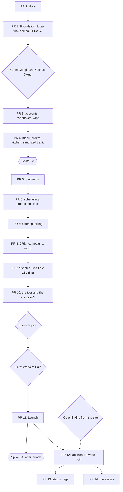

# Roadmap

What gets built, in which pull request and in what order; when each pull request counts as done; which platform questions are tested before code depends on them; and where Joseph decides before work continues. It is the plan for Proof of Concept Bakery, the made-up bakery (named on 2026-11-04, Q2 · Q-name; "Proof of Concept" from here on): its ordering, scheduling, catering, billing and CRM system, every backend in Rust on Cloudflare Workers with state in Durable Objects (DOs), modelled on the site's [roadmap](https://github.com/IHaveASegway/website/blob/main/docs/roadmap.md). Scope details live in the docs that own each topic. [product.md](product.md) holds the full table of open decisions (Q1 to Q45); this file says which of them each pull request proceeds on. Joseph answered the blocking ones on 2026-11-04.

Status: Updated in PR 8 · 2026-11-05

Prices, limits and versions are as of 2026-11-04, with sources. Estimates are estimates until the outside view corrects them.

## How we work

The site's rules ([How we work](https://github.com/IHaveASegway/website/blob/main/docs/roadmap.md#how-we-work), Q36 · Q-process), restated for a repository that is public from its first push.

- **One pull request in flight.** The next starts when the previous merges. One person has no one to hand half-finished work to, and with throughput fixed, more work in progress only lengthens each piece (Little's law). Dependabot's grouped minor and patch pull requests are maintenance, merged every other Monday, and do not count; a major version is a pull request of its own. Cost: a blocked pull request stops everything. Two-way door; revisit if one sits blocked over a week while other work is ready. **Relaxed for agent-built branches, as the site relaxed it on 2026-10-23:** while one pull request waits on Joseph's manual checks (a phone read, a Stripe or Google console step), the next may be built on a branch stacked on it, and spikes run outside the repository. **Joseph's direction of 2026-11-05:** building does not stop for what waits on him. Each next pull request stacks on the last and opens against it, so CI scans it from its first push; his reads, ADR acceptances and merges catch up later, and the [decision gates](#decision-gates) still stop work.
- **Speed first until launch (Q44 · Q-posture, Joseph's direction of 2026-11-04).** Nobody uses the bakery yet, so until the launch pull request (PR 11) CI runs `verify` (format, clippy, `cargo test`, the wasm build, the Astro build), `firewall` and `firewall-selftest`, and nothing else: no previews, no `e2e`, no Lighthouse, no deploy jobs. Joseph reads each pull request on `wrangler dev`. The domain's native tests stay, because they cost nothing. Previews for the web Worker, a small `e2e` suite, `prod-smoke` and the deploy jobs arrive in PR 11; API previews wait for spike S4, after launch. Cost: a broken screen is caught by Joseph's read and not by a browser test; with no production, a miss costs rework and not an incident. Two-way door; revisit when PR 11 starts.
- **A branch per pull request,** named for its scope. This one is `docs/plan`.
- **Never push to `main`.** A local pre-push hook refuses it (from PR 2), and the repository's ruleset refuses it on GitHub ([operations.md](operations.md#7-github-repository-settings)); from PR 11, `deploy` needs `verify`, `firewall` and `firewall-selftest` ([delivery.md](delivery.md#pipeline)).
- **No force pushes.** The repository is public, so a pushed branch is readable before CI scans it, and a force push leaves the replaced commits reachable by SHA. Fix forward; merge `main` into the branch instead of rebasing.
- **An ADR for every decision that meets the threshold in [ADR 0001](adr/0001-record-architecture-decisions.md)** (costly to reverse, a technology or plan a reviewer would question, or a moved boundary), written in the pull request that makes it and Accepted by the pull request that first builds on it.
- **Open decisions are due before the pull request they block.** This is the last responsible moment. Joseph answered every blocking decision on 2026-11-04 ([product.md](product.md#decided)); the rest proceed on their recommendation, and a different answer later costs rework in the pull request it touches.
- **Spikes before dependence** ([spikes](#spikes)), and **time budgeted in focused days** ([time budget](#time-budget)).
- **"Write about it" is part of done.** Every pull request leaves a field note of 30 minutes or less. This repository has no blog; the notes go to the site's writing plan.
- **A Claude Code cloud session commits without the hooks, and says so.** Joseph's decision of 2026-10-25 for the site, adopted here: the session's machine has no private rules file, so the hooks would refuse every commit. CI's `firewall` job scans every push, but a pushed branch is public before the scan runs. So the session reads its own changes against the pull request checklist's firewall classes before each commit, never sets `core.hooksPath`, and states in the pull request that it committed without the hooks ([security.md](security.md)). Commits use `TZ=UTC`, the GitHub noreply identity and no `Co-authored-by` address outside `scripts/firewall/allowed-identities.txt`.

### Definition of done, every pull request

The per-PR checklists add to this one.

- [ ] CI is green. Until the launch pull request (PR 11) that means three jobs, `verify`, `firewall` and `firewall-selftest`; from PR 11 it also means `preview`, `e2e` and the rest ([delivery.md](delivery.md#pipeline)). PR 1 has no CI; its docs were read against the firewall's classes before commit.
- [ ] Joseph has read the pull request on `wrangler dev` for both Workers, on a phone-width screen and a desktop, against the pull request template's content checklist (paraphrase, screenshots, a persona that resembles someone real). Copy gets this read on a later day than it was written. From PR 11 the web preview carries the public pages; signed-in screens stay on `wrangler dev` until the API has previews (spike S4, after launch).
- [ ] The doc that owns each topic touched is updated in the same pull request; if an ADR changed, so did the [ADR index](adr/README.md).
- [ ] The ADRs built on are Accepted, and the decisions needed are marked decided in product.md, dated.
- [ ] A field note is drafted, and the actual focused days go in the [phases table](#phases-and-pull-requests).
- [ ] For this repository: `cargo test` and `cargo clippy -D warnings` are clean; the wasm size and startup budgets are green ([delivery.md](delivery.md#quality-gates-as-fitness-functions)); no personal data is in any fixture.

### Time budget

A focused day is about five hours of uninterrupted work. Several evenings add up to one. The five hours are an assumption, corrected from the actuals.

The estimates below add up to 55–76 focused days. Recurring work comes on top: about 2 hours a month of maintenance ([operations.md](operations.md#maintenance-calendar) itemizes it and says where it overruns) and about 3 hours of field notes. The site's own queue draws on the same hours. Q38 · Q-time asks how many Joseph has; it decides the calendar more than any estimate:

| Hours a month | Left for building | Calendar for 55–76 focused days |
|---|---|---|
| 20 | 15 h, 3 focused days | about 18–25 months |
| 40 | 35 h, 7 focused days | about 8–11 months |

At 20 hours the last pull request lands about two years out. The plan answers with a cut order ([risks](#risks-to-the-plan)); speed first until launch (Q44) is the other answer, because the first thing Joseph can read end to end arrives at PR 11 and not at PR 2. Solo estimates run optimistic (the planning fallacy); the remedy is the outside view: **after PR 2 and again after PR 3,** divide actual by estimated focused days and scale every remaining estimate by that ratio; the second ratio replaces the first. The site's PR 3 ran near three times its estimate, so these ranges are wide.

## Phases and pull requests

| Phase | Pull request | Scope | Est. (focused days) | Actual | Blocked by |
|---|---|---|---|---|---|
| 0 | [PR 1 The plan](#pr-1-the-plan-docs) | `docs/` (this pull request) | done | — | — |
| 1 | [PR 2 Foundation](#pr-2-foundation) | Local-first: Cargo and pnpm workspaces; `bakery-api` with one `Control` object and `/v1/health`, and a `bakery-web` placeholder Home, both on `wrangler dev`; CI `verify`, `firewall` and `firewall-selftest`; the firewall; hooks; Dependabot; the Stripe sandbox and the Google and GitHub OAuth clients; spikes S1, S2, S5, S6 | 5–7 | 1 (2026-11-04 to 05, with agents) | nothing: the blocking questions were answered on 2026-11-04 |
| 2 | [PR 3 Accounts, sandboxes and the wipe](#pr-3-accounts-sandboxes-and-the-wipe) | Google and GitHub sign-in, demo accounts, Turnstile, `Sandbox` and `Account`, guest scope, the seed crate, the nightly wipe, the privacy page's text | 5–7 | 1 (2026-11-05, with agents) | PR 2; the Google and GitHub OAuth gate, whose remaining half is the real-provider consent on Joseph's machine |
| 3 | [PR 4 Menu, orders and the kitchen board](#pr-4-menu-orders-and-the-kitchen-board) | `Catalog`, `Order`, `Kitchen`, the outbox, the Queue and consumer, the menu cache, the live board, menu and cart, simulated traffic (`Simulator`) | 7–9 | 1 (2026-11-05, with agents) | PR 3 |
| 3 | [PR 5 Payments](#pr-5-payments) | Stripe sandbox, `Billing`, Payment Element checkout, webhooks, refunds, receipts, the key guard | 4–6 | 1 (2026-11-05, with agents) | PR 4; spike S3 |
| 4 | [PR 6 Scheduling, production and time travel](#pr-6-scheduling-production-and-time-travel) | `Schedule`, slots and windows, the bake list, the clock | 4–5 | 1 (2026-11-05, with agents) | PR 5 |
| 4 | [PR 7 Catering and billing](#pr-7-catering-and-billing) | `CateringEvent`, quotes, deposits, invoices, reminders, the calendar | 5–7 | 1 (2026-11-05, with agents) | PR 6 |
| 5 | [PR 8 CRM, campaigns and the inbox](#pr-8-crm-campaigns-and-the-inbox) | `Customer`, `Crm`, `Inbox`, segments, campaigns, loyalty, rebuild | 6–8 | 1 (2026-11-05, with agents) | PR 7 |
| 5 | [PR 9 Dispatch](#pr-9-dispatch) | `Dispatch`, the savings heuristic, VROOM in the browser, the comparison, the Salt Lake City data build | 6–8 | — | PR 8 |
| 6 | [PR 10 The tour and the visitor API](#pr-10-the-tour-and-the-visitor-api) | The guided tour on every screen; the per-sandbox bearer token; the OpenAPI document at `/docs/api/`; ADR 0013 | 4–6 | — | PR 9 |
| 7 | [PR 11 Launch](#pr-11-launch) | Workers Paid, the deploy token, custom domains, zone rules, `deploy` and `prod-smoke`, the morning object check, budget alerts, web previews, a small `e2e` suite, the privacy page live | 4–6 | — | PR 10; the Launch gate; the Workers Paid gate |
| 8 | [PR 12 The lab links and How it's built](#pr-12-the-lab-links-and-how-its-built) | The tour's lab and ADR links; the site's PRs adding "Running in the bakery"; the essay on single-writer objects and consensus | 3–4 | — | PR 11; the linking gate |
| 8 | [PR 14 The How it's built essays](#pr-14-the-how-its-built-essays) | One essay for each of the other four lab principles; one essay per principle in the wiring | 2–3 | — | PR 12 |
| 8 | [PR 13 The status page](#pr-13-the-status-page) | `/status/` with live counters | 2–3 | — | PR 12 |

No pull request is blocked by an open decision any more. PR 3 waits for the OAuth gate, and PR 11 for the Launch gate and the Workers Paid gate ([decision gates](#decision-gates)). The rest proceed on their recommendations, each due before the pull request [product.md](product.md#open-decisions) names: Q45 · Q-guest-scope before PR 3, Q40 · Q-traffic before PR 4, Q41 · Q-tour and Q42 · Q-api-access before PR 10. Q39 · Q-template was skipped on 2026-11-04 at Joseph's request, and Q43 · Q-email-signin is explicitly later.

The order is Q37 · Q-order-of-work, as renumbered on 2026-11-04: build locally, deploy when it is good. The wipe and sign-in come before any feature, because every feature stores data in a sandbox, and a sandbox that cannot be wiped must not exist. Payments come before catering, because deposits and invoices are payments. Dispatch reads confirmed orders and catering, so it comes late and is cut third. The tour comes after the screens it describes, and launch after the tour, so that the first public day shows a bakery a visitor can be shown around. The order is a two-way door; it was wrong if a pull request sits blocked on a later one's code.

## Pull requests

### PR 1: The plan (docs/)

Phase 0 · estimate: done (this pull request) · blocked by: nothing

**Scope.** `docs/`: the index, product, domain, architecture, stack, security, cost, delivery, operations, this roadmap and twelve Proposed ADRs (0013 is reserved for the API and socket contract v1, written in PR 10).

**Done when:**
- [x] Every planned doc exists and every relative link resolves.
- [x] All twelve ADRs are Proposed, and every open decision in product.md names what it blocks.
- [x] Joseph answered the blocking decisions on 2026-11-04 ([product.md](product.md#decided)).

**What it teaches.** The architect's pass written down before code. **ADRs**; **one-way and two-way doors**; the **last responsible moment**; **bounded contexts** with **one aggregate per object** ([domain.md](domain.md)).

### PR 2: Foundation

Phase 1 · estimate: 5–7 focused days, spikes included · blocked by: nothing: the blocking questions were answered on 2026-11-04

**Scope.** Local-first: nothing is deployed, no token is created, no zone record is written, and the account stays on Workers Free. Spikes S1, S2 and S6 first ([spikes](#spikes)); S5 moved to launch; S3 runs before PR 5 and S4 after launch. The Cargo workspace (`crates/domain`, `app`, `seed`, `contracts`, `workers/api`) and the pnpm workspace (`apps/web`) at the pins in [delivery.md](delivery.md#toolchain-pins). `bakery-api`: `GET /v1/health` and one SQLite-backed `Control` object, on `wrangler dev`. `bakery-web`: an Astro 7 placeholder Home on an assets-only Worker, on `wrangler dev`. CI with `verify`, `firewall` and `firewall-selftest` and the hardening rules ([delivery.md](delivery.md#before-launch)). The site's firewall with this repository's private rules, and the local hooks. Dependabot for cargo, npm and actions. Created early because local development needs them: the Stripe sandbox, the Google OAuth client and the GitHub OAuth app, with Turnstile's test keys ([operations.md](operations.md#access-setup)); their secrets live in `.dev.vars`, never in the repository.

**Done when:**
- [x] S1, S2, S5 and S6 have a dated Result; a failed spike has changed its owning doc (2026-11-05: none failed; S1's edge half and S5 wait for a deployed Worker).
- [x] `GET /v1/health` on `wrangler dev` answers 200 with the build commit; a request with `Origin: https://bakery.ihaveasegway.com` gets exact CORS headers and any other origin gets none (`scripts/smoke-api.sh` passed on Linux on 2026-11-04, and on macOS on 2026-11-05 after the change that lets it run there).
- [x] The placeholder Home on `wrangler dev` carries the headers in [security.md](security.md) (2026-11-05: the policy, `nosniff`, the referrer, permissions and opener policies, and no HSTS, which is the zone's).
- [x] The Stripe sandbox and both OAuth clients exist; a sandbox-key test passes locally and no key is in the tree (2026-11-04: the restricted key reads customers, 200, and is refused the balance, 403; both client secrets authenticate against their providers).
- [x] `firewall-selftest` proves exits 0, 1 and 2; the pre-push hook refuses `main` (2026-11-05: both, locally and in CI).
- [ ] After the merge, Dependabot has opened a pull request per ecosystem. It reads `.github/dependabot.yml` only from `main`, so this cannot be proven before then.
- [x] `cargo test`, `cargo clippy -D warnings` and `cargo deny check` pass on five crates, and CI shows `verify`, `firewall` and `firewall-selftest` green (2026-11-05, with the real rules in `firewall` and a clean full-history scan).

**What it teaches.** The **walking skeleton**: the thinnest runnable slice through every layer, local first because nobody is waiting on it. **Build once, scan the bytes you will ship.** **Least privilege**, by creating no deploy credential until one is needed. **Fitness functions**: a budget checked by the build cannot erode one pull request at a time. **Expand, migrate, contract** for DO classes, since each class change is a rollback boundary.

### PR 3: Accounts, sandboxes and the wipe

Phase 2 · estimate: 5–7 focused days · blocked by: PR 2 for its merge, not its build: it stacks on `feat/foundation`; the Google and GitHub OAuth gate. Proceeds on the recommendation for Q45 · Q-guest-scope

**Scope.** Google sign-in with `scope=openid` alone (S2 passed on 2026-11-05), GitHub sign-in with the numeric user `id` only (no `user` scope; the token is used once for `GET /user` and discarded; the id is HMAC'd like Google's `sub`; [GitHub](https://docs.github.com/en/apps/oauth-apps/building-oauth-apps/creating-an-oauth-app), as of 2026-11-04), and demo accounts with a generated username and an argon2id-hashed password ([ADR 0006](adr/0006-sign-in-that-learns-nothing.md)); the host-only session cookie. Turnstile on guest sandbox and demo-account creation. Guest scope (Q45): a guest browses, orders and pays with a test card; sign-in unlocks the console's writes, the API token and simulated traffic, and a sandbox that follows the account across devices; guest sandboxes have a tighter cap in `Control` (100 a day of the 300). `Account`, `Sandbox`, `Control`'s daily ledger and caps. The `seed` crate: personas, menu, made-up venues and 90 days of history, deterministic per seed (Q26 · Q-seed); delivery zones are labels until PR 9 adds the Salt Lake City places. The flows are proven on `wrangler dev` against a local fake provider (`scripts/fake-providers.mjs`); the real-provider consent on Joseph's machine is the remaining check. The nightly wipe at 10:00 UTC, the 36 h backstop alarm and "Wipe now", driven locally through the scheduled handler on `wrangler dev`; the morning object check arrives with the deploy jobs in PR 11. The privacy page's text ([ADR 0005](adr/0005-a-private-sandbox-per-visitor-wiped-nightly.md)), reviewed here and published at launch.

**Done when:**
- [ ] Google and GitHub sign-in work end to end against the real providers on `wrangler dev`, with one consent each on Joseph's machine, which holds `.dev.vars`. Until then the flow is proven against a local fake provider. It drops `email` and the other profile claims if a provider ever sends them, because Google's docs still describe `openid` alone as invalid ([S2](#spikes)). Proven on 2026-11-05 against the fake provider, on `wrangler dev` 4.157.0 by `scripts/smoke-auth.sh` (180 checks), with every fault (wrong nonce, issuer or audience, an expired token, a bad signature, `alg: none`, an unknown `kid`, a wrong `state`) refused by a redirect to `/signin/?error=<slug>` and no session. Remains: Joseph's `.dev.vars` with the real client ids and secrets, `SESSION_HMAC_KEY`, `ACCOUNT_HMAC_KEY`, `TURNSTILE_SECRET` (the test value), `ALLOWED_ORIGIN=http://127.0.0.1:8787`, `API_ORIGIN=http://127.0.0.1:8788` and none of the five overrides, with the two local callback URIs registered ([operations.md](operations.md#access-setup)).
- [x] After Google or GitHub sign-in the API holds `HMAC(secret, sub)` or `HMAC(secret, github id)` and nothing else; a test asserts no `email`, `name`, `login` or `picture` reaches storage or a log (2026-11-05: native tests in `crates/app` assert the ID-token verifier's output holds `sub` alone and the GitHub reply deserializes into `id` alone; the fake sends `email`, `email_verified`, `name` and `picture` on purpose and the account id is identical with and without them; the Worker's log after "Ready" holds no `@`, `sub`, name, `picture`, login, GitHub id, query string, username or canary password, and its request lines carry a 64-hex `ip_hash`, never the address).
- [x] A demo account signs in on a second browser; a canary password never appears in a log (2026-11-05: sign-up answers 201 behind Turnstile with a generated `baker-xxxx` username; a second cookie jar signs in; a wrong password and an unknown user both get 401; ten failures lock for 15 minutes, 429 with `Retry-After`; an 11-character password gets 422; argon2id runs in the Worker and only the PHC string reaches an object).
- [x] A guest sandbox needs Turnstile; the 101st guest sandbox and the 301st sandbox of any kind in a UTC day are refused with problem+json; a guest's request for a console write is refused with the rule named (2026-11-05: 403 without a Turnstile token. The caps were proven at 2 guests, 3 sandboxes, 2 demo accounts and 1 sandbox an account, lowered through vars, the same code paths as 100, 300, 100 and 3: the 3rd guest got 503 `guest-cap`, the 4th sandbox 503 `sandbox-cap` with `Retry-After` to the next 00:00 UTC, the 3rd demo account 503 `demo-cap`, an account's second sandbox 429 `account-sandbox-cap`. A guest's `POST /v1/sandboxes/{id}/faults` got 403 `guest-scope` naming the rule (Q45). A second creation from one IP hash inside a minute got 429 `rate-limit` from the Rate Limiting binding, which works on `wrangler dev` 4.157.0; the same `Idempotency-Key` twice returned the same sandbox with `Idempotent-Replayed: true` and counted once).
- [x] Two seed runs produce identical bytes: about 90 days of orders, 60 customers, 8 catering events (2026-11-05: two runs of `bakery-seed 42 2026-11-07` were byte-identical at 581,403 bytes: 722 history orders, 60 customers, 8 catering events, 48 variants; CI's `verify` now runs the seed twice and compares).
- [x] After the scheduled handler's wipe on `wrangler dev` no sandbox-scoped object holds data; a deliberately orphaned object is found by the listing script that PR 11 turns into the morning check (2026-11-05: `/cdn-cgi/local/scheduled?cron=0+10+*+*+*` wiped every live sandbox within seconds, each then answering 410 `wiped`, with `Control`'s day count unchanged; `node scripts/list-objects.mjs <persist-dir>` exited 0; a sandbox created after the wipe made it exit 1 naming the object; the 15-minute sweep and a second wipe changed nothing).
- [ ] "Wipe now" empties one sandbox within the time the privacy page states, and the page's text has been read by Joseph. Wipe half proven on 2026-11-05: `DELETE /v1/sandboxes/{id}` emptied one sandbox in about 20 ms locally, re-issued the session without the sandbox claim, and the listing was clean again. Remains: Joseph's read of the privacy page's text.

**What it teaches.** **Admission control** in layers: Turnstile, the rate-limit binding, `Control`'s caps, a tighter cap for the anonymous. **Leases and TTLs**: a nightly deadline with an alarm backstop. **Data minimisation by construction.** **Pseudonymous identifiers** with a keyed hash. **Deterministic seeds.** **Single-writer aggregates**: `Sandbox` owns its children's registry, so the wipe has one place to start.

### PR 4: Menu, orders and the kitchen board

Phase 3 · estimate: 7–9 focused days · blocked by: PR 3. Proceeds on the recommendation for Q40 · Q-traffic

**Scope.** `Catalog` (about 24 items in 5 categories, variants, allergens, lead times, the menu version), `Order` (event log, state machine, idempotency keys, the 15-minute expiry alarm), `Kitchen` (the board on the Hibernation API, protocol v1). The transactional outbox, the relay to the Queue `bakery-events`, the consumer, per-subscriber `seen` tables, `bakery-events-dlq` after 3 retries ([ADR 0004](adr/0004-queues-between-objects-and-alarms-for-time.md)). The menu cache keyed by sandbox and version, invalidated by `MenuPublished`. The storefront's menu, drawn items (Q7 · Q-images) and cart. Simulated traffic (Q40): a `Simulator` object per sandbox, the 14th DO class (`simulator:<sandbox>`), started and stopped from the console ("Start traffic", with the labs' kind of rate presets, signed-in visitors only under Q45), which on its alarm issues ordinary commands as synthetic customers (orders, a catering inquiry, a pickup) in business time, so the board, timelines and projections move while the visitor watches. Its events carry `cause: sim:<ulid>`. Guardrails: it runs only while the console is open (a socket or a heartbeat), at most 6 orders a minute, at most 30 minutes of traffic a sandbox a day counted in `Control`'s ledger, and the wipe stops it. Its cost, about 8 rows and 3 Queue operations an order, is in [cost.md](cost.md). The minimal clock advance (`POST /v1/sandboxes/{id}/clock`, whole minutes of business time) arrived early so the 15-minute expiry could be watched; PR 6 builds the rest of the clock.

**Done when:**
- [x] The same `Idempotency-Key` twice returns one order and appends one event (2026-11-05, `wrangler dev` 4.157.0, `scripts/smoke-orders.sh`, 191 checks: the second `POST /v1/sandboxes/{id}/orders` answered 200 with `Idempotent-Replayed: true` and the Order's log held one event; the same key with a different body got 422).
- [ ] A consumer killed mid-batch redelivers; each subscriber's effect happens once. Half proven on 2026-11-05: `bakery-events` is consumed by `#[event(queue)]` in the same Worker, a failed delivery is retried, and each subscriber's `seen` makes a redelivery a no-op (a repeated command id gave one event; a redrive after clearing the `kitchen` fault applied the event once, and the board showed the card once). Not proven: a consumer process killed mid-batch. No process was killed, so the box stays open until it is, or Joseph accepts the retry evidence in its place.
- [ ] A poisoned message reaches the DLQ after 3 retries and the alert test fires. Half proven on 2026-11-05: with the `kitchen` fault on, the Kitchen answered 503, each delivery was retried, and after three retries the platform moved the message to `bakery-events-dlq`, where the same handler wrote it with its last error to the owning Sandbox's dead letters; the `dlq` log line is written. Not proven: the alert. It does not exist before PR 11, which adds it; the box stays open until then.
- [x] A menu change bumps the version; the next read misses once, then hits; a current ETag gets 304 (2026-11-05: a price change is a draft; publish moved the version from 1 to 2; the next `GET .../menu` answered `Bakery-Cache: miss`, the one after `hit`; a current `If-None-Match` got 304).
- [x] A second browser sees a board change within one second; a reconnect gets a snapshot; an idle board hibernates (2026-11-05, with `max_batch_timeout: 0` on the consumer: a second socket client saw `OrderPlaced` 108 ms after the POST; a reconnect's snapshot equalled the board another open socket folded from its own snapshot and events; after 12 s idle with two sockets open the Kitchen left memory, `kitchen_wake` was logged on the next upgrade with a new instance mark and the sockets were kept, which is hibernation observed locally, not billing measured).
- [x] An unpaid order expires after 15 minutes of business time, and the alarm is safe to fire twice (2026-11-05: proven with the minimal clock advance, `POST .../clock {minutes: 15}`; a second advance, the alarm firing again, changed nothing).
- [x] No object contains `setTimeout`, `setInterval` or `Date::now`; CI checks it (the `verify` job's no-timers gate has run since PR 3 and passed on this branch's code on 2026-11-05).
- [x] The `Simulator` stops when the console closes; a 7th order in a minute and a 31st minute in a day are refused and logged; the wipe stops it; every event it causes carries a `sim:` cause (2026-11-05: it starts only for a signed-in session, a guest got 403 `guest-scope`; rate 6 placed 6 orders in the first minute, each event with `cause: sim:<ulid>`; a second start in the same minute logged `sim_rate` and placed nothing; the 31st minute was proven with `TRAFFIC_MINUTES_CAP` lowered to 2 through a var, the same code path as 30: 503 `traffic-cap` and `sim_cap used:2 cap:2`; with no socket and no heartbeat for 90 s it stopped with `console_closed` (120 s in the test); `DELETE .../traffic` stopped it with `stop`; the wipe stopped a running one with `wipe` and closed the socket with `bye wiped` and 1001).

**What it teaches.** The **transactional outbox**. **At-least-once delivery with idempotent consumers.** The **dead-letter queue.** **CQRS**: aggregates write, projections read. **Cache invalidation by event** and **versioned keys**. **Hibernation** as a billing property. **Snapshot on join.** The Queue Lab and Cache Lab principles in production code. **Load shaped by a guarded generator.**

### PR 5: Payments

Phase 3 · estimate: 4–6 focused days · blocked by: PR 4; the Stripe gate; spike S3

**Scope.** The `PaymentGateway` port and a Stripe adapter. `Billing`: ledger, payment intents, webhook events seen, refunds. The Payment Element with `fields.billingDetails: 'never'` and synthetic details at `confirmPayment`. Webhook verification in Rust (HMAC-SHA256 over `t.payload`, 5-minute tolerance, [Stripe](https://docs.stripe.com/webhooks#verify-manually), as of 2026-11-04), idempotent by event id. Full and partial refunds, receipts to the inbox, and the key guard ([ADR 0007](adr/0007-stripe-sandbox-and-a-payment-element-that-collects-nothing.md)).

**Done when:**
- [ ] The test card 4242 4242 4242 4242 ([Stripe testing](https://docs.stripe.com/testing)) pays an order in a test on `wrangler dev`, and Joseph's read confirms no name or email field appears; the Playwright payment spec arrives in PR 11. Half proven on 2026-11-05, against a local fake of Stripe's API (`scripts/fake-stripe.mjs`) and not against Stripe: `scripts/smoke-payments.sh` (115 checks, `wrangler dev` 4.157.0) pays a guest's order the way the Payment Element's confirmation does, a confirm of Stripe's test payment method `pm_card_visa` at the fake, and `OrderPaid` reached the kitchen board 73 ms after the confirm (140 ms in the first run); the browser never marks an order paid, only the webhook does. The Simulator's orders are paid the same way: of 6 placed, 4 were confirmed with `pm_card_visa` and 2 declined with `pm_card_chargeDeclined`, which are `PaymentFailed` and in no ledger. The pure parts of the storefront's payment step (which key it uses, the billing details it passes, the wait for the webhook's mark, the refund amount, the decline message, the receipt's text) are covered by vitest in `apps/web/test/payment.test.ts`. Not proven: the Payment Element itself. No browser has mounted it, and the fake knows nothing of `fields.billingDetails: 'never'`. That it confirms with synthetic details and shows no name or email field is spike S3, which needs Joseph's real sandbox key, and then his read of the screen.
- [x] A webhook replayed 5 times changes the ledger once; a body altered by one byte, and a timestamp 6 minutes old, are rejected (2026-11-05, against the fake, on `wrangler dev` 4.157.0 by `scripts/smoke-payments.sh`, 115 checks: one `payment_intent.succeeded` delivered 5 times, each answered 200, was applied once and replayed 4 times, and the ledger holds one line for it; with the fake's `tamper_body` fault, which flips one byte after signing, every delivery got 400, logged as `signature`; with `old_timestamp`, which dates `t` 360 s back, every delivery got 400 `timestamp`, while a `t` 240 s old was accepted; a bad signature and a `livemode: true` event also got 400 on every delivery; the same event sent clean afterwards paid the order. The refusals are logged by reason code only. The verifier's own tests in `crates/app/src/stripe/webhook.rs` pin the tolerance at offsets of -360, -301, +301 and +360 s refused and -300, -240, 0, +240 and +300 s accepted, a flipped byte at the start, middle or end refused, and several `v1` entries accepted when one matches. Not Stripe's own deliveries: whether Stripe's real webhooks verify is spike S3).
- [x] A partial and a full refund each append one `RefundIssued`; a refunded order's ledger nets to zero (2026-11-05, against the fake: `scripts/smoke-payments.sh` takes a partial refund, which leaves the order's status, and then the rest, which moves it to `refund_pending` and then `cancelled`; each gave one ledger line, two refunds reached the fake, the order's lines net to zero and `net_cents` is 0; a repeated `Idempotency-Key` returned the first answer with `Idempotent-Replayed`, a refund past what was paid got 422 `order` and a reason of `requested_by_customer`, which staff may not give, got 400 `body`. The native tests in `crates/app/src/stripe/mod.rs` (a flow with `Billing` and the test double of the port: a webhook replayed 5 times, then a partial and a full refund, one `RefundIssued` each) and the property tests in `crates/domain/src/billing.rs` (512 cases: refunds never exceed what was paid, a replayed event changes nothing, the ledger equals the fold of the events) pin the same). Remains for S3: that Stripe's `refund.created` carries what the fake's does.
- [ ] A live-key prefix in any variable, fixture or log fails `verify`, and a Worker started with one refuses payment routes. Half proven on 2026-11-05. The Worker half: `scripts/smoke-payments.sh` starts `wrangler dev` with a live-shaped key (built from parts at run time, so the script never holds the prefix) and health and the menu work, while the payment, ledger, refund and webhook routes each answer 503 `stripe-key`; `stripe_key_refused` is logged exactly once; the fake's request log holds no 401, which a request carrying that key would have got; and no client secret, key, `Bearer`, signature or event body appears in the Worker's log. The key guard accepts `sk_test_` and `rk_test_` only, which is stricter than "not live": a publishable key or an unknown prefix is refused too. The `verify` half: a step, "No live Stripe key in the tree or the bundles", greps everything but `docs/` and its own file, and both built bundles, for the three live prefixes (put together from parts, so the step does not match itself). It found nothing in the tree and the bundles when run locally on 2026-11-05, and run by hand over a scratch tree its two greps passed a clean one and failed on a prefix in a source file and in a bundle. Not proven: the step has not run on GitHub, so the box stays open until `verify` has, and no script plants a prefix on purpose to watch the job fail. The web build's check (`PUBLIC_STRIPE_PUBLISHABLE_KEY` empty or `pk_test_`, else `astro build` stops) is covered by `apps/web/test/publishable-key.test.ts`.

**Built and proven against a fake, 2026-11-05.** Everything here ran against `scripts/fake-stripe.mjs`, a local stand-in for Stripe's API and its signed webhooks on 127.0.0.1:8791, never against Stripe: the facts it models are Stripe's documented ones as of 2026-11-05 ([API](https://docs.stripe.com/api), [webhooks](https://docs.stripe.com/webhooks#verify-manually), [testing](https://docs.stripe.com/testing)), and spike S3 confirms the two things only a real sandbox can (the Payment Element with synthetic details, and a real delivery reaching the Worker). Checks that ran on the branch: `scripts/smoke-payments.sh` 115, `scripts/smoke-orders.sh` 192, `scripts/smoke-auth.sh` 180 and `scripts/smoke-api.sh`, all passing on `wrangler dev` 4.157.0; `cargo test --workspace --locked` with 50 tests in `bakery-api`, 101 in `bakery-app`, 111 in `bakery-domain`, 26 in `bakery-seed`, 9 in `bakery-contracts` and 4 in the seed alignment test; 220 in `pnpm --filter web test`. Also shown: an expired order's intent is canceled at Stripe with the reason `abandoned`; the wipe cancels an intent still open and leaves the object listing clean, `Billing` included; a webhook for a wiped or unknown sandbox is answered 200; and the webhook route answers `OPTIONS` with 405 and sends no CORS header even for the storefront's `Origin`. A sandbox then seeded 15 children in three batches, `Billing` among them (36 from PR 9, 2026-11-06).

Known gaps, written down and not hidden. A seeded paid order has no Stripe payment, so a staff refund of one answers 409 `no-stripe-payment` and a customer's cancellation of a seeded confirmed order stays `refund_pending` (`Billing` logs `refund_skipped`); PR 8, which writes the seed's history into `Billing` and `Crm`, closes it. The seed's daily totals sit in `Billing`'s `history` table and appear in no response yet. The 409 `webhook-later` answer, for an event `Billing` cannot apply yet, exists in the code and has no smoke check. Receipts to the inbox, in this pull request's scope, are not built: there is no Inbox until PR 8, and the storefront's receipt screen is the only receipt. `out_for_delivery` refuses a staff refund (a reading to confirm, [domain.md](domain.md#order)). The wasm module grew to 3,013,075 B on 2026-11-05, 445,037 B over PR 4's 2,568,038 B, and the budget moved to 3,766,343 B ([delivery.md](delivery.md#quality-gates-as-fitness-functions)); a jump that size is something to look at before PR 6.

**What it teaches.** **Idempotency keys** at both edges. **Verifying a webhook** against the raw body. **Ports and adapters.** **Append-only ledgers**: a refund is a new entry. **Reconciliation.** **Blast-radius control** by a key guard.

### PR 6: Scheduling, production and time travel

Phase 4 · estimate: 4–5 focused days · blocked by: PR 5

**Scope.** `Schedule`: 15-minute pickup slots and 2-hour delivery windows per zone, staff-set capacities (Q10 · Q-slots). The bake list per day, projected from confirmed orders and catering with lead-time rules (Q11 · Q-production). The per-sandbox business clock and "time travel", with platform alarms on wall time re-armed when the clock moves, at most 100 a day per object (Q12 · Q-clock).

**Done when:**
- [x] Two orders racing for the last slot: one reserves, one gets 409 naming the next free slot (2026-11-05, `wrangler dev` 4.157.0, `scripts/smoke-schedule.sh`, 98 checks: with a slot cut to one place, two sessions of one account placed in parallel; one got 201 and the other 409 `slot-full`, whose `detail` and `next_free` member both named the next free start that day. The native test in `crates/domain/src/schedule.rs` pins the same with two orders at 10:00 and the second told 10:15, and its property test (512 cases; a temporary counter showed 126 runs with a full slot, since removed) checks `next_free` is a later start with room. A window refusal names no slot, since a zone's stops are shared by its windows).
- [x] A cake for tomorrow is refused with the 48 h rule named; for the day after, it appears on that day's bake list (2026-11-05, `scripts/smoke-schedule.sh`: a chocolate layer cake for tomorrow got 409 `lead-time` and a `detail` naming 48 h (the native test pins the domain's sentence, "Chocolate layer cake needs 48 h; the slot is 25 h away"); for the first slot at least 48 h 30 min out, on a day the cake is baked, the order was placed, paid through the fake Stripe and found on that day's bake list and in the kitchen socket's snapshot. The native flow in `crates/app/src/scheduling_flow.rs` pins both halves).
- [ ] Advancing the clock a day expires an unpaid order and changes the bake list, with the clock port faked in tests. Mostly proven on 2026-11-05. `scripts/smoke-schedule.sh` advances a sandbox's clock a day (`{step: "1d"}`): the unpaid order becomes `expired`, its slot's `taken` drops back, the Schedule's own log holds `SlotReleased` and the console's feed shows `ClockAdvanced`. The clock port is faked in `crates/app/src/scheduling_flow.rs` (`FixedClock`): an unpaid order's `Expire` is refused as not due, after a day it emits `OrderExpired`, the Schedule's `Release` frees the place and the hold timer firing afterwards is a no-op. Not met as the line is worded: an unpaid hold is never on a bake list, so the advance cannot take the expired order off one. What the advance changes on the board is the days it keeps (the snapshot's bake lists start at business today, and the days before it dropped out in the smoke), and a paid order's `SlotReserved` is what puts a line on the list (`BakeListChanged` version 1 in the native flow). The box stays open until Joseph accepts that reading or rewords the line.
- [ ] Re-arming is idempotent, and the 101st re-arm in a day is refused with a logged reason. Half proven on 2026-11-05. Idempotent, over HTTP: a `{minutes: 5}` advance replayed with its `Idempotency-Key` answered 200 with `Idempotent-Replayed` and moved the Order's `expiry` timer by 300 s exactly once, read from the state's SQLite file (`scripts/smoke-schedule.sh`); arming the wall time already armed writes nothing. The 101st, natively: `plan_arm` in `workers/api/src/objects/stream.rs` has four unit tests (the 101st alarm-driven re-arm is refused while a command still arms; one wall time twice counts once; a new UTC day resets the count; a past timer arms for now and no timer deletes the alarm). Not proven: the refusal inside a running object. No production path re-arms from its own alarm often enough to reach 100 in a smoke run, the crate has no object-level test harness, and no `alarm_guard` line was logged in any run, so the logged reason (`{"event":"alarm_guard","reason":"rearm-cap","object":<class>}`) is code that no test executes. The box stays open until an object-level test, or Joseph accepts the pure function in its place.

**Built and proven, 2026-11-05.** Checks that ran on the branch, all passing on `wrangler dev` 4.157.0: `scripts/smoke-schedule.sh` 98 (41 s), `scripts/smoke-orders.sh` 192 (151 s), `scripts/smoke-payments.sh` 115 (77 s), `scripts/smoke-api.sh` (all checks passed, 29 s) and `scripts/smoke-auth.sh` 180 (66 s); `cargo test --workspace --locked` 371 (70 in `bakery-api`, 104 in `bakery-app`, 5 in the seed alignment test, 10 in `bakery-contracts`, 153 in `bakery-domain`, 29 in `bakery-seed`; PR 5 had 301); 283 in `pnpm --filter web test` (20 files; PR 5 had 220); `cargo deny check`, clippy with `-D warnings` for the workspace and for `bakery-api` on `wasm32-unknown-unknown`, `pnpm lint`, `pnpm format:check` and `pnpm typecheck` clean. The wasm module is 3,591,024 B (budget 4,488,780 B; [delivery.md](delivery.md#quality-gates-as-fitness-functions)); a sandbox seeds 22 children in four batches. The Schedule object, the hold at placement and its release on failure, the schedule and capacity routes, the clock's four steps, the staff capacity editor, the slot picker with a one-click `next_free`, the bake list panel and the clock control are built; of the web screens only the pure logic (`apps/web/src/lib/`) is tested, and the new console components were type-checked and linted but never rendered in a browser. Also shown: a capacity cut to 0 keeps the reservation (taken 1, free 0, still on the bake list); an item cap of 1 makes the next order 409 `item-cap`; 403 `guest-scope` and 422 `bad-target` on the capacity route; the seven seeded days are there at birth; and every child, `Schedule` included, is empty after the wipe (`list-objects` exits 0). Two smoke fixes ride along: `smoke-auth.sh` now waits for `live` before listing objects (it raced the 22 children's seeding once), and the other smokes pick a valid open slot through `Intl`. One earlier `smoke-orders.sh` run aborted at its hibernation check (the Kitchen did not leave memory within 12 s) and the rerun passed; the flake is not tied to this pull request.

**Known gaps and readings, written down and not hidden.**
- **The 18:00 plan lock is not built.** [domain.md](domain.md#money-and-time) says tomorrow's production plan locks at 18:00 the day before and never says what the lock refuses; a hard lock contradicts a same-day order with a 2 h lead. Joseph decides what it should do.
- **A box of six counts as one.** Item caps and the bake list sum variant quantities per item, so a croissant box of six is one croissant, as the seed's `sold` counter does. Counting units baked would change both.
- **A late payment revives a released hold past capacity** (`revived: true` on `SlotReserved`), because the money already moved. The alternative is to refund that payment. No smoke check drives it; the native test `a_late_payment_revives_a_released_hold_past_capacity` and the property test (512 cases; a temporary counter showed 51 runs with a revival, since removed) do.
- **The seed's business times are now daylight-aware**, where PR 4 and PR 5 wrote `-07:00` all year; one pin moved (the first order's ULID, `01KZE0H7D0AHWTMASY3YGTFWD7` to `01KZDX3BS0AHWTMASY3YGTFWD7`, because 90 days back from 2026-11-07 reaches August). A summer-born sandbox is proven by `seed_alignment.rs`, five seeds and dates, two in summer.
- **Capacity defaults are the domain stream's numbers**, 6 an order slot, 20 stops a zone, 2 catering events ([domain.md](domain.md#schedule-reservation)), not Joseph's.
- **A day born later had no item caps; closed in the hardening after PR 13 (2026-11-06).** Item caps arrived by `RefreshCaps` at seed and on `MenuPublished` only, so a day first touched after that was uncapped until the next publish (`Schedule::open` and the first write of `Schedule::command` started from `ScheduleState::new(date)`, which holds no caps). Now a day's birth reads the Catalog's published menu once and writes `CapsRefreshed` before its first command in the same transaction, for a hold, a read and a capacity change alike, so it is capped like a seeded day; when the menu cannot be read the day is not born and the touch is refused (`schedule_birth_refused`, reason `caps-unavailable`), since an uncapped day could promise a bake the kitchen cannot make. Proven by `scripts/smoke-schedule.sh` (116 checks, 18 of them new, all passing on `wrangler dev` 4.157.0 on 2026-11-06: on a day 13 days out that no seed touched (2026-11-18), the order that filled chocolate-layer-cake's cap of 30 was 201, the day it bore showed the menu's version and 24 caps with `CapsRefreshed` before `SlotHeld` in its log, and one more cake was 409 `item-cap`; a day first read before a publish did the same; the 30th day, born by a read, now shows `menu_version` 1 where it showed 0) and the unit test `a_day_born_by_a_hold_is_capped_by_the_menu_it_reads` in `workers/api/src/objects/schedule.rs`.
- **A retried placement could lose its hold; closed in the hardening after PR 13 (2026-11-06).** A hold released by its timer or after a transient failure, then retried with the same key past 15 business minutes, could place an order with no live hold: the day replayed the stored `hold:<key>` answer, which still said `held`, and the Order placed at its own time. Now a retry first asks the Order whether it exists (if it does, the Order replays and no place is asked for); otherwise the day decides a released place as `Retake`, held again with the retry's own 15 minutes when there is room, so the order is placed on a live hold, or refused 409 `hold-lost` with `next_free` as `slot-full` has it. Taking the place again, not refusing it, is the choice: the visitor asked once and the place is free. Proven by `scripts/smoke-orders.sh` (217 checks, 25 of them new; on 2026-11-06 all 25 passed: the retry was 409 `hold-lost` while the slot was cut to the places it held, then 201 with the slot's count one higher once it had room, and a third try replayed 200 with no second place. The one failure, "a 7th order in a minute is refused and logged sim_rate", is not this change's: at 03:30 UTC every simulated order's slot, four hours on, falls before opening and lands on the next day's 07:00, so slot-full refusals keep the Simulator under the minute's 7th order, and the unchanged base commit `f6762a8` failed the same check in the same hour with the same 4 orders placed) for a place given back after the Order refused, and natively for the timer's release (`a_lost_hold_is_taken_again_when_the_slot_has_room`, `a_lost_hold_with_no_room_left_is_refused_naming_the_next_free_start` and the property test, which now draws `Retake`, in `crates/domain/src/schedule.rs`).
- **A reservation made before the page connected and released while connected** leaves the web page's reserved count too high until the next snapshot, since the frame carries no count; the Kitchen's board follows the same rule.
- **Days are bounded** from the sandbox's birth to business today plus 30 (404 `no-such-day` outside), where [architecture.md](architecture.md#object-naming) still says birth minus 90 to plus 30.
- **Not driven by any smoke check:** 422 `no-such-slot` and 422 `closed-day` on order placement (unit-tested), the new console components in a browser, and a Worker built for the edge (all of this ran on `wrangler dev`). The wasm startup was not measured.
- **`ClockAdvanced` reaches the console through the Sandbox's `/_clock` push** to the Kitchen, not through a catalog route.

**What it teaches.** **Capacity as a reservation problem** with one writer. **Projections from events.** **A logical clock as a port.** **Alarms as a timer wheel** with an explicit re-arm budget.

### PR 7: Catering and billing

Phase 4 · estimate: 5–7 focused days · blocked by: PR 6

**Scope.** `CateringEvent`: inquiry (date, headcount, package, a made-up venue), staff quote, 25% deposit, confirmed, production, delivered, balance invoice, paid, closed; declined and cancelled paths. Reminders by alarm. The calendar: 2 events a day, 7-day lead time. The 500-character brief, pattern-checked on write (Q14 · Q-free-text).

**Done when:**
- [x] Every transition in [domain.md](domain.md) has a test; a property test finds no sequence reaching an undefined state (2026-11-05, `cargo test -p bakery-domain`, 176 tests, 20 of them in `crates/domain/src/catering.rs`. `every_edge_of_the_diagram_is_walked` drives the aggregate along each of the diagram's 18 edges (the start, the 12 state changes drawn before this pull request, the new `quoted --> confirmed`, and a reminder's loop in `quoted`, `confirmed`, `in_production` and `invoiced`) and fails if one is missing or another is taken. `no_sequence_reaches_an_undefined_state` runs 512 random sequences of up to 80 commands at business times from 0 minutes to a week apart and checks every step against that list, that a replayed log gives the state, that deposit plus balance is the quote, that a terminal state has no timer and that a repeated command at the same time changes nothing. The refusals, the no-ops and the timers have tests of their own).
- [x] A deposit delivered by two webhooks is recorded once (2026-11-05, `scripts/smoke-catering.sh`, 151 checks on `wrangler dev` 4.157.0, against the fake Stripe: one `payment_intent.succeeded` delivered twice, each answered 200, gave one `CateringDepositPaid` in the event's log and one deposit line in `Billing`'s ledger; the event is `confirmed` only after the webhook, never on the browser's word. A second `deposit` call returned the same client secret and payment).
- [x] A third event on a day, and an event 6 days out, are refused with the rule named (2026-11-05, `scripts/smoke-catering.sh`. An inquiry 6 days out, or 5 when that falls on a Monday, is 422 `catering` whose `detail` names "7 business days" and the earliest date and ends "The rule is catering-lead."; with a day already holding two catering places, the third event's acceptance is 409 `slot-full` ("two catering places") and records nothing. The third event is refused when its place is asked for, at acceptance, and not at the inquiry. "6 days out" is read as the open-day count of [domain.md](domain.md#cateringevent): a Tuesday inquiry may name the Wednesday of the next week).
- [x] A reminder fires when the clock passes it; cancelling deletes the alarm (2026-11-05, `scripts/smoke-catering.sh`. Fires: a quoted event's follow-up was due at the opening of the 3rd open day after its quote; `POST .../clock` moved the sandbox past it and the event's log gained `CateringReminderDue` naming `follow_up`. Deletes: a confirmed event holds one timer row, `event_soon`; cancelled 8 days out and cancelled 3 days out it holds none, and `timers_cleared` is logged; a closed event holds none either. What no check read is the platform's alarm itself: the object arms its one alarm from the rows it holds, as every object does, so a row going is the alarm going, and no `alarm_guard` line was logged in the run).
- [x] Deposit plus balance equals the quote; a brief holding an email, phone, card number or URL is rejected (2026-11-05. Equals: `deposit_plus_balance_is_the_total` draws totals from 1 cent to 1,000,000,000 cents (proptest's default of 256 cases) and holds the deposit to the exact quarter within half a cent; `scripts/smoke-catering.sh` closed a 40-head breakfast spread at 58,000 cents, the event's `deposit_cents + balance_cents` equal to its `total_cents`, and the ledger's deposit and balance lines summing to 58,000. Rejected: 422 `catering` for `brief-email`, `brief-phone`, `brief-card-number` and `brief-url`, each naming its class in the `detail` and never echoing the brief, which is in no refusal body and no log line. The checker's own vectors are in `crates/domain/src/free_text.rs`, and the page's hints are ported from them with about 60 vectors in `apps/web/test/catering.test.ts`).

**Built and proven against a fake, 2026-11-05.** The Stripe half ran against `scripts/fake-stripe.mjs`, never against Stripe: it now models customers, invoice items and invoices and the `invoice.paid`, `invoice.payment_failed` and `invoice.voided` webhooks (`node --test scripts/fake-stripe.test.mjs`: 5 of 5), as Stripe documents them as of 2026-11-05 ([Invoicing](https://docs.stripe.com/invoicing), [API](https://docs.stripe.com/api)). Checks that ran on the branch, all on `wrangler dev` 4.157.0: `scripts/smoke-catering.sh` 151 of 151, `scripts/smoke-payments.sh` 115 of 115, `scripts/smoke-schedule.sh` 98 of 98, `scripts/smoke-auth.sh` 180 of 180 and `scripts/smoke-api.sh`; `cargo test --workspace --locked` with 81 tests in `bakery-api`, 111 in `bakery-app` (5 more in its seed alignment test), 176 in `bakery-domain`, 32 in `bakery-seed` and 11 in `bakery-contracts`, 416 in all (re-run for these docs on 2026-11-05); 458 in `pnpm --filter web test` (24 files, the web stream's count). The smoke scripts for orders, payments and schedule now expect `children === 33` where they expected 22, and `smoke-auth` expects at most 33. `scripts/smoke-orders.sh` aborted at its hibernation check, after 129 ok and no FAIL, on this branch and on the unchanged base commit alike, three times on this branch and once on the base: the staff Kitchen with two sockets does not always go quiet within one 12-second window with 33 children running, the flake PR 6's report describes. After that change `scripts/smoke-orders.sh` passed all 192 checks on this branch on 2026-11-05 (the Kitchen went quiet on the third of five 12-second spells). A sandbox then seeded 33 children, five batches of 7 (36 from PR 9). The wasm module grew to 4,113,149 B on 2026-11-05, 522,125 B over PR 6's 3,591,024 B, and the budget moved to 5,141,436 B ([delivery.md](delivery.md#quality-gates-as-fitness-functions)). The storefront builds 8 pages, `/catering/` among them, and the page's chunk is 3.7 KB gzipped (the console 14.1 KB, the Payment Element panel both the checkout and the deposit share 6.8 KB, the web stream's figures); the `verify` job's JavaScript byte budgets run only in CI and were not run.

What exists: the inquiry form (the date a select of the 60 open days from the earliest allowed, a headcount, a package, a made-up venue, a brief with a live count and a hint for each of the four classes), "Your events" with each event's state and figures, the event page (accept, pay the deposit with the same Payment Element panel the checkout uses, cancel, pay the balance), and in the console a queue grouped by state with quote, decline, start production, mark delivered and staff cancel, and a list of every reminder by alarm. `/catering/*` is a payment page in the CSP and carries exactly the three Stripe origins, asserted in `headers.test.ts` and `policy.test.ts`. The inquiry reaches `CateringEvent` through twelve routes ([the API's README](../workers/api/README.md)), and the balance is a Stripe invoice raised from `CateringDelivered` ([architecture.md](architecture.md#the-catering-saga)). The brief is stored in the object, shown to staff and to its own visitor as escaped text, stripped from every event the consumer delivers, and never in a log.

Decisions taken for this pull request on the domain stream's questions, each Joseph's to reverse:
- **The seeded accepted quote is born with a live deposit hold.** Its acceptance is replayed at the birth time, so a visitor can pay its deposit within 15 business minutes of the sandbox's birth; the alternative, letting it lapse to `quoted` at once, was left (proven: `scripts/smoke-catering.sh` finds the seeded accepted event `accepted` at birth, asks for its deposit intent, which the route allows only in `accepted`, and then lets the hold lapse with a one-day clock advance, the quote still valid).
- **A late deposit is refunded when the quote has expired, and confirms when it has only lapsed.** After the 15 minutes the money moved, so the event confirms and the place is taken back; after the quote's 14 business days the aggregate refuses it and `Billing` returns the whole amount, as an `Order` treats a late payment. Proven end to end on the seed's accepted event once its quote had expired, by a script that tries up to 3 sandboxes to find one where both seeded quotes expire within the clock's 14 days (in the last run the second qualified and the deposit was refunded in full at the fake and in the ledger; when none qualifies, the script proves the confirming branch instead, which that run did not exercise).
- **The balance is paid through the fake with the test card, and real Stripe is spike S3's question.** `pay-balance` pays the invoice with `pm_card_visa` on the test path. How a visitor pays it at real Stripe (the Payment Element on the invoice's payment, the same server-side call, or the hosted invoice page), whether `send_invoice` to a customer with no email sends nothing, and whether the invoice's own payment intent carries none of our metadata are listed in [operations.md](operations.md#what-spike-s3-must-still-do).
- **A paid balance is not refunded.** `Billing` refuses it, as before; a refund of a deposit is.
- **The invoice falls due 7 days after delivery,** with its `invoice_due` reminder on the due day, one decision and not two (7 and 14 were the choices).
- **Re-quoting, declining a quoted inquiry and cancelling before confirmation are refused,** as the diagram draws it: 409 `out-of-order`. The customer's and the staff's Cancel are offered only in `confirmed`.
- **Stripe idempotency keys begin with the sandbox id,** `<sandbox>:<ref>:<purpose>[-call]:<n>`, for every call, PR 5's included, since two sandboxes born from one seed share their seeded refs and Stripe keeps a key for 24 hours ([Stripe](https://docs.stripe.com/api/idempotent_requests), as of 2026-11-05). A test asserts two sandboxes never share a key ([domain.md](domain.md#idempotency)).

Known gaps and questions, written down and not hidden. Each is a decision for Joseph unless it says otherwise.
- **Nothing here ran against Stripe.** The Payment Element has not been mounted on `/catering/` or on `/checkout/`, which this pull request refactored into the shared panel (the old step had no component test beyond the receipt's markup, and typecheck, build and the unchanged `waitForPaid` tests cover the change); a look at both on `wrangler dev` with a real sandbox key is S3's, and then Joseph's read of the screens. Real Stripe's behaviour for `send_invoice` to a customer with no email, for the invoice's payment intent, for paying an invoice with `pm_card_visa`, for deleting a customer who has a void invoice, and for the restricted key's invoice-item permission is all unread.
- **A fresh quote cannot be watched expiring.** It is valid for 14 business days, 16 or more calendar days, and the clock moves at most 14 days in total. The expiry is proven on the seeded quoted event only. Raise the clock's cap, or shorten the validity for the demo?
- **A seeded invoiced event cannot be paid, and a seeded confirmed event's cancellation refunds nothing,** because the seed writes no `Billing` invoice or deposit behind them: `pay-balance` answers 409 and `refund_skipped` is logged. The page shows the refusal. PR 8's `Billing` history closes it with PR 5's gap.
- **The seeded catering events are never relayed.** They have no outbox rows, so no subscriber sees them; relaying them would raise a Stripe invoice at every birth. `Crm` and `Inbox` do not exist until PR 8, so the quote message, the reminders and the receipts in the catalog have no reader: a reminder is an event in the log and a line on the console, and nothing is sent.
- **The Simulator places no catering inquiry,** though its scope lists one; the Kitchen board shows no catering card (its model is orders only, so `CateringProductionStarted` and `CateringDelivered` clear nothing); and no pickup reaches either. Left for a later pull request; say whether PR 8 or this one should have them.
- **No upper bound on an inquiry's date.** The domain sets none, and a catering hold registers its day without the 30-day limit orders have. Cap it (for example at 365 days)?
- **Per-head prices are mirrored in the page** (`apps/web/src/lib/catering.ts`) with a drift test against `crates/domain/src/catering.rs` (skipped when that file is absent), because no response or contract returns packages. A `GET` for packages would remove the copy. **Venue names are not exposed:** the browser sees `v1` to `v6` and the page says "Venue 1 (made up)" to "Venue 6 (made up)"; expose the seed's names on the response or a venues route?
- **A brief-class hint warns and does not block,** so the API stays the check. NFC normalization of the brief is not done ([domain.md](domain.md#free-text-and-personal-data)).
- **Unproven over HTTP, until 2026-11-06:** the 409 of `decline`, `start-production`, `delivered`, `cancel` and `staff-cancel`, 422 `quote-total` and `date`, and 503 on the catering payment routes. `scripts/smoke-catering.sh` now drives each (238 checks, up from 151, `wrangler dev` 4.157.0, 2026-11-06): the five 409s `out-of-order` from two states each, 422 `quote-total` for 0 and -500 and 422 `date` for `2026-02-30` and `tomorrow`, each leaving the event byte for byte as it was, and 503 on `deposit` and `pay-balance` with a key of the other mode (`stripe-key`) and with no key (`config` naming `STRIPE_SECRET_KEY`, not `stripe-key`; [the README](../workers/api/README.md)). No browser test ran the page's flows; `apps/web/test/catering-ui.test.ts` renders the first paint only. The Worker's startup time was not measured again with the new class.
- **Seed rows.** The row estimates in [domain.md](domain.md#the-seed) were not measured again: the Schedule has 10 objects now, and spike S5 measures the real figure.

**What it teaches.** The **saga by alarm**: a long-running process as a state machine in one object, advanced by events and timers, with compensation for declined and cancelled paths. **Process managers** against choreography. **Property-based testing** of state machines.

### PR 8: CRM, campaigns and the inbox

Phase 5 · estimate: 6–8 focused days · blocked by: PR 7

**Scope.** `Customer` (synthetic profile, consent flags, loyalty), `Crm` (customer list, timelines, segments, campaign stats, the rebuild cursor), `Inbox` (messages, simulated opens and clicks). Segments as rules over the projection. Campaigns: compose, schedule, send to the sandbox inbox. A catering lead pipeline. Loyalty points. "Rebuild projections" with a progress bar (Q21 · Q-crm-scope). Real sends only to Joseph's own verified address, off by default (Q22).

**Done when:**
- [x] Dropping every `Crm` table and rebuilding reproduces the projections byte for byte, with progress shown (2026-11-05, `wrangler dev` 4.157.0, `scripts/smoke-crm.sh`, 163 checks, and the domain's `the_projection_is_the_fold_of_its_own_log`). The smoke read the customers, a timeline, the segments, the campaigns, the leads, the activity feed and Crm's stored projection row, started `POST .../rebuild` (202; a second start while it ran got 409 `rebuild`), watched `applied` climb to a `total` of 1,033 over several alarms of 200 log entries each, and read the same things again: all byte-identical. The Worker logged `rebuild_finished` with `identical: true`, which is its own comparison of the replay with the projection it replaced, and the appended `ProjectionRebuildFinished` held `events` equal to the log's length. The property test, 256 cases at proptest's default (as of 2026-11-05, [proptest](https://docs.rs/proptest)), delivers events in any order with duplicates and retried refusals and compares the projection with `CrmProjection::from_log` of the envelopes it applied as JSON strings. One word of the box is read narrowly: the rebuild truncates the projection, not "every table". Crm's append-only log, the one table that is not disposable, is what it replays, and the campaigns are a fold of Crm's own stream and are kept; the roster comes from the seed and is kept too.
- [x] A segment changes membership when an event arrives; a consent flag excludes a customer from a campaign (2026-11-05). Segment: the domain test `membership_changes_exactly_when_the_event_arrives`, and in `scripts/smoke-crm.sh` a cake order placed and paid through the fake Stripe for the visitor's persona added one member to `cake-last-30-days` (the script picks the first seed from 1 to 80 whose persona has consented and has no cake order in the last 30 days; today that was seed 8). Consent: `consent_comes_from_the_customer_stream_and_gates_the_audience` and the property test `consent_gates_every_send_and_a_send_fires_once` (no recipient lacks consent, every consenting member is one, whatever flips arrive); in the smoke, with `marketing` withdrawn campaign 1's frozen recipients and the inbox excluded the persona, and with it back campaign 2 reached it. A recipient list can only be built through `Audience::of`, which applies consent, so a send cannot skip it.
- [x] A campaign scheduled for tomorrow sends once when the clock passes it, even if the alarm fires twice (2026-11-05, with a reading to note). The unit test `a_send_timer_that_fires_twice_sends_once_and_only_to_consenting_members` in `workers/api/src/objects/crm.rs` runs the second firing through the aggregate, and the property test above fires a send twice for every case. In `scripts/smoke-crm.sh` the clock was advanced past the send time and then advanced again: one `CampaignSent` in Crm's log and one message per recipient. What the smoke scheduled was 20 minutes ahead, the earliest the rule allows being 15 ([domain.md](domain.md#campaign)), and not a whole day ahead; no run scheduled a day out.
- [x] No `Mailbox` implementation can address a non-sandbox recipient (test) (2026-11-05, `cargo test -p bakery-app`). The port's `Note` carries a `Recipient`, whose fields are private and which is built only by `Recipient::new(sandbox, customer)`, two ids; there is no string or address anywhere in the port. Two `compile_fail` doctests in `crates/app/src/ports.rs` fail to compile on `Recipient::from("someone")` (E0277) and on building a `Recipient` from its fields (E0451), and `no_mailbox_can_address_a_recipient_outside_its_sandbox` in `crates/app/src/test_support.rs` shows the fake refusing a foreign sandbox's recipient with `recipient-outside-sandbox` and delivering nothing, while its own sandbox's customer is delivered. Nothing in `workers/api` implements `Mailbox` yet, because every message is an Inbox row, so the rule binds the port and the one test double and has no real adapter to bind.

**Built and proven, 2026-11-05.** Checks that ran on the branch: `cargo test --workspace --locked` with 480 passing (93 in `bakery-api`, 112 in `bakery-app` plus 5 in the seed alignment test, 1 in `crm_contracts` and 2 `compile_fail` doctests, 218 in `bakery-domain`, 37 in `bakery-seed`, 12 in `bakery-contracts`), `cargo clippy --all-targets -- -D warnings`, `cargo fmt --check` and `cargo deny check` clean, and 541 tests in 29 files in `pnpm --filter web test` (458 before the console panels and the inbox page). On `wrangler dev` 4.157.0: `scripts/smoke-crm.sh` 163 of 163 (107 s), `scripts/smoke-api.sh` all passed, `scripts/smoke-auth.sh` 180, `scripts/smoke-orders.sh` 192, `scripts/smoke-payments.sh` 115, `scripts/smoke-schedule.sh` 98 and `scripts/smoke-catering.sh` 150; the last six ran just before a one-line fix that only Crm consumes (`SandboxSeeded.born` had been written as a wall time where the catalog says a date), and `smoke-crm.sh` ran after it. What `smoke-crm.sh` shows beyond the boxes above: the seed gives 60 customers and 240 receipts in the inbox, of which 111 were opened and 38 clicked, the same in two sandboxes born from one seed; a paid order earns points equal to its whole dollars and a full refund takes them back, with every balance at 0 or more; the paid order's receipt, the ready notice (through the kitchen socket), the refund notice, a catering inquiry's acknowledgement and its quote each land in the inbox; one campaign to `everyone` sent in two sandboxes with the same key ended at the same stats, 47, 47, 23 and 9 (recipients, delivered, opened, clicked), with opens appearing an hour of business time later and clicks a day later; the lead pipeline moved the inquiry to quoted; the activity feed showed the clock advances, the payment intent and `SandboxSeeded`; a guest changed consent on its own persona (200, and 200 with `Idempotent-Replayed` on the same key) and got 403 `guest-scope` on another persona; the wipe ran over the new classes, `scripts/list-objects.mjs` exiting 0 with the `Customer`, `Crm` and `Inbox` objects listed; and an order placed with a note and an inquiry with a brief, each made of synthetic letter-only words, left neither word in any CRM or inbox response, in Crm's projection or log, in the Inbox's rows or in the Worker's log, while the Kitchen kept the note, as it should. Native checks add: the seed's history is 722 `OrderClosed` envelopes for seed 42 (714 for seed 8) and its bytes are unchanged on a second run (614,580 B); the compile-fail and refusal tests above; and the doc-against-routing-table test now reads 66 event rows. The wasm module measured 5,031,202 B on 2026-11-05 (4,113,149 B at PR 7, 918,053 B more) and the budget moved to 6,289,002 B, that plus 25% ([delivery.md](delivery.md#quality-gates-as-fitness-functions)). A sandbox then seeded 35 children in five batches of 7 (36 in six from PR 9, 2026-11-06), `Crm` and the `Inbox` among them, plus the Customers that seeding touches ([architecture.md](architecture.md#creating-a-sandbox)). The inbox now holds the receipts that the PR 5 gap note above says were not built: a paid order's receipt, in the storefront's `/inbox/` page and in `GET .../inbox`.

**Known gaps and questions.** Written down and not hidden.

- **Not run in a browser.** The console panels (customers, segments, the campaign composer, the lead pipeline, the activity feed, the rebuild control) and the `/inbox/` page are covered by static-render tests and by unit tests of their pure rules, not by a browser or an end-to-end test; the first of those is PR 11's `e2e` suite. The page's guesses about the API were each checked against the Worker's answers afterwards: a `schedule-too-soon` detail carries an ISO time with an offset, such as `2026-11-05T14:09:00-07:00`, which the page reads as its new default; `GET /campaigns` answers a guest 200; and `GET /rebuild` stays `finished`, with its `ms`, until the next start.
- **Not proven by a run.** A campaign scheduled a day ahead (above). A send that falls due while a rebuild runs was proven on 2026-11-06 (`scripts/smoke-crm.sh`, 176 checks, up from 163, `wrangler dev` 4.157.0): a campaign scheduled 20 business minutes ahead, the rebuild started and the clock advanced an hour by the next request, the Worker logs `sends_deferred`, then `rebuild_finished` with `identical: true` (a log field; `GET /rebuild` has no such field), then `campaign_sent`, and the campaign ends sent with recipients and delivered above 0 and one message per recipient. It also showed a defect, fixed in the same change: a deferred send kept its past due time, so `stream::rearm` armed Crm's alarm for now and it ran once per re-arm until the rebuild ended, 72 to 74 `sends_deferred` lines in one wait and 83 of the day's 100 re-arms spent (a second such wait would have reached `alarm_guard`). `Crm::alarm` now moves each deferred send's due time to the rebuild's next step (its business time kept), so the same wait logs 6 `sends_deferred` lines over 5 rebuild steps and spends 7 re-arms (16 of 100 that day); the smoke asserts at most one line per rebuild run and at most 15 re-arms. The wasm module measured 4,334,689 B on 2026-11-06, under the 5,317,776 B budget. The engagement timers for seeded messages: the seed settles every open and click of its 240 messages before birth (0 pending for seeds 42 and 8), so the Inbox's seeding path that arms a timer for one still ahead ran in no check; the timers for campaign messages did, and opened and clicked counts changed with the clock. The rebuild at a scale beyond 1,033 log entries, and the two minutes the page polls for before giving up on a slow one.
- **Not built.** Q22's real sends to Joseph's own verified address: no `Mailbox` adapter exists and nothing can send mail; the setting would be off by default, and the port cannot name an address ([security.md](security.md#privacy-and-data-inventory)). The PR 5 gap that a seeded paid order has no Stripe payment is not shown closed by any check in this pull request; it stays as written above. The Backfill Lab link on the rebuild control waits for the linking gate in PR 12 (built on 2026-11-06 as the tour's rebuild step, which links the lab page and the ADR; the site's link back still waits).
- **Contract comments out of date (corrected on 2026-11-06 in the cleanup after PR 13).** The doc comments in `crates/contracts` had been left behind by the routes built (the storefront's `/leads`, `/activity` and `/rebuild`, with no `/crm/` prefix) on four points: a `POST` during a rebuild, the inbox's reach, the activity feed's order, and the route names. On the cleanup's reading of `main` the route names, the 409 `rebuild` and "newest first" were already right, so the cleanup corrected the rest: the inbox comment now says any session of the sandbox sees every customer's messages, the rebuild comment says only a second start is refused (other commands run and a send that falls due is deferred as `sends_deferred`), and the activity comment says newest first by business time. The schemas, the TypeScript and the OpenAPI document were regenerated.
- **Questions for Joseph, with how each is answered today** (all four from the domain stream, each a one-line change if the answer differs):
  1. Loyalty points on the paid total including tax, which the Worker uses live, or on the subtotal, which is the seed's existing rule for history? The two differ.
  2. A late event with a lower `seq` for its stream is dropped as stale under [ADR 0004](adr/0004-queues-between-objects-and-alarms-for-time.md)'s rule, so its timeline line is not added. Should a stale event still add its line?
  3. `catering-leads` counts a lead at inquiry, quoted or accepted. Should "accepted, awaiting its deposit" count as open?
  4. Campaign bodies do not greet the customer by name. Greeting by name would mean giving the Inbox the roster.

**What it teaches.** **Projections are disposable; the log is not.** **Replaying a log** with a cursor (the Backfill Lab). **Consent as data** a send must check. **The `Mailbox` port**: sending is an adapter, and the system holds no addresses.

### PR 9: Dispatch

Phase 5 · estimate: 6–8 focused days, about 2 of them the data build · blocked by: PR 8 · third to be cut

**Scope.** `Dispatch` per sandbox and day: stops from confirmed deliveries, the proposed plan from a Clarke–Wright savings heuristic in Rust, and the published plan ([ADR 0012](adr/0012-delivery-dispatch.md)). VROOM in the browser for interactive planning. A page comparing the two (Q9 · Q-dispatch). **The Salt Lake City data build** (Q3 · Q-city, Joseph's choice of 2026-11-04; spike S7 first), as built on 2026-11-05 and amended by Joseph that day ([ADR 0012](adr/0012-delivery-dispatch.md)): a new, dependency-free Node 22 build in `tools/route-data/`, run offline on a self-hosted [openrouteservice v9.10.0](https://github.com/GIScience/openrouteservice/releases/tag/v9.10.0) (GPL-3.0 and LGPL-3.0, a build tool; no API key; the site's `tools/route-data/pipeline/` is read-only reference, and OSRM is not used). The extract is Geofabrik's Utah file ([Geofabrik](https://download.geofabrik.de/north-america/us/utah.html), ODbL) when reachable, else the [openstreetmap.fr US West file](https://download.openstreetmap.fr/extracts/north-america/us-west-latest.osm.pbf) (3.78 GB; this build used it, with the publisher's MD5 matched, replication timestamp 2026-11-05T00:58:30Z). The steps: download the extract and check its MD5; clip it with osmium to the routing box and the display box; choose 64 public places by a written rule (parks, gardens, libraries, stations, squares, viewpoints; none a business, a residence or a person's home) and have Joseph review them against the firewall's classes; snap each place to a road with ORS; build the 64 by 64 matrix of seconds and metres in one request; build the isochrones for 5 to 30 minutes in six bands; write the site's output shapes with OpenStreetMap's attribution; copy the three data files to `crates/seed/data/salt-lake-city/` and two of them to `apps/web/public/app/dispatch/data/`. The solver is not copied: `scripts/fetch-solver.mjs` fetches the Route Lab's VROOM 1.15.0 folder at build from the site's repository at a pinned commit and checks it against `apps/web/solver.lock.json` (the folder is git-ignored, and no WebAssembly is committed). Docker is the written path and the jar the proven one. The Route Lab keeps its Seattle data; the two builds share no output.

**Done when:**
- [x] The build reruns from the committed script and reproduces the committed output; the matrix covers 64 places and the isochrones render. Proven 2026-11-05: a rebuild from a deleted answer cache and ORS graph rewrote `route-data.json`, `isochrones.json` and `matrix.json` byte for byte (SHA-256s in `tools/route-data/out/README.md`), on one machine; the matrix is 64 by 64 and the nesting check is 100% for all five band pairs. "Render" is the storefront's map: headless Chrome 153 against `wrangler dev` drew the six bands and 63 places from the committed files with no CSP violation (the storefront stream's report, 2026-11-05, not a committed test).
- [ ] The 64 places are listed in the seed with a source line each, and Joseph has read them. Half done on 2026-11-05: `tools/route-data/out/places.md` lists all 64 with a source line each (OpenStreetMap, ODbL, with the element id; `provenance.json` holds the same ids), and the matrix in `crates/seed/data/salt-lake-city/` carries their labels. Joseph's read is pending, so this stays unticked. A few names are worth Joseph's attention: bare station names ("Stadium", "Power"), public library branches named for people, and garden and farm names that read as personal.
- [x] A property test over 100 generated instances: every stop once, capacity respected (2026-11-05, `cargo test --workspace --locked`, in `crates/domain/src/dispatch/tests.rs`). Two `proptest` tests of 100 cases each, one over symmetric travel-time matrices and one over asymmetric ones; a case is 5 to 63 stops of 1 to 30 units, 1 to 4 vans, a capacity of 20 to 300 and a random matrix of 2 to 64 places with times of 1 to 60 minutes and no triangle inequality enforced. Each case checks that every stop appears exactly once across the routes and the unassigned list, that no route is empty, over capacity or numbered past the vans, that the plan's minutes equal a recomputation from the matrix, that nothing is unassigned while the units total at most half of vans times capacity (the module's comment gives the argument), that shuffling the stops gives the same plan, and, through the aggregate, that the proposal resubmitted as a browser plan passes the validator with the same minutes and that publishing it succeeds, or fails with `stop-missing` exactly when stops were left unassigned. A test in `crates/seed/src/dispatch.rs` also builds the day for 10 seeds on 3 birth days each and plans the busy Saturday's 63 stops on 4 vans or fewer with none unassigned. Not a proof: 100 cases a test is the line's own number.
- [x] Publishing twice with one key stores one plan and appends one `RoutePublished` (2026-11-05, twice over). In the domain, `publishing_twice_with_one_key_stores_one_plan_and_appends_one_route_published` in `crates/domain/src/dispatch/tests.rs`. On `wrangler dev` 4.157.0, `scripts/smoke-dispatch.sh` publishes with one `Idempotency-Key` twice: both answer 200, the second with `Idempotent-Replayed: true`; the object holds one plan (`plan_v` 1), one `RoutePublished` in its log and one `commands_seen` row for the key; and the same key with another body is 422 `idempotency-key`.
- [x] The comparison shows both totals, and handles the browser solver being unavailable (2026-11-05, vitest, `pnpm --filter web test`). `apps/web/test/dispatch-ui.test.ts` renders the comparison with both plans (both drive-minute totals side by side, last back, vans used, stops placed and the gap), with no browser plan (the other column says it is not planned yet) and with the solver unavailable (the server's figures stand alone and the column says unavailable); `apps/web/test/dispatch.test.ts` covers the gap sentence for a positive, a negative, a zero and a missing gap and the report with the solver unavailable; `apps/web/test/solver-client.test.ts` covers the solver client's reasons for being unavailable that it can reach in a test (`unsupported`, `load` and `timeout`; the fourth, `vroom`, has no test of its own). The API's side is `scripts/smoke-dispatch.sh`, where the page-shaped plan is accepted with a `gap_percent` of 0 and its minutes come from the matrix. A headless Chrome 153 run against `wrangler dev` and a throwaway fake API, which is not a committed test and is not counted here, pressed "Plan in the browser": VROOM 1.15.0 solved the 63-stop day in 548 ms, and with the solver folder removed the page said the browser's solver was unavailable and kept the server's plan (the storefront stream's report, 2026-11-05).

**Built and proven, 2026-11-05.** The Dispatch is the 14th class and the 36th child of a seeded sandbox. Checks that ran on the branch: `scripts/smoke-dispatch.sh` 136 checks, and the other seven smoke scripts all passing on `wrangler dev` 4.157.0, `scripts/smoke-api.sh`, `scripts/smoke-auth.sh` 180, `scripts/smoke-orders.sh` 192, `scripts/smoke-payments.sh` 115, `scripts/smoke-schedule.sh` 98, `scripts/smoke-catering.sh` 150 and `scripts/smoke-crm.sh` 163; `cargo test --workspace --locked` 524 (100 in `bakery-api`, 246 in `bakery-domain`, 115 in `bakery-app`, 42 in `bakery-seed`, 13 in `bakery-contracts`, 5 in the seed alignment test, 1 in the CRM contracts test and 2 doctests, counted again on 2026-11-05); `pnpm --filter web test` 671 in 36 files. The wasm module is 4,202,873 B with its name section stripped as PR 8 was after its merge (5,531,012 B with the names; PR 8: 3,812,321 B stripped, 5,031,202 B with them), measured on 2026-11-05 after merging `main`, and the budget in `workers/api/budgets.json` moved to 5,253,591 B, with a line saying what the bytes buy ([delivery.md](delivery.md#quality-gates-as-fitness-functions)). What `scripts/smoke-dispatch.sh` shows, against the fake providers and `scripts/fake-stripe.mjs`: today's stops are exactly the seed's open deliveries, with the right places, labels, units, windows and statuses, and the seeded proposal's minutes match the matrix recomputed in the script; three new orders become stops, the two paid ones going from provisional to confirmed and the unpaid one removed as `expired` after the clock moves an hour; `propose` with 2 vans and a capacity of 5 plans every stop once with the matrix's minutes, and refuses `vans`, `capacity` and `no-stops` with 422; the page-shaped plan (stop lists, `start` and `end` 0, no totals) is accepted, and tampered plans are refused 422 by rule (`stop-twice`, `over-capacity`, `route-ends`, `stop-missing`, `vans`, `stop-unknown`), while a total sent with the plan is 400 `body`; publishing sends each stop's Order out for delivery with `van-1` or `van-2` and its stop number in the Order's own log, the kitchen board's cards show the van and the stop, and the on-its-way notices arrive; completing a stop marks its Order delivered; a republish after a van has left is 409 `published`, a publish with no plan is 409 `no-plan`, and a stop the plan lacks is 422 `stop-unknown`; a guest reads the day and gets 403 `guest-scope` on all four commands; another sandbox's day and a date outside the sandbox's days are 404; and after the wipe `scripts/list-objects.mjs` exits 0, with no dead letter, no `alarm_guard` and no `delivery_failed` in the log. The seed's JSON is unchanged, 614,580 B and byte-identical to PR 8's. One smoke run in four of `scripts/smoke-crm.sh` failed once ("after a second alarm, one CampaignSent in Crm's log") and the two after it passed; the cause is not found. `pnpm --filter web test` timed out once in the storefront's real-VROOM 63-stop test (a 5 s limit) while the smoke scripts loaded the machine, and passed on an idle one.

Known gaps, written down and not hidden. The real-browser check above is Chrome only, and the browser floor is WebAssembly exception handling, bulk memory and module workers. The Docker path of the data build and the Geofabrik path are written and not run ([S7](#spikes)). The routes on the map are straight lines between stops, and the page says so.

**Decisions recorded for Joseph.** Each was made while building, on 2026-11-05, where the brief left a choice. Each is a two-way door, and Joseph can change any of them.

1. **A van that has left keeps its plan.** [ADR 0012](adr/0012-delivery-dispatch.md) decision 4 is decided in the domain, from a fact the object reads. At publish time the object asks the published plan's Orders for their status and passes `departed` into `Publish`; if any is out for delivery, delivered or closed, a new publish is refused `published` (409), and completing stops still works. The alternative, routing `OrderOutForDelivery` to Dispatch, would need a new event and a catalog change. The consequence: an Order that is not yet ready refuses `MarkOutForDelivery` (logged `order_event_refused`, then acked), so its van has not "left", and `scripts/smoke-dispatch.sh` makes its orders ready on the kitchen socket before it publishes.
2. **`last_back` counts the doors.** It is 09:00 plus the longest van's drive minutes plus 3 minutes a stop (`SERVICE_MINUTES`, the route data's `serviceSeconds` of 180). A van's `minutes`, and so the comparison, stay drive minutes.
3. **`seed_matrix` is the committed fixture.** The seeded proposal and the object plan on the same `crates/seed/data/salt-lake-city/matrix.json`, so their minutes agree. On it the busy Saturday still plans all 63 stops on 4 vans or fewer.
4. **The refusal statuses.** A publish answers every refusal 409, the plan's own rules re-checked at publish time included; a completion answers 409 for `no-plan` and 422 for `stop-unknown`; a proposal and a browser plan answer 422. A missing `Idempotency-Key` is 400 and a key reused with another body is 422, both `idempotency-key`.
5. **The Kitchen's `RoutePublished` frame goes to the sockets as it is.** The web board folds it the way the Kitchen does (the highest `plan_v` of the day wins, a plan never clears a label, `apps/web/src/lib/kitchen.ts`), so a board folded live equals a reconnect's snapshot; the cards carry `van` and `stop` only when set, and the board shows them as "Van 1, stop 3".
6. **Command keys are prefixed by step** in the object's `commands_seen` (`publish:<key>`), so one `Idempotency-Key` sent to two routes is two commands.
7. **The solver is fetched at build, not committed.** `scripts/fetch-solver.mjs` fetches the Route Lab's VROOM 1.15.0 folder from the site's repository at commit `34b4515260bdcca350a949f130a879b472ff90e0` and checks each file against `apps/web/solver.lock.json`, so `vroom.wasm` (919,927 B) is never in git and the firewall's "no WebAssembly committed" line stays true. The cost is that the first build needs GitHub reachable or a cached folder. Committing the module, as the site does, is the alternative. This changes the ADR's decision 6 ("copied"), as its amendment says.
8. **The map draws straight lines between stops.** The routes are not the roads' shapes, and the page says so.

Two questions only Joseph can settle:

- **Should the seed draw `p2` to `p64` instead of `p1` to `p64`?** `p1` is the bakery's own square, index 0 in the matrix, so a seeded delivery can be a zero-minute stop at the bakery ([domain.md](domain.md#the-seed)). The Worker pass kept the draw. Changing it changes the seed's output (614,580 B as of 2026-11-05) and so every pinned value that follows the draw.
- **Should a plan published before its orders are ready be re-sent?** Those orders stay unsent, and nothing sends them again when they become ready later. A fix would be a second delivery of `RoutePublished` to an Order when it reaches `ready`, or a rule that refuses a publish while any stop's order is not ready; each changes what a published plan means.

**What it teaches.** **Heuristics against exact solvers.** **The object decides**: the browser proposes, the aggregate validates and stores. The Route Lab's principle in production. Reading an **optimality gap**. **Reproducible data builds**: a committed script, a pinned extract date and a lockfile, so the matrix can be rebuilt by a stranger.

### PR 10: The tour and the visitor API

Phase 6 · estimate: 4–6 focused days · blocked by: PR 9. Proceeds on the recommendations for Q41 · Q-tour and Q42 · Q-api-access

**Scope.** A guided walkthrough on every screen (Q41), a client-side island with no third party. Each step says what the visitor is looking at, which events the last action produced, the principle with its lab page and ADR, and how to do the same thing through the API with a copyable request that carries the visitor's own token. The "How this works" drawer becomes a step of the tour. API access (Q42): a per-sandbox bearer token the console shows and can rotate, signed like the session cookie (same claims, `Authorization: Bearer`, 24 h, dies with the sandbox, signed with `SESSION_HMAC_KEY`, so no new secret), rate-limited per token. An OpenAPI document generated from `crates/contracts` and served as a static page at `/docs/api/` on the storefront; every console action has an API equivalent. ADR 0013, the API and socket contract v1, is written here.

**Done when:**
- [x] Every screen has a tour (2026-11-05, `pnpm --filter web test`, `apps/web/test/tour.test.ts`). The 10 screens (home, signin, menu, checkout, console, catering, inbox, dispatch, api and privacy) have 63 steps between them, and the test fails when a screen has none or a step names a screen it is not on. The test also reads `docs/domain.md` and `public/docs/api/openapi.json`: every event name is in the event catalog, every ADR number has a file, every `data-tour` target exists in a component or page, and every step's request matches its operation (the method, the path, the bearer rule and a body that validates against the request schema). Read narrowly: the tour was driven in a browser on `/`, `/menu/` and `/docs/api/` only (headless Chrome, the built `dist` with its `_headers` policy, no policy violation); the console's panels and the other screens are covered by the tests and by type checks, and the first end-to-end run is PR 11's `e2e` suite.
- [x] Every console action has an API call in the docs (2026-11-05, the route table and the reference page at `/docs/api/`). The table has 72 routes in 64 paths and the generated document has the same 72 operations, 64 paths and 112 schemas, and the reference page draws each operation once with its session rule, its answers and a copyable `curl`. Every `POST`, `PATCH` and `DELETE` under `/v1/sandboxes/{id}`, 33 routes, is the request of some tour step except `issue-token` and `rotate-token`, which a token cannot call and which the console's Token panel shows instead; the kitchen board's commands are frames on the socket, which the page documents from the document's `x-websocket` entry (9 frames). The check is of the routes, not of the console's buttons: no test enumerates the buttons, and the console's helpers in `apps/web/src/lib/api.ts` were written against the same table.
- [x] A token works with `curl` and dies with the sandbox (2026-11-05, `scripts/smoke-token.sh`, 107 checks of 107). With no cookie and no `Origin`, `curl` and a token read the sandbox, the menu, the schedule and the token's own info (each 200), placed an order (201), paid it through the fake Stripe (200) and read it back `confirmed`, with no CORS header and no `Set-Cookie` on any answer. The copyable command the reference page builds for `get-menu` ran as written. Then `DELETE` on the sandbox, made with the token and no cookie, answered 200, and the same token got 404 on the sandbox, the menu and an order, while the console's cookie got 410; `scripts/list-objects.mjs` exited 0 and the Worker's log held each token's `tid` and no token and no `Bearer`. A 410 while a wipe runs, and 401 `expired`, are covered by unit tests and the code, not by an HTTP run.
- [x] A rotated token stops working (2026-11-05, `scripts/smoke-token.sh`). `POST .../token/rotate`, from the console's path, answered 200 at `token_v` 1; the old token then got 401 `token` with the reason `rotated` on its next request and the new token got 200, and `ApiTokenRotated` reached the activity feed. A token calling rotate got 401 `cookie-only` and left `token_v` where it was.

**Built and proven, 2026-11-05 and 2026-11-06.** Measured again after rebuilding this branch on `main` with PR 9's dispatch merged, from one tree in one session (UTC dates). The nine smoke scripts all passed on `wrangler dev` 4.157.0 against the fake providers, run one at a time between 23:56 on 2026-11-05 and 00:07 on 2026-11-06: `scripts/smoke-api.sh` (all checks passed), `scripts/smoke-token.sh` 107 of 107, `scripts/smoke-dispatch.sh` 136, `scripts/smoke-auth.sh` 180, `scripts/smoke-orders.sh` 192, `scripts/smoke-payments.sh` 115, `scripts/smoke-schedule.sh` 98, `scripts/smoke-catering.sh` 150 and `scripts/smoke-crm.sh` 163. `scripts/smoke-orders.sh` failed its first run, 186 of 192, every failure in the Simulator's daily minutes (a 7th order in a minute, and the day's cap with its `Retry-After` to 00:00 UTC), because that run crossed 00:00 UTC, where `Control`'s day turns over; its rerun as written passed 192 of 192. `smoke-token.sh` now expects 36 children, PR 9's count. `cargo test --workspace --locked` with 557 passing on 2026-11-05 (107 in `bakery-api`, 126 in `bakery-app`, 5 in the seed alignment test, 1 in `crm_contracts`, 28 in `bakery-contracts`, 246 in `bakery-domain`, 42 in `bakery-seed` and 2 `compile_fail` doctests), with `cargo fmt --all --check`, `cargo clippy --all-targets --locked -- -D warnings` and `cargo deny check` clean; 948 tests in 41 files in `pnpm --filter web test` on 2026-11-06, with `pnpm lint`, `pnpm format:check` and `pnpm typecheck` (0 errors) clean and `pnpm --filter web build` building 11 pages. The two agreement tests, `cargo test -p bakery-contracts --locked` and `cargo test -p bakery-api --locked`, hold the Worker's route table and the README's table to the contract's: method, pattern shape, session rule, bearer rule, and every status and slug the README names; the README's lead line says "Through PR 10", so every route through PR 10, the five dispatch routes and the three token routes included, must be in the README and served. Holding the dispatch rows to the Worker as built (`workers/api/src/http/dispatch.rs`) added 503 `seeding` to all five, `no-stops` to the browser's plan and `published` to a publish. The OpenAPI document is generated by `cargo run -p bakery-contracts --bin openapi` and checked with `--check` in CI: 408,818 B on 2026-11-05, 30,819 B gzipped (`node:zlib` `gzipSync`, as `apps/web/test/dist.test.ts` measures), with 64 paths, 72 operations and 112 schemas (406,868 B before the dispatch corrections, 380,776 B before the Worker stream's shared token answers and `Retry-After` notes). The reference page builds to 475,676 B of HTML, 44,499 B gzipped by the same measure, on 2026-11-06 (a dist test caps it at 600 KB and 60 KB gzipped), and the tour's chunk is 39,288 B, 12,406 B gzipped. The wasm module, stripped, measured 4,254,221 B on 2026-11-05, 51,348 B more than PR 9's 4,202,873 B stripped, and the budget moved to 5,317,776 B, that plus 25% ([delivery.md](delivery.md#quality-gates-as-fitness-functions); `workers/api/budgets.json` says what the bytes buy). The new binding is `TOKEN_LIMIT` (namespace 1004, 60 requests a minute); `wrangler deploy --dry-run` lists it beside `DISPATCH`. The API token and its rules are in [security.md](security.md#the-api-token); the contract is [ADR 0013](adr/0013-the-api-and-socket-contract-v1.md).

**Decisions recorded for Joseph.** Each is answered today as written, and each is a small change if the answer differs. Nothing here blocks the merge.

1. **A bearer token cannot rotate itself.** `rotate-token`, like `issue-token`, the session routes, the sign-out and the socket, takes the cookie only, so a leaked token cannot rotate the owner's token away or mint its successor. The cost is that the curl demo of a rotated token stopping uses the console's "Rotate". A token calling either gets 401 `token` with the reason `cookie-only`. The ADR's "Revisit if" names it.
2. **Guests and campaigns.** `GET /campaigns` and `GET /rebuild` are open to any session, a guest's included; the writes are staff-only. The PR 8 brief called both "staff". The contract and the storefront already read them as open.
3. **A rebuild already running.** `POST /rebuild` while one runs answers 409 `rebuild`, as the PR 8 brief and the Worker do, where an older contract comment said 202 with progress. The table has 409 and the storefront handles both.
4. **The masked token is stored.** The `Sandbox` keeps the last token's id, times and masked form (the first 6 characters, an ellipsis and the last 4), so the console can show it after a reload; the token itself is never stored. The first 6 characters of every token are the same (`eyJ2Ij`), so the stored form reveals 24 bits of the MAC. Say if the console alone should hold it, at the cost of a second call to the `Sandbox` after signing.
5. **The 409 KB document.** The OpenAPI document is 408,818 B pretty-printed and 30,819 B gzipped (2026-11-05, `node:zlib` `gzipSync`), served as a static asset. The pretty copy is what CI drift-checks; minifying it serves fewer bytes and checks nothing different.
6. **The per-token limit has its own binding.** `TOKEN_LIMIT`, 60 a minute keyed by token id, the session's command rate; every request a token makes counts, reads included, where the session's limit counts commands only. This is stricter on purpose, as a protection against a leaked token: a script that sends more than 60 requests in a minute, reads included, gets 429 `rate-limit` with `Retry-After: 60` (proven: exactly 60 passed in one window and the 61st was refused, while the cookie session kept getting 200). Whether reads should count is the Worker stream's open question.
7. **A token on a cookie-only route is 401 `token`, not 401 `session`,** the Worker stream's reading of the brief. A token in a query string, or beside the cookie, is refused on every route that needs a session.
8. **After the wipe a token gets 404 where the cookie gets 410,** as the PR 10 brief said (a token for a sandbox that is gone names nothing); 410 `wiped` is kept for the wipe in progress, which is covered by the code and unit tests, not by an HTTP run.
9. **Sign-out does not end a token.** Only rotation, the 24 h or the wipe do. The Worker skips the revocation check for a token.
10. **Issuing and rotating work while the sandbox is seeding,** and a key already used for the other one is 422 `idempotency-key`.
11. **Tour and island pages.** The storefront's island class now includes `/`, `/privacy/*` and `/docs/api/*`, because those pages hydrate the tour; the `/` rule relies on Cloudflare's exact-path matching and was tested only in a local replica of the headers file. The card is docked at the foot of the window rather than placed beside its target, because the policy forbids style attributes; the tour is one 39,288 B chunk and may be split per screen if PR 11's byte budgets bite; and the activity feed's `at` is read as business time, which the Worker stream should confirm.

**What it teaches.** **Documentation as a feature**, and an **API as a first-class client**: the console and a visitor's `curl` call the same contract. **Contract-first types**: one source (`crates/contracts`) for the schema, the TypeScript and the docs. **Capability tokens** with a short life and per-token rate limits.

### PR 11: Launch

Phase 7 · estimate: 4–6 focused days · blocked by: PR 10; the Launch gate; the Workers Paid gate

**Scope.** Everything that needs the account, the zone or a public URL, in the order of the [Launch runbook](operations.md#launch). The account to Workers Paid, with the site's superseding ADR merged ([ADR 0010](adr/0010-workers-paid-with-the-sites-guardrails.md); $5 a month minimum, [Workers pricing](https://developers.cloudflare.com/workers/platform/pricing/), as of 2026-11-04) and `limits.cpu_ms` on `bakery-api` (`bakery-web` runs no code). The deploy token and the read token. Custom domains for both hostnames. The zone's rate-limiting rule on the API hostname and the disabled kill rule (L3). The `deploy` and `prod-smoke` jobs, with `rollback`, `prod-verdict` and `preview-cleanup`. The morning object check (`bakery-objects`). Budget alerts at $10, $25, $50 and $100, the account's ceiling (Q28, Joseph's answer of 2026-11-04), and the cron breaker. Web previews, Lighthouse and a small `e2e` suite covering sign-in, an order, a payment and the wipe. The privacy page live, the Google consent screen and the GitHub app published. Spike S4 (API previews) runs after launch.

**Done when:**
- [ ] `https://api.bakery.ihaveasegway.com/v1/health` answers 200 with the build commit; a request with `Origin: https://bakery.ihaveasegway.com` gets exact CORS headers and any other origin gets none.
- [ ] The storefront carries the headers in [security.md](security.md); `prod-smoke` passes through both hostnames.
- [ ] A rollback of each Worker is rehearsed, and the API's DO caveat is in [operations.md](operations.md#rollback).
- [ ] The deploy token works with the permissions in operations.md alone; any permission added in the first deploy is recorded there.
- [ ] The budget alerts exist at $10, $25, $50 and $100, and the kill switch's L3 rule is created, disabled.
- [ ] The first morning object check after a 10:00 UTC wipe is green, and a deliberately orphaned object makes it open an issue.
- [ ] The `e2e` suite and Lighthouse pass in CI, and the ruleset requires `e2e` as well as the three earlier checks.
- [ ] The privacy page is the URL on the Google consent screen; sign-in works from both providers on the production hostnames.

**What it teaches.** **Guardrails before spend**: the alerts, the rule and the breaker exist before the first visitor. **Deploy the scanned bytes.** **Rehearsed rollback.** **Launching a system that was only ever run locally**: what `wrangler dev` hid (the edge's CPU limit, a cold start, a certificate) is found on one day, with the kill switch ready.

### PR 12: The lab links and How it's built

Phase 8 · estimate: 3–4 focused days · blocked by: PR 11; the linking gate

**Scope.** The tour's steps link the lab page and the ADR (Q32 · Q-links). The site's pull requests adding "Running in the bakery" to each lab page. The How it's built page and the essay on why a single-writer object needs no consensus. The map (Q33 · Q-principles): Queue Lab to the outbox, Queues and DLQ; Cache Lab to the menu cache; Backfill Lab to the CRM rebuild; Route Lab to dispatch; Raft Lab to the essay.

**Done when:**
- [x] Every tour step that names a principle links its lab page and its ADR, and a link check resolves every one (2026-11-06, `apps/web/src/lib/links.ts`, `apps/web/src/lib/how-its-built.ts`, `scripts/check-links.mjs`, `pnpm --filter web test`). A lab page's URL is made from its name through one map of the five slugs (`queue`, `cache`, `backfill`, `routes`, `raft`), an ADR's from its number and the file names in `docs/adr/` read at build, and `principleOf()` is the only place a URL is attached, so the tour's card ("Principle: <name>. Read how it works: <Lab> · ADR NNNN") and the How it's built page read the same objects. A principle with no lab page links its section of the page and its ADR instead. `node scripts/check-links.mjs` fetched 22 external links on 2026-11-06 and all answered 2xx (the 5 lab pages, `/lab/`, the site's home, 6 ADRs, `security.md`, the repository, 5 Cloudflare pages, the USENIX page and OpenStreetMap's copyright page). Read narrowly: the check reads the built HTML, not the tour's data. The tour's links reach it through the How it's built page, which is made by the same function, and `apps/web/test/dist.test.ts` fails if any principle's lab or ADR link is missing from that page. The ADR links name `main` on GitHub, so they resolve only for files already merged; the 6 that were checked are. A forced failure (a made-up lab URL) printed the URL, exited 1 and produced the audit step's finding line.
- [ ] The site's pull requests merged under the site's rules, with this repository passing its readiness checklist. Not started, on purpose (2026-11-06): they wait for the linking gate ([Linking from the site](#decision-gates)), whose checklist ([content.md](https://github.com/IHaveASegway/website/blob/main/docs/content.md)) wants the privacy page live and 7 nights of wipes without an issue, and nothing here is deployed yet. The gate is about the site linking to the bakery, which is shared and cannot be taken back; the bakery's links to the site, which this pull request adds, are the bakery's own side of Q32.
- [x] The essay says what single-writer objects give up and buy, with a source (2026-11-06, `/how-its-built/single-writer/`, `apps/web/test/how-its-built.test.ts`). About 960 words, and a test holds it between 700 and 1,000. It says what consensus is for, what a Durable Object is instead, what that buys, what it gives up (one region per object, throughput bounded by one object, a stall when the instance moves or restarts, and nothing atomic across two objects) and where the bakery pays (the outbox and the Queue, the sagas by alarm, the sharding per sandbox and day). Its seven sources each carry "read on 2026-11-06" on the page: five Cloudflare pages (What are Durable Objects?, Rules of Durable Objects, SQLite-backed Durable Object Storage, Lifecycle of a Durable Object, Durable Objects limits), the Raft paper on its USENIX ATC 2014 page, and the site's Raft Lab. The only figures are Cloudflare's, as the pages gave them that day: a soft limit of 1,000 requests a second for one object, and roughly 500 to 1,000 for simple work. The essay is linked from the Raft section of the page and from the Raft tour step on the kitchen board; on 2026-11-06 PR 14 added an essay for each of the other four lab principles, so the Raft essay is one of five.
- [x] Each new principle (idempotency keys, sagas, leases, admission control, CQRS, time travel) has a tour step (2026-11-06, `apps/web/test/tour.test.ts`). All 16 principles were already used by at least one of the tour's 63 steps, so no step was added (the two home steps' text changed, not their number); what is new is a test that fails if a principle has no step, and it names the six by id.

**Built and proven, 2026-11-06.** From the storefront stream's run on this branch, in one session (UTC date). The pages: `/how-its-built/` (16 sections: the 5 lab principles, then 8 with no lab page, then the sandbox, no-personal-data and API principles), `/how-its-built/single-writer/` and `/about/`, so `pnpm --filter web build` made 14 pages, up from 11 (PR 14 later added four essays and the build is 18 pages; see [PR 14](#pr-14-the-how-its-built-essays)). The home page became the launch home, and every page gained a header, a nav, a skip link and a footer. `pnpm --filter web test` passed 980 tests in 42 files, up from 948 in 41 on the same day, with `pnpm lint`, `pnpm format:check` and `pnpm typecheck` (0 errors) clean and actionlint clean on `scheduled.yml`. The Tour chunk grew from 39,288 B to 42,039 B, and from 12,406 B to 13,507 B at gzip -9, because every card now carries URLs; the table and the page's prose are separate modules so the tour does not carry the prose. Not run: the `e2e` suite (it needs `wrangler dev` and the fakes; its page lists in `public.spec.ts` and `prod-smoke.spec.ts` were extended and not executed), and shellcheck on the new workflow step (this machine has none). The weekly link check is [delivery.md](delivery.md#the-jobs-as-written)'s `audit` step and [operations.md](operations.md#maintenance-calendar)'s Monday row.

**Lighthouse over every public page, local, 2026-11-06.** Lighthouse CI 0.15.1 with `apps/web/lighthouserc.json` (median of 3 runs, `--headless=new --no-sandbox`, the sandbox's pre-installed Chromium at `/opt/pw-browsers/chromium`) against `wrangler dev` serving `apps/web/dist` through the assets Worker, so the real headers applied. Local, not the preview: nothing is deployed, the API hostname was unreachable, and a Cloudflare preview adds its own `noindex` header (`is-crawlable` is skipped by the config). Scores as performance / accessibility / best practices / SEO, after a favicon fix (a `rel="icon"` link and `apps/web/public/favicon.svg`; before it every page scored 96 for best practices on a 404 for `/favicon.ico`): `/` 100/100/100/100, `/about/` 100/100/100/100, `/how-its-built/` 100/100/100/100, `/how-its-built/single-writer/` 100/100/100/100, `/outbox/`, `/cache/`, `/rebuild/` and `/routes/` 100/100/100/100 each, `/privacy/` 100/100/100/100, `/signin/` 100/100/100/100, `/menu/`, `/catering/`, `/checkout/` and `/status/` 100/100/96/100 each (best practices loses its point to `errors-in-console`: the call to `api.bakery.ihaveasegway.com`, unreachable here), `/docs/api/` 98/100/100/100 (performance loses points to `dom-size`, 16,092 elements, and main-thread work, in the generated reference). Every page meets every budget; the six pages the `lighthouse` job did not list are now in its `for page in` list.

**The public shell landed here.** The bakery's header, nav, footer, launch home and About page are built in this pull request, not in an earlier one, because the home page was still a pre-launch placeholder ("Nothing is live yet. Read the plan") with no header, nav or footer, and Q6 · Q-public named Home, Menu, Catering, About the bakery, How it's built, Privacy and Status as the public pages. Status was built in PR 13 ([below](#pr-13-the-status-page)), a pull request after this one, and joined the nav there. The hard-coded `noindex` is gone, which is a change to [security.md](security.md#robots-and-previews).

**Decisions recorded for Joseph.** Each is answered today as written, and each is a small change if the answer differs. Nothing here blocks the merge.

1. **The home page's copy is a draft.** The one line is product.md's; the recruiter sentence (`RECRUITER_LINE` in `apps/web/src/lib/how-its-built.ts`) is new, because product.md asks for one and never writes it; the five "try it in a minute" steps and the closing "Nothing here is real" note are new. The steps start with "Sign in, or try it as a guest", because checkout needs a sandbox first, and say the clock needs a sign-in, because a guest cannot make console writes. Edit the words freely; the two `data-tour` anchors the home tour uses (`home-intro`, `home-links`) must stay.
2. **The About page's content.** From [domain.md](domain.md#the-story): a neighborhood bakery in Salt Lake City, open 07:00 to 15:00 Tuesday to Sunday and closed Mondays (the hours are domain.md's bakery day, not "The story", which says only 07:00), what it sells, 60 regular customers, six venues, that every customer, venue, address and card is synthetic, and that the delivery places are 64 public places from OpenStreetMap shown by their map labels. "Who built it" is one paragraph that says "the person behind ihaveasegway.com" and links the site, its lab and the repository; no name is written. Say if it should name you.
3. **No `noindex` meta, and why.** The production hostnames must be indexable once public (the Launch gate), and Cloudflare's own header keeps the previews out: its Workers previews page (last updated 2026-09-24, read 2026-11-06) says a Preview's `workers.dev` URL "includes an `X-Robots-Tag: noindex` response header", and its previews-on-custom-domains page (same dates) says Cloudflare "adds this header automatically to `workers.dev` Preview URLs, but not to custom domain Preview URLs". `ci.yml` publishes with `wrangler preview` to `workers.dev`, and its existing check still fails the job if the header is missing. A test now fails the build if any page carries a robots meta. If previews ever move to a custom domain, the rule stops applying and a header is needed ([security.md](security.md#robots-and-previews)).
4. **The nav and the footer.** The nav is Menu, Catering, How it's built, About and Sign in, with the bakery's name linking home; the footer is Privacy, the API reference, the repository, the site's lab and one line, "Everything here is made up". Status was not listed here; PR 13 added it after About (2026-11-06). The console's own link when signed in is left to the pages. The home page no longer links the plan's folder in the repository.
5. **The essay's claims, and its names.** Every claim about Cloudflare is as its documentation stated it on 2026-11-06 and is dated on the page. The essay cites the Raft paper by title and venue without its authors' names, because AGENTS.md's synthetic-data rule says no real person in docs and the page follows it, while the tour already names Clarke and Wright for the routing heuristic, which is an algorithm's name. The paper's USENIX address still has a surname in its path, which a link cannot avoid. Say if the authors should be named; it is one line in `single-writer.astro`. (PR 14's four essays, the same day, cite works by their authors; see its decision 2.)
6. **About, How it's built and the essay are reading pages.** They have no tour island and take the strict policy, like the 404, so `ISLAND_PATHS` and the tour's screens are unchanged and these pages ship no script. A tour on them would take two new screens, their steps and the island paths, and would add the island's hashes to three more rules.
7. **The page has 16 sections, not 14.** Two principles beyond the brief's list ("Idempotency keys on payments and webhooks" and "Load you can watch") were already in the tour, so each got a section in the "no lab page yet" group. Each principle keeps the single ADR it already had, where [domain.md's map](domain.md#the-principle-map) lists two for some.
8. **The site's pull requests wait.** Nothing in the site's repository was touched. When the linking gate opens, each lab page's "Running in the bakery" deep link is a screen path that already exists; the map is in domain.md.

**What it teaches.** **Documentation as a feature.** **Consensus against a single writer.** **Two-way links** as a cheap test that two systems describe the same thing.

### PR 13: The status page

Phase 8 · estimate: 2–3 focused days · blocked by: PR 12 · first to be cut

**Scope.** `/status/`: counters (sandboxes today, orders, payments, the last wipe) from Analytics Engine through the API, cached, with a degraded state (Q31 · Q-status).

**Done when:**
- [x] With the API down, the page shows a cached snapshot and says so (2026-11-06, `scripts/smoke-status.sh`, `apps/web/test/status.test.ts`). It happens in two layers. The Worker keeps the last good counters in `Control`'s `status_snapshot` row. When the Analytics Engine SQL API fails or the secrets are removed, `GET /v1/status` still answers 200 with the old counters, the old `counters_as_of` and `counters_state: "stale"`; the page then says **"Older than it should be."** and "the last refresh failed, so these numbers are from <time>". With no snapshot yet the state is `unavailable` and the page says **"Not available yet."**, shows "No counters yet." and no numbers. When the API itself cannot be reached, the island shows the last good answer from the browser's `localStorage` (key `bakery.status.last-good`) under **"Unreachable."** with "The API is unreachable. This is the last answer this browser saw, from <time>"; with nothing kept it says "The API is unreachable, and this browser has no earlier answer to show." and shows no numbers. Read narrowly: the smoke proves the Worker's layer against a local fake of the SQL API, and the unit tests prove the browser's layer with a failing `fetch` and throwing stores; the `e2e` specs for `/status/` were added to their page lists and were not run.
- [x] Counters match the kept queries in [operations.md](operations.md#observability) (2026-11-06). The kept queries are now two constants in `crates/app/src/analytics.rs`, `COUNTS_24H` and `LAST_WIPE`, listed in `KEPT`, and a unit test fails if the list or the six counted event names change without it. Against the fake the smoke shows the counters equal to the fake's rows exactly, an event with no row reads as 0, and a dataset with no wipe gives `last_wipe: null`. Read narrowly: the SQL API's answer shape in the unit tests is Cloudflare's documented `FORMAT JSON` (fetched 2026-11-06), not a recorded real answer, so the box stays open in spirit until launch day confirms one real answer (see "Before the counters are live" below).
- [x] The page meets its JavaScript budget (2026-11-06, `apps/web/test/dist.test.ts`). The island, `Status.*.js`, is 5,881 B raw and **2,248 B gzipped** (node's `gzipSync` at its default level), against the test's cap of 2,810 B (measured plus a quarter) and the 8 KB ceiling the build spec set; React and the JSX runtime are shared chunks and not counted. The Worker side moved `bakery-api`'s wasm module to 4,333,984 B, under its budget of 5,317,776 B, so `workers/api/budgets.json` is unchanged.

**Built and proven, 2026-11-06.** From the Worker, storefront and docs streams' runs on this branch, in one session (UTC date).
- **The seven points.** `sandbox_created`, `order_placed`, `payment_succeeded`, `payment_failed`, `refund_issued`, `wipe` and `dlq`, written through the `METRICS` binding (dataset `bakery_events`, `wrangler deploy --dry-run` lists it). `sandbox_created` is written by `Control::admit` after its commit, only when admitted and not a replay; `order_placed` by the Order's `place` after its commit; the payment and refund points by Billing's `commit`, one per matching event; `dlq` by the dead-letter writer when the Sandbox keeps the message and by the consumer's poison path when its dead letter is written; `wipe` by `Control::finish_wipe_run`, from a new `wipe_runs` table that the 10:00 cron opens and the fan-out's last run closes, with the sandboxes, objects and milliseconds. Every point has `blobs: [name]`, `indexes: [name]` and doubles `[1]` (the wipe's are `[sandboxes, objects, ms]`). Each write is fire-and-forget: a missing binding logs `metrics_unbound` once per isolate, a refused write logs `metrics_error`, and neither fails a request. Seeded orders and payments write no point, because seeding bypasses the commit paths; the Simulator's do. So a fresh sandbox's zero is not a bug.
- **The snapshot and its cadence.** The `*/15` cron, after the retry sweep and in the Worker, never in an object, runs the two kept queries against the SQL API (5 s timeout each) and sends `Control` the answer; `Control` stores it in `status_snapshot(id = 1, as_of, json, failed_at)`. At most 96 refreshes and 192 queries a day, whatever the traffic.
- **The three states**, one pure function in bakery-app (`counters_state`): `unavailable` with no readable snapshot; `stale` when a failure came after `as_of` or the snapshot is older than 20 minutes; otherwise `live`.
- **Tests (2026-11-06).** `cargo test --workspace --locked` ran 246, 134, 110, 42, 28, 5, 2 and 1 tests; `pnpm --filter web test` ran 1,008 tests in 43 files (up from 980 in 42 on the same day: 23 in `status.test.ts` and 3 in `dist.test.ts` are new, and the page lists in the existing hash, header, policy and nav tests gained `/status/`). `cargo fmt --all --check`, clippy with `-D warnings`, `cargo deny check`, the OpenAPI `--check` (414,094 B), `pnpm lint`, `pnpm format:check` and `pnpm typecheck` (0 errors) were clean.
- **The smoke.** `scripts/smoke-status.sh` passed 65 checks against `scripts/fake-analytics.mjs`: no token gives `null`, `null`, `unavailable`; with the fake, `live` with its rows exactly and new rows at the next refresh; the fake answering 500 gives `stale` with the old values and the old `counters_as_of`, and `analytics_failed` names `counts_24h`; a fake failing only `last_wipe` (503) names `last_wipe` and stores none of the counts read before it; recovery returns to `live`; a fake delayed 7 s is given up on at about 5 s and reads `stale`; secrets removed after a snapshot send no query and the snapshot is still served as `stale`; one refresh's request log is `counts_24h,last_wipe`. The route answers 200 with no session and no cookie, answers the storefront's origin with credentialed CORS and the preflight with 204, and sends `Cache-Control: no-store`. The same run proves a guest admission (201) and the wipe's `wipe_point` with 1 sandbox, with no `metrics_error` or `metrics_unbound`, and that the Worker's log holds no token, account id or query text. The nine earlier smokes still pass with the points live (api, auth 180, orders 192, payments 115, schedule 98, catering 150, crm 163, dispatch 136, token 107; run before the two-query change, which touched only the shared query reader and doc text).
- **Not run.** The `e2e` suite (it needs `wrangler dev` and the fakes); a real Analytics Engine answer (nothing is deployed).

**Before the counters are live.** Until the first deploy sets two Worker secrets the page reads `unavailable` and the cron logs `analytics_unconfigured`: `ANALYTICS_API_TOKEN` (a custom account token with Account Analytics Read only) and `ANALYTICS_ACCOUNT_ID`, both set as in [operations.md](operations.md#6-worker-secrets) and [step 8](operations.md#8-the-read-token-for-the-nightly-object-check). On launch day, confirm one real answer from the SQL API against the unit tests' shape, and that `IN`, `NOW()` and `INTERVAL` behave as Cloudflare documents; the steps are in [Launch](operations.md#launch).

**Decisions recorded for Joseph.** Each is answered today as written and is a two-way door. Nothing here blocks the merge.

1. **Points are written only by the Worker and its objects,** never by the browser, with the event name as the one blob and the one index, counts and milliseconds as doubles, and nothing about a visitor, a sandbox, an account or an IP. The only thing the platform adds is what Analytics Engine records itself (a timestamp and the dataset).
2. **The counters are a 15-minute snapshot, not a query per view.** A query per view is what Q31 first recommended and it makes a read's cost follow the traffic; a snapshot makes it constant, 192 queries a day against the free allowance cost.md cites (10,000 a day). The price is that a number can be up to about 15 minutes old, and the page says when it is as of. This is "the cost of a read" the pull request teaches.
3. **The degraded state is explicit,** `counters_state` in the response (`live`, `stale`, `unavailable`) and a separate "Unreachable." in the browser, so a zero is never shown for "no answer". `failed_at` is an addition to the spec's `(as_of, json)`: without it, a failure right after a good refresh would have read as `live` for 20 minutes.
4. **Two new Worker secrets.** `ANALYTICS_API_TOKEN` is a custom account token with Account Analytics Read and nothing else, so it reads this account's analytics and cannot edit anything; it is the Worker's own and is not the Actions read token. `ANALYTICS_ACCOUNT_ID` is a secret only because this repository's logs are public, as the runbook already says of `CLOUDFLARE_ACCOUNT_ID`. With either missing the cron skips the refresh and the state stays `unavailable`.
5. **`ANALYTICS_API_BASE` is a loopback-only override** for the local fake, as `STRIPE_API_BASE` is: honored for `127.0.0.1` and `localhost`, never in `wrangler.jsonc`, and any other value logs `analytics_base_refused` and uses Cloudflare's address.
6. **`GET /v1/status` keeps `Cache-Control: no-store`,** like every route, so no browser or edge cache can repeat an older answer to the island's 60-second poll; a view costs the Worker and one `Control` request and never a query. The age of the numbers is `counters_as_of`.
7. **Failure reasons are codes.** `analytics_failed` carries the query's name, a reason among `status`, `timeout`, `unreachable`, `body` and `shape`, and the status; no log line holds the token, the account id or any SQL.
8. **The counters are rolling 24-hour totals** across every sandbox, not a calendar day; the day's cap of 300 is still `sandboxes_today` from `Control`'s ledger, not from analytics. The page draws both.
9. **Seeded activity writes no point.** Seeding bypasses the commit paths, so on a day with no visitor the counters read 0 although every sandbox holds seeded orders; the Simulator's orders and payments do count.

**What it teaches.** **Observability for an audience.** **Graceful degradation.** **The cost of a read**: queries are metered ([cost.md](cost.md)); 192 a day, whatever the traffic.

### PR 14: The How it's built essays

Phase 8 · estimate: 2–3 focused days · blocked by: PR 12

Joseph's direction of 2026-11-06: "We implement specific tech to solve different problems, and link to the lab we explain what the nuances of the tech is and how it works."

**Scope.** One essay for each of the four lab principles that had none, beside PR 12's essay for the Raft Lab: `/how-its-built/outbox/` ("Why a paid order is never lost and never doubled", Queue Lab), `/how-its-built/cache/` ("Why the menu is cached by version, not by time", Cache Lab), `/how-its-built/rebuild/` ("Why the CRM can be thrown away and rebuilt", Backfill Lab) and `/how-its-built/routes/` ("Why the browser plans the route and the object decides", Route Lab). The wiring made one essay per principle: `ESSAYS` in `apps/web/src/lib/links.ts` replaces the single `ESSAY_PATH`, `principleOf()` attaches the essay's URL and title, the tour card and the How it's built section both link it by title, and the page's intro lists the five. Each essay says what the lab's simulation shows and what it cannot, how the bakery does it as built (the object, the table, the event, the header or route a visitor can see), the nuance that matters most, what it costs, what to try on which screen, and its sources with the date read.

**Done when:**
- [x] Each essay is 900 to 1,300 words of body and a test holds the range (2026-11-06, `apps/web/test/dist.test.ts`). Counted the way the test counts, between the h1 and "Sources": outbox 1,297, cache 1,170, rebuild 1,283, routes 1,223 (streams A and B of PR 14); the Raft essay stays at 971 within its 700 to 1,000.
- [x] A test checks every essay page, from `ESSAYS` (2026-11-06, `apps/web/test/dist.test.ts`): it is in `dist`, on the Base layout, with the hint back to How it's built; one h1 equal to its title, then a lead, and the `<title>`; a link to its lab page and its ADR; at least five sources in `ul.sources`, each either linked with "read on <date>" or saying "not read on <date>"; no coordinates and no email address. The static-page lists and the strict-policy list come from `ESSAYS`, so a sixth essay is covered by adding a row.
- [x] The wiring is one essay per principle (2026-11-06, `apps/web/test/how-its-built.test.ts`, `apps/web/test/tour.test.ts`, `apps/web/test/tour-ui.test.ts`): the five lab principles have their essays exactly as in `ESSAYS` and no other principle has one; a tour step has an essay exactly when its principle has a lab page; every essay is reached from at least one step; each card links its essay by title.
- [x] Every claim about the lab pages is true of them as they were on 2026-11-06 and says so (2026-11-06, each lab page read with WebFetch by the writing streams; all 14 source URLs of the outbox and cache essays answered 200 that day).
- [x] `pnpm --filter web build`, `pnpm --filter web test`, `pnpm lint`, `pnpm format:check` and `pnpm typecheck` are green (2026-11-06, stream A's run after both streams' pages were in the worktree): 18 pages, up from 14; 1,018 tests in 42 files, up from 980; typecheck 0 errors, 0 warnings, 0 hints. No Rust changed, so cargo was not run.

**Built and proven, 2026-11-06.** The four essays and the wiring above, in one session (UTC date). `pnpm --filter web build` made 18 pages on the branch (14 before), and 19 once PR 13's status page was merged in. The e2e suite was not run: its page lists in `e2e/public.spec.ts` and `e2e/prod/prod-smoke.spec.ts` were extended with the four paths and not executed. The Tour chunk is 42,556 B and 13,628 B at gzip -9, from 42,039 B and 13,507 B, the five titles. The sources test was relaxed for one item: a source need not be a link that was read if it says "not read on <date>", for the Clarke and Wright paper (decision 1 below). The weekly link check (22 external links on 2026-11-06 before this pull request) now also fetches the new essays' links; it was not re-run for this count. The essays' numbers come from the code (files named on each page) or carry the date and source of the documentation page they come from; the arithmetic they add is marked as arithmetic.

**Decisions recorded for Joseph.** Each is answered today as written, and each is a small change if the answer differs. Nothing here blocks the merge.

1. **Clarke and Wright is cited without a link.** The paper's publisher answers 403 to a non-browser fetch (stream B, 2026-11-06: a redirect, then 403), which would fail the weekly link check, so the routes essay lists the 1964 paper (Operations Research) as a print citation that says it was not read on 2026-11-06. Journal and year come from the roadmap's reading list; volume and pages are not given. If every source must be a link that was read, the sources test goes back to requiring it and the essay needs another page for the heuristic.
2. **Names in the essays, and the PR 12 question.** The new essays cite works by their authors where the repository already names them (Clarke and Wright, as [ADR 0012](adr/0012-delivery-dispatch.md) and the tour do) and also Richardson, Hohpe and Woolf, and the RFC editors by name, and they name projects by their project names (VROOM, openrouteservice) with no individual maintainer. The three names in VROOM's citation block were dropped from the routes essay's source before the commit, so it names the project only. This is not what PR 12's decision 5 did (the Raft paper cited without its authors' names under AGENTS.md's synthetic-data rule, for the same kind of source). Not resolved here: either the single-writer essay names the Raft authors and the rule is read as covering private individuals only, or the new essays drop the authors' names. Say which.
3. **The cache essay's "Try it" needs a signed-in session to publish.** A guest can read the version, the `ETag` and the `Bakery-Cache` line, but cannot change a price and publish (guests cannot make console writes, as in PR 12's decision 1), so the try-it works end to end only signed in. The essay says so.
4. **The outbox's `attempts` column is written and never read.** A row the Queue refused stays and its `attempts` goes up by one on each failed send (`workers/api/src/objects/stream.rs`); nothing reads it. Either something should (a limit, a metric, the redrive screen) or the column goes; the essay describes the behaviour without relying on it.
5. **The How it's built prose was reworded to the code in two places.** The code won where the page's prose and the code disagreed. (a) Backfill's "how" said a projection that added on every replay "would count each order twice"; `crates/domain/src/crm.rs` recomputes a customer's order count from its orders table, so it is the timeline line that would be written twice, and the prose now says that (reworded by the coordinator at stream B's finding). (b) Two sentences stream A found were reworded by the coordinator before the commit. The cache "problem" said asking the Catalog each time "costs a request", where `workers/api/src/http/menu.rs` still asks the Catalog for its version on every read and the cache saves the second read and the menu's body, so the prose now says that and its "how" names the version check and one miss per publish in each data centre. The queue "how" said each subscriber records an event's id "in its seen table", where only the Schedule and the Dispatch have one (the Kitchen keeps a set in its board row, the Order its `commands_seen`), so the prose now says each subscriber records the ids of the events it has applied in the same transaction as its change.
6. **The lab pages, as read on 2026-11-06.** The Route Lab names OSRM, Seattle data and VROOM 1.15.0; the bakery uses openrouteservice 9.10.0 and Salt Lake City, and the lab does not mention openrouteservice or any server heuristic (it compares arrival order against VROOM only). The Backfill Lab has a numbered event log (42 events) and a rebuild that shows 275 against 179 rows, but no replay, cursor or batch. The essays say what each lab showed that day and that it may change; the site is another repository.
7. **The rebuild essay's stall.** It says a log over about 20,000 entries would stall at the re-arm cap (100 re-arms a UTC day, 200 entries a run). That is read from the code, hedged in the text, and not run.
8. **The outbox essay has 3 words of room** under its 1,300-word cap; adding to it means cutting elsewhere.
9. **Consumer batch size.** [architecture.md](architecture.md) said the consumer runs "in batches of up to 100"; `workers/api/wrangler.jsonc` sets `max_batch_size` to 10 (and 10 for the dead-letter consumer), so architecture.md now says 10, as configured on 2026-11-06. The 100 elsewhere in these documents ([cost.md](cost.md), S6 below, ADR 0004's diagram) is Cloudflare's ceiling as its pricing page gave it, and was left.

**What it teaches.** **The lab and the bakery describing the same technique two ways**: a browser simulation shows the shape and the real system pays its costs, and each essay says which is which. **A heuristic read against a solver**: Clarke and Wright's savings against VROOM, with the object checking whatever the browser sends. **At-least-once as the only exactly-once**: a paid order is never lost because it can be doubled, and never doubled because every consumer recognises an event it has seen. **Versioned keys against invalidation**: a cache key that names the version needs no purge. **The log as the record**: a projection that can be thrown away and rebuilt is derived data.

## Decision gates

Six points where work stops until Joseph decides. Each is about exposure or money, not code.

| Gate | Opens when | Door | Recorded in |
|---|---|---|---|
| The Stripe account and sandbox | Q17 · Q-psp and Q20 · Q-stripe-account are answered. The test-mode sandbox and two restricted keys were set up on 2026-11-04, in PR 2, because local development needs them ([operations.md](operations.md#3-the-stripe-sandbox)); spike S3 gates PR 5. No live key exists for this repository | Two-way: a sandbox can be deleted ([Stripe](https://docs.stripe.com/sandboxes), as of 2026-11-04) | [ADR 0007](adr/0007-stripe-sandbox-and-a-payment-element-that-collects-nothing.md) |
| The Google and GitHub OAuth gate | Q23 · Q-auth answered, before PR 3 signs anyone in. Joseph creates the Google client and the GitHub OAuth app in PR 2, for local development. Google asks for `openid` only and GitHub for no scope; the Google screen names Proof of Concept Bakery and stays in testing status until the privacy page is live, at launch | Two-way for the clients; the screen's text is public copy | [ADR 0006](adr/0006-sign-in-that-learns-nothing.md) |
| The name's registry check | Q2 · Q-name is decided: Proof of Concept Bakery, 2026-11-04. A web search that day found no bakery of that name; the business-registry and trademark check is still to do, before the Launch gate, because a real business of that name would be a firewall finding | One-way once linked from the site | [product.md](product.md#decided) |
| The Launch gate | PRs 2 to 10 merged; spike S1 passed; Joseph's end-to-end read on `wrangler dev`; the name's business-registry and trademark check done; the privacy page's text reviewed. Before PR 11 | One-way in effect: once public, the bakery is indexed and shared | [product.md](product.md#decided) |
| Workers Paid | Q27 · Q-plan and Q28 · Q-budget are answered, before PR 11. $5 a month minimum, no spend cap ([Workers pricing](https://developers.cloudflare.com/workers/platform/pricing/), as of 2026-11-04). The account's ceiling is $100 a month, with alerts at $10, $25, $50 and $100 (Joseph, 2026-11-04). The plan is per account, so the site moves with the bakery; it fires the site's ADR 0008 "Revisit if", and the site gets a superseding ADR | Two-way: the plan can be downgraded | [ADR 0010](adr/0010-workers-paid-with-the-sites-guardrails.md) |
| Linking from the site | The site's readiness checklist ([content.md](https://github.com/IHaveASegway/website/blob/main/docs/content.md)) passes over this repository: clean, the privacy page live, 7 nights of wipes without an issue, Joseph has read it end to end. Before PR 12 | One-way: links get shared | [product.md](product.md#decided) |

## Spikes

A spike answers one question with the least code, and the code is thrown away ([site rules](https://github.com/IHaveASegway/website/blob/main/docs/roadmap.md#spikes)).

- Throwaway Workers, nothing merged, from the laptop with a short-lived token ([operations.md](operations.md#access-setup)): only the permissions that spike needs, a 1-day TTL, deleted after. Never `wrangler login`. Stripe spikes use the sandbox's restricted key only. The bakery's own deploy token does not exist until PR 11.
- Time-boxed to half a focused day, S1 to one. A box that runs out means "unknown", and the design takes the safe branch.
- Results go in the Result column, dated, with scrubbed evidence; a result that changes a design updates its owning doc.
- **Ask Joseph before anything that spends.** S1, S2, S5 and S6 run before launch on the Free plan, which has no overage charge ([Workers pricing](https://developers.cloudflare.com/workers/platform/pricing/), as of 2026-11-04); S4 runs after launch on Paid and costs cents.

S1, S2 and S6 ran inside PR 2, and S5 moved to launch. S3 runs before PR 5, S7 at the start of PR 9, and S4 after launch.

| Spike | Question | Why it matters | Method | Pass criteria | Cost and risk | Result |
|---|---|---|---|---|---|---|
| **S1** · first in PR 2 | What do a Rust Worker and one SQLite-backed DO cost in wasm size, startup time and CPU? Does a declarative class declaration work from a `worker-build` bundle? | Every backend is Rust ([ADR 0002](adr/0002-rust-for-every-backend.md)). Startup must stay within 1 s (error 10021 past it), size within 64 MiB uncompressed ([limits](https://developers.cloudflare.com/workers/platform/limits/), as of 2026-11-04). | Deploy `worker` 0.8.7 with one DO class. Record `.wasm` size before and after `wasm-opt`, startup from the deploy output, CPU of a 10-row SQL write from Workers Logs, and of an argon2id hash at the parameters in [security.md](security.md) timed locally on `wrangler dev` | It deploys on Free; startup under 500 ms; size recorded as the budget; the hash's local time recorded, to be confirmed against `limits.cpu_ms` on Paid in PR 11 (the Free plan's 10 ms CPU cap cannot run it). On failure: lazy-load the heavy crate, or PBKDF2 through WebCrypto | One day; free | **Local half passed, 2026-11-04**, on `wrangler dev` (workerd through Wrangler 4.157.0), not the edge. `.wasm` 612,111 B after wasm-bindgen, 437,223 B after `wasm-opt` (138,504 B gzip); the shim's `index.js` 29,991 B; the dry-run upload 475.83 KiB, 146.48 KiB gzip. The first request took 390 ms median (347 to 420) by `wrangler dev`'s own log, an upper bound on the cold start, under the 500 ms budget; `/v1/health` 4.9 ms, `/v1/status` (one SQL read) 6.80 ms and `/admit` (one transaction) 6.85 ms, medians of 20; one argon2id hash at m=19456, t=2, p=1 took 35.7 ms median of 10 (33.9 to 36.5), as wall time, about 31 ms above the health baseline. The declarative `exports` class form runs locally and passes a dry-run deploy with the worker-build shim. Not measured: CPU time on the edge, which waits for PR 11. `workers/api/budgets.json` holds the size plus 25% |
| **S2** · in PR 2 | Does sign-in with `scope=openid` alone return an ID token with `sub` and no email? | Google's docs say the scope "must begin with openid and then include profile, email, or both" ([Google](https://developers.google.com/identity/openid-connect/openid-connect), as of 2026-11-04). The privacy promise rests on it | A throwaway client and script run the code flow with `scope=openid`; decode the token and validate it against the `jwks_uri` keys | Success with `sub` and no `email` or `email_verified`. Otherwise `openid email`, claim dropped before storage, recorded as the weaker design | Half a day | **Passed, 2026-11-05**, with one consent on Joseph's account, through a throwaway local script using the code flow with PKCE, state and nonce, on the client in testing status. Granted scope: `openid`. The ID token's claims were `at_hash`, `aud`, `azp`, `exp`, `iat`, `iss`, `nonce` and `sub`, with no `email`, `email_verified`, `name` or `picture`. RS256 verified against the `jwks_uri` key; `iss`, `aud`, `exp` and `nonce` checked. Claim names only were printed, and no value was stored. Two notes for PR 3: the docs quoted here still say otherwise, so the flow also drops those claims if they ever appear; and the token response carries an `access_token`, which the flow has no use for. Not tested: a client in production status, which arrives at launch. Google's consent screen reads "Associate you with your personal info on Google", which the privacy page should explain |
| **S3** · before PR 5 | Does the Payment Element with `billingDetails: 'never'` and synthetic details confirm a sandbox payment, and does the webhook reach a Worker? | The visitor must never type a name or email into Stripe ([ADR 0007](adr/0007-stripe-sandbox-and-a-payment-element-that-collects-nothing.md)); the integration must pass the details itself ([Stripe](https://docs.stripe.com/js/elements_object/create_payment_element), as of 2026-11-04) | A throwaway page and Worker with the restricted key: create a PaymentIntent, mount with `never`, confirm with the test card, register the Worker as an endpoint, verify the signature in Rust | Confirms with no billing field shown; the webhook verifies; a tampered body is rejected. Otherwise record which method fails and limit to card | Half a day; sandbox | Not run. One part answered on 2026-11-04: a sandbox's keys carry `pk_test_`, `sk_test_` and `rk_test_`, the prefixes the key guard checks |
| **S4** · after launch | Do Worker Previews work for a Rust Worker with DOs: the `previews` block, namespaces counted, cleanup? | Previews count toward the class limit and need cleanup ([site S5 and S6](https://github.com/IHaveASegway/website/blob/main/docs/roadmap.md#spikes)); Paid allows 500 classes ([DO limits](https://developers.cloudflare.com/durable-objects/platform/limits/), as of 2026-11-04), this Worker has 14 | A throwaway Worker with 2 classes and a `previews` block; run `wrangler preview` twice; count namespaces by API before, during and after; delete; request each URL | Works or refuses clearly; counts return to baseline. Otherwise the API gets no previews and `preview` publishes the web Worker only (the state of PR 11) | Half a day | |
| **S5** · in PR 2, before PR 3 | What does the wipe bill? | Deleted rows count as rows written, $1.00 per million over 50M a month ([DO pricing](https://developers.cloudflare.com/durable-objects/platform/pricing/), as of 2026-11-04). [cost.md](cost.md) assumes about 2,500 rows written and as many deleted per sandbox | Seed about 2,000 rows, run 20 minutes of simulated commands, wipe with `deleteAll()`; read rows written and read from the DO's metrics | Writes within 25% of the meter; the wipe's rows recorded; cost.md corrected. If the wipe dwarfs use, compare dropping tables with deleting rows | Half a day; free (about 2,000 rows is far under the Free plan's 100,000 written a day) | Needs a deployed Worker and the dashboard's metered rows, so it moves to launch (PR 11); not run on 2026-11-04 |
| **S6** · in PR 2, before PR 4 | How does a Rust Queue consumer batch, retry and dead-letter? | The outbox assumes at-least-once delivery, batches to 100, a DLQ after 3 retries ([Queues](https://developers.cloudflare.com/queues/platform/pricing/), as of 2026-11-04). The `queue` feature is beta | A throwaway producer and `#[event(queue)]` consumer; send 300 messages, fail one, delay one; count deliveries, retries, DLQ arrivals and operations | The batch API works; a failing message lands in the DLQ after 3 tries; operations per message match cost.md's 3. Otherwise a small TypeScript shim and a postscript to ADR 0002 | Half a day; free (inside the Free plan's 10,000 Queue operations a day, [Queues pricing](https://developers.cloudflare.com/queues/platform/pricing/), as of 2026-11-04) | **Passed, 2026-11-04**, on `wrangler dev`'s local queue: 300 messages sent in 3 batches of 100; 304 deliveries covering all 300, the 4 extra being 3 retries of one message made to fail and 1 of one delayed 3 s; the failing message reached `bakery-events-dlq` once after its third retry with its id unchanged; 33 batches on `bakery-events` and 1 on the dead-letter queue; settled in about 5 s. Local queues support a dead-letter queue. Not measurable locally: Queue operations per message, so cost.md's 3 stays an assumption until launch. Two findings for PR 4: `worker` 0.8.7 exposes no `attempts` on a message, so retries are counted by id; and a `serde_json::Value` sent with `Queue::send` arrives as `{}` (serde-wasm-bindgen writes a map as a JavaScript `Map`, which the queue encodes as `{}`), so the relay sends each envelope as a JSON string ([architecture.md](architecture.md#events-and-the-outbox)), and numbers come back as floats |
| **S7** · start of PR 9 | Does the site's route-data pipeline run on Geofabrik's Utah extract, clipped to Salt Lake City, within a focused day? | PR 9's dispatch screen needs a travel-time matrix and isochrones for 64 places ([Geofabrik](https://download.geofabrik.de/), ODbL, as of 2026-11-04); the pipeline was built for the Route Lab's Seattle extract and pins osmium-tool 1.16.0 and `@project-osrm/osrm` 26.6.5 ([site stack.md](https://github.com/IHaveASegway/website/blob/main/docs/stack.md), as of 2026-11-04) | Copy `tools/route-data/pipeline/` and its lockfile into a scratch directory; download the Utah extract; clip to the city; run osmium and OSRM's car profile; time each stage | A matrix for 64 places with isochrones, built in one focused day. Otherwise a smaller place set (the largest the build finishes in a day), recorded here and in PR 9's scope | One day at most; free; the extract's size and OSRM's memory are the risks **Passed on 2026-11-05**, with the method changed by Joseph's direction of that day to a self-hosted openrouteservice v9.10.0 over the openstreetmap.fr US West extract ([ADR 0012](adr/0012-delivery-dispatch.md)); Geofabrik's Utah file was unreachable from the build machine (connection reset), so its path is written and not run. From the full 3.78 GB extract (replication timestamp 2026-11-05T00:58:30Z, MD5 matched the publisher's) to 64 places, a 64 by 64 matrix and six isochrone bands took about 6 minutes of tool time in one focused session; the extract downloaded in about 3 minutes, the ORS jar took 4 to 5 minutes to build with Maven, and the graph builds in about 20 s. The matrix came from one request (longest drive 36.3 minutes), the nesting check was 100% for all 5 band pairs, and 20 tests pass. The data files came out byte-identical on a rerun over the cache and on a rebuild from a deleted cache and graph, on one machine. Method as it ran: download and MD5; osmium clip; a written selection rule over 7 OSM tags (131 candidates after the drops, 4 dropped as unsnappable); ORS snap, matrix and isochrones; checks and copies. Not proven: the Docker path (no daemon on the build machine, image digest unpinned); the Geofabrik path; a rebuild on another machine or ORS version, which is not promised to give equal times. Evidence: `tools/route-data/out/README.md`, `provenance.json` and `places.md`. |

## Risks to the plan

| Risk | How it would show | Response |
|---|---|---|
| **Over-scoping.** 13 pull requests and 14 DO classes add up to 55–76 focused days, more than the site's whole plan | A pull request runs past 150% of its estimate | Cut in this order: the status page (PR 13), then the tour's API examples (PR 10 keeps the tour), then dispatch (PR 9), then campaigns (PR 8 keeps customers, timelines and the inbox), then catering balance invoices (PR 7 stops at the deposit). Never the wipe, sign-in or payments safety |
| **workers-rs churn.** `worker` is 0.x, with two breaking releases in a year per the site's ADR 0014. Not bound: Workflows, DO RPC, point-in-time recovery, `ctx.abort()` ([workers-rs](https://github.com/cloudflare/workers-rs), as of 2026-11-04) | A release breaks the build for more than a day | Exact pins; `worker`, `worker-build` and `wasm-bindgen` bumped together after reading the notes ([delivery.md](delivery.md#dependency-policy)). Domain logic lives in `crates/domain`, with no platform dependency, so only the shim churns |
| **Stripe's sandbox.** Some features are beta and behavior can differ from live | A spike's result stops holding; e2e fails on a Stripe change | S3 gates PR 5; the port isolates the adapter; the monthly Stripe review reads the changelog; hosted Checkout is the fallback (Q18) |
| **A solo bus factor** | Nothing shows until it happens | Runbooks a stranger could follow; every clone of the public repository is a backup |
| **The site's queue competes for the same hours** | Hours fall below the 20-hour row; a pull request sits open for weeks | The one-pull-request limit; small pull requests; Q38 makes the budget a number. If the bakery pauses for 2 months, the README says so |
| **Cost surprises.** Rows written bind first; a bot can create sandboxes | The $10 alert fires in the first week after launch; the ledger and metered usage disagree | `Control`'s 300-sandbox cap (100 for guests), the Simulator's caps, Turnstile, the rate limit, the cron breaker, the weekly reconciliation, the kill switch ([operations.md](operations.md#kill-switch-l0-to-l4)) |
| **Launching what was only run locally.** Speed first (Q44) means no preview, no edge test and no browser suite before PR 11 | The first deploy shows an edge-only failure: a CPU limit, a cold start, a header | The Launch gate's end-to-end read; S1's recorded numbers; `prod-smoke`, `e2e` and the kill switch arriving together in PR 11; launch day set aside for it ([Launch runbook](operations.md#launch)) |

## Explicitly later

| Item | Why it waits | What would bring it forward |
|---|---|---|
| A subscription product with Stripe Billing (a weekly bread box) | Q19 · Q-billing-scope: a new aggregate and webhooks | Joseph wants the recurring story |
| Passkeys | Q23 · Q-auth: a second sign-in design with recovery rules | Demo passwords prove painful |
| A second payment adapter | Q17 · Q-psp chose Stripe; Worldpay's sandbox needs a merchant application. The port keeps the door open | A provider with a free, self-serve sandbox |
| Real email to opted-in visitors | Rejected unless the privacy rule changes: the system holds no addresses (Q22 · Q-email) | Never without a new ADR and privacy page |
| A second location, multi-currency, a native app | Each multiplies scope with no new principle | A principle the demo cannot otherwise show |
| Workflows for the saga | JavaScript and TypeScript only ([Workflows pricing](https://developers.cloudflare.com/workflows/reference/pricing/), as of 2026-11-04), so out of the Rust rule | A Rust binding |
| Email sign-in as magic links | Q43 · Q-email-signin: the address is used once to send the link through Cloudflare's Email Service and never stored; Email Service sending is Workers Paid only and in beta ([Email Service pricing](https://developers.cloudflare.com/email-service/platform/pricing/), as of 2026-11-04) | Joseph moves Q43 |
| API previews | Spike S4 runs after launch; until it passes the API has none | S4 passes, or a class change needs a rehearsal |

## Patterns and further reading

- WIP limits, small batches and Little's law: Donald Reinertsen, *The Principles of Product Development Flow* (2009), chapters 3, 5 and 6.
- The last responsible moment: Mary and Tom Poppendieck, *Lean Software Development* (2003), chapter 3.
- The walking skeleton: Steve Freeman and Nat Pryce, *Growing Object-Oriented Software, Guided by Tests* (2009), chapter 4.
- The planning fallacy and the outside view: Bent Flyvbjerg, "From Nobel Prize to Project Management: Getting Risks Right" (2006).
- One-way and two-way doors: Jeff Bezos, 2015 letter to Amazon shareholders.
- Fitness functions: Neal Ford, Rebecca Parsons and Patrick Kua, *Building Evolutionary Architectures* (2017).
- The transactional outbox and idempotent receiver: Gregor Hohpe and Bobby Woolf, *Enterprise Integration Patterns* (2003); Chris Richardson, *Microservices Patterns* (2018), chapter 3.
- Sagas: Hector Garcia-Molina and Kenneth Salem, "Sagas" (1987).
- Aggregates that cannot span a transaction: Pat Helland, "Life beyond Distributed Transactions" (2007).
- CQRS and event sourcing: Greg Young, "CQRS Documents" (2010).
- The savings heuristic: G. Clarke and J. W. Wright, "Scheduling of Vehicles from a Central Depot to a Number of Delivery Points" (1964).
- Bulkheads and breakers: Michael Nygard, *Release It* (2018). The site's other sources: its [reading list](https://github.com/IHaveASegway/website/blob/main/docs/reading-list.md).
