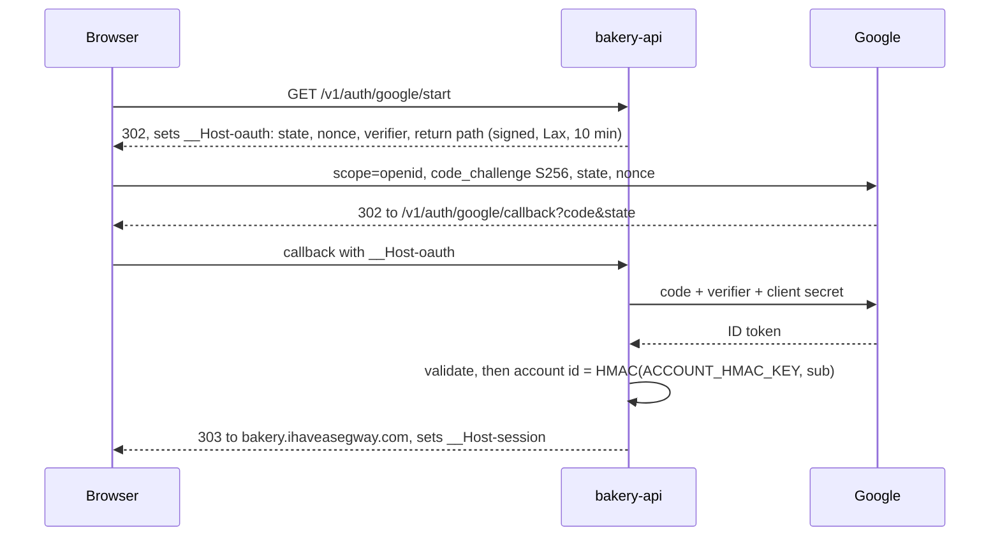

# Security

What the system of the made-up bakery, Proof of Concept Bakery, protects, from whom, and how. This doc owns the threat model, the headers, the Content Security Policy (CSP) and CORS, sign-in and sessions, sandbox isolation, the privacy and data inventory, the wipe as a privacy control, payments safety, the secrets inventory, the content firewall here, commit identities, the supply chain and account continuity. Money and denial of wallet are in [cost.md](cost.md); how the Durable Object (DO) classes fit together is in [architecture.md](architecture.md); rotation, leak response and the Stripe sandbox reset are runbooks in [operations.md](operations.md). The decisions are [ADR 0005](adr/0005-a-private-sandbox-per-visitor-wiped-nightly.md) (sandbox), 0006 (sign-in), 0007 (Stripe) and 0009 (the API hostname) ([ADR index](adr/README.md)).

Status: Updated in PR 17 · 2026-11-06; reconciled with the code on 2026-11-09

Prices, limits and versions are as of 2026-11-04, with sources.

## Threat model

Scope: `bakery-web`, `bakery-api` and every DO class it holds, the Queue, this repository and its pipeline, and the Cloudflare, Stripe, Google Cloud and GitHub accounts behind them. The zone, DNS and mail belong to the site's [security.md](https://github.com/IHaveASegway/website/blob/main/docs/security.md).

### Assets

| Asset | Why it matters | Where it lives |
|---|---|---|
| Visitors' trust and privacy | Visitors are engineers, hiring managers and recruiters; one page that asks for more than it needs undoes the demo's point | Nowhere, by construction: no email, name or address is held |
| Joseph's reputation | A real person in a fixture or a real card charged costs more than any bill | Everything below |
| The Stripe sandbox and its keys | No money moves, but the keys create objects and read events in Joseph's Stripe account | Worker secrets; one CI secret |
| The Cloudflare account | Both Workers, the site's Workers, the zone, the registrar, the bill | Cloudflare |
| The deploy token | It can replace what both hostnames serve | Actions secret |
| The account's bill | Workers Paid has no spend cap ([cost.md](cost.md#the-core-trade)) | Cloudflare billing |

### Actors

- **A visitor**, signed in or a guest, trusted with their own sandbox and nothing else.
- **A bot** creating sandboxes or accounts, guessing passwords or holding sockets.
- **A curious engineer** who reads this repository and pokes at the API, assumed to know everything but the secrets.
- **A leaked-credential holder** with a key, a token or a cookie.
- **A hostile page** open in another tab, which can send requests and open sockets with the visitor's cookies attached.
- **Joseph or an AI agent, by mistake**: the likeliest source of a leak or a loop.

Out of scope: provider insiders, legal compulsion, malware on a visitor's machine.

### Threats

| Threat | Control | Residual risk |
|---|---|---|
| Cross-site WebSocket hijacking: upgrades ignore CORS and carry the cookie | Exact `Origin` check on every upgrade; `SameSite=Strict`; a socket attaches only to the cookie's sandbox ([OWASP](https://cheatsheetseries.owasp.org/cheatsheets/WebSocket_Security_Cheat_Sheet.html)) | `SameSite` treats every `*.ihaveasegway.com` host as same-site; the `Origin` check stops a forgotten subdomain |
| CSRF against the API | `SameSite=Strict`; exact `Origin` and `Sec-Fetch-Site` checks on state-changing requests; JSON and `Idempotency-Key` force a preflight only the storefront passes | A browser sending neither header is refused |
| Session theft | `__Host-session`, host-only, `HttpOnly`, `Secure`, 24 h; never in `localStorage`; hash-only `script-src` | A stolen cookie works up to 24 h for ordinary commands, never past the wipe; the sandbox is synthetic |
| A leaked API token | `Authorization` only, never in a URL or a log; 24 h; "Rotate" in the console; a per-token rate limit (60 a minute); signed-in sandboxes only ([the API token](#the-api-token)) | It acts in one sandbox until rotated or the wipe; the data is synthetic |
| Sandbox enumeration | 128-bit server-minted ids; a path id must match the cookie's; mismatch and unknown get the same 404 | None known: nothing lists sandboxes |
| One visitor reaching another's objects | Object names derived in the Worker from the cookie's sandbox id; each object stores its sandbox id and refuses others | A derivation bug; covered by native tests and by the smoke scripts' 404 checks for another sandbox's id; the e2e suite has no cross-sandbox test yet (2026-11-09) |
| Personal data in free text | Two capped fields (note 140, brief 500 characters), rejected on email, phone, card-number or URL patterns; never logged (Q14 · Q-free-text) | A name or street in prose passes; it lives in that sandbox until 10:00 UTC |
| Personal data reaching Stripe | `fields.billingDetails: 'never'`; synthetic details passed on confirmation (Q18 · Q-payment-ui) | A real card typed into the card field reaches Stripe, which declines it in a sandbox; never the API |
| A live Stripe key reaching the Worker | CI and the Worker refuse non-sandbox keys; `livemode: true` events refused | None past first use |
| Webhook forgery and replay | HMAC-SHA256 over `t.payload`, constant-time, 5-minute tolerance; idempotent by event id ([Stripe](https://docs.stripe.com/webhooks#verify-manually)) | A leaked endpoint secret forges events until rotated; amounts come from `Billing`'s records |
| OAuth code or token leak | PKCE (S256) and `state` for Google and GitHub, `nonce` for Google; single-use codes; tokens discarded, GitHub's after one `GET /user`; 303 out of the callback with `Referrer-Policy: no-referrer`; its query never logged | An extension reading URLs sees a code; useless without the verifier |
| Profile data in GitHub's reply | No scope requested; the reply deserialized into `id` alone; bodies never logged | A public name or email passes through one request's memory |
| Email bombing through sign-in links, later | Turnstile; the Rate Limiting binding per IP hash and per address HMAC; Paid's 3,000 sends a month ([email sign-in, later](#email-sign-in-later)) | Cloudflare's delivery logs hold each address sent to |
| Open redirect in sign-in | The return path is a relative path matching a fixed pattern, held in the signed `__Host-oauth` cookie | None known |
| Denial of wallet | Turnstile, the Rate Limiting binding, `Control`'s caps (100 guest sandboxes of 300 a day), the simulator's caps, the loop guard, the breaker ([cost.md](cost.md#guardrails)) | Budget alerts at $10, $25, $50 and $100, the account's ceiling, arrive a day late; the breaker (built in PR 17, 2026-11-06) reads the last 15-minute window every 15 minutes and bounds the gap to about 30 minutes plus the analytics delay ([cost.md](cost.md#d-a-loop-with-no-outside-traffic)). It prices the whole account, the site's lab included. It is proven against a fake and not yet against Cloudflare ([cost.md](cost.md#open-on-the-first-real-run-of-the-breaker)) |
| Denial of service against the kitchen socket | Session cookie and exact `Origin` on upgrades (401, 403); the `UPGRADE_LIMIT` rate-limit binding, 6 upgrades a minute per session (429 on the 7th); at most 4 sockets per sandbox, the 5th getting `bye limit` and close 1008; frames over 4 KB close with 1009; more than 10 frames a second close with 1008; binary frames close with 1003; the wipe closes with 1001. As built and run on `wrangler dev` 4.157.0 on 2026-11-05 | A visitor can saturate only their own room |
| Alarm loops | Re-arm only for a later time, at most 100 a day per object ([cost.md](cost.md#d-a-loop-with-no-outside-traffic)) | Code that skips the guard; the breaker (built in PR 17) reads metered usage, sets `Control` to `read-only`, then `off`, and enables the WAF rule. It does not stop an alarm loop itself: only the guard, a deploy or the wipe does |
| A poisoned Queue message | Envelope version and schema checked; `sandbox` must own `stream`; 3 retries, then `bakery-events-dlq`; no re-enqueue. The `inbox` and `kitchen` fault switches (signed-in sandboxes only; a guest gets 403 `guest-scope`) make one subscriber refuse deliveries, so a dead letter can be made on purpose and redriven | A well-formed wrong event reaches a projection; "rebuild projections" repairs it |
| Supply chain in cargo and npm | Pins, lockfiles, `cargo deny` and `cargo audit` on every run of `verify` and weekly, cooldowns ([Supply chain](#supply-chain)) | A version older than the cooldown |
| A firewall miss | The site's firewall, copied (Q34 · Q-firewall) | Public at `git push`, before CI scans |
| Drafts on public previews | Web previews from the launch pull request (PR 11), as the site's (`noindex` by Cloudflare's header, [Robots and previews](#robots-and-previews), deleted on close); API previews only with their own DO namespaces (Q30 · Q-previews) | A preview URL is readable while its PR is open |

## Headers, CSP and CORS

### The storefront's policy

The build writes the page policy as a `Content-Security-Policy` header in `dist/_headers`, one module owning every directive, as the site's [ADR 0018](https://github.com/IHaveASegway/website/blob/main/docs/adr/0018-page-policy-as-a-header.md) does. The shared policy names no third party; screens that need one get their own rule, so a visitor reading the menu loads nothing from Stripe or Cloudflare.

| Directive | Every page | Payment screens add | Sandbox and account creation add |
|---|---|---|---|
| `script-src` | `'self'` and a SHA-256 hash per inline script; no `'unsafe-inline'` or `'unsafe-eval'` | `https://js.stripe.com` | `https://challenges.cloudflare.com` |
| `frame-src` | `'none'` | `https://js.stripe.com https://hooks.stripe.com` | `https://challenges.cloudflare.com` |
| `connect-src` | `'self' https://api.bakery.ihaveasegway.com wss://api.bakery.ihaveasegway.com` | `https://api.stripe.com` | — |
| `style-src` | `'self'` and hashes | — | — |
| `default-src`, `img-src`, `font-src`, `form-action` | `'self'` | — | — |
| `object-src`, `base-uri`, `frame-ancestors` | `'none'` | — | — |

**As built in PR 5 (2026-11-05).** `apps/web/src/policy.ts` has four page classes, and `/checkout/*` is the `payment` class: the island class plus exactly the three Stripe origins above and nothing else, written to `dist/_headers` with the page's own script and style hashes. No other rule names a Stripe origin. `apps/web/test/headers.test.ts` asserts both (`/checkout/*` carries exactly those origins, and the whole file mentions `stripe.com` four times: `js.stripe.com` in `script-src` and `frame-src`, `hooks.stripe.com` and `api.stripe.com`). The checkout imports Stripe.js through `@stripe/stripe-js/pure`, which does not inject Stripe's script when imported, and loads it only once an order has been placed, so even the checkout page loads nothing from Stripe until then. What no test does yet is open the page in a browser and watch the CSP for violations: that is spike S3's e2e check.

**As found on launch day (2026-11-06).** The first production smoke failed on the start page alone: in a browser, `/` got two policies, the `/` rule's with the island hashes and then `/*`'s without them, and the stricter one blocked Astro's island loader and its one-rule style. Every other path, the bundles included, got exactly one policy, so the detach (`! Content-Security-Policy`) works on production for every rule but the one path without a splat; `wrangler dev` had applied the file as written, which is why the local rehearsal passed. Since then no rule in `_headers` is without a splat: the start page's hashes ride in the `/*` rule, so every page's policy allows Astro's island loader and its style by hash (an allowance for that exact text and nothing else), and `test/headers.test.ts` and `test/policy.test.ts` refuse a rule path without a splat. The check that caught it is the production smoke's browser load of `/` and `/menu/` (`apps/web/e2e/prod/prod-smoke.spec.ts`), which this repository's incident issue records.

The dispatch screen adds `worker-src 'self'`, its solver folder carrying its own policy with `'wasm-unsafe-eval'`, as the site's Route Lab does. As built in PR 9 (2026-11-05): `/app/dispatch/*` is the `dispatch` page class, the challenge class plus `worker-src 'self'` and nothing else; `/app/dispatch/solver/*` gets exactly the Route Lab's policy, `default-src 'none'; script-src 'self' 'wasm-unsafe-eval'; connect-src 'self'; base-uri 'none'; form-action 'none'; frame-ancestors 'none'`, with `Cache-Control: public, max-age=31536000, immutable`; and `'wasm-unsafe-eval'` appears once in the built `_headers`, in that rule. The storefront stream's real-browser check (headless Chrome 153, 2026-11-05) saw one CSP header and no violations, and the worker ran under it. The folder is fetched at build and checked against a lock, not committed ([delivery.md](delivery.md#repository-layout)). ([ADR 0016](https://github.com/IHaveASegway/website/blob/main/docs/adr/0016-route-lab-in-the-browser.md)). `hooks.stripe.com` (3D Secure frames) and `api.stripe.com` follow Stripe's [security guide](https://docs.stripe.com/security/guide#content-security-policy); spike S3 confirms them with an e2e test that fails on any CSP violation. Sign-in needs no Google or GitHub origin: each is a navigation through the API.

Also from `_headers`, as on the site: `nosniff`, `strict-origin-when-cross-origin`, `Permissions-Policy: camera=(), microphone=(), geolocation=(), usb=()` (not `payment`, which the Payment Element may use) and `Cross-Origin-Opener-Policy: same-origin`. HSTS has one owner, the zone ([site ADR 0011](https://github.com/IHaveASegway/website/blob/main/docs/adr/0011-dnssec-and-hsts-ramp.md)).

### Robots and previews

As built in PR 12 (2026-11-06). The public pages, production and every route of the storefront, are indexable: no page carries a `<meta name="robots">`, and `apps/web/test/dist.test.ts` fails the build if one does. The hard-coded `noindex` the placeholder pages had is gone, because the Launch gate says that once public the bakery is indexed and shared, and a meta on every page would keep it out of search for good. `apps/web/public/robots.txt` said otherwise until 2026-11-08: it still carried the placeholder's `Disallow: /`, two days into the launch, which the audit of that day found; it now allows every path and names `/sitemap.xml`, written by the build from the pages it made (`apps/web/scripts/sitemap.mjs`).

Previews stay out of search without the pages saying so, by Cloudflare's header. Its Workers previews page (last updated 2026-09-24, read 2026-11-06, [Previews](https://developers.cloudflare.com/workers/previews/)) says a Preview's `workers.dev` URL "includes an `X-Robots-Tag: noindex` response header". The page on previews with custom domains (same dates, [Preview URLs on custom domains](https://developers.cloudflare.com/workers/previews/custom-domains/)) says Cloudflare "adds this header automatically to `workers.dev` Preview URLs, but not to custom domain Preview URLs". `ci.yml` publishes each preview with `wrangler preview` to a `workers.dev` URL, so the rule applies, and the `preview` job still fails if the header is missing. Cost: this rests on Cloudflare's behaviour, not on the repository's files. If previews ever move to a custom domain, nothing adds the header and the build would need to write it into `_headers` for that environment. Two-way door.

The About, How it's built and essay pages (the single-writer essay of PR 12, since PR 14 on 2026-11-06 the four at `/how-its-built/outbox/`, `/how-its-built/cache/`, `/how-its-built/rebuild/` and `/how-its-built/routes/`, since PR 15 on 2026-11-06 the four at `/how-its-built/idempotency/`, `/how-its-built/sagas/`, `/how-its-built/leases/` and `/how-its-built/admission/`, since PR 16 on 2026-11-06 the four at `/how-its-built/time-travel/`, `/how-its-built/lag/`, `/how-its-built/sandbox/` and `/how-its-built/api/`, and since PR 18 on 2026-11-06 the one at `/how-its-built/breaker/`, fourteen essays in all) carry the same headers as the 404: the strict page policy of `/*` with no third party, plus `nosniff`, the referrer policy, the permissions policy and `Cross-Origin-Opener-Policy` below. They have no island and no script, so they take no hashes. The home page, which now holds the tour, keeps the island class it had. Every page, new ones included, now shows the same header, nav and footer made of plain links, which add no script and no origin to any policy.

### The API's CORS

The API is a second origin (Q8 · Q-api-host, [ADR 0009](adr/0009-the-api-on-its-own-hostname.md)).

| Header | Value | Why |
|---|---|---|
| `Access-Control-Allow-Origin` | `https://bakery.ihaveasegway.com`, only when `Origin` equals it exactly; never reflected, never `*` | `*` cannot carry credentials; reflection admits every page |
| `Access-Control-Allow-Credentials` | `true` | The cookie rides on every call |
| `Access-Control-Allow-Methods` | `GET, POST, PATCH, DELETE` | Nothing else exists under `/v1/` |
| `Access-Control-Allow-Headers` | `Content-Type, Idempotency-Key, If-Match, If-None-Match` | JSON, idempotency, ETags |
| `Access-Control-Expose-Headers` | `ETag, Location, Retry-After, Bakery-Cache` | What the islands read; `Bakery-Cache` (`miss` or `hit`, added in PR 4) is the Cache Lab's miss-or-hit line in the drawer |
| `Access-Control-Max-Age` | `7200` | Chromium's cap ([MDN](https://developer.mozilla.org/en-US/docs/Web/HTTP/Reference/Headers/Access-Control-Max-Age)); the cache is per URL, so [cost.md](cost.md#the-per-sandbox-meter) counts preflights |
| `Vary` | `Origin` | No cache serves one origin's answer to another |

The Stripe webhook, the Google and GitHub callbacks and API-token calls have no CORS: the first is server to server, the callbacks are navigations, and `curl` needs none. `Authorization` is deliberately absent from `Access-Control-Allow-Headers`, so no web page can spend a visitor's token from a browser.

API responses carry `Content-Type: application/json` (or `application/problem+json`), `X-Content-Type-Options: nosniff`, `Cache-Control: no-store` (the sandbox menu: `private, no-cache` with its `ETag`), `Content-Security-Policy: default-src 'none'; frame-ancestors 'none'`, `Referrer-Policy: no-referrer` and `Cross-Origin-Resource-Policy: same-site`. HSTS comes from the zone.

## Sign-in and sessions

Decided on 2026-11-04 (Q23 · Q-auth, Q24 · Q-guest; [ADR 0006](adr/0006-sign-in-that-learns-nothing.md)). Four ways in, one cookie out: Google, GitHub, a demo account, or a guest behind Turnstile. Email sign-in is designed and ships later (Q43 · Q-email-signin). A signed-in sandbox also gets an API token for calls from outside the browser.

### Google, with the openid scope alone

The authorization code flow, with `bakery-api` as a confidential client, using `state`, `nonce` and PKCE ([RFC 6749](https://www.rfc-editor.org/rfc/rfc6749), [RFC 7636](https://www.rfc-editor.org/rfc/rfc7636), [Google](https://developers.google.com/identity/openid-connect/openid-connect)).



- **`__Host-oauth` is `Lax`** because Google's redirect back is a cross-site navigation, which a `Strict` cookie would miss. The `Strict` session cookie set on the way out is stored and sent from the first same-site call.
- **ID token validation, locally, in Rust.** Google says to validate against the keys at the discovery document's `jwks_uri`, with `tokeninfo` for debugging only. The Worker checks `alg` is `RS256` only, `kid` is known, the signature, `iss` is `https://accounts.google.com` or `accounts.google.com`, `aud` (and `azp`) is the client id, `exp` and `iat` with 60 s of skew, and `nonce`. Keys and discovery document are cached in the isolate's memory for their `Cache-Control` lifetime (not in the Cache API, as built 2026-11-09, `workers/api/src/http/oauth.rs`); an unknown `kid` refetches at most once a minute. Whether to add a Cache API layer is a decision pending, listed in the roadmap's Remaining work (2026-11-09).
- **A hand-rolled RS256 check on `rsa` and `sha2`:** pure Rust, built for `wasm32-unknown-unknown`, tested natively, short enough to review. `ring` has limited wasm32 support, and `jsonwebtoken`'s backends are one more build choice for [stack.md](stack.md) to police. `cargo audit` flags RUSTSEC-2023-0071 (Marvin) in `rsa`; it concerns private-key operations, and the Worker only verifies, so `deny.toml` ignores it with that reason.
- **Only `sub` is used.** It is "unique among all Google Accounts and never reused", and `email` appears only with the `email` scope ([Google](https://developers.google.com/identity/openid-connect/openid-connect)). The account id is `HMAC-SHA256(ACCOUNT_HMAC_KEY, "google:" + sub)` and names the `Account` object. The tokens and `sub` are dropped once it is computed, never stored or logged.
- **`openid` alone works** ([S2](roadmap.md#spikes), passed on 2026-11-05), although Google's docs still say the scope "must begin with openid and then include profile, email, or both". The callback still drops `email`, `email_verified`, `name` and `picture` before anything is stored or logged if they ever appear, and drops the token response's `access_token`. That is the old fallback's protection kept as a defence; the weaker design it replaced would have had the consent screen say an email is shared and an address pass through memory. A client in production status was not tested and arrives at launch.
- The consent screen's developer contact is `hello@ihaveasegway.com`. Its support email can only be the signed-in account's address or a Google Group the account manages (as of 2026-11-04), so a Google account on `hello@ihaveasegway.com`, which forwards through Email Routing, takes over the field before the screen is published ([operations.md](operations.md#4-the-google-oauth-client)).

### GitHub, with the numeric user id alone

An OAuth app's web flow, with `bakery-api` as a confidential client, `state` and PKCE (`S256`; GitHub does not support `plain`), and no `scope` parameter, so GitHub's default empty scope applies: no `user`, no `read:user`, no `user:email` ([Authorizing OAuth apps](https://docs.github.com/en/apps/oauth-apps/building-oauth-apps/authorizing-oauth-apps), as of 2026-11-04). It is Google's flow with three differences:

- **No ID token.** The callback exchanges the code, which expires after 10 minutes, with the verifier and the client secret at `POST https://github.com/login/oauth/access_token`, then makes one `GET https://api.github.com/user` with the token. A token without scopes still authenticates as its owner ([REST API, users](https://docs.github.com/en/rest/users/users), as of 2026-11-04). The token is then dropped: used once, never stored, logged or reused.
- **Only `id` is kept.** The reply is deserialized into a struct with one field, the numeric `id`, which GitHub treats as durable where the login can change. The account id is `HMAC-SHA256(ACCOUNT_HMAC_KEY, "github:" + id)`. The reply's public profile fields, which can include a name and a public email, are skipped by the parser and never stored or logged; they pass through one request's memory.
- **The same cookies.** `__Host-oauth` carries `state`, the verifier and the return path (`Lax`, 10 minutes); the callback answers 303 with `Referrer-Policy: no-referrer` and sets `__Host-session`.

### Email sign-in, later

Designed now and shipped later, unless Joseph moves it (Q43 · Q-email-signin): magic links under one rule, that the address is transient.

- **Used once.** The visitor types an address. The Worker normalizes it (trimmed, lowercased), computes the account id `HMAC-SHA256(ACCOUNT_HMAC_KEY, "email:" + normalized address)`, and sends one message with a sign-in link through Cloudflare's Email Service, by the `send_email` binding. The address is never stored, logged, counted in a metric, put in an event or put in the link.
- **The link** carries a signed, single-use token naming the account id, valid 15 minutes. Its callback records the token id in the `Account`, so a second use fails, and answers 303 with `Referrer-Policy: no-referrer`, as the OAuth callbacks do.
- **Typed again each time.** Nothing holds the address, so a returning visitor types it again and the API looks up the HMAC. There is no recovery and no "change my email".
- **No email bombing.** Turnstile before every send; the Rate Limiting binding per IP hash, and a second limit keyed by the address's HMAC so one inbox cannot be flooded from many addresses. Neither stores the address.
- **Cost.** Sending is Workers Paid only and in beta: 3,000 messages a month included, then $0.35 per 1,000 ([Email Service pricing](https://developers.cloudflare.com/email-service/platform/pricing/), as of 2026-11-04; [cost.md](cost.md#price-sheet)).
- **Residual risk.** Cloudflare's own delivery logs hold each recipient address, under Cloudflare's retention and outside this system; the Email Service is a beta. Whoever holds `ACCOUNT_HMAC_KEY` and an address can tell whether it has an account.
- **The privacy page's sentence becomes "never stores your name or email."**

### Demo accounts

After Turnstile, the API generates a username such as `baker-7f3k` ([domain.md](domain.md) sets the suffix) and the visitor sets a password of 12 to 128 characters, with no composition rules ([NIST SP 800-63B](https://pages.nist.gov/800-63-4/sp800-63b.html)). No email and no recovery: a forgotten password means a new account. The `Account` is named by `HMAC-SHA256(ACCOUNT_HMAC_KEY, "demo:" + username)`.

**Argon2id in the stateless Worker, on Paid.** OWASP's first recommended parameters: m = 19,456 KiB, t = 2, p = 1, a 16-byte random salt, stored as a PHC string ([OWASP](https://cheatsheetseries.owasp.org/cheatsheets/Password_Storage_Cheat_Sheet.html)). In wasm32 without threads or SIMD, one hash is estimated at 50 to 150 ms of CPU; spike S1 measures it, and [cost.md](cost.md#formulas) plans for 150 ms, inside Paid's 30 s default and `bakery-api`'s 300 ms `limits.cpu_ms` ([limits](https://developers.cloudflare.com/workers/platform/limits/)). 1,000 sign-ins use 0.5% of the 30M CPU-ms included a month; a million guesses would cost about $2.40 before the rate limits stop them. The 19 MiB of Wasm memory stay once grown, inside the 128 MB isolate. Hashing in the Worker keeps `Account`'s handler short. A sign-in for a username that does not exist is verified against a fixed dummy hash, so its answer takes about as long as a wrong password's, and a guesser cannot tell a missing account from a wrong password by the clock (`workers/api/src/http/demo.rs`, as built 2026-11-09).

**PBKDF2 through WebCrypto is the fallback on Free** (not built: a design for a return to Free only, 2026-11-09; the account is on Paid and `limits.cpu_ms` is 300), where the stateless Worker gets 10 ms of CPU and argon2id cannot fit. PBKDF2-HMAC-SHA256 at OWASP's 600,000 iterations runs as native code with no Wasm memory to grow. Whether WebCrypto's time counts against the 10 ms is not documented; spike S1 measures it. If it does not fit, argon2id moves into the `Account` object, where the site's spike S3 ran about 250 ms of CPU per call on Free without a limit error ([site roadmap.md](https://github.com/IHaveASegway/website/blob/main/docs/roadmap.md#spikes)). A PHC string names its algorithm, so hashes upgrade at the next sign-in.

Guessing is bounded by the Rate Limiting binding per IP hash, the `Account` refusing for 15 minutes after 10 failures in 15 minutes, and Turnstile on creation.

### The session cookie

```text
Set-Cookie: __Host-session=<payload>.<mac>; HttpOnly; Secure; SameSite=Strict; Path=/; Max-Age=86400
```

- **Host-only on `api.bakery.ihaveasegway.com`:** the `__Host-` prefix makes the browser refuse it unless it is `Secure`, has `Path=/` and no `Domain` ([MDN](https://developer.mozilla.org/en-US/docs/Web/HTTP/Reference/Headers/Set-Cookie#cookie_prefixes)).
- **The payload:** version, account id (or a guest's id, after Turnstile), sandbox id, a 128-bit session id, issue and expiry times, key id. It holds identifiers and no secret, so it is signed and left unencrypted.
- **The MAC:** HMAC-SHA256 with `SESSION_HMAC_KEY`, compared in constant time. On rotation the old key becomes `SESSION_HMAC_KEY_PREV`, accepted for one lifetime, 24 h, then removed.
- **Sign-out** is a `POST` answering `Max-Age=0` and recording the session id as revoked in the `Account`, which the socket upgrade and account-level actions check. Ordinary commands verify the cookie without a lookup, one DO request each; a copied cookie keeps working for them until it expires, never past the wipe.

### The API token

Signed-in sandboxes only (Q42 · Q-api-access, Q45 · Q-guest-scope). The console shows it masked, shows it in full once when it is issued or rotated, copies it on request, and rotates it. As built and run on 2026-11-05 (`scripts/smoke-token.sh`, 107 checks; `workers/api/src/http/token.rs`; `crates/app/src/auth/token.rs`). The contract is [ADR 0013](adr/0013-the-api-and-socket-contract-v1.md).

- **Signed like the cookie, with its own purpose.** The payload is `{v: 1, kind: "api", signin, acct, sbx, tid, iat, exp, kid, token_v}`, with no other field allowed. `signin` is how the visitor signed in (the cookie's `kind`, renamed so that `kind` can say `"api"`); `acct` and `sbx` are required, so a guest, who has no token, cannot be given one; `tid` is a 128-bit token id, 32 lower-case hex characters, where the cookie has `sid`; `token_v` is the Sandbox's token version when it was signed. It is signed with `SESSION_HMAC_KEY` and the previous key through the same keyring as the cookie, and compared in constant time, but under its own purpose label (`bakery-api-token-v1`), so a session cookie presented as a bearer is refused as `purpose` and a token presented as a cookie fails the cookie's signature check. No new secret.
- **Carried in `Authorization: Bearer`, never in a URL.** A token in a query string, by a parameter's name or by a value shaped like a signed token, is refused with 400 `token` (reason `query`); no query string is ever logged.
- **24 h, and it dies with the sandbox.** `exp` is `iat` plus 86,400 s. "Rotate" (`POST .../token/rotate`) adds one to `token_v` in the `Sandbox` and appends `ApiTokenRotated {token_v}` in the same transaction. Every request with a token makes one read of the `Sandbox`, which returns its state and `token_v`; a token with an older version is refused 401 `token` (reason `rotated`) and one with a newer version 401 `token` (reason `token`). The wipe removes the Sandbox and every token with it: the next request gets 404, where the console's cookie gets 410. A sign-out does not end a token; rotation, the 24 h and the wipe do.
- **The order of checks,** each cheap before the one that costs: (1) the request's shape: a token beside the `__Host-session` cookie is 400 `token` (reason `both`), a malformed `Authorization` header is 401 `token`, and a token on a route that takes the cookie only is 401 `token` (reason `cookie-only`); (2) the `Idempotency-Key`; (3) the signature, purpose and expiry, with no storage: 401 `token`, `purpose` or `expired`; (4) the token's `sbx` against the path's `{id}`, where a mismatch is the 404 of an id that names nothing; (5) the per-token rate limit; (6) the one `Sandbox` read, for its state (404 once gone, 410 `wiped` while the wipe runs) and its version. Every refusal's `detail` ends "The rule is <reason>." and never holds the token.
- **Rate-limited per token** with its own Rate Limiting binding, `TOKEN_LIMIT` (namespace 1004), 60 requests a minute keyed by `tid:<tid>`, which is `COMMAND_LIMIT`'s rate; the 61st in a window is 429 `rate-limit` with `Retry-After: 60`. Every request a token makes counts, reads included, where the session's limit counts commands only: a token can leave the browser, so a leaked one is held to a request a second. The check runs before the `Sandbox` is read, so a flood never reaches the object, and a token's request spends nothing from `COMMAND_LIMIT`, so a token never slows the console's cookie (proven: the cookie kept getting 200 after the token's 61st).
- **No `Origin` check, no CORS.** A request with a bearer token and no cookie skips the [Origin checks](#origin-checks): a browser never attaches a bearer token by itself, so CSRF does not apply, and `curl` sends no `Origin`. It also gets no CORS headers, not even when the storefront's `Origin` is sent, and `Authorization` stays out of `Access-Control-Allow-Headers`, so no web page can spend a visitor's token from a browser. A wipe made with a token sets no cookie.
- **Where a token may not be used.** A token is refused with 401 `token` (reason `cookie-only`) on `/v1/session`, the sign-out, the kitchen socket, `issue-token` and `rotate-token`, so a token never mints its successor or rotates the owner's away. It is ignored on a public route. The Stripe webhook and the sign-in callbacks have their own checks. A guest gets 403 `guest-scope` on all three token routes. Of the 74 routes in the table, 59 accept a token (as of 2026-11-09, `apps/web/public/docs/api/openapi.json`; the menu drafts route of 2026-11-08 and the tax rate's route of 2026-11-09 each added one of each).
- **What is stored.** The `Sandbox` keeps the token version and, for the console, the last token's `tid`, its times and its masked form: the first 6 characters, an ellipsis and the last 4. Every token starts `eyJ2Ij`, so the masked form shows 24 bits of the MAC and nothing that can be replayed. The token itself is shown in one response and is in no row, event, log line or problem; the idempotency record keeps the claims, not the token, and a replay signs them again to the same bytes. The storefront holds the token in memory only, never in `localStorage`, `sessionStorage`, a cookie or a URL, and drops it when the panel unmounts.
- **The log.** A log line for a token request holds the route, the status, a reason code and the `tid`, which the log accepts only as 32 lower-case hex characters, and never the token, the `Authorization` header or the query string. Proven on 2026-11-05: after `scripts/smoke-token.sh`, the Worker's log held each token's `tid` and no token and no `Bearer`.

### Origin checks

Every `POST`, `PATCH` and `DELETE`, and every upgrade at `/v1/sandboxes/{id}/kitchen/ws`, must carry `Origin: https://bakery.ihaveasegway.com` exactly and must not carry `Sec-Fetch-Site: cross-site`; otherwise a 403 problem+json, logged with its reason. The Stripe webhook (signature), the Google and GitHub callbacks (`state`) and requests with an API token and no cookie ([the API token](#the-api-token)) are exempt. The webhook is in the router's `SERVER_TO_SERVER` route list (`workers/api/src/http/routes.rs`), the routes a browser never calls: they get no CORS headers (not even on a 405), no preflight, no Origin check, no session, no `Idempotency-Key` requirement and no rate-limit spend, because Stripe's signature is the check and a rate limit on it would drop genuine retries. `scripts/smoke-payments.sh` shows `OPTIONS` on it answered 405, and no CORS header on an answer to a request carrying the storefront's `Origin` (2026-11-05). Every `POST` carries an `Idempotency-Key`, stored with the command's result, so a retry gets the first answer ([OWASP CSRF](https://cheatsheetseries.owasp.org/cheatsheets/Cross-Site_Request_Forgery_Prevention_Cheat_Sheet.html)).

## Sandbox isolation

Decided on 2026-11-04 (Q24 · Q-guest, Q25 · Q-ttl, Q45 · Q-guest-scope; [ADR 0005](adr/0005-a-private-sandbox-per-visitor-wiped-nightly.md)).

- **Names come from the server.** Sandbox ids are ULIDs minted by the router on admission, 80 random bits each; every other id is server-minted too ([architecture.md](architecture.md#object-naming)).
- **The binding.** An `Account` holds its one current sandbox id; the `Sandbox` holds its owner; the cookie and the API token carry both. A path naming another sandbox gets the 404 of one naming nothing.
- **Derived, never copied.** The Worker builds each name from the cookie's or the token's sandbox id, the class and a server id (`order:<sandbox>:<ulid>`) before `id_from_name`.
- **Objects check too.** Each child stores its sandbox id when initialized and refuses others; an uninitialized object refuses everything and writes nothing, so neither a request after the wipe nor a guessed name summons a fresh object.
- **No cross-sandbox reads.** Projections are per sandbox, and the consumer routes an event only within its envelope's sandbox.
- **The simulator stays home.** The `Simulator` issues commands only to objects named from its own sandbox id, through the same checks as the visitor's commands.
- **Guest scope** (Q45 · Q-guest-scope): a guest sandbox can browse, order and pay with a test card. Sign-in unlocks the console's writes (menu edits, campaigns, publishing a route), the API token, simulated traffic, and a sandbox that follows the account across devices.
- **The dispatch routes** (PR 9, as built on 2026-11-05; the full table is in [`workers/api/README.md`](../workers/api/README.md)). Five routes under `/v1/sandboxes/{id}/dispatch/{date}`. `GET` is any session's of that sandbox, a guest's included, and the console shows a guest the day read-only; `POST .../propose`, `.../plan`, `.../publish` and `.../complete` are staff commands, so a guest gets 403 `guest-scope` on all four, and another sandbox's id or day is the 404 of a name that exists nowhere. A date from the sandbox's birth day to 30 days after business today is born on first touch; any other is 404 `no-such-day`. Every `POST` needs an `Idempotency-Key` holding a ULID (a missing one is 400 `idempotency-key`); the same key and body again answers the stored result with `Idempotent-Replayed: true`, and the same key with another body is 422 `idempotency-key`; the object keys each command by its step (`publish:<key>`), so one key sent to two routes is two commands. A rule the day refuses is a `dispatch` problem whose `detail` names the rule as a whole word ("The rule is stop-twice.") and never a value the caller sent: 422 for a proposal (`vans`, `capacity`, `no-stops`, `place-unknown`) and for the browser's plan (`route-ends`, `vans`, `stop-unknown`, `stop-twice`, `over-capacity`, `stop-missing`, `no-stops`); 409 for a publish (`no-plan`, `stop-missing`, `published` once a van has left, and the plan's own rules again); for a completion 409 `no-plan` and 422 `stop-unknown`. A body that is not the request's shape is 400 `body`, and the plan's request refuses an unknown field, so a total a client sends is refused instead of read. Proven on `wrangler dev` 4.157.0 by `scripts/smoke-dispatch.sh`, 136 checks.
- **`Control`'s caps:** 300 sandboxes a day, of which at most 100 are guests', so bots creating sandboxes hit a wall before the paid-for meters do; 3 per account; a per-IP-hash limit for guests; 30 minutes of simulated traffic a sandbox a day (the public var `TRAFFIC_MINUTES_CAP`, added in PR 4); if `Control` errors, no sandbox ([cost.md](cost.md#guardrails)).

**Why not row-level security.** Row-level security filters the rows of a shared table per tenant on every query. It is the design a single D1 or Postgres database would need, and one missing or wrong policy exposes every tenant. Here there is no shared table. Every aggregate of a sandbox is its own object with its own SQLite database, addressed by a name the Worker derives from the sandbox id in the signed cookie or token; each object stores its sandbox id and refuses a mismatch; nothing lists or joins across sandboxes; and the wipe deletes whole databases instead of filtering rows out of shared ones. It is a database per tenant per aggregate, which is stronger than row-level security and cheaper to wipe, at the cost of any query across sandboxes, which the demo never needs.

## Privacy and data inventory

| Data | Collected by | Held by | Kept for | Purpose |
|---|---|---|---|---|
| `__Host-session` cookie | `bakery-api`, at sign-in or guest start | The browser | 24 h, or sign-out | Admission to the visitor's sandbox |
| API token | `bakery-api`, shown in the console to a signed-in visitor | Wherever the visitor puts it; the API stores only the Sandbox's token version and the last token's id, times and masked form | 24 h, rotation, or the wipe, whichever comes first | API calls from `curl` or scripts |
| `__Host-oauth` cookie | `bakery-api`, as Google or GitHub sign-in starts | The browser | 10 minutes | `state`, `nonce`, PKCE verifier |
| Account id: HMAC of the Google `sub`, the GitHub `id` or the demo username | `bakery-api` | The `Account` | 30 days after the last sign-in, then its alarm runs `deleteAll()` (Q23 · Q-auth) | One sandbox across devices |
| Email address, for email sign-in, later (Q43 · Q-email-signin) | The visitor, typed each time | Nobody here: one request's memory, then Cloudflare's Email Service delivery logs | One request; Cloudflare's retention for its logs | Sending the sign-in link; only its HMAC names the `Account` |
| Demo username and argon2id hash | The visitor | The `Account` | As the account id | Demo sign-in |
| Sandbox contents, the two free-text fields included | The seed and the visitor | The sandbox's objects | Until 10:00 UTC; 36 h at most; recoverable by the account owner for 30 days ([The wipe](#the-wipe)) | The demo |
| Business clock offset | The visitor (Q12 · Q-clock) | The `Sandbox`, copied to each child; signed-in visitors only, a guest's advance being 403 `guest-scope` (PR 6) | As the sandbox | Time travel |
| Synthetic customers, their consent flags and loyalty points (PR 8) | The seed; the visitor's consent switch for a persona | `Customer` and `Crm` | As the sandbox | The CRM screens. A display name is a made-up word pair from the seed's lists, with no email, phone number or street address |
| Crm's projection and its log of applied events (PR 8) | The consumer, from the events of the sandbox's own objects | `Crm` | As the sandbox | Timelines, segments, campaign stats. The log holds events as the consumer stripped them: no order note and no catering brief |
| Inbox messages (PR 8) | Rendered from fixed templates by the `Inbox`, for a customer id | `Inbox` | As the sandbox | The inbox screen. A message holds a template's text and ids, a recipient that is a customer id and no address, and no visitor-typed word |
| Turnstile signals | Turnstile, on creation screens | Cloudflare | Cloudflare's policy | Abuse prevention; no pre-clearance, so no `cf_clearance` |
| `HMAC(daily salt, IP)`; the address is never stored or logged | `bakery-api` | Log lines; the rate limiter's counters | Logs 7 days on Paid ([Workers Logs](https://developers.cloudflare.com/workers/observability/logs/workers-logs/)), Observability's retention from 2026-12-01 ([pricing](https://developers.cloudflare.com/observability/pricing/)); the salt one UTC day, in memory | Rate limits, caps, abuse review |
| Country and continent | `request.cf` | Logs; Analytics Engine | Logs as above; Analytics Engine 3 months ([limits](https://developers.cloudflare.com/analytics/analytics-engine/limits/)) | Capacity and abuse review |
| Stripe sandbox objects with synthetic details | `bakery-api`, on a payment | Stripe | A customer to the wipe, which deletes it; an invoice to the wipe, which voids it if open, and then to the sandbox reset; the rest to the sandbox reset | Payments, deposits, invoices |
| Workers Logs (the Worker's own lines) | `bakery-api` | Cloudflare | As above | Operations |
| Analytics Engine points | `bakery-api` | Cloudflare | 3 months ([limits](https://developers.cloudflare.com/analytics/analytics-engine/limits/)); a status-page snapshot (counts, a wipe's totals and two timestamps) lives in `Control` until the wipe prunes it | Counts and denials. As built on 2026-11-06 (PR 13), seven names: `sandbox_created`, `order_placed`, `payment_succeeded`, `payment_failed`, `refund_issued`, `dlq` (each a count of 1 with its name as blob and index) and `wipe` (the sandboxes, objects and milliseconds of one wipe). No sandbox id, account, IP hash or country is written by the code; the platform adds only its own fields. The public status page shows 24-hour totals of these |
| Theme choice (`sessionStorage` `theme`) | The toggle | The tab | Until it closes | As the [site's](https://github.com/IHaveASegway/website/blob/main/docs/security.md#privacy-and-data-inventory) |
| Signed-in hint (`localStorage` `bakery.signed-in`, `1` or absent) | The page, when `GET /v1/session` answers 200 (set) or 401 (cleared), and on sign-out | The browser | Until a look finds no session, sign-out, or the visitor clears site data | Lets a page with no other call to the API show "Console" in the header. A hint only; it holds no id, name or token, and the API's answer decides |

Rules:

- **No email or name stored, ever:** not from Google or GitHub, not typed, not in Stripe. Email sign-in, later, uses an address for one request and keeps only its HMAC ([email sign-in, later](#email-sign-in-later)). Personas, venues, addresses and cards are synthetic.
- **No city, region, postal code or coordinates;** country and continent at most, as in the site's [lab](https://github.com/IHaveASegway/website/blob/main/docs/lab.md#rules-for-every-demo).
- **No invocation logs:** they are off on both Workers, because they record `request.cf`, which carries city and coordinates. The Worker's own lines never hold a body, a free-text field, a cookie, a token or a query string.
- **The salt is never written to storage,** because SQLite objects keep 30 days of point-in-time recovery ([SQLite storage API](https://developers.cloudflare.com/durable-objects/api/sqlite-storage-api/)); `Control` makes it in memory, as the site's lab does.
- **Pattern checks on free text,** in `crates/domain` under `cargo test`: email shapes, phone numbers of 7 or more digits, 13 to 19 digits whether or not they pass Luhn, URLs and bare domains. A match is rejected with the class named and not logged; each field says it is wiped tonight. As built in PR 7 (2026-11-05), for the catering brief: the aggregate checks it on `SubmitInquiry`, so no route can skip the check; the refusal is 422 `catering` and its `detail` ends "The rule is `brief-email`" (or `brief-phone`, `brief-card-number`, `brief-url`, `brief-too-long`) and never holds the text; `scripts/smoke-catering.sh` found no refused brief's text in any refusal body and none of its briefs in the Worker's log (an accepted brief is returned to its own sandbox's reads, and nowhere else); the consumer strips the brief from `CateringInquiryReceived` for every subscriber, so only the object and the staff screen read it; the page renders it as escaped text (`apps/web/test/catering-ui.test.ts` renders `` as text); and the brief is never sent to Stripe. The storefront's hints warn and never block, so a false positive cannot lock a visitor out and the API stays the one check. NFC normalization is not yet done ([domain.md](domain.md#free-text-and-personal-data)).
- **`/privacy/` goes live in the launch pull request (PR 11),** before the first visitor's sandbox. It lists every row above, says Proof of Concept "never stores your name or email", and promises the 10:00 UTC wipe, the 36 h backstop and what "deleted" means, the 30 days of recovery included.

**What the CRM and the inbox hold, and cannot hold (PR 8, 2026-11-05).** Nothing personal, by construction and by test, in four ways.

- **The `Mailbox` port cannot name an address.** A `Note` carries a `Recipient`, built only by `Recipient::new(sandbox, customer)` from two ULIDs, with private fields and no conversion from a string. Two `compile_fail` doctests in `crates/app/src/ports.rs` fail to build `Recipient::from("someone")` (E0277) and a `Recipient` from its fields (E0451), and a test shows the fake refusing a recipient from a foreign sandbox with `recipient-outside-sandbox` and delivering nothing. So no implementation of the port can send to an address or to another sandbox's customer, and that is a property of the types and not of a check. No implementation exists in the Worker yet: every message is an `Inbox` row, and Q22's real sends to Joseph's own verified address are unbuilt and off ([roadmap.md](roadmap.md#pr-8-crm-campaigns-and-the-inbox)).
- **The note and the brief are never stored outside their owners.** The order's note is held by the Kitchen and the catering brief by the `CateringEvent`. The consumer removes both from every event bound for Crm or the Inbox, and Crm removes them again before writing its log. `scripts/smoke-crm.sh` placed an order with a note and an inquiry with a brief, each made of synthetic letter-only words, and found neither in any CRM or inbox response, in Crm's stored projection or log, in the Inbox's rows or in the Worker's log; the Kitchen still held the note. A domain test with canary strings shows the same for the projection and the log.
- **A campaign and a message have no free text.** The visitor picks a subject, a body and a segment from fixed lists by slug, so the console has no field to type a campaign into (a rendering test of the composer checks that it has selects only), and the templates are checked under `cargo test` against the same email, phone, card and URL patterns as any free text, with no `@` and no `http`. Dates in a message are written in words, so none matches the phone-number pattern.
- **Consent is data a send must check.** A recipient list can be built only from the customers whose `marketing` flag is true at the moment of the send, and is then frozen with the event ([domain.md](domain.md#campaign)). A guest may change consent for its own persona only (403 `guest-scope` otherwise), and every campaign, schedule, cancel and rebuild action is a signed-in action.

The new log events carry ids, counts and slugs only ([operations.md](operations.md#observability)).

While the salt exists, an IP hash is pseudonymous personal data under the GDPR (Recital 26), and so is an account id, which whoever holds `ACCOUNT_HMAC_KEY` and a `sub`, a GitHub id or an address could link. "No personal data by construction" means nothing that names a person; these identifiers get short retention for that reason. The session cookie is strictly necessary for a service the visitor asked for, so no consent banner, on the site's reading of the ePrivacy rules ([site security.md](https://github.com/IHaveASegway/website/blob/main/docs/security.md#privacy-and-data-inventory)). This is not legal advice.

## The wipe

Every sandbox, all of it, every night at 10:00 UTC (03:00 Mountain standard time, 04:00 in summer) (Q25 · Q-ttl, [ADR 0005](adr/0005-a-private-sandbox-per-visitor-wiped-nightly.md)).

1. **10:00 UTC:** the cron handler calls `Control`, which holds the day's registry and fans out by its own alarm, 50 sandboxes a run, well inside the cron's 15 minutes of wall time ([limits](https://developers.cloudflare.com/workers/platform/limits/)).
2. **Each `Sandbox`** reads its registry of children; each child deletes its alarm and runs `deleteAll()`.
3. **Stripe:** `Billing`, when the `Sandbox` wipes it and before its own `delete_all`, cancels each open payment intent, voids each open invoice and deletes each customer it created, best effort, and logs `stripe_wipe` with the counts. Proven against the fake on 2026-11-05 by `scripts/smoke-catering.sh`: one open invoice voided, one customer deleted, none failed, and `scripts/list-objects.mjs` exits 0. Not covered: a draft invoice left by a crash between the draft and its finalization is in no `Billing` record, so the wipe does not know it; the sandbox reset clears it.
4. **Itself:** it reports `SandboxWiped` to `Control`, deletes its alarm and runs `deleteAll()`.
5. **The backstop:** every object's own alarm, 36 h after initialization, runs `deleteAll()` if the wipe missed it.
6. **The morning object check:** a scheduled Actions job lists each sandbox-class namespace with a read-only token, as the site's [nightly check](https://github.com/IHaveASegway/website/blob/main/docs/lab.md#observability) does. The listing carries only `id` and `hasStoredData`, so it compares two mornings and opens an issue for an object holding data in both. `Control` and `Account` are skipped.

"Wipe now" runs steps 2 to 4 for one sandbox.

**What the console gets afterward,** as found on 2026-11-08. A cookie that still names a wiped sandbox gets 410 `wiped` on that sandbox's routes for the rest of its life: that is the nightly wipe's case, and the case of any request sent before "Wipe now" answers. "Wipe now" re-issues an account's cookie without the sandbox and clears a guest's, so a request for the old id with the new cookie is the 404 of an id the session does not name (reason `not-yours`), or 401 for a guest. The Kitchen closes the board's socket partway through the wipe, and Chromium reported the close about 2 s after the `bye` in the local e2e runs of that day, so on a loaded machine the console reloaded before the wipe answered and asked for the old sandbox with the new cookie: a 404 in `apps/web/e2e/wipe.spec.ts`, in 8 of 25 runs under CPU load on 2026-11-08. Since then the console lets its own wipe's answer decide what it shows, and the board sends no heartbeat after a `wiped` close. A test in the same spec holds the wipe's answer past the close and fails if the console asks for its session, the sandbox or a heartbeat in between.

**What "deleted" means.** After the wipe the application cannot read the sandbox: its objects are empty and refuse. Cloudflare keeps 30 days of point-in-time recovery for SQLite-backed objects ([SQLite storage API](https://developers.cloudflare.com/durable-objects/api/sqlite-storage-api/)), so the account owner could restore rows for a month; workers-rs does not bind recovery and nothing here calls it. Stripe keeps what it cannot delete until the sandbox reset. Logs hold no contents. The privacy page says exactly this. On the Free fallback the wipe depends on the day's row quota ([cost.md](cost.md#e-the-nightly-wipe)).

## Payments safety

Built in PR 5 against a local fake of Stripe's API, `scripts/fake-stripe.mjs`; what only a real sandbox can confirm is spike S3, and the points where this section waits for it are named. Q17 · Q-psp, Q18 · Q-payment-ui and Q20 · Q-stripe-account are assumed until answered ([ADR 0007](adr/0007-stripe-sandbox-and-a-payment-element-that-collects-nothing.md)).

- **Sandbox keys only.** A Stripe sandbox has its own keys, and its payments are not processed by card networks ([Stripe sandboxes](https://docs.stripe.com/sandboxes)). The secret key is a restricted key (payment intents, customers, invoices, refunds). The guard in `workers/api/src/stripe.rs` accepts `sk_test_` and `rk_test_` only, which is stricter than "not live": a publishable key, an unknown prefix or an empty value is refused too. It runs on every payment route, the webhook included, and again before every call to Stripe; its verdict is kept for the isolate. A refusal answers 503 `stripe-key`, makes no call to Stripe, and logs `stripe_key_refused` once per isolate with a kind (`other-mode`, `not-a-secret-key` or `unrecognized`) and never the key. Proven on 2026-11-05 by `scripts/smoke-payments.sh`: with a live-shaped key, built at run time from parts so the script never holds the prefix, health and the menu answer 200 while the payment, ledger, refund and webhook routes each answer 503, the log holds one `stripe_key_refused` and not the key, and the fake's request log holds no 401. The web build fails unless `PUBLIC_STRIPE_PUBLISHABLE_KEY` is empty or starts `pk_test_` (`apps/web/src/lib/publishable-key.ts`, run by `astro.config.mjs` on every build, with a message that does not repeat the value; empty builds a checkout that says payments are not configured on this build and offers nothing to type), and the page itself never uses a key that does not start `pk_test_`, whoever supplied it. CI's `verify` job has a step, "No live Stripe key in the tree or the bundles", that greps everything but `docs/` and its own file, and both built bundles, for the three live prefixes; it ran locally on 2026-11-05 and has not yet run on GitHub. The CI-key check and the post-deploy mode check arrive with the deploy jobs in PR 11. Every webhook event must carry `livemode: false`, below.
- **Webhook signatures, on the raw body.** The route reads the body as bytes before anything parses it, then checks HMAC-SHA256 over `t + "." + body` with `STRIPE_WEBHOOK_SECRET`, compared in constant time with each `v1` in `Stripe-Signature`; a `t` more than 5 minutes off, in either direction, is refused ([Stripe](https://docs.stripe.com/webhooks#verify-manually)). Failures answer 400 and are logged by reason code only (`signature`, `timestamp`, `body`, `livemode`). Proven against the fake on 2026-11-05 (`scripts/smoke-payments.sh`): a body altered by one byte after signing, a `t` 360 s old, a bad signature and a `livemode: true` event each got 400 on every delivery, and a `t` 240 s old was accepted. `STRIPE_WEBHOOK_SECRET` must start `whsec_`, or the route answers 503 `config`.
- **Livemode refused.** An event with `livemode: true` answers 400 `livemode` after its signature has verified, and the adapter refuses a Stripe answer that carries it. `livemode` is a required field of the event, so one without it is a 400 `body`.
- **Idempotent handling.** `Billing` appends the Stripe event id inside the event it records, in the same transaction as the state change; a repeat finds it in the fold, answers 200 and changes nothing. There is no separate table of event ids to fall out of step with the events. Events name their sandbox through metadata the Worker set on the intent; an event for a wiped or unknown sandbox answers 200 and is dropped, so Stripe stops retrying. Amounts come from `Billing`'s records, never from the event alone: an event whose amount differs is refused as `amount-mismatch`.
- **What the logs never carry.** A log line holds the route, the status, a reason code and ids (the Stripe event id, the sandbox), never a key, a client secret, a `Stripe-Signature` header, a webhook body, a `Bearer` token or a card. The adapter keeps only the type, code, decline code and parameter of a Stripe error, and drops its `message`, because Stripe's bad-key message quotes part of the key. The client secret goes from Stripe to the browser in one response body and is in no event, no row and no log; the types that hold it redact or omit it under `Debug`. Proven on 2026-11-05: after the payment run, the Worker's log from "Ready" held no `_secret_`, no key, no webhook secret, no `Bearer`, no `v1=` and no event body (`scripts/smoke-payments.sh`). The dispatch lines of PR 9 follow the same rule and hold an event id, a class and a rule slug, never a body, an order's note, a place or an address: `dispatch_event_refused` (the object refused a consumed event, with its type and rule), `seed_dispatch_refused` (a seeded command the rules refused, with its rule), `dispatch_no_place` (a delivery whose persona has no place), `dispatch_no_day` (a stop whose date is outside the sandbox's days, or whose sandbox is wiped) and `stop_order_gone` (a published stop whose Order has gone). A token request logs its `tid` and a reason code, nothing more ([the API token](#the-api-token)). The adapter keeps only the type, code, decline code and parameter of a Stripe error, and drops its `message`, because Stripe's bad-key message quotes part of the key. The client secret goes from Stripe to the browser in one response body and is in no event, no row and no log; the types that hold it redact or omit it under `Debug`. Proven on 2026-11-05: after the payment run, the Worker's log from "Ready" held no `_secret_`, no key, no webhook secret, no `Bearer`, no `v1=` and no event body (`scripts/smoke-payments.sh`).
- **Customers and invoices carry no personal data (PR 7, against the fake).** A Stripe customer is made once per persona, with `metadata[sandbox]` and `metadata[persona]`, the synthetic persona's ULID, and nothing else: no email, name, phone or address, so Stripe has no address to send an invoice to. Its invoice is `collection_method=send_invoice` with `days_until_due` and `auto_advance=false`, carrying only ids in its metadata (`sandbox`, `invoice`, `purpose`, `ref`), and one item for the balance. The request builders in `crates/app/src/stripe/request.rs` accept no email or name field, and native tests pin the exact bodies. Whether Stripe really sends nothing for a `send_invoice` invoice to a customer with no email is S3's to confirm ([operations.md](operations.md#what-spike-s3-must-still-do)); the fake sends no email by construction, so it proves nothing about it. Idempotency keys now begin with the sandbox id ([domain.md](domain.md#idempotency)), so two sandboxes born from one seed never share a Stripe key. The webhook route also applies `invoice.paid` (the amount is `amount_paid`) and `invoice.voided`, each only for the sandbox its metadata names, and answers 200 to the other invoice events without effect.
- **Synthetic billing details.** `fields.billingDetails: 'never'`, with the persona's synthetic name and address (from the seed, ending "(synthetic)") passed to `confirmPayment`, as the integration then must ([Payment Element](https://docs.stripe.com/js/elements_object/create_payment_element)). Spike S3 checks no billing field renders and that Stripe's sandbox accepts it; the fake cannot.
- **No card data touches the API.** Card fields live in Stripe's frames; the API sees Stripe's ids. The page says test cards only, such as 4242 4242 4242 4242 ([Stripe testing](https://docs.stripe.com/testing)). Server-side confirmations (the Simulator's, and the smoke test's) use Stripe's test payment methods `pm_card_visa` and `pm_card_chargeDeclined`, which are ids and not numbers.
- **Where a request may go.** `STRIPE_API_BASE` overrides Stripe's origin for `wrangler dev` against the fake, and is honored only for `127.0.0.1` and `localhost`, as the provider overrides are; it is never in `wrangler.jsonc`. `STRIPE_API_VERSION` is pinned in `wrangler.jsonc` to `2026-10-28.endive` (as of 2026-11-09, read from the dashboard on 2026-11-06) and sent as `Stripe-Version` on every call.
- **Stripe's retention.** Stripe keeps a sandbox's objects until they or the sandbox are deleted. Payment intents, charges, refunds and finalized invoices survive the wipe, holding synthetic details only, so a periodic reset ([operations.md](operations.md#stripe-sandbox-reset), assumed quarterly) clears them and rolls every Stripe key and the webhook secret. The wipe cancels each intent still open before it deletes `Billing` (proven against the fake on 2026-11-05). The sandbox itself is never deleted, because Stripe refuses a new one until the business is verified (as of 2026-11-04).

## Secrets inventory

Never in the repository, a log or a doc. `.dev.vars` is git-ignored; `.dev.vars.example` holds names only.

| Secret | Where it lives | Who reads it | Scope | Rotation |
|---|---|---|---|---|
| `CLOUDFLARE_API_TOKEN` | Actions secret; never Dependabot | The Wrangler steps of deploy, preview and rollback | Account-owned: the site's four permissions plus what Queue and Custom Domain deploys need ([operations.md](operations.md)); one zone; can replace both hostnames | 12-month expiry; at once on suspicion |
| `CLOUDFLARE_ACCOUNT_ID` | Actions secret, masked in logs | The same steps, and `bakery-objects`' listing step | An identifier, never written | None |
| `FIREWALL_RULES` | Actions and Dependabot secrets, from the site's private file | The firewall step; `pr-text.yml` | Grants nothing; its contents are the disclosure | Each term change, with `sync-secrets.sh`, both repositories |
| `STRIPE_SECRET_KEY` (sandbox, restricted) | Worker secret | Payment routes; the wipe | Four resources in the sandbox | Yearly; at the reset; on suspicion |
| `STRIPE_WEBHOOK_SECRET` | Worker secret; must start `whsec_`, or the route answers 503 `config` | The webhook route | Forges events | With the endpoint; at the reset |
| `STRIPE_PUBLISHABLE_KEY`, and `PUBLIC_STRIPE_PUBLISHABLE_KEY` at build | An optional Worker var, handed to the browser in the payment answer only when it starts `pk_test_`; and a build variable, public in the page, that fails the build unless empty or `pk_test_` | The Payment Element | Public; `pk_test_` only | With the sandbox |
| `GOOGLE_CLIENT_ID` | Public in the authorization URL, so not a secret. It was kept out of the repository until launch (PR 11), in `.dev.vars` locally; since the launch it is a `vars` entry in `wrangler.jsonc` (a dashboard-only var is deleted by a deploy without `--keep-vars`, which `deploy` does not pass) | Sign-in routes | Public | With the client |
| `GOOGLE_CLIENT_SECRET` | Worker secret | The code exchange | Exchanges codes for this client | Yearly; on suspicion |
| `GITHUB_CLIENT_ID` | Public in the authorization URL, so not a secret. It was kept out of the repository until launch (PR 11), in `.dev.vars` locally; since the launch it is a `vars` entry in `wrangler.jsonc` (a dashboard-only var is deleted by a deploy without `--keep-vars`, which `deploy` does not pass) | Sign-in routes | Public | With the OAuth app |
| `API_ORIGIN` | A public variable: `https://api.bakery.ihaveasegway.com` in `wrangler.jsonc`, `http://127.0.0.1:8788` in `.dev.vars` | The OAuth redirect URIs | Public; the base of the redirect URIs, which must match the registered ones exactly. A var and not read from the request, because `wrangler dev` rewrites the request's host to the route's (checked 2026-11-05, Wrangler 4.157.0) | With the hostname |
| `GITHUB_CLIENT_SECRET` | Worker secret | The code exchange | Exchanges codes for this OAuth app | Yearly; on suspicion |
| `TURNSTILE_SECRET`, and the site key | Worker secret; the site key public in the page | Siteverify | Skips challenges | Yearly; on suspicion |
| `SESSION_HMAC_KEY`, `SESSION_HMAC_KEY_PREV` | Worker secrets | Authenticated routes; the oauth cookie; API tokens; email sign-in links, later | Forges any session or API token | Yearly, `_PREV` for 24 h |
| `ACCOUNT_HMAC_KEY` | Worker secret | Sign-in | Links a known `sub`, GitHub id or address to its account | Only on a leak: rotation orphans every `Account` |
| `STRIPE_E2E_SECRET_KEY` | Actions secret | The `e2e` job's one step | A second restricted key in the same sandbox, because Stripe refuses another until the business is verified | Yearly |
| `CLOUDFLARE_READ_TOKEN` | Actions secret | The morning object check (`scheduled.yml`), in one step's `env:` as `CLOUDFLARE_API_TOKEN` | Account: Workers Scripts Read only (confirm on launch day). Account Analytics Read is not on it, by design: since PR 13 the Worker's own `ANALYTICS_API_TOKEN` reads the `dlq` count, and the 12:17 run's dead-letter step reads it from the public `GET /v1/status`, so that step uses no secret and no new secret is needed (no Actions job reads analytics) | With the deploy token |
| `ANALYTICS_API_TOKEN` | Worker secret (PR 13, as built 2026-11-06) | The 15-minute status refresh, as a bearer token to the Analytics Engine SQL API | Reads this account's analytics (Account Analytics Read, nothing else); cannot edit or deploy anything; the counters it reads are already public on the status page | With the deploy token; a 401 or 403 shows as `analytics_failed` and a stale page |
| `ANALYTICS_ACCOUNT_ID` | Worker secret (PR 13) | The SQL API's path | An account id is an identifier, not a credential; it is a secret only because this repository's logs are public and no log line may carry it (the code logs none), as `CLOUDFLARE_ACCOUNT_ID` is | Never, unless the account changes |
| `BREAKER_API_TOKEN` | Worker secret (PR 17, as built 2026-11-06) | The 15-minute breaker, as a bearer token to the GraphQL Analytics API and the Rulesets API | Two permissions, as the [permissions reference](https://developers.cloudflare.com/fundamentals/api/reference/permissions/) names them (read 2026-11-06; confirm on the first run): Account: Account Analytics Read and Zone: Zone WAF Edit, on this zone. A leak lets its holder read this account's usage numbers and edit this zone's WAF rules: enable the kill rule (the site's API goes dark) or disable it, and change or add rules. It cannot deploy, read secrets or touch the bakery's data | With the deploy token; a 401 or 403 shows as `breaker_meter_unread` with that `status`, and the page's Breaker line stops advancing |
| `BREAKER_ZONE_ID` | Worker secret (PR 17) | The Rulesets API's paths | An identifier, not a credential; a secret only because this repository's logs are public and no log line may carry it (the code logs none), as `CLOUDFLARE_ACCOUNT_ID` is | Never, unless the zone changes |
| `BREAKER_RULE_ID` | Worker secret (PR 17) | The one rule the breaker enables | The same: an identifier, kept out of public logs; the code logs none | Never, unless the rule is recreated |

**Local-only provider overrides.** PR 3 adds no secret, but five variables in `.dev.vars` point the API at the local fake provider (`scripts/fake-providers.mjs`) for `wrangler dev`: `GOOGLE_ISSUER`, `GITHUB_AUTHORIZE_URL`, `GITHUB_TOKEN_URL`, `GITHUB_USER_URL` and `TURNSTILE_SITEVERIFY_URL`. Each is honored only when its host is `127.0.0.1` or `localhost`; it is never set in `wrangler.jsonc`; and for any other value the Worker logs `provider_override_refused` and uses the default, so a stray value cannot send a code or a secret to another host.

**Local-only Stripe overrides.** PR 5 adds two more variables in `.dev.vars`, neither a secret. `STRIPE_API_BASE` points the API at the fake Stripe (`scripts/fake-stripe.mjs`, `http://127.0.0.1:8791`); like the provider overrides it is honored only for `127.0.0.1` and `localhost`, never set in `wrangler.jsonc`, and any other value is ignored, the default used and `provider_override_refused` logged. `STRIPE_API_VERSION` is optional: when set it is sent as the `Stripe-Version` header on every call, and unset means the account's default version, until Joseph reads the dashboard's version at S3 and pins it as a `wrangler.jsonc` var.

**Local-only analytics override.** PR 13 adds one more variable in `.dev.vars`, not a secret: `ANALYTICS_API_BASE` points the status refresh at the fake SQL API (`scripts/fake-analytics.mjs`, `http://127.0.0.1:8792`). It is honored only for `127.0.0.1` and `localhost`, never set in `wrangler.jsonc`, and any other value is ignored, Cloudflare's address used and `analytics_base_refused` logged, so a stray value cannot send `ANALYTICS_API_TOKEN` to another host (the refusal line is `analytics_base_refused`, not `provider_override_refused`, and names only the variable). **Local-only breaker override.** PR 17 adds `BREAKER_API_BASE` in `.dev.vars`, not a secret, pointing the breaker at `scripts/fake-cloudflare.mjs` (`http://127.0.0.1:8793`). Honored only for `127.0.0.1` and `localhost`, never set in `wrangler.jsonc`; any other value logs `breaker_base_refused` and uses Cloudflare's address, so a stray value cannot send `BREAKER_API_TOKEN` to another host. The breaker's lines (`breaker_*`) carry a variable's name, a meter's name, a reason code, a status, counts and dollars, never the token, the zone id, the rule id, the ruleset id, a URL with an id in it, or a response body. The two public vars, `BREAKER_CEILING_USD` and `BREAKER_BURST_FACTOR`, are in `wrangler.jsonc`.

**What the logs never carry, PR 13.** The refresh's lines (`analytics_unconfigured`, `analytics_failed`, `analytics_refreshed`, `analytics_base_refused`) and the points' (`metrics_unbound`, `metrics_error`, `wipe_point`) hold a variable's name, a query's name, a reason code (`status`, `timeout`, `unreachable`, `body`, `shape`), a status, counts and milliseconds, never the token, the account id or any SQL; the smoke checks the Worker's log for them (2026-11-06).

**The Turnstile key guard.** `verify` warns when the storefront was built with Turnstile's test site key, and `deploy` refuses to publish such a bundle, before either stage (`.github/workflows/ci.yml`, since #73 on 2026-11-08). The site key is public by design, but the test key passes every visitor.

Stored nowhere: Global API Keys, live Stripe keys, tokens in git config or remote URLs, real values in committed files ([site security.md](https://github.com/IHaveASegway/website/blob/main/docs/security.md#secrets-inventory)).

## The content firewall here

Decided on 2026-11-04 (Q34 · Q-firewall). The repository is public from its first push, so the site's firewall applies unchanged: policy in the site's [product.md](https://github.com/IHaveASegway/website/blob/main/docs/product.md) and [ADR 0007](https://github.com/IHaveASegway/website/blob/main/docs/adr/0007-content-firewall.md), mechanism in its [security.md](https://github.com/IHaveASegway/website/blob/main/docs/security.md#content-firewall-design).

- **The same scripts** in `scripts/firewall/` (`check.sh`, `test.sh` with throwaway rules only, the pinned gitleaks, `sync-secrets.sh`) and `.githooks/`. Changes land in the site first.
- **The same rules,** held as this repository's `FIREWALL_RULES` secrets, synced from the same private file; no term or hash of one ever enters this repository.
- **The identity allowlist,** `scripts/firewall/allowed-identities.txt`.
- **The scanner's scope check.** `scripts/firewall/scanner-changed.sh` says whether a change touches the scanner (`scripts/firewall/`) or `ci.yml`. A pull request that does gets no preview, because its self-test has not passed yet, and a push to `main` runs the self-test only when it does (as built, 2026-11-09).
- **Cloud agent sessions** commit without the hooks (Joseph's decision of 2026-10-25), read their changes against the checklist's firewall classes, and say so in each pull request ([AGENTS.md](../AGENTS.md)).

What regex cannot see, beyond the site's [list](https://github.com/IHaveASegway/website/blob/main/docs/security.md#what-regex-cannot-see):

| Gap | What carries it |
|---|---|
| A made-up name in the seed that matches a real business, venue or person | The seed's word lists, reviewed once in writing before the first sandbox; additions through the PR checklist |
| Salt Lake City places | Only public OpenStreetMap data (ODbL): 64 public places chosen by a written rule (parks, gardens, libraries, stations, a square, a viewpoint; businesses, residences, universities and churches excluded by tag) from the openstreetmap.fr US West extract of 2026-11-05 ([extract](https://download.openstreetmap.fr/extracts/north-america/us-west-latest.osm.pbf)), only as the made-up bakery's city (Q3 · Q-city). The served files hold the places' OSM names and integer view units: no coordinates, no street addresses and no OSM ids. The ids, in `provenance.json` and `places.md`, are not served. A few names are public places named for people (library branches) or read as personal (a garden, a farm); Joseph reads all 64 against the firewall's classes before the fixture merges |
| Names outside the repository: the Google Cloud project and consent screen, the GitHub OAuth app, the Stripe account name, Worker names, the workers.dev subdomain | Checked once at setup ([operations.md](operations.md)) |
| The dispatch solver, `vroom.wasm` | Fetched at build from the site's repository at a pinned commit, verified against `apps/web/solver.lock.json` and never committed ([delivery.md](delivery.md#repository-layout)); it sits in `dist/`, which the firewall scans. Third-party bytes, not ours: the site's Wasm reader covers it as it covers any module |
| The `bakery-api` Wasm module | Built in CI from scanned source and never committed; the site's Wasm reader ([ADR 0017](https://github.com/IHaveASegway/website/blob/main/docs/adr/0017-firewall-reads-webassembly.md)) covers any module that is |
| Metadata inside an image or PDF | A diff never shows it. `scripts/image-metadata.mjs` refuses EXIF, XMP, IPTC and C2PA in an image and any PDF info field but Title and Author; the pre-commit hook runs it on staged files, and `verify` runs its `--tracked` mode over every tracked image and PDF (from 2026-11-09) |

**Scrubbing evidence:** what the site's [list](https://github.com/IHaveASegway/website/blob/main/docs/security.md#scrubbing-evidence) names (account and zone ids, Worker names other than `bakery-web` and `bakery-api`, every email address but `hello@ihaveasegway.com`, `cf-ray` suffixes, colos), plus the Stripe account id, webhook endpoint ids, and the Google Cloud project id and number.

## Commit identity hygiene

The site's rules apply ([site security.md](https://github.com/IHaveASegway/website/blob/main/docs/security.md#commit-identity-hygiene)): the GitHub noreply identity, checked with `git config --show-origin user.email`; commits with `TZ=UTC`; no `--no-verify`; no `Co-authored-by` unless the address is allowlisted, which CI enforces; no force-push to a pull request branch, never a push to `main`.

## Supply chain

Each control is configured once, in [delivery.md](delivery.md). Dependabot updates `cargo`, `npm` and `github-actions` with the cooldowns below, and its runs see only Dependabot secrets.

| Door | The attack | Controls | What still gets through |
|---|---|---|---|
| cargo | A malicious version, or a build script or proc-macro running at compile time | Exact pins (`=x.y.z`), committed `Cargo.lock`, `--locked`; `cargo deny` (advisories, licenses, crates.io only, bans); as built (2026-11-09), `cargo deny check` and `cargo audit` on every run of `verify`, and again in the Monday `audit` of `scheduled.yml`; an accepted advisory is ignored in both `deny.toml` and `.cargo/audit.toml`, with its reason. A new crate with `build.rs` needs a named reason: `deny.toml`'s `[bans.build]` lists the 21 crates whose build scripts the tree runs (2026-11-09), each with the dependency that brings it, and `cargo deny check` fails on any other. A proc-macro is not covered: cargo-deny 0.20.2 allow-lists build scripts only, so review catches a new one. `deny.toml` also bans `ring` and `tokio` and checks sources and licences | A malicious release of an allowed crate |
| Wasm toolchain | A changed compiler or bundler alters what ships | `rust-toolchain.toml` pins Rust 1.97 and `wasm32-unknown-unknown`; `worker-build` (which brings its own `wasm-bindgen` step) installed `--locked` at the version in `[workspace.metadata.tools]` ([stack.md](stack.md), as built 2026-11-09) | A compromised pinned release |
| npm | Install scripts; build-time code | As the site: frozen lockfile, `minimumReleaseAge`, `allowBuilds`, cooldowns of 3 days and 14 for majors; the build holds no secret ([site](https://github.com/IHaveASegway/website/blob/main/docs/security.md#supply-chain)) | A version older than the cooldown; Wrangler |
| GitHub Actions | A moved tag runs in a job with a secret | `permissions: {}`; step-scoped secrets; only GitHub-created actions and `pnpm/action-setup` where secrets are; no `pull_request_target`; `persist-credentials: false`; PR text only through `env:` | A moved tag on an allowed action |

## Account continuity

The bakery lives in the site's Cloudflare account (Q29 · Q-account), so the site's [controls](https://github.com/IHaveASegway/website/blob/main/docs/security.md#account-continuity) cover it, and the same rules (hardware-key 2FA, a personal primary address, offline recovery codes) apply to the Stripe account, the Google Cloud project and the GitHub account that owns the OAuth app. If Joseph is away for months, nothing accumulates: the wipe runs nightly, every object has a backstop, and the plan fee is the only charge.

## Patterns and further reading

- Complete mediation, least privilege, fail-safe defaults (checks on every request; restricted keys; objects that refuse): Saltzer and Schroeder, ["The Protection of Information in Computer Systems"](https://web.mit.edu/Saltzer/www/publications/protection/Basic.html) (1975).
- WebSockets: [OWASP WebSocket Security Cheat Sheet](https://cheatsheetseries.owasp.org/cheatsheets/WebSocket_Security_Cheat_Sheet.html).
- Sessions: [OWASP Session Management Cheat Sheet](https://cheatsheetseries.owasp.org/cheatsheets/Session_Management_Cheat_Sheet.html).
- CSRF: [OWASP CSRF Prevention Cheat Sheet](https://cheatsheetseries.owasp.org/cheatsheets/Cross-Site_Request_Forgery_Prevention_Cheat_Sheet.html).
- Password storage: [OWASP Password Storage Cheat Sheet](https://cheatsheetseries.owasp.org/cheatsheets/Password_Storage_Cheat_Sheet.html).
- Webhooks: [Stripe webhooks](https://docs.stripe.com/webhooks).
- OpenID Connect: [Google's guide](https://developers.google.com/identity/openid-connect/openid-connect); [RFC 6749](https://www.rfc-editor.org/rfc/rfc6749) (OAuth 2.0); [RFC 7636](https://www.rfc-editor.org/rfc/rfc7636) (PKCE).
- Pseudonymous data: GDPR [Recital 26](https://gdpr-info.eu/recitals/no-26/), as the site's [security.md](https://github.com/IHaveASegway/website/blob/main/docs/security.md#privacy-and-data-inventory) applies it to hashed addresses.
- Open design (public mechanism, secret rules): the site's [ADR 0007](https://github.com/IHaveASegway/website/blob/main/docs/adr/0007-content-firewall.md).
